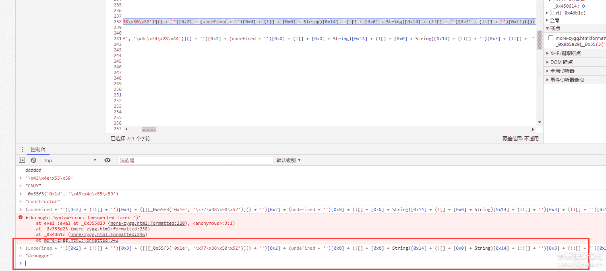
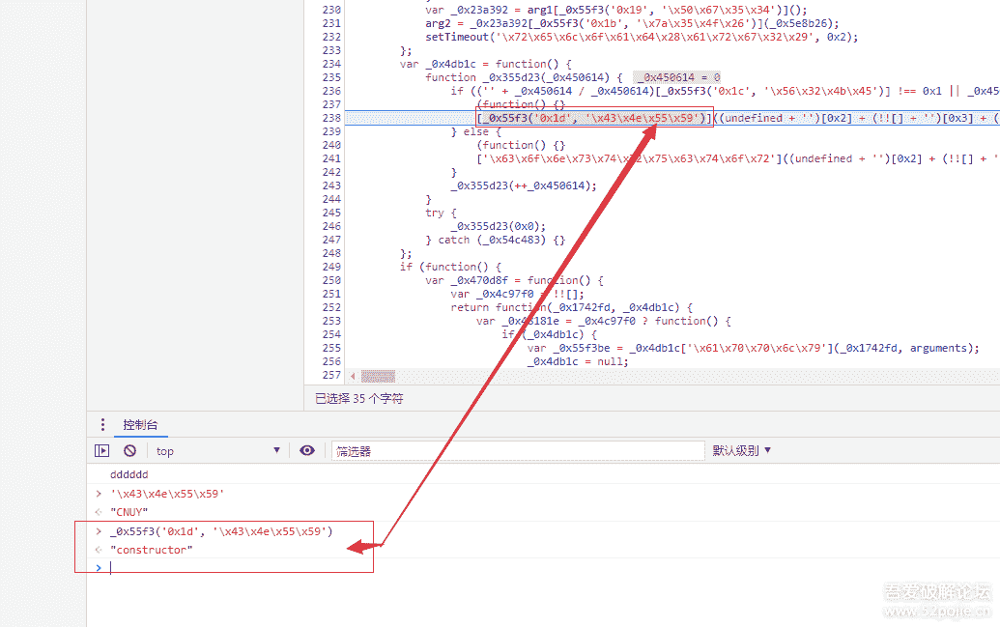
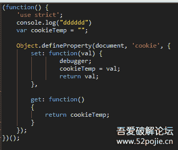
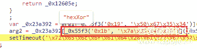
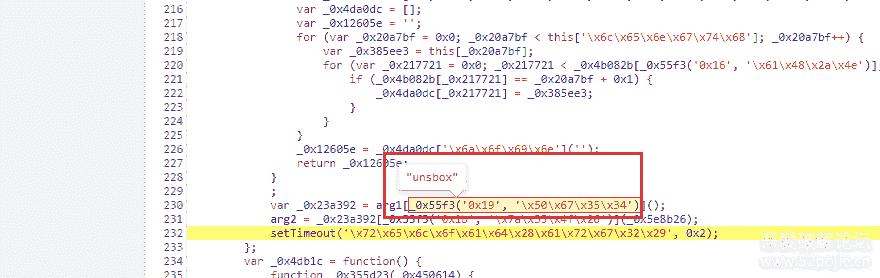
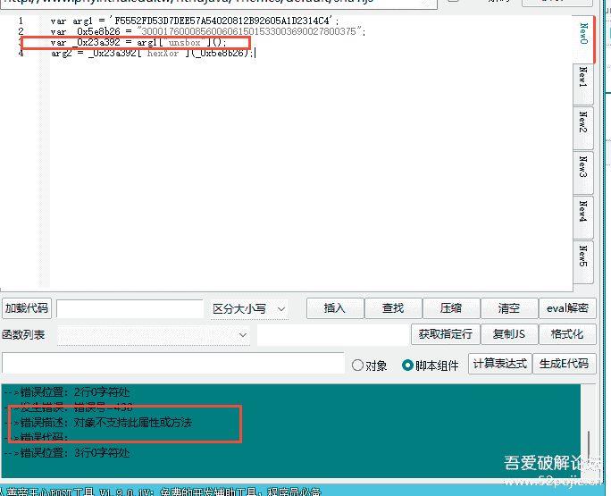
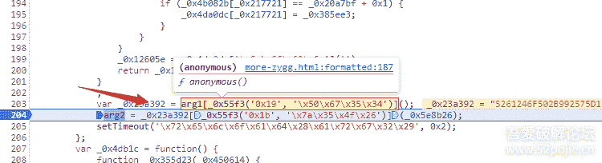

# [Web逆向] 某acw_sc__v2 cookie逆向分析

- 原帖: https://www.52pojie.cn/forum.php?mod=viewthread&tid=1625598
- 抓取时间: 2026-11-01T23:28:17

最近在学习js逆向，俗话说好记性不如烂笔头子，看视频不练习也是白扯，恰好在某论坛看到有人说某站访问需要到`cookie`，这个`cookie`还是动态生成的，那就来分析一下。PS：我之前没搞，边搞边写文章可能写到最后没搞出来哈哈

站点：`aHR0cHM6Ly93d3cuY2R0LWVjLmNvbS9ob21lL21vcmUtenlnZy5odG1s`

## 第一步开始调试

打开`F12`访问网站，发现进入无限`debugger`，我们看一下引用，把前面的加密字符串都输出出来是`constructor`和`bugger`，所以这里可以通过`hook` `constructor`进行跳过这个`debugger`或者在`debugger`里直接永远不在这里断下，解决反调试。



debugger.png (86.41 KB, 下载次数: 4)

[href="forum.php?mod=attachment&aid=MjUxNTgxMHwzZjg2M2ExY3wxNzkzNTc1Njk0fDE2ODA4NnwxNjI1NTk4&nothumb=yes" target="_blank"](https://www.52pojie.cn/forum.php?mod=attachment&aid=MjUxNTgxMHwzZjg2M2ExY3wxNzkzNTc1Njk0fDE2ODA4NnwxNjI1NTk4&nothumb=yes)

2022-4-21 19:02 上传



construct.png (88.46 KB, 下载次数: 3)

[href="forum.php?mod=attachment&aid=MjUxNTgwOXw0MjhkMjRhOXwxNzkzNTc1Njk0fDE2ODA4NnwxNjI1NTk4&nothumb=yes" target="_blank"](https://www.52pojie.cn/forum.php?mod=attachment&aid=MjUxNTgwOXw0MjhkMjRhOXwxNzkzNTc1Njk0fDE2ODA4NnwxNjI1NTk4&nothumb=yes)

2022-4-21 19:02 上传

## 第二步找到设置Cookie的位置

我的第一反应是`hook` `cookie`，直接用`hook`工具注入代码，之后就会在设置`cookie`这里断掉，当然这里我们直接搜索`acw_scv2`也是可以的，果然`reload`调用了`setcookie`，再看是定时器调用了`reload`，那么第一感觉是直接把这里抠出来就行了是不是？扣一下。



hook.png (17.99 KB, 下载次数: 2)

[href="forum.php?mod=attachment&aid=MjUxNTgxMnw5NTViNGZiM3wxNzkzNTc1Njk0fDE2ODA4NnwxNjI1NTk4&nothumb=yes" target="_blank"](https://www.52pojie.cn/forum.php?mod=attachment&aid=MjUxNTgxMnw5NTViNGZiM3wxNzkzNTc1Njk0fDE2ODA4NnwxNjI1NTk4&nothumb=yes)

2022-4-21 19:02 上传

## 第三步抠JS代码

我们先把用到的都抠出来试试，

```
var arg1 = 'F5552FD53D7DEE57A54020812B92605A1D2314C4';
var _0x55f3 = function(_0x4c97f0, _0x1742fd) {
            var _0x4c97f0 = parseInt(_0x4c97f0, 0x10);
            var _0x48181e = _0x4818[_0x4c97f0];
            if (!_0x55f3['\x61\x74\x6f\x62\x50\x6f\x6c\x79\x66\x69\x6c\x6c\x41\x70\x70\x65\x6e\x64\x65\x64']) {
                (function() {
                    var _0xdf49c6 = Function('\x72\x65\x74\x75\x72\x6e\x20\x28\x66\x75\x6e\x63\x74\x69\x6f\x6e\x20\x28\x29\x20' + '\x7b\x7d\x2e\x63\x6f\x6e\x73\x74\x72\x75\x63\x74\x6f\x72\x28\x22\x72\x65\x74\x75\x72\x6e\x20\x74\x68\x69\x73\x22\x29\x28\x29' + '\x29\x3b');
                    var _0xb8360b = _0xdf49c6();
                    var _0x389f44 = '\x41\x42\x43\x44\x45\x46\x47\x48\x49\x4a\x4b\x4c\x4d\x4e\x4f\x50\x51\x52\x53\x54\x55\x56\x57\x58\x59\x5a\x61\x62\x63\x64\x65\x66\x67\x68\x69\x6a\x6b\x6c\x6d\x6e\x6f\x70\x71\x72\x73\x74\x75\x76\x77\x78\x79\x7a\x30\x31\x32\x33\x34\x35\x36\x37\x38\x39\x2b\x2f\x3d';
                    _0xb8360b['\x61\x74\x6f\x62'] || (_0xb8360b['\x61\x74\x6f\x62'] = function(_0xba82f0) {
                        var _0xec6bb4 = String(_0xba82f0)['\x72\x65\x70\x6c\x61\x63\x65'](/=+$/, '');
                        for (var _0x1a0f04 = 0x0, _0x18c94e, _0x41b2ff, _0xd79219 = 0x0, _0x5792f7 = ''; _0x41b2ff = _0xec6bb4['\x63\x68\x61\x72\x41\x74'](_0xd79219++); ~_0x41b2ff && (_0x18c94e = _0x1a0f04 % 0x4 ? _0x18c94e * 0x40 + _0x41b2ff : _0x41b2ff,
                        _0x1a0f04++ % 0x4) ? _0x5792f7 += String['\x66\x72\x6f\x6d\x43\x68\x61\x72\x43\x6f\x64\x65'](0xff & _0x18c94e >> (-0x2 * _0x1a0f04 & 0x6)) : 0x0) {
                            _0x41b2ff = _0x389f44['\x69\x6e\x64\x65\x78\x4f\x66'](_0x41b2ff);
                        }
                        return _0x5792f7;
                    }
                    );
                }());
                _0x55f3['\x61\x74\x6f\x62\x50\x6f\x6c\x79\x66\x69\x6c\x6c\x41\x70\x70\x65\x6e\x64\x65\x64'] = !![];
            }
            if (!_0x55f3['\x72\x63\x34']) {
                var _0x232678 = function(_0x401af1, _0x532ac0) {
                    var _0x45079a = [], _0x52d57c = 0x0, _0x105f59, _0x3fd789 = '', _0x4a2aed = '';
                    _0x401af1 = atob(_0x401af1);
                    for (var _0x124d17 = 0x0, _0x1b9115 = _0x401af1['\x6c\x65\x6e\x67\x74\x68']; _0x124d17 
```

运行一下，有个`0x4818`未定义，一看是个大数组，填进去运行卡死了.....我怀疑应该是有什么就检测那就算了。然后看看他都用了什么吧，对比发现他们每次通过`0x55f3`算出来的值都一样现在是如下：



hexxor.png (20.05 KB, 下载次数: 4)

[href="forum.php?mod=attachment&aid=MjUxNTgxMXwzNWU2OTI5MXwxNzkzNTc1Njk0fDE2ODA4NnwxNjI1NTk4&nothumb=yes" target="_blank"](https://www.52pojie.cn/forum.php?mod=attachment&aid=MjUxNTgxMXwzNWU2OTI5MXwxNzkzNTc1Njk0fDE2ODA4NnwxNjI1NTk4&nothumb=yes)

2022-4-21 19:02 上传



unsbox.png (51.7 KB, 下载次数: 2)

[href="forum.php?mod=attachment&aid=MjUxNTgxNHwwZDE2ZDdkZHwxNzkzNTc1Njk0fDE2ODA4NnwxNjI1NTk4&nothumb=yes" target="_blank"](https://www.52pojie.cn/forum.php?mod=attachment&aid=MjUxNTgxNHwwZDE2ZDdkZHwxNzkzNTc1Njk0fDE2ODA4NnwxNjI1NTk4&nothumb=yes)

2022-4-21 19:02 上传

```
var arg1 = 'F5552FD53D7DEE57A54020812B92605A1D2314C4';

var _0x5e8b26 = "3000176000856006061501533003690027800375";

var _0x23a392 = arg1["unsbox"]();

arg2 = _0x23a392["hexXor"](_0x5e8b26);
```

运行一看不支持这种写法，



不支持写法.png (41.49 KB, 下载次数: 4)

[href="forum.php?mod=attachment&aid=MjUxNTgxNXwxMjhjZjM5MHwxNzkzNTc1Njk0fDE2ODA4NnwxNjI1NTk4&nothumb=yes" target="_blank"](https://www.52pojie.cn/forum.php?mod=attachment&aid=MjUxNTgxNXwxMjhjZjM5MHwxNzkzNTc1Njk0fDE2ODA4NnwxNjI1NTk4&nothumb=yes)

2022-4-21 19:02 上传

看来还是不行下断点断到`arg2`处，发现这两个最终都是匿名函数，直接把`arg2`的匿名函数抠出来，把里面解密函数手动找出来



匿名1.png (41.93 KB, 下载次数: 5)

[href="forum.php?mod=attachment&aid=MjUxNTgxN3w5MjViNGQwZXwxNzkzNTc1Njk0fDE2ODA4NnwxNjI1NTk4&nothumb=yes" target="_blank"](https://www.52pojie.cn/forum.php?mod=attachment&aid=MjUxNTgxN3w5MjViNGQwZXwxNzkzNTc1Njk0fDE2ODA4NnwxNjI1NTk4&nothumb=yes)

2022-4-21 19:04 上传

```
String["prototype"]["hexXor"] = function(_0x4e08d8) {
    var _0x5a5d3b = '';
    for (var _0xe89588 = 0x0; _0xe89588 
```

这样就弄出来了，但是如果解密函数非常多怎么办，我们不可能一个一个去找吧，求大佬指点
