# [原创] 记录一下 160 个 crackme 练手--2

- 原帖：<https://www.52pojie.cn/forum.php?mod=viewthread&tid=1625607>
- 抓取时间：2026-11-01T23:28:15

第二个是个 VB5 的程序 `Afkayas.1.Exe`，爆破非常简单，直接开始。

`PEID` 查一下，无壳。

运行程序看看报错什么样。

输入账户密码，点 OK，发现有个弹窗。

那我们可以用挺多方法的：

1. 搜字符串
2. VB 程序的弹窗断点（`rtcMsgBox`）
3. VB 程序的比较函数（`_vbaStrCmp`）
4. VB 程序按钮事件特征码（`816C24`）

## 方法一：搜索字符串

我们先来字符串 `You Get Wrong`。

载入 `OD` 搜索字符串……真少啊。

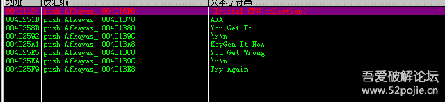  
[附件下载](https://www.52pojie.cn/forum.php?mod=attachment&aid=MjUxNzgwOHw3ZDE2ZDBhNnwxNzkzNTc1NjkzfDE2ODA4NnwxNjI1NjA3&nothumb=yes)　`192559ne8uhk8g77kezi6h.png`（9.85 KB，下载次数：1，2022-4-27 19:55 上传）

直接双击 `You Get Wrong`。

进去一看，和上个几乎一样的破法。

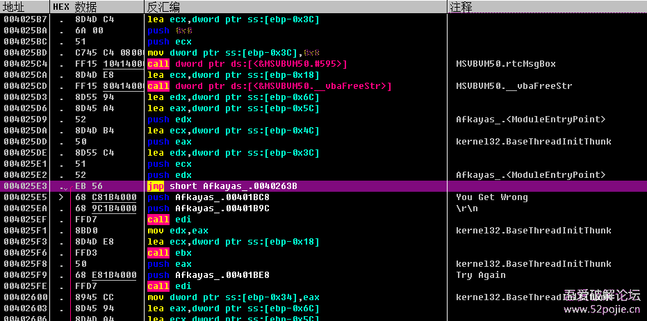  
[附件下载](https://www.52pojie.cn/forum.php?mod=attachment&aid=MjUxNzgwOXwyMTQwN2JiNnwxNzkzNTc1NjkzfDE2ODA4NnwxNjI1NjA3&nothumb=yes)　`192739n0e5ltm7nnqwjlgy.png`（28.61 KB，下载次数：2，2022-4-27 19:55 上传）

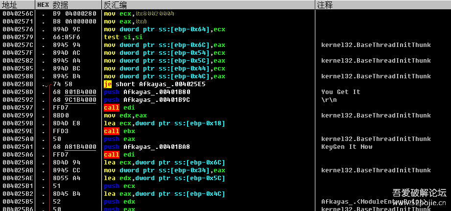  
[附件下载](https://www.52pojie.cn/forum.php?mod=attachment&aid=MjUxNzgxMHwwNjI0MmMwM3wxNzkzNTc1NjkzfDE2ODA4NnwxNjI1NjA3&nothumb=yes)　`192742tv8vqor8aowxmrhh.png`（27.14 KB，下载次数：0，2022-4-27 19:55 上传）

直接把逃过成功的 `je nop` 掉就成功了。

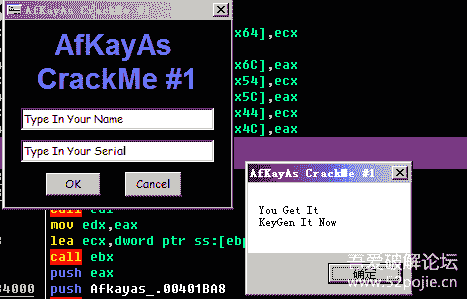  
[附件下载](https://www.52pojie.cn/forum.php?mod=attachment&aid=MjUxNzgxMXwzZDhjYjZiN3wxNzkzNTc1NjkzfDE2ODA4NnwxNjI1NjA3&nothumb=yes)　`192922rbdakkk0h87tjd45.png`（21.46 KB，下载次数：1，2022-4-27 19:56 上传）

## 方法二：弹窗断点

再来下弹窗断点。

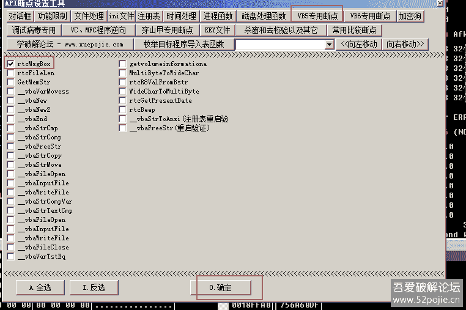  
[附件下载](https://www.52pojie.cn/forum.php?mod=attachment&aid=MjUxNzgxMnxlZmRlMjJiMXwxNzkzNTc1NjkzfDE2ODA4NnwxNjI1NjA3&nothumb=yes)　`193233m7z666j626nd64aj.png`（16.21 KB，下载次数：1，2022-4-27 19:56 上传）

下好后 `F9` 运行，输入账户、序列号，点确定。

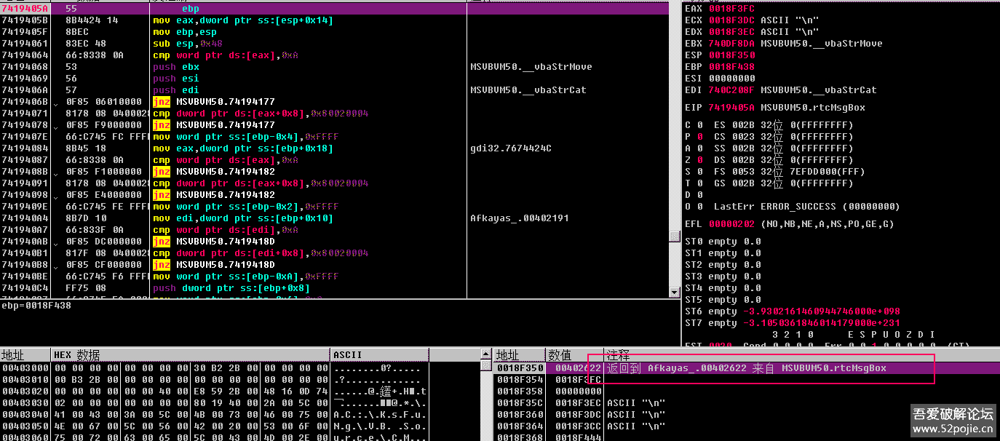  
[附件下载](https://www.52pojie.cn/forum.php?mod=attachment&aid=MjUxNzgxM3xjNTg2N2I2ZXwxNzkzNTc1NjkzfDE2ODA4NnwxNjI1NjA3&nothumb=yes)　`193353vmj1qho16j9q6kq0.png`（31.38 KB，下载次数：1，2022-4-27 19:56 上传）

看到返回到右键反汇编窗口中跟随（`Enter`）。

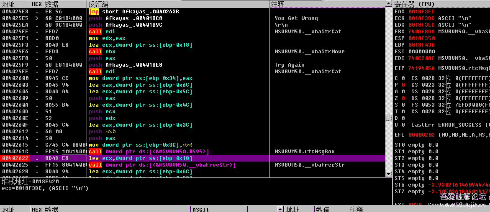  
[附件下载](https://www.52pojie.cn/forum.php?mod=attachment&aid=MjUxNzgxNHwwYzdmYzdjM3wxNzkzNTc1NjkzfDE2ODA4NnwxNjI1NjA3&nothumb=yes)　`193505vr7ay06611a7d1u4.png`（39.67 KB，下载次数：0，2022-4-27 19:56 上传）

跟随后向上一划就看到关键位置了，继续同样的操作即可。

## 方法三：比较函数

再来比较函数。

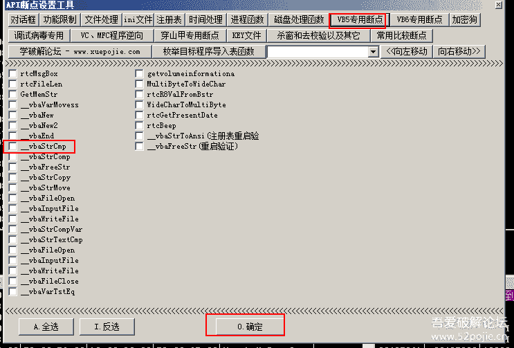  
[附件下载](https://www.52pojie.cn/forum.php?mod=attachment&aid=MjUxNzgxNXxkZDQ5ZWU3N3wxNzkzNTc1NjkzfDE2ODA4NnwxNjI1NjA3&nothumb=yes)　`193637n8t8tczt7un9ktie.png`（27.96 KB，下载次数：3，2022-4-27 19:56 上传）

下好断点后输入账户、序列号，点确定。其实断下来我们就已经看到真码了。

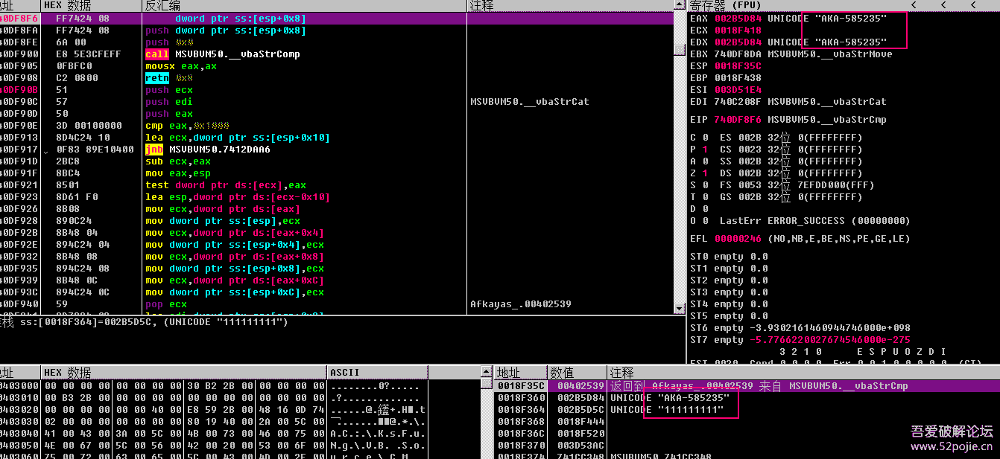  
[附件下载](https://www.52pojie.cn/forum.php?mod=attachment&aid=MjUxNzgxNnxlYWFmMzdiNnwxNzkzNTc1NjkzfDE2ODA4NnwxNjI1NjA3&nothumb=yes)　`193754ma7aga7y7yvre9r2.png`（46.24 KB，下载次数：2，2022-4-27 19:56 上传）

继续看堆栈窗口，继续在反汇编窗口中跟随（`Enter`），跟随后向下一划，又是熟悉的位置，`je nop` 即可。

## 方法四：VB 按钮事件特征码

再来 VB 按钮事件特征码。`OD` 载入，`ctrl+b` 输入 `816c24`。

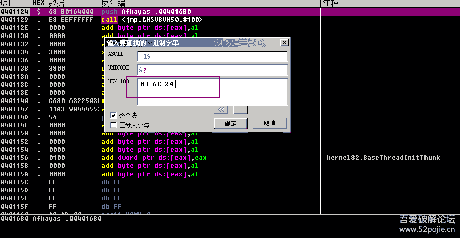  
[附件下载](https://www.52pojie.cn/forum.php?mod=attachment&aid=MjUxNzgxN3xmZjYzNDkyMXwxNzkzNTc1NjkzfDE2ODA4NnwxNjI1NjA3&nothumb=yes)　`194120q44n7vxjnn75j7yb.png`（23.87 KB，下载次数：1，2022-4-27 19:56 上传）

点确定，然后输入用户名和序列号点确定即可。

两个 `jmp` 对应着两个按钮，由于不知道哪个 `jmp` 对应哪个按钮，我们两个 `jmp` 都下断。

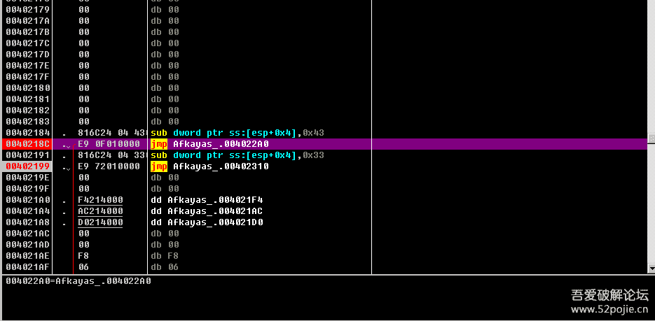  
[附件下载](https://www.52pojie.cn/forum.php?mod=attachment&aid=MjUxNzgxOHw1MzE2NmVmNnwxNzkzNTc1NjkzfDE2ODA4NnwxNjI1NjA3&nothumb=yes)　`073715l0j1orel88lygye8.png`（19.07 KB，下载次数：1，2022-4-27 19:56 上传）

断下后直接 `F8` 就到了关键处的段首，我们向下滑就可以了。

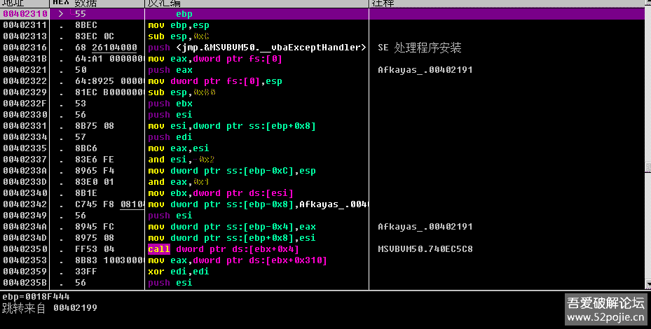  
[附件下载](https://www.52pojie.cn/forum.php?mod=attachment&aid=MjUxNzgxOXwzMjA0NmUzOXwxNzkzNTc1NjkzfDE2ODA4NnwxNjI1NjA3&nothumb=yes)　`073845fwe1zzoyz0la6jew.png`（16.03 KB，下载次数：2，2022-4-27 19:57 上传）

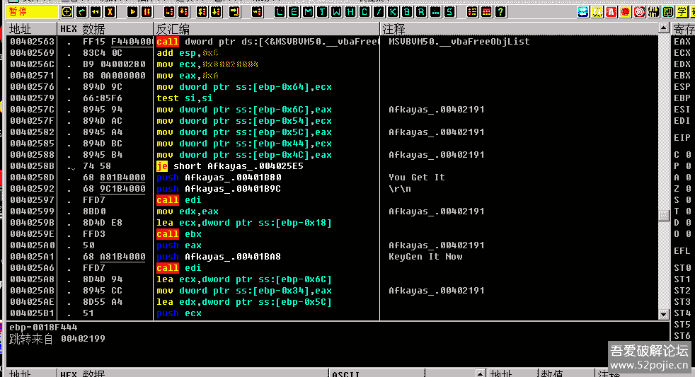  
[附件下载](https://www.52pojie.cn/forum.php?mod=attachment&aid=MjUxNzgyMHwyNzgxY2RlNXwxNzkzNTc1NjkzfDE2ODA4NnwxNjI1NjA3&nothumb=yes)　`073923bvl2inztcln3sf32.png`（24.08 KB，下载次数：1，2022-4-27 19:57 上传）

就爆破是挺简单的，我去看看大佬帖子学着逆算法去了，继续努力！！
