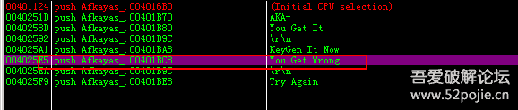
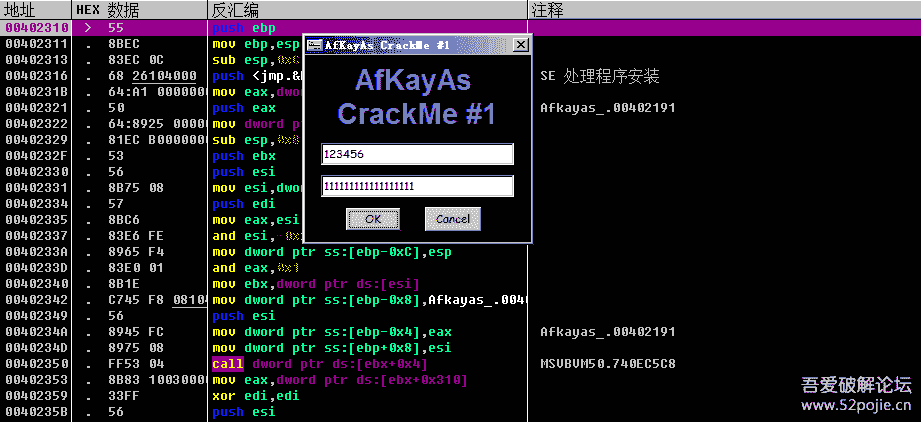
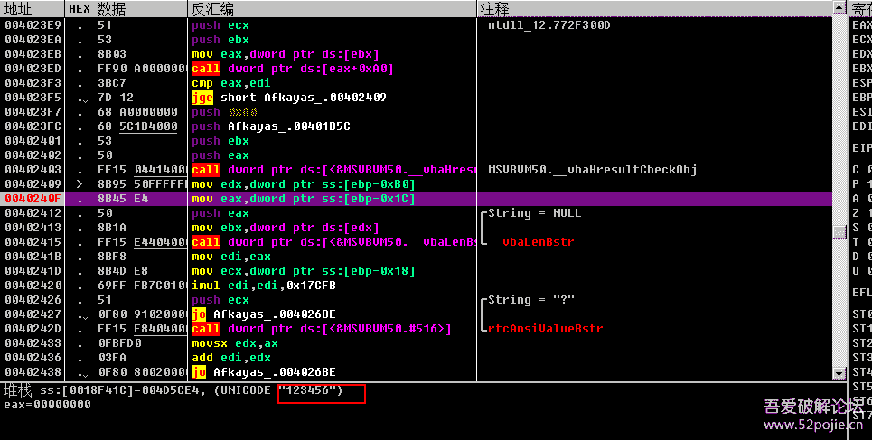
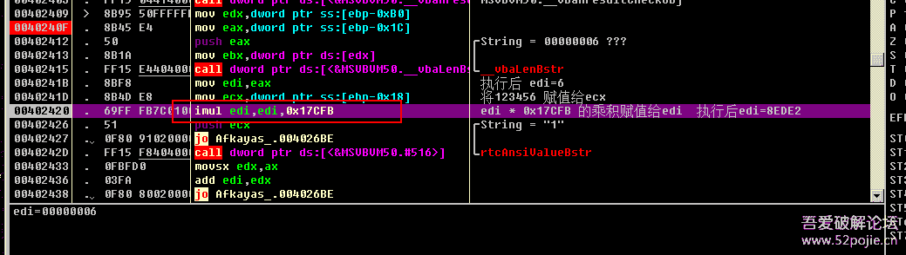
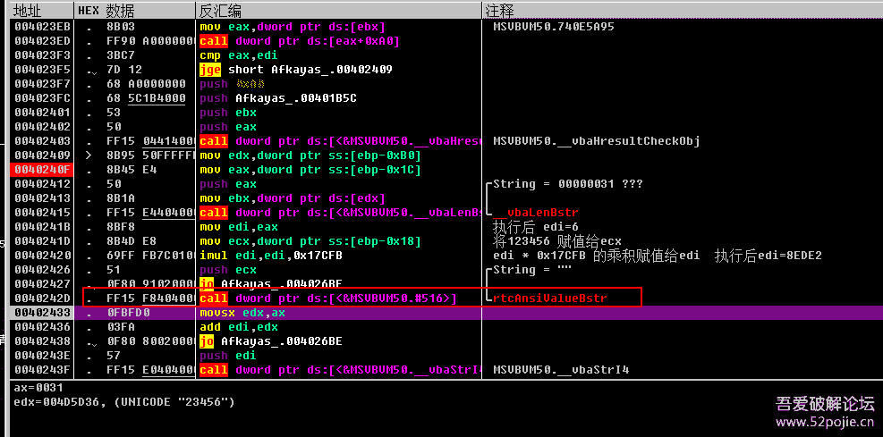
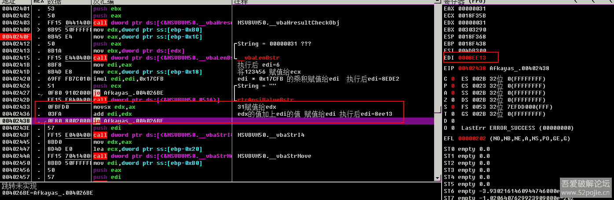
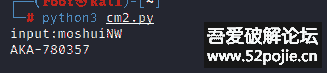
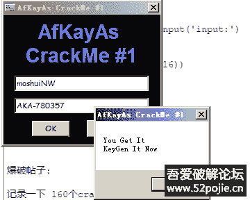

# [原创] 160个新手cm--2 Afkayas.1算法逆向

- 原帖：<https://www.52pojie.cn/forum.php?mod=viewthread&tid=1625664>
- 抓取时间：2026-11-01T23:28:13

## 载入 OD 搜索字符串



双击，去到段首下断（因为不知道什么时候开始生成，所有段首下断，按 `F8` 单步跟，直到第一次出现我们输入的字符，就证明开始了）。



断下，然后单步，单步到 `0040240F`，出现了我们输入的账户。



## 开始 `F8` 单步分析

`_vbaLenBstr` 函数获取用户名长度。我们输入的用户名是 `123456`，所以长度是 6。



将我们的用户名长度乘以 `0x17CFB`。



这个 `call` 取出了 `1` 的 ASCII 码值，也就是我们账户的第一个字符的 ASCII 码值。



将第一个字符的 ASCII 码值加上了 `我们用户名 * 0x17CFB` 的值。

至此我们知道这个数字是怎么来的了，剩下的就是把 `AKA-` 拼上去。

## 总结

`用户名字符长度 * 0x17CFB + 用户名第一个字符的 ASCII 码`

最后在前面加上 `AKA-`。

## 开始写注册机

```python
a=input('input:')
c=hex(ord(a[0]))
d=str(len(a))
d=hex(int(d,16)*int('17cfb',16))
b=int(d,16)+int(c,16)
print("AKA-%s"%b)
```

生成一个 `moshuiNW` 的序列号试试。



成功。



## 爆破帖子

记录一下 160 个 crackme 练手--2：<https://www.52pojie.cn/thread-1625607-1-1.html>（出处：吾爱破解论坛）
