# [原创] 记录一下 160个crackme练手--3

- 原帖: https://www.52pojie.cn/forum.php?mod=viewthread&tid=1626262
- 抓取时间: 2026-11-01T23:28:03

周五了，美妙的周五

开始第三个 `CM AfKayAs.2.Exe` 这个还是有点难度的，如果不知道VB的4C打法这个NGA还是有点难去掉的

可以看两个大佬的贴子 真的写的非常非常的好

yyhd也在《玩玩》系列里做过这个

我也就跟着照猫画虎了

去掉NGA窗口直接来爆破

和昨天一样都是VB程序，那么我们还是试试昨天的4个方法

## 1、搜字符串

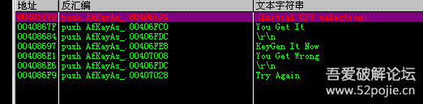
`Snipaste_2022-04-22_23-44-54.png` (9.45 KB, 下载次数: 1)
2022-4-23 00:54 上传

成功搜到了 我们双击Try Again 跟过去

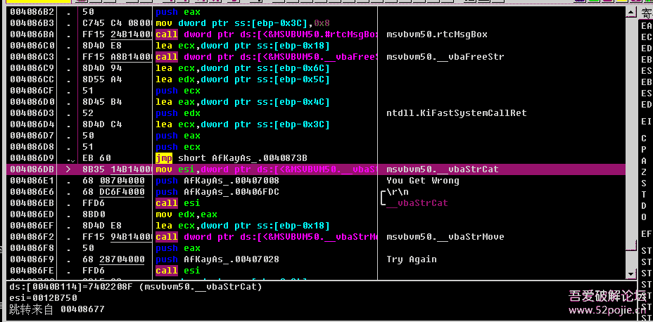
`Snipaste_2022-04-22_23-53-09.png` (31.28 KB, 下载次数: 1)
2022-4-23 00:54 上传

啊 非常熟悉啊我们去跳过这个`jmp`的跳转看看

选择这个跳转 然后右键 转到xxx 就过去了

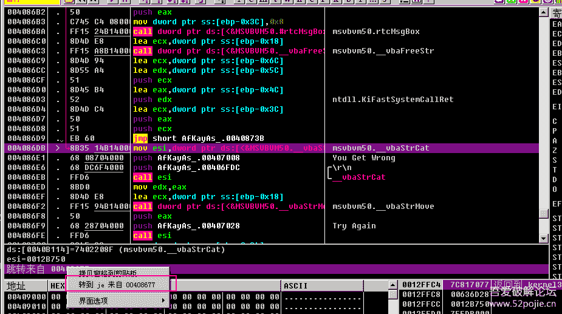
`Snipaste_2022-04-22_23-54-15.png` (38.83 KB, 下载次数: 2)
2022-4-23 00:54 上传

还是一样将这个`je` `nop`掉就可以成功了

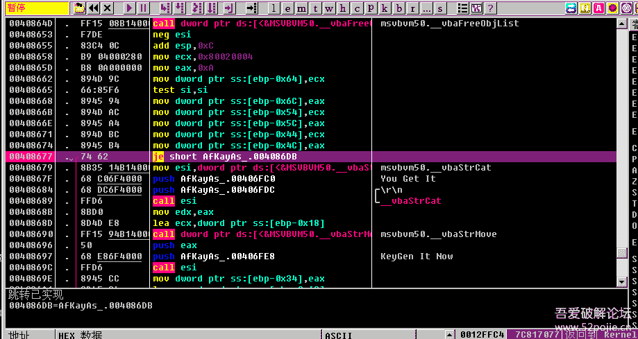
`Snipaste_2022-04-22_23-55-35.png` (39.91 KB, 下载次数: 1)
2022-4-23 00:54 上传

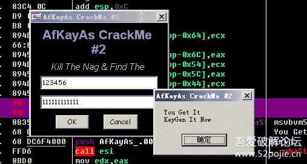
`Snipaste_2022-04-22_23-56-21.png` (18.51 KB, 下载次数: 1)
2022-4-23 00:54 上传

## 第二种方法 VB程序的弹窗（`rtcMsgBox`）

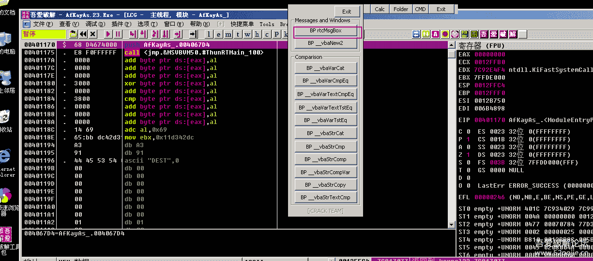
`Snipaste_2022-04-22_23-57-53.png` (71.12 KB, 下载次数: 2)
2022-4-23 00:55 上传

下断点，运行程序然后输入账户序列号点登录

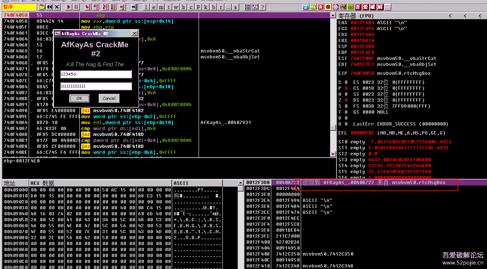
`Snipaste_2022-04-22_23-58-55.png` (65.86 KB, 下载次数: 0)
2022-4-23 00:55 上传

断下来然后看堆栈 选中‘返回到xxx’ 然后反汇编窗口中跟随（Enter）

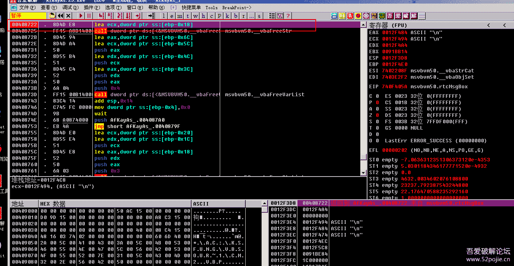
`Snipaste_2022-04-23_00-00-52.png` (67 KB, 下载次数: 2)
2022-4-23 00:55 上传

跟随到之后我们下断在运行程序 让程序运行到这（不然等等单步就又回去了）

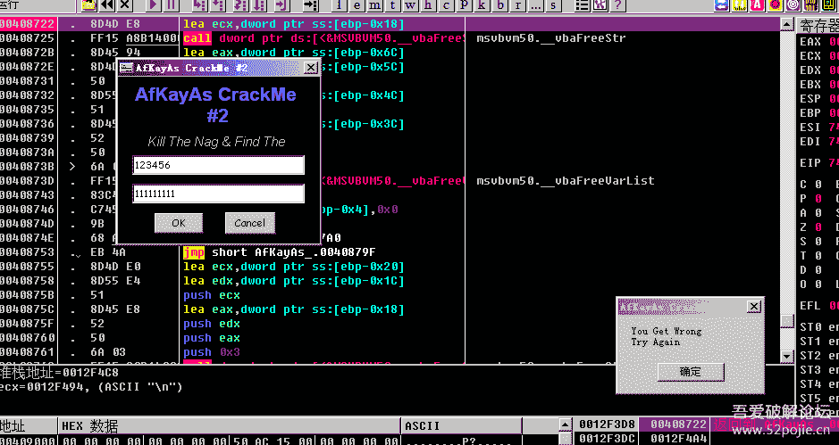
`Snipaste_2022-04-23_00-02-11.png` (45.02 KB, 下载次数: 2)
2022-4-23 00:55 上传

有弹窗点确定 然后程序断下，我们来找找能跳过这个弹窗的跳

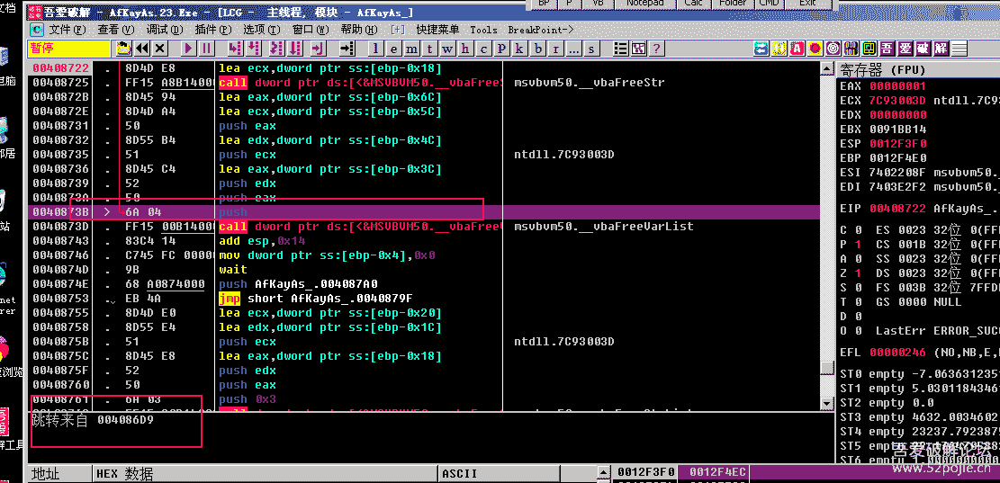
`Snipaste_2022-04-23_00-03-19.png` (60.53 KB, 下载次数: 2)
2022-4-23 00:56 上传

很好，直接在下面就看到了有个跳转跳过来了 那我们得看看是谁跳过来了

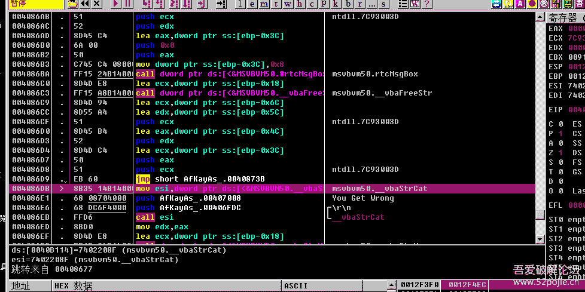
`Snipaste_2022-04-23_00-04-34.png` (43.98 KB, 下载次数: 0)
2022-4-23 00:56 上传

哦，我们已经到了 剩下的就是把跳过成功跳向失败的`je`给`nop`掉我们就胜利了

## VB程序的比较函数（`_vbaStrCmp`）

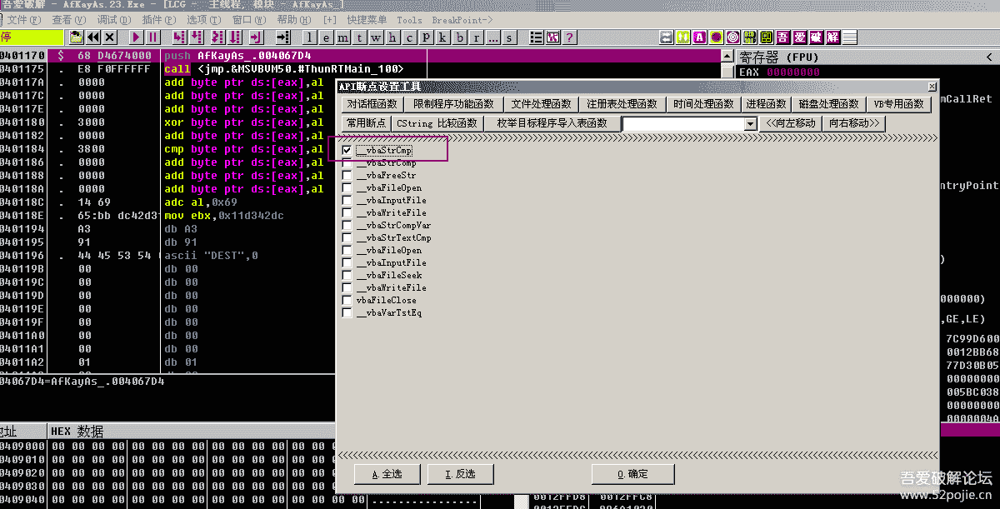
`Snipaste_2022-04-23_00-07-51.png` (50.87 KB, 下载次数: 1)
2022-4-23 00:56 上传

下好断点运行程序，输入账户，序列号 好吗，没断下来，看来这个不能用了

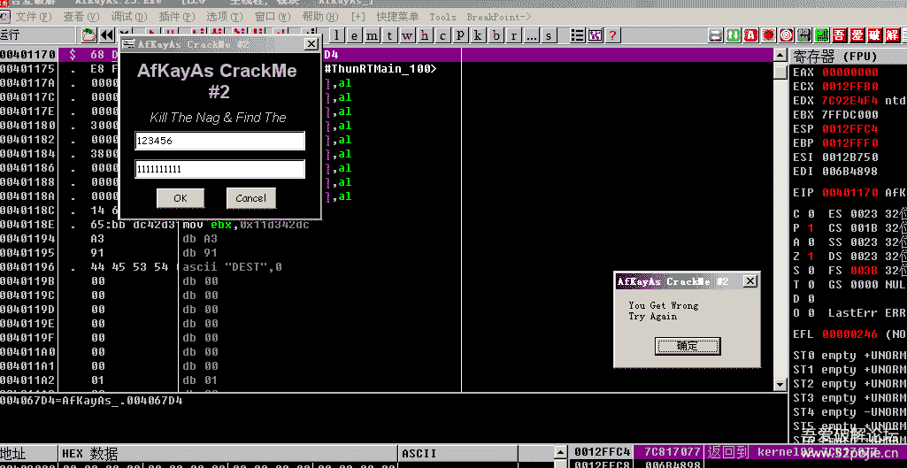
`Snipaste_2022-04-23_00-08-44.png` (48.44 KB, 下载次数: 0)
2022-4-23 00:56 上传

## 按钮事件

再试试按钮事件呢（`816C24`）

`ctrl+b` `816c24`

下断 怎么就一个啊

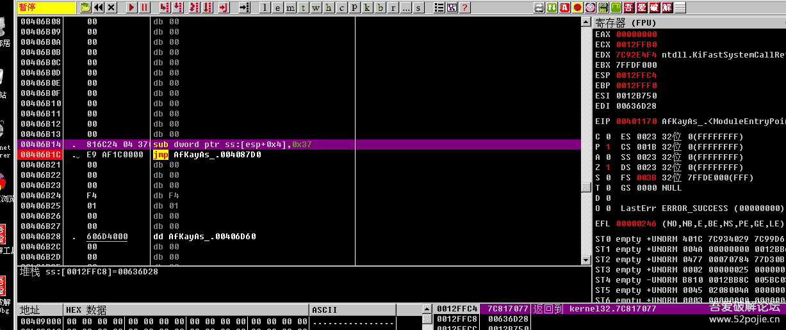
`Snipaste_2022-04-23_00-10-02.png` (50.03 KB, 下载次数: 1)
2022-4-23 00:57 上传

输入账户，序列号点确定 好吗，又没断下来，为什么呢？

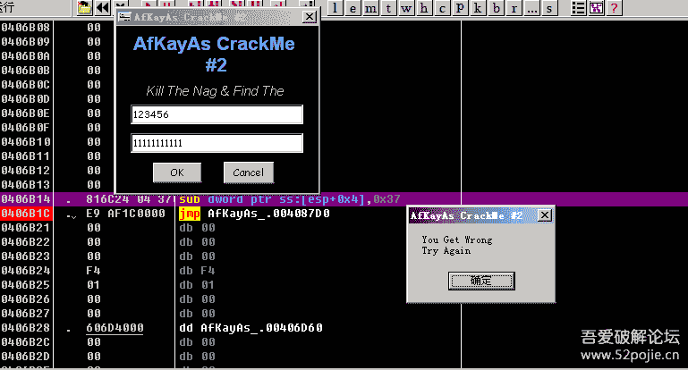
`Snipaste_2022-04-23_00-11-46.png` (25.41 KB, 下载次数: 0)
2022-4-23 00:57 上传

## 12暂停大法

直接运行程序 输入账户，序列号点确定 注意有弹窗 不要关也不要点确定

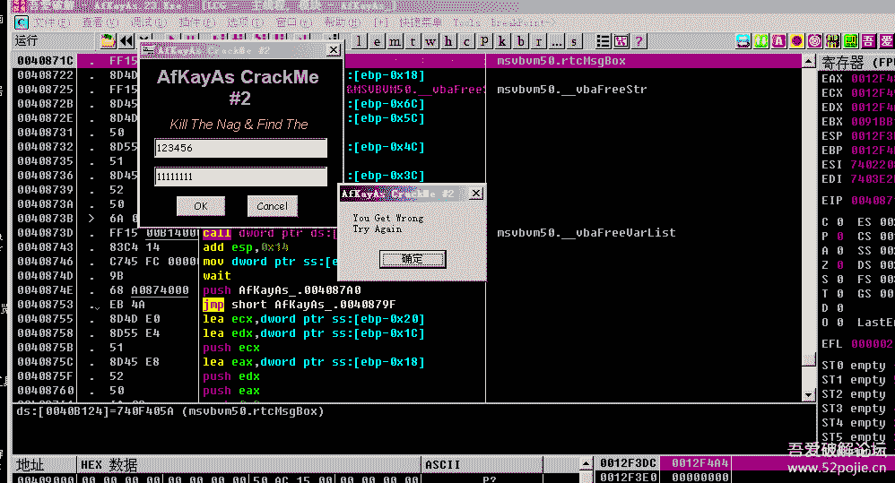
`Snipaste_2022-04-23_00-13-10.png` (51.72 KB, 下载次数: 2)
2022-4-23 00:57 上传

这时候我们回到按`F12`暂停

停住之后我们点击这个K (`Alt+K`)

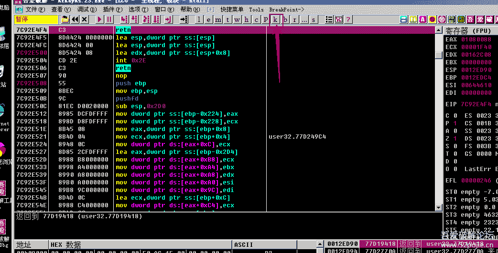
`Snipaste_2022-04-23_00-15-10.png` (60.49 KB, 下载次数: 2)
2022-4-23 00:57 上传

看到了它调用了弹窗函数（越下面 越新）

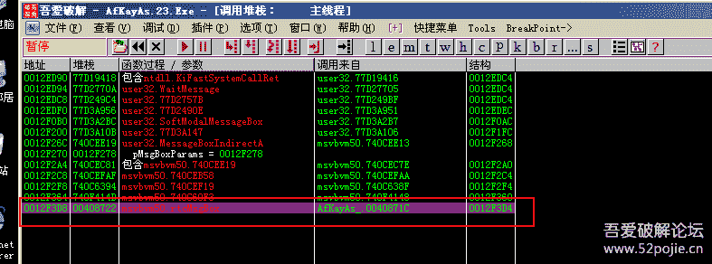

`Snipaste_2022-04-23_00-16-01.png` (28.49 KB, 下载次数: 2)

[href="forum.php?mod=attachment&aid=MjUxNjM2NnwzNDBkMWUyY3wxNzkzNTc1NjgwfDE2ODA4NnwxNjI2MjYy&nothumb=yes" target="_blank"](https://www.52pojie.cn/forum.php?mod=attachment&aid=MjUxNjM2NnwzNDBkMWUyY3wxNzkzNTc1NjgwfDE2ODA4NnwxNjI2MjYy&nothumb=yes)

2022-4-23 00:58 上传

右键显示调用 我们看看是谁调用了这个函数 弹出了这该死的弹窗

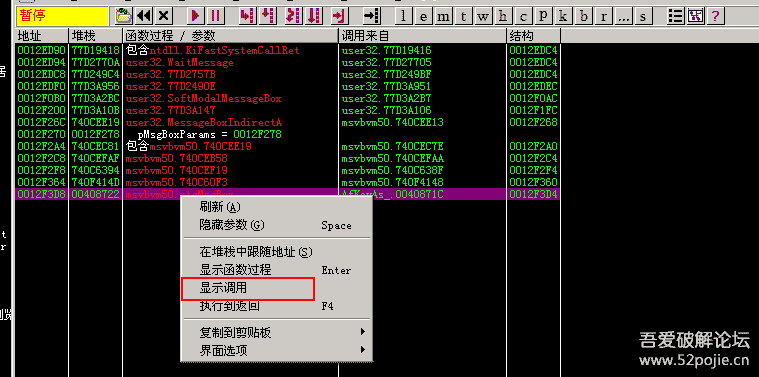

`Snipaste_2022-04-23_00-17-48.png` (24.64 KB, 下载次数: 0)

[href="forum.php?mod=attachment&aid=MjUxNjM2N3w5ZTJlN2M0Y3wxNzkzNTc1NjgwfDE2ODA4NnwxNjI2MjYy&nothumb=yes" target="_blank"](https://www.52pojie.cn/forum.php?mod=attachment&aid=MjUxNjM2N3w5ZTJlN2M0Y3wxNzkzNTc1NjgwfDE2ODA4NnwxNjI2MjYy&nothumb=yes)

2022-4-23 00:58 上传

过去一看，原来是这个`call`调用 然后我们往上一看，老熟人了，接下来就又到了`nop` `je`的时候了XDDD

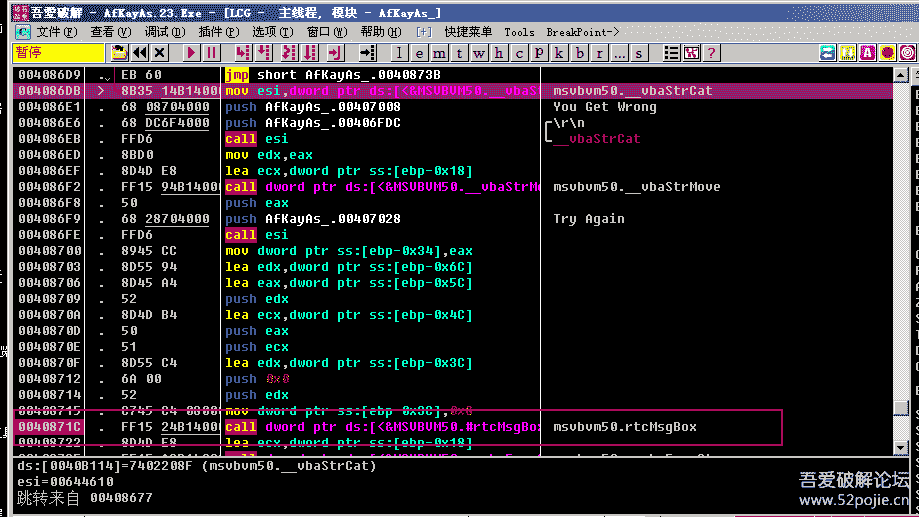

`Snipaste_2022-04-23_00-19-05.png` (43.53 KB, 下载次数: 2)

[href="forum.php?mod=attachment&aid=MjUxNjM2OHw0ODg0ZDY5OXwxNzkzNTc1NjgwfDE2ODA4NnwxNjI2MjYy&nothumb=yes" target="_blank"](https://www.52pojie.cn/forum.php?mod=attachment&aid=MjUxNjM2OHw0ODg0ZDY5OXwxNzkzNTc1NjgwfDE2ODA4NnwxNjI2MjYy&nothumb=yes)

2022-4-23 00:58 上传

追码：

今天简单的追下码把

我们来到被我们`nop`了好多次的`je`（关键跳）这下断点

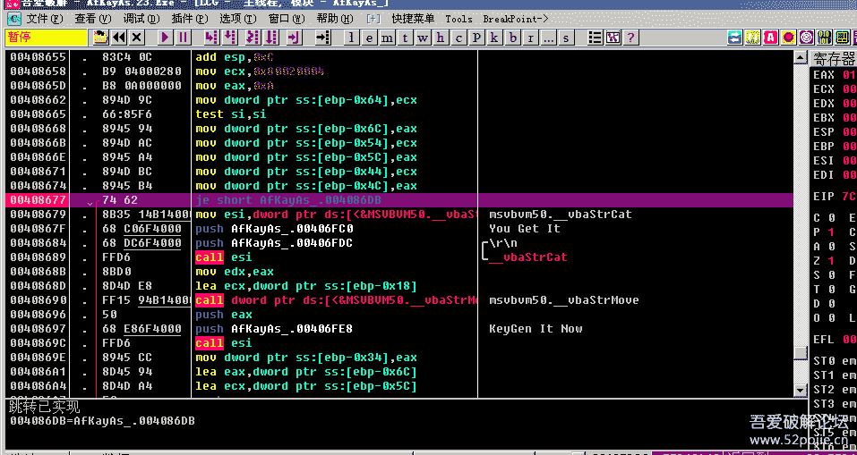

`Snipaste_2022-04-23_00-20-48.png` (46.25 KB, 下载次数: 0)

[href="forum.php?mod=attachment&aid=MjUxNjM2OXxkYWMxOGE5NHwxNzkzNTc1NjgwfDE2ODA4NnwxNjI2MjYy&nothumb=yes" target="_blank"](https://www.52pojie.cn/forum.php?mod=attachment&aid=MjUxNjM2OXxkYWMxOGE5NHwxNzkzNTc1NjgwfDE2ODA4NnwxNjI2MjYy&nothumb=yes)

2022-4-23 00:58 上传

输入账户，序列号点确定 程序断下

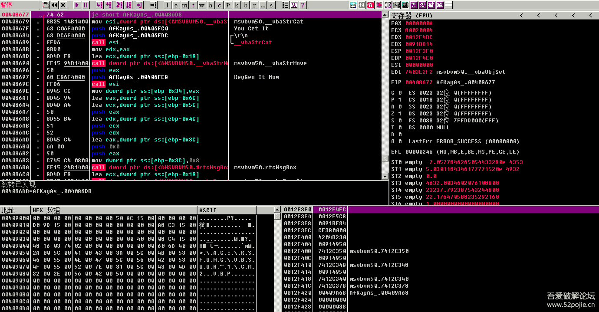

`Snipaste_2022-04-23_00-22-59.png` (62.96 KB, 下载次数: 0)

[href="forum.php?mod=attachment&aid=MjUxNjM3MHw1N2MzODczZHwxNzkzNTc1NjgwfDE2ODA4NnwxNjI2MjYy&nothumb=yes" target="_blank"](https://www.52pojie.cn/forum.php?mod=attachment&aid=MjUxNjM3MHw1N2MzODczZHwxNzkzNTc1NjgwfDE2ODA4NnwxNjI2MjYy&nothumb=yes)

2022-4-23 00:59 上传

然后我们去翻右下角的堆栈窗口 如果它没有加密真码的话，我们可以再堆栈里找到真码

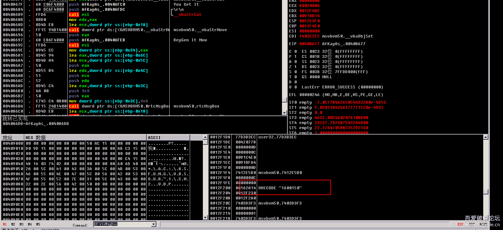

`Snipaste_2022-04-23_00-24-30.png` (59.92 KB, 下载次数: 0)

[href="forum.php?mod=attachment&aid=MjUxNjM3MXwxM2I0N2I3NXwxNzkzNTc1NjgwfDE2ODA4NnwxNjI2MjYy&nothumb=yes" target="_blank"](https://www.52pojie.cn/forum.php?mod=attachment&aid=MjUxNjM3MXwxM2I0N2I3NXwxNzkzNTc1NjgwfDE2ODA4NnwxNjI2MjYy&nothumb=yes)

2022-4-23 00:59 上传

随便向上翻了几下就看到了一串可疑字符‘1600150’

我们去试试

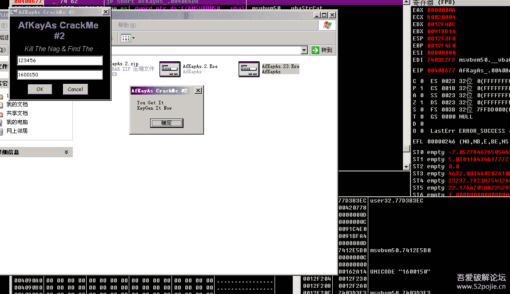

`Snipaste_2022-04-23_00-25-44.png` (45.01 KB, 下载次数: 1)

[href="forum.php?mod=attachment&aid=MjUxNjM3MnxlNDM2NzY4MXwxNzkzNTc1NjgwfDE2ODA4NnwxNjI2MjYy&nothumb=yes" target="_blank"](https://www.52pojie.cn/forum.php?mod=attachment&aid=MjUxNjM3MnxlNDM2NzY4MXwxNzkzNTc1NjgwfDE2ODA4NnwxNjI2MjYy&nothumb=yes)

2022-4-23 00:59 上传

好成功了，我们找到真码了

还有就是我们可以写一个内存注册机，内存注册机就很简单了

我们可以去断首下断，然后单步，时刻关注寄存器窗口什么时候出现真码

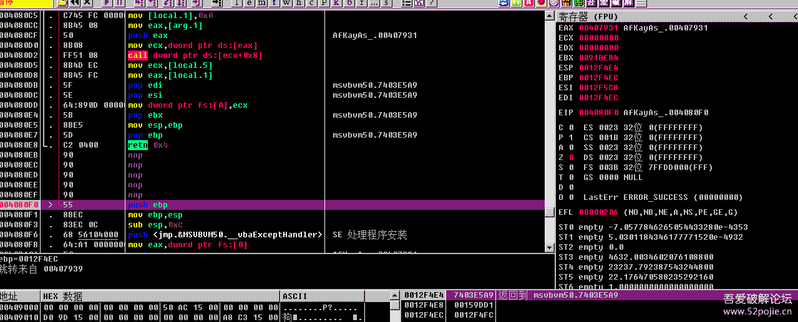

`Snipaste_2022-04-23_00-28-50.png` (46.33 KB, 下载次数: 2)

[href="forum.php?mod=attachment&aid=MjUxNjM3M3wyNmNjNDhlM3wxNzkzNTc1NjgwfDE2ODA4NnwxNjI2MjYy&nothumb=yes" target="_blank"](https://www.52pojie.cn/forum.php?mod=attachment&aid=MjUxNjM3M3wyNmNjNDhlM3wxNzkzNTc1NjgwfDE2ODA4NnwxNjI2MjYy&nothumb=yes)

2022-4-23 00:59 上传

断在段首，开始`F8`

`F8`到这可算出现了 ‘1600150’ 在`F8`的过程中有挺多的可疑字符的，因为我们知道了123456的序列号一定是‘1600150’了 所以我们盯着它找准没错

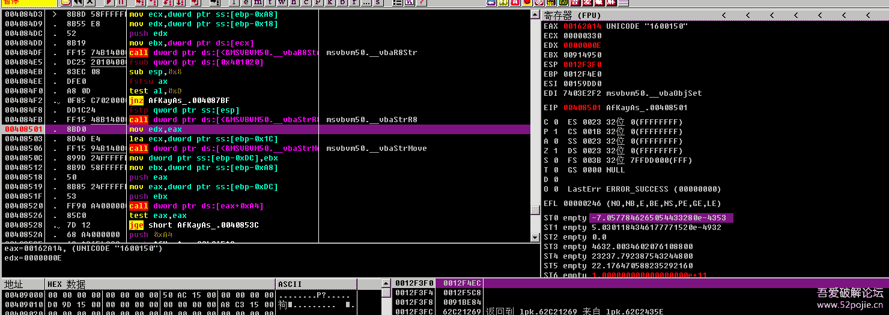

`Snipaste_2022-04-23_00-30-16.png` (49.03 KB, 下载次数: 2)

[href="forum.php?mod=attachment&aid=MjUxNjM3NHw5ZmE2ODY4NHwxNzkzNTc1NjgwfDE2ODA4NnwxNjI2MjYy&nothumb=yes" target="_blank"](https://www.52pojie.cn/forum.php?mod=attachment&aid=MjUxNjM3NHw5ZmE2ODY4NHwxNzkzNTc1NjgwfDE2ODA4NnwxNjI2MjYy&nothumb=yes)

2022-4-23 00:59 上传

然后打开内存注册机工具

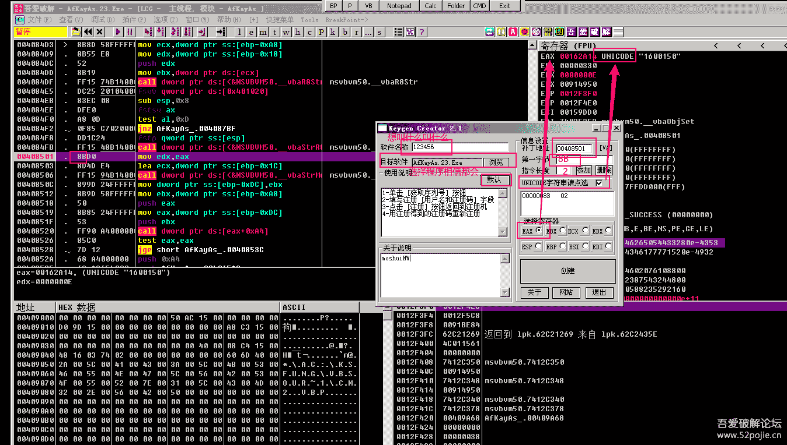

`Snipaste_2022-04-23_00-37-07.png` (88.55 KB, 下载次数: 2)

[href="forum.php?mod=attachment&aid=MjUxNjM3NXwyMDM4YmQ4NXwxNzkzNTc1NjgwfDE2ODA4NnwxNjI2MjYy&nothumb=yes" target="_blank"](https://www.52pojie.cn/forum.php?mod=attachment&aid=MjUxNjM3NXwyMDM4YmQ4NXwxNzkzNTc1NjgwfDE2ODA4NnwxNjI2MjYy&nothumb=yes)

2022-4-23 00:59 上传

根据断下的地址填上点添加就可以 使用说明默认就好

这里说一下第一自己为什么是`8B` 因为一个字节是8位 8个二进制数就是一个字节 二进转16进制是取四合一 所以一个字节就是两个16进制数所以是`8B` emmm是不是有点乱，我在这解释常识。。。

然后点击创建就可以了 保存一下

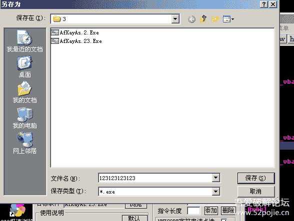

`Snipaste_2022-04-23_00-42-04.png` (32.22 KB, 下载次数: 3)

[href="forum.php?mod=attachment&aid=MjUxNjM3NnwwM2U4NzlkOHwxNzkzNTc1NjgwfDE2ODA4NnwxNjI2MjYy&nothumb=yes" target="_blank"](https://www.52pojie.cn/forum.php?mod=attachment&aid=MjUxNjM3NnwwM2U4NzlkOHwxNzkzNTc1NjgwfDE2ODA4NnwxNjI2MjYy&nothumb=yes)

2022-4-23 00:59 上传

我们来试试内存注册机吧

获取序列号然后输入用户名和假序列号点确定 好，真码出来了

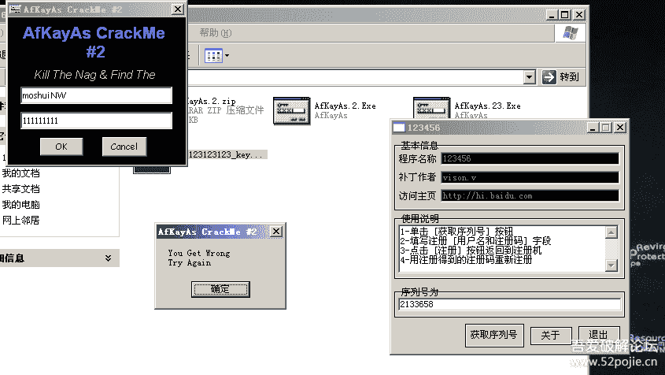

`Snipaste_2022-04-23_00-43-05.png` (68.96 KB, 下载次数: 2)

[href="forum.php?mod=attachment&aid=MjUxNjM3N3w2YzY1NTIyY3wxNzkzNTc1NjgwfDE2ODA4NnwxNjI2MjYy&nothumb=yes" target="_blank"](https://www.52pojie.cn/forum.php?mod=attachment&aid=MjUxNjM3N3w2YzY1NTIyY3wxNzkzNTc1NjgwfDE2ODA4NnwxNjI2MjYy&nothumb=yes)

2022-4-23 01:00 上传

将真码赋值进去 好！成功了！

内存注册机就是简单啊 哈哈
