# [原创] 记录一下 160个crackme练手--6

- 原帖: https://www.52pojie.cn/forum.php?mod=viewthread&tid=1627537
- 抓取时间: 2026-11-01T23:27:47

第6个CM其实也不难（我是指爆破，追码的话我感觉都挺难的......）可能也有一些运气吧
`PEID`查壳 无壳 `Delphi`程序
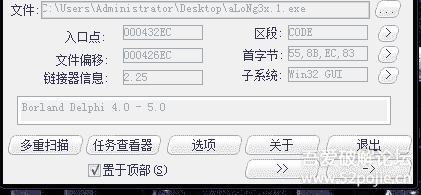
Snipaste_2022-04-25_14-09-23.png (21.58 KB, 下载次数: 1)
[href="forum.php?mod=attachment&aid=MjUxNzE0MXw2NTY0OWRkYnwxNzkzNTc1NjY1fDE2ODA4NnwxNjI3NTM3&nothumb=yes" target="_blank"](https://www.52pojie.cn/forum.php?mod=attachment&aid=MjUxNzE0MXw2NTY0OWRkYnwxNzkzNTc1NjY1fDE2ODA4NnwxNjI3NTM3&nothumb=yes)
2022-4-25 14:08 上传

打开程序查看要破什么 点了一下`help`发现它要我们把两个按钮给隐形才算过关
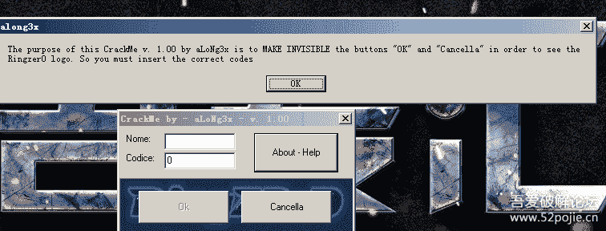
Snipaste_2022-04-25_14-10-45.png (195.81 KB, 下载次数: 0)
[href="forum.php?mod=attachment&aid=MjUxNzE0MnxjOTVhOWU1NHwxNzkzNTc1NjY1fDE2ODA4NnwxNjI3NTM3&nothumb=yes" target="_blank"](https://www.52pojie.cn/forum.php?mod=attachment&aid=MjUxNzE0MnxjOTVhOWU1NHwxNzkzNTc1NjY1fDE2ODA4NnwxNjI3NTM3&nothumb=yes)
2022-4-25 14:10 上传
还发现`OK`按钮是灰色的 不能用
这里我想到了灰色按钮（功能限制）
然后我们载入`OD` 下断点
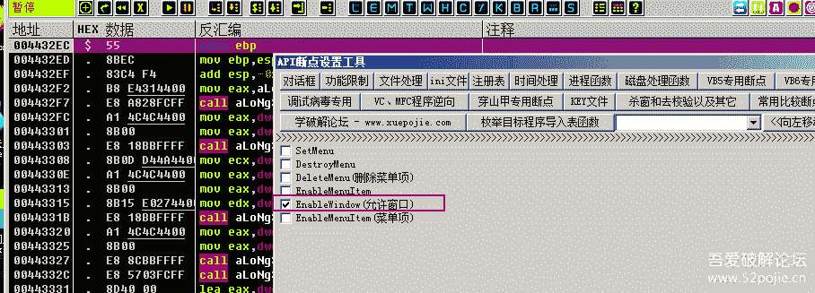
Snipaste_2022-04-25_14-16-18.png (40.68 KB, 下载次数: 2)
[href="forum.php?mod=attachment&aid=MjUxNzE0NHxkN2E1NDk4MHwxNzkzNTc1NjY1fDE2ODA4NnwxNjI3NTM3&nothumb=yes" target="_blank"](https://www.52pojie.cn/forum.php?mod=attachment&aid=MjUxNzE0NHxkN2E1NDk4MHwxNzkzNTc1NjY1fDE2ODA4NnwxNjI3NTM3&nothumb=yes)
2022-4-25 14:15 上传
然后`F9`运行程序，发现没断下来，看来没用这个函数啊。。。
那我们搜素字符串
没发现什么敏感的字符串，就看见那4串点了`help`弹出来的话了
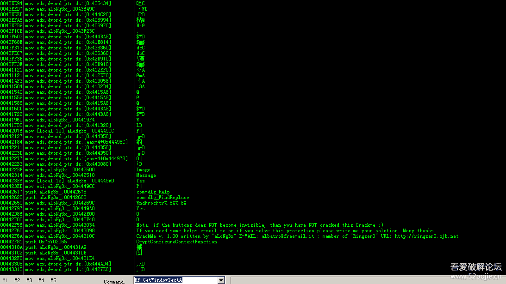
Snipaste_2022-04-25_14-18-16.png (38.54 KB, 下载次数: 2)
[href="forum.php?mod=attachment&aid=MjUxNzE0NXwzNmQxNmVmY3wxNzkzNTc1NjY1fDE2ODA4NnwxNjI3NTM3&nothumb=yes" target="_blank"](https://www.52pojie.cn/forum.php?mod=attachment&aid=MjUxNzE0NXwzNmQxNmVmY3wxNzkzNTc1NjY1fDE2ODA4NnwxNjI3NTM3&nothumb=yes)
2022-4-25 14:17 上传
无奈，我们用`dede`看看都有什么事件吧
有10个事件 而其中有意义的有5个
`CodiceChange` 输入密码（在`Codice`的框里输入字符）
`OKClick` 左键单击`OK`按钮
`NomeChange` 输入用户名（在`Nome`的框里输入字符）
`CancellaClick` 左键单击`Cancella`按钮
`AboutClick` 左键单击`About-Help`按钮
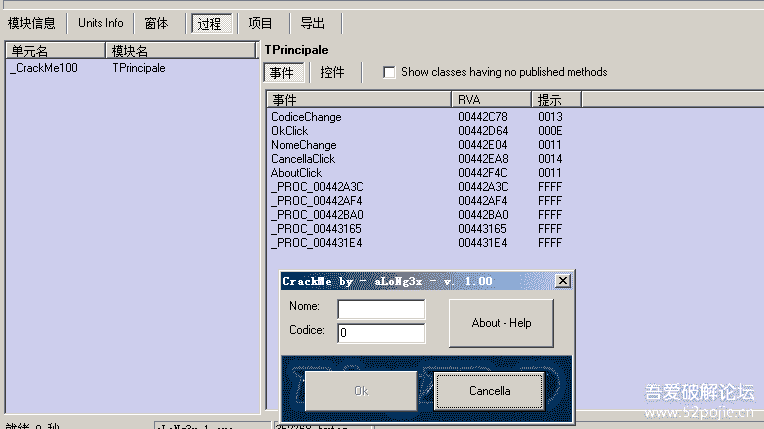
Snipaste_2022-04-25_14-24-43.png (27.98 KB, 下载次数: 2)
[href="forum.php?mod=attachment&aid=MjUxNzE0NnxjZjZmMmZhNXwxNzkzNTc1NjY1fDE2ODA4NnwxNjI3NTM3&nothumb=yes" target="_blank"](https://www.52pojie.cn/forum.php?mod=attachment&aid=MjUxNzE0NnxjZjZmMmZhNXwxNzkzNTc1NjY1fDE2ODA4NnwxNjI3NTM3&nothumb=yes)
2022-4-25 14:24 上传
我去了`CodiceChange`这个事件的段首下断点（因为我绝对如果不是灰色按钮 那应该就是它检测了我们的账户密码正不正确 如果正确就激活`OK`按钮）
载入`OD` `Ctrl+G`转到
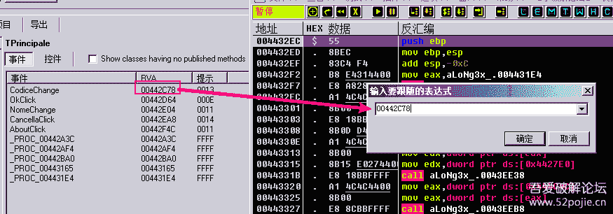
Snipaste_2022-04-25_14-31-05.png (30.22 KB, 下载次数: 2)
[href="forum.php?mod=attachment&aid=MjUxNzE0N3w5YTY4ZTE0OHwxNzkzNTc1NjY1fDE2ODA4NnwxNjI3NTM3&nothumb=yes" target="_blank"](https://www.52pojie.cn/forum.php?mod=attachment&aid=MjUxNzE0N3w5YTY4ZTE0OHwxNzkzNTc1NjY1fDE2ODA4NnwxNjI3NTM3&nothumb=yes)
2022-4-25 14:30 上传
转到之后 段首下断 然后运行 输入账户密码，在输入密码的时候直接被断下来
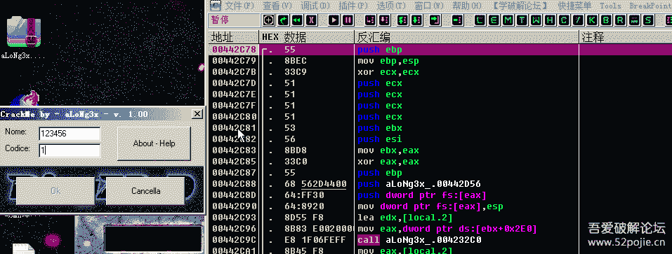
Snipaste_2022-04-25_14-32-30.png (164.38 KB, 下载次数: 0)
[href="forum.php?mod=attachment&aid=MjUxNzE0OHwzMDM0N2NmMHwxNzkzNTc1NjY1fDE2ODA4NnwxNjI3NTM3&nothumb=yes" target="_blank"](https://www.52pojie.cn/forum.php?mod=attachment&aid=MjUxNzE0OHwzMDM0N2NmMHwxNzkzNTc1NjY1fDE2ODA4NnwxNjI3NTM3&nothumb=yes)
2022-4-25 14:32 上传
开始`F8`单步 一直单步到段尾了 也没发现真码 但是发现了一个能直接跳到最后的`jmp` 我觉得这很可疑
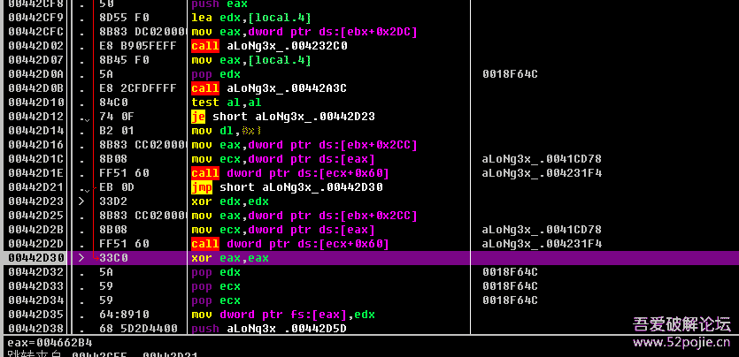
Snipaste_2022-04-25_14-36-27.png (23.44 KB, 下载次数: 1)
[href="forum.php?mod=attachment&aid=MjUxNzE0OXxlYWE4Nzc0NXwxNzkzNTc1NjY1fDE2ODA4NnwxNjI3NTM3&nothumb=yes" target="_blank"](https://www.52pojie.cn/forum.php?mod=attachment&aid=MjUxNzE0OXxlYWE4Nzc0NXwxNzkzNTc1NjY1fDE2ODA4NnwxNjI3NTM3&nothumb=yes)
2022-4-25 14:35 上传
转过去看看 发现两个都是`jmp`而且下面都有个跳过`jmp`的跳转，看到这个就很熟悉了 可能又是跳过了成功走向了失败
但不确定是那个 当然上面的那个更可疑因为它一下跳了4个`call` 我们先试试让上面的`jmp`执行
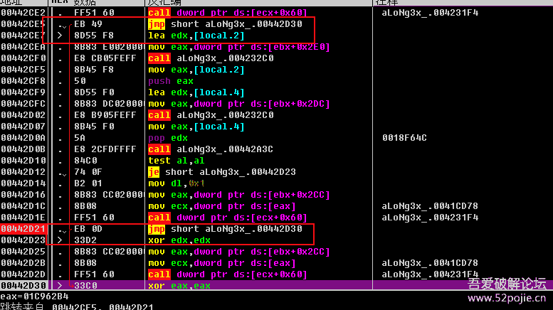
Snipaste_2022-04-25_14-38-53.png (26.78 KB, 下载次数: 1)
[href="forum.php?mod=attachment&aid=MjUxNzE1MHw5MDE0NWFkNXwxNzkzNTc1NjY1fDE2ODA4NnwxNjI3NTM3&nothumb=yes" target="_blank"](https://www.52pojie.cn/forum.php?mod=attachment&aid=MjUxNzE1MHw5MDE0NWFkNXwxNzkzNTc1NjY1fDE2ODA4NnwxNjI3NTM3&nothumb=yes)
2022-4-25 14:38 上传
将跳过`jmp`的跳转下断，然后重载程序，看看是不是真的跳过了`jmp`
跳过了 我们将它`nop`掉
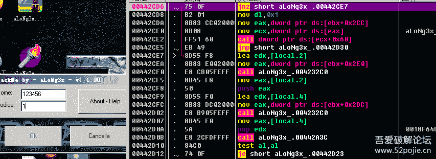
Snipaste_2022-04-25_14-41-47.png (114.2 KB, 下载次数: 1)
[href="forum.php?mod=attachment&aid=MjUxNzE1MXw1NmQxZmY3M3wxNzkzNTc1NjY1fDE2ODA4NnwxNjI3NTM3&nothumb=yes" target="_blank"](https://www.52pojie.cn/forum.php?mod=attachment&aid=MjUxNzE1MXw1NmQxZmY3M3wxNzkzNTc1NjY1fDE2ODA4NnwxNjI3NTM3&nothumb=yes)
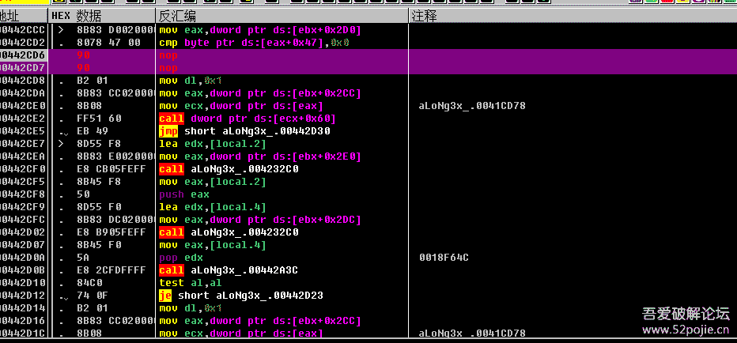
Snipaste_2022-04-25_14-43-00.png (26.04 KB, 下载次数: 2)
[href="forum.php?mod=attachment&aid=MjUxNzE1MnwyNGNkMzVlNXwxNzkzNTc1NjY1fDE2ODA4NnwxNjI3NTM3&nothumb=yes" target="_blank"](https://www.52pojie.cn/forum.php?mod=attachment&aid=MjUxNzE1MnwyNGNkMzVlNXwxNzkzNTc1NjY1fDE2ODA4NnwxNjI3NTM3&nothumb=yes)
2022-4-25 14:42 上传
`F9`运行
成了`OK`能用了
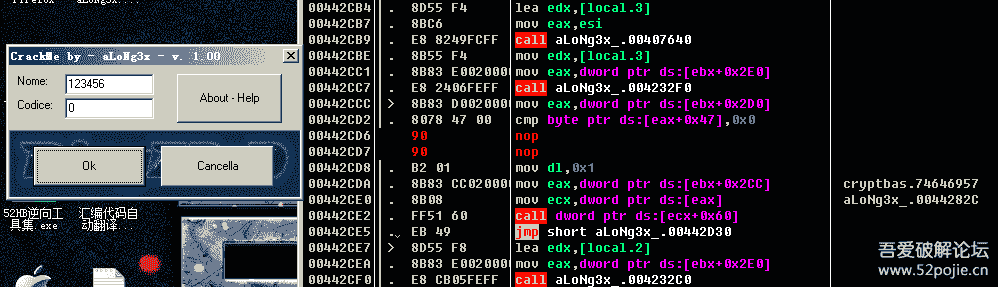
Snipaste_2022-04-25_14-44-08.png (114.14 KB, 下载次数: 0)
[href="forum.php?mod=attachment&aid=MjUxNzE1M3w1NjJiN2FmMHwxNzkzNTc1NjY1fDE2ODA4NnwxNjI3NTM3&nothumb=yes" target="_blank"](https://www.52pojie.cn/forum.php?mod=attachment&aid=MjUxNzE1M3w1NjJiN2FmMHwxNzkzNTc1NjY1fDE2ODA4NnwxNjI3NTM3&nothumb=yes)
2022-4-25 14:43 上传
我们也去试试下面的那个`jmp`
也成了 这两个都行，看来能不能使就是跳不跳过下面那个`call`啊
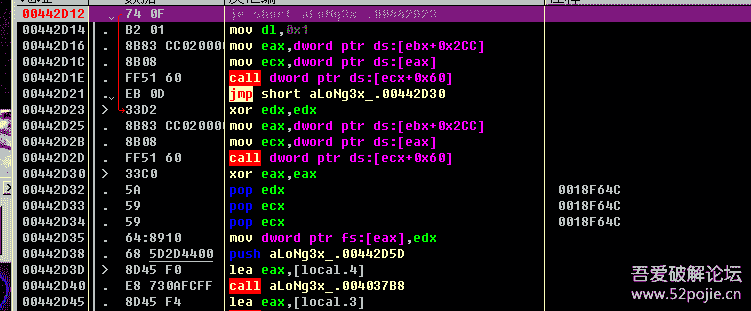
Snipaste_2022-04-25_14-45-41.png (26.02 KB, 下载次数: 2)
[href="forum.php?mod=attachment&aid=MjUxNzE1NXxhNzI0YjdkNnwxNzkzNTc1NjY1fDE2ODA4NnwxNjI3NTM3&nothumb=yes" target="_blank"](https://www.52pojie.cn/forum.php?mod=attachment&aid=MjUxNzE1NXxhNzI0YjdkNnwxNzkzNTc1NjY1fDE2ODA4NnwxNjI3NTM3&nothumb=yes)
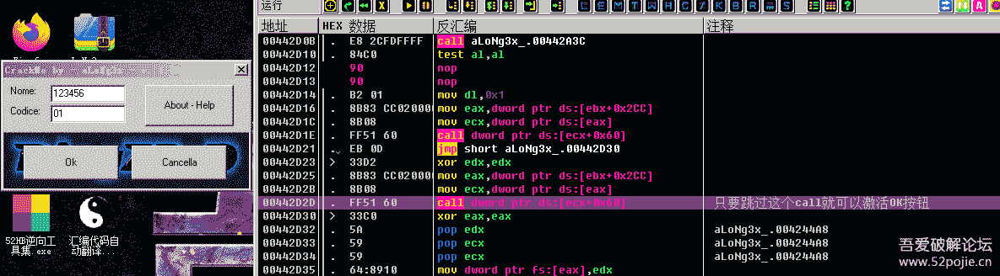
Snipaste_2022-04-25_14-47-24.png (145.24 KB, 下载次数: 3)
[href="forum.php?mod=attachment&aid=MjUxNzE1Nnw0MmI2N2NkY3wxNzkzNTc1NjY1fDE2ODA4NnwxNjI3NTM3&nothumb=yes" target="_blank"](https://www.52pojie.cn/forum.php?mod=attachment&aid=MjUxNzE1Nnw0MmI2N2NkY3wxNzkzNTc1NjY1fDE2ODA4NnwxNjI3NTM3&nothumb=yes)
2022-4-25 14:46 上传
既然成了，我们就随便改一个地方，然后保存出来
然后我们开始下一步，隐藏按钮
将修改后的程序载入`OD`
我们先来看看隐藏`Cancella`这个按钮吧，我们去到它的按钮事件段首下断
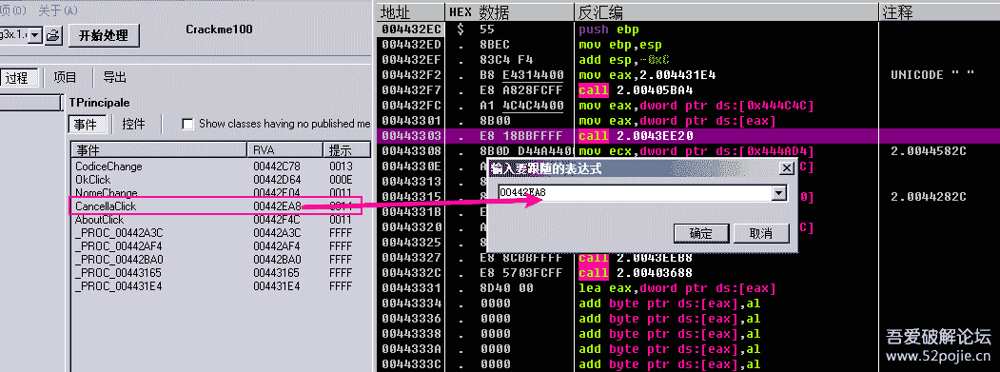
Snipaste_2022-04-25_14-51-34.png (31.23 KB, 下载次数: 2)
[href="forum.php?mod=attachment&aid=MjUxNzE1OHw3MTA2NThkZnwxNzkzNTc1NjY1fDE2ODA4NnwxNjI3NTM3&nothumb=yes" target="_blank"](https://www.52pojie.cn/forum.php?mod=attachment&aid=MjUxNzE1OHw3MTA2NThkZnwxNzkzNTc1NjY1fDE2ODA4NnwxNjI3NTM3&nothumb=yes)
2022-4-25 14:51 上传
下好断后运行起来直接点`Cancella`这个按钮就好了，毕竟我们是爆破
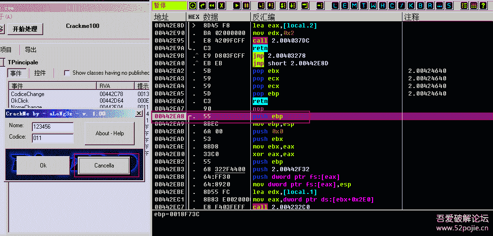
Snipaste_2022-04-25_14-53-33.png (45.11 KB, 下载次数: 3)
[href="forum.php?mod=attachment&aid=MjUxNzE1OXw1NGQ2NjhkMXwxNzkzNTc1NjY1fDE2ODA4NnwxNjI3NTM3&nothumb=yes" target="_blank"](https://www.52pojie.cn/forum.php?mod=attachment&aid=MjUxNzE1OXw1NGQ2NjhkMXwxNzkzNTc1NjY1fDE2ODA4NnwxNjI3NTM3&nothumb=yes)
2022-4-25 14:53 上传
断下后单步，我们发现一个判断是否等于0（`test`），对比之后有个`je` 这个`je`跳过了一个`jmp`
又是非常熟悉的操作
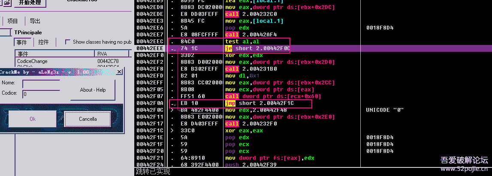
Snipaste_2022-04-25_14-55-23.png (37.12 KB, 下载次数: 1)
[href="forum.php?mod=attachment&aid=MjUxNzE2MHxhYmZiMzMyYnwxNzkzNTc1NjY1fDE2ODA4NnwxNjI3NTM3&nothumb=yes" target="_blank"](https://www.52pojie.cn/forum.php?mod=attachment&aid=MjUxNzE2MHxhYmZiMzMyYnwxNzkzNTc1NjY1fDE2ODA4NnwxNjI3NTM3&nothumb=yes)
2022-4-25 14:55 上传
我把`je` `nop`掉不让它跳转看看
`nop`掉之后 它过来`call`之后按钮就消失了，看来真的是我们想的那样，跳过了消失（成功）走向了失败
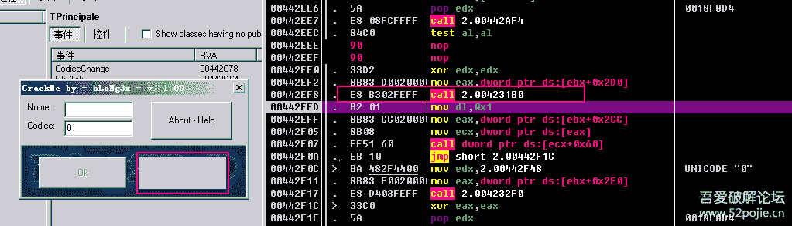

`Snipaste_2022-04-25_14-57-56.png` (29.68 KB, 下载次数: 1)

[href="forum.php?mod=attachment&aid=MjUxNzE2NHxjNmU2ZWQ3ZnwxNzkzNTc1NjY1fDE2ODA4NnwxNjI3NTM3&nothumb=yes" target="_blank"](https://www.52pojie.cn/forum.php?mod=attachment&aid=MjUxNzE2NHxjNmU2ZWQ3ZnwxNzkzNTc1NjY1fDE2ODA4NnwxNjI3NTM3&nothumb=yes)

2022-4-25 14:57 上传

然后我们运行程序就看到`Cancella`按钮消失了

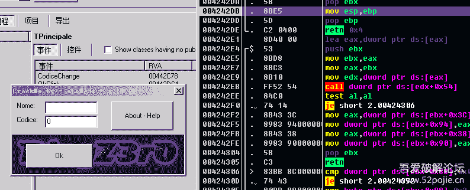

`Snipaste_2022-04-25_14-59-17.png` (34.16 KB, 下载次数: 1)

[href="forum.php?mod=attachment&aid=MjUxNzE2NXxjMTNiZWEyOHwxNzkzNTc1NjY1fDE2ODA4NnwxNjI3NTM3&nothumb=yes" target="_blank"](https://www.52pojie.cn/forum.php?mod=attachment&aid=MjUxNzE2NXxjMTNiZWEyOHwxNzkzNTc1NjY1fDE2ODA4NnwxNjI3NTM3&nothumb=yes)

2022-4-25 14:58 上传

估计`OK`也是这样消失，因为它也有个事件

我们继续用同样的方法在`OK`的按钮事件段首下断试试看

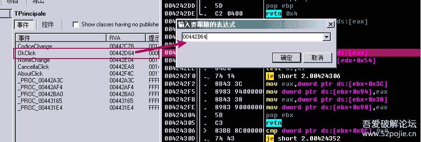

`Snipaste_2022-04-25_15-01-17.png` (24.28 KB, 下载次数: 1)

[href="forum.php?mod=attachment&aid=MjUxNzE2OXxlNWY4YmJiMnwxNzkzNTc1NjY1fDE2ODA4NnwxNjI3NTM3&nothumb=yes" target="_blank"](https://www.52pojie.cn/forum.php?mod=attachment&aid=MjUxNzE2OXxlNWY4YmJiMnwxNzkzNTc1NjY1fDE2ODA4NnwxNjI3NTM3&nothumb=yes)

2022-4-25 15:00 上传

下断点`OK`程序断下

往下一看，这还真像啊 但是这少了个判断是否等于0（`test`）

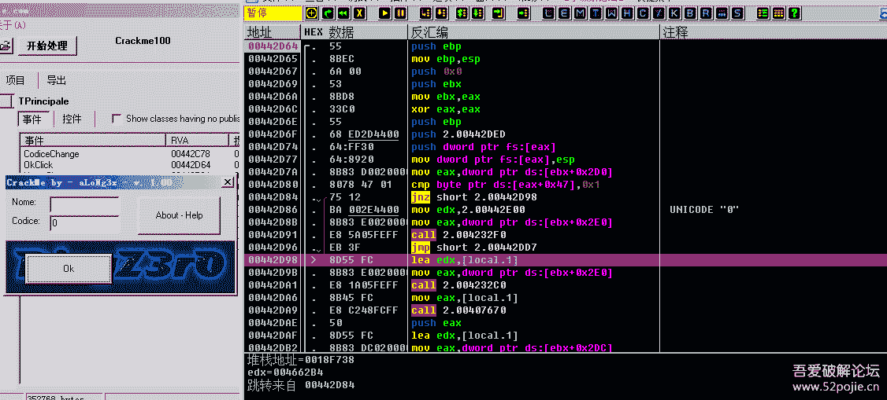

`Snipaste_2022-04-25_15-02-02.png` (50.64 KB, 下载次数: 1)

[href="forum.php?mod=attachment&aid=MjUxNzE3MnwzMDkyOWRkM3wxNzkzNTc1NjY1fDE2ODA4NnwxNjI3NTM3&nothumb=yes" target="_blank"](https://www.52pojie.cn/forum.php?mod=attachment&aid=MjUxNzE3MnwzMDkyOWRkM3wxNzkzNTc1NjY1fDE2ODA4NnwxNjI3NTM3&nothumb=yes)

2022-4-25 15:01 上传

继续吧跳过`jmp`的`jnz`给`nop`掉不让它跳看看

没成功`OK`按钮还在 但是我们发现了另一个跳转 这个`je` 经过一个对比，然后跳过了一个`call`

竟然上个`jmp`不是那这个`je`就有很大可能是了，毕竟它还有个判断是否等于0（`test`）

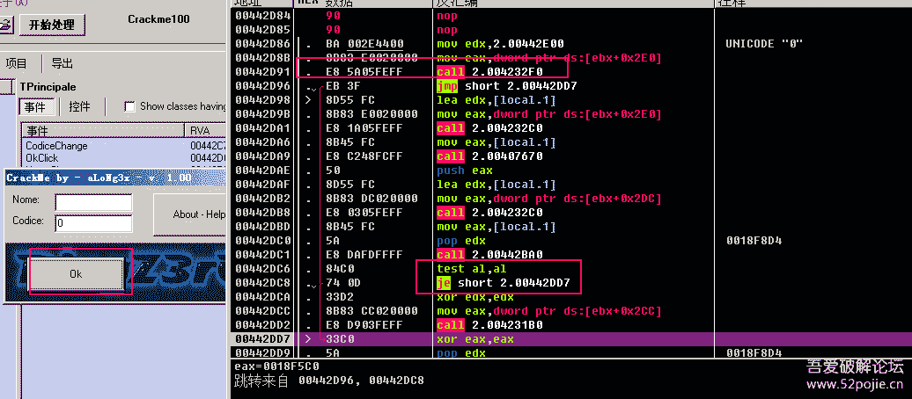

`Snipaste_2022-04-25_15-05-59.png` (39.39 KB, 下载次数: 1)

[href="forum.php?mod=attachment&aid=MjUxNzE3NHwwYTUxYjQ2M3wxNzkzNTc1NjY1fDE2ODA4NnwxNjI3NTM3&nothumb=yes" target="_blank"](https://www.52pojie.cn/forum.php?mod=attachment&aid=MjUxNzE3NHwwYTUxYjQ2M3wxNzkzNTc1NjY1fDE2ODA4NnwxNjI3NTM3&nothumb=yes)

2022-4-25 15:05 上传

我们在`je`处下断点，然后`F9`运行程序，重新点`ok` 它还会断在段首（如果你没删掉的话）

发现它确实跳转了 我们将它`nop`掉 (其实这地方直接改标志位控制跳转就可以了 因为如果不确定直接`nop`掉会让断点失效)

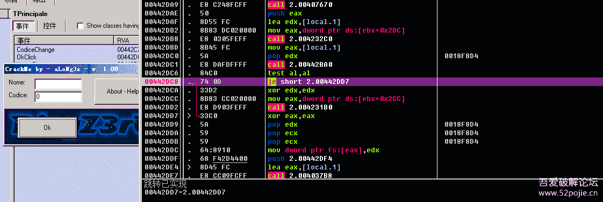

`Snipaste_2022-04-25_15-10-55.png` (35.25 KB, 下载次数: 3)

[href="forum.php?mod=attachment&aid=MjUxNzE3N3w0OTBiZGNmOXwxNzkzNTc1NjY1fDE2ODA4NnwxNjI3NTM3&nothumb=yes" target="_blank"](https://www.52pojie.cn/forum.php?mod=attachment&aid=MjUxNzE3N3w0OTBiZGNmOXwxNzkzNTc1NjY1fDE2ODA4NnwxNjI3NTM3&nothumb=yes)

2022-4-25 15:10 上传

双击`z`标志位让他不跳

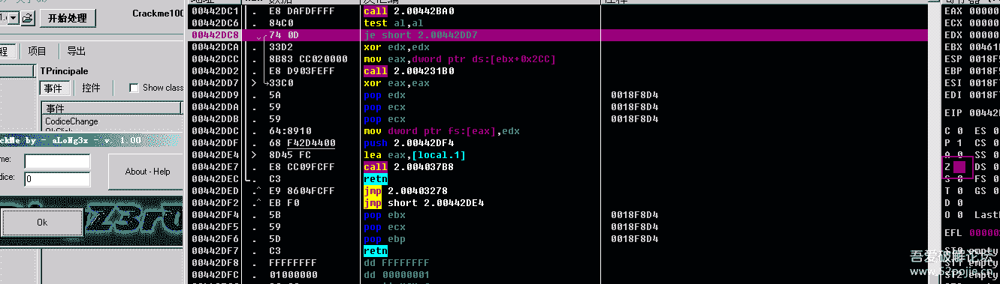

`Snipaste_2022-04-25_15-13-12.png` (41.58 KB, 下载次数: 0)

[href="forum.php?mod=attachment&aid=MjUxNzE3OXxhNmViZjE3Y3wxNzkzNTc1NjY1fDE2ODA4NnwxNjI3NTM3&nothumb=yes" target="_blank"](https://www.52pojie.cn/forum.php?mod=attachment&aid=MjUxNzE3OXxhNmViZjE3Y3wxNzkzNTc1NjY1fDE2ODA4NnwxNjI3NTM3&nothumb=yes)

2022-4-25 15:12 上传

单步向下跟

经过这个`call`按钮消失了

然后我们可以直接把那个`je` `nop`掉保存了

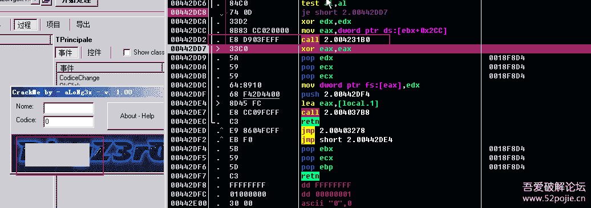

`Snipaste_2022-04-25_15-14-05.png` (34.76 KB, 下载次数: 1)

[href="forum.php?mod=attachment&aid=MjUxNzE4MHw2ZWM2NDBlZXwxNzkzNTc1NjY1fDE2ODA4NnwxNjI3NTM3&nothumb=yes" target="_blank"](https://www.52pojie.cn/forum.php?mod=attachment&aid=MjUxNzE4MHw2ZWM2NDBlZXwxNzkzNTc1NjY1fDE2ODA4NnwxNjI3NTM3&nothumb=yes)

2022-4-25 15:13 上传

因为 我刚刚`nop`掉`Cancella`的跳转的时候没有保存 所以要选保存全部修改

右键-复制到可执行文件-所有修改

然后选全部复制就可以了（这应该都知道了 我又在多bb）

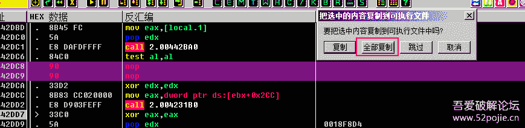

`Snipaste_2022-04-25_15-17-02.png` (22.69 KB, 下载次数: 1)

[href="forum.php?mod=attachment&aid=MjUxNzE4NXw4NDhmOGQwMHwxNzkzNTc1NjY1fDE2ODA4NnwxNjI3NTM3&nothumb=yes" target="_blank"](https://www.52pojie.cn/forum.php?mod=attachment&aid=MjUxNzE4NXw4NDhmOGQwMHwxNzkzNTc1NjY1fDE2ODA4NnwxNjI3NTM3&nothumb=yes)

2022-4-25 15:16 上传

打开保存后的文件 看看是否成功

至此就爆破成功了

如果你问我 “为什么你知道每个按钮的隐藏是它他们的事件里呢？” 我只能说我不知道但我觉得他们既然存在那可能就有一定的作用把 也可能是我运气好 哈哈哈

那我们再去看看输入账号这个事件把

转过去 然后下断 运行 在`Nome`输入个1然后断下

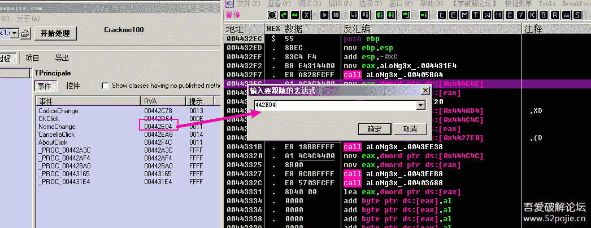

`Snipaste_2022-04-25_15-28-25.png` (39.2 KB, 下载次数: 1)

[href="forum.php?mod=attachment&aid=MjUxNzE4OHw2OWFjMDBiMXwxNzkzNTc1NjY1fDE2ODA4NnwxNjI3NTM3&nothumb=yes" target="_blank"](https://www.52pojie.cn/forum.php?mod=attachment&aid=MjUxNzE4OHw2OWFjMDBiMXwxNzkzNTc1NjY1fDE2ODA4NnwxNjI3NTM3&nothumb=yes)

2022-4-25 15:27 上传
