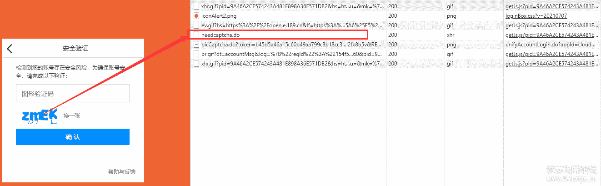
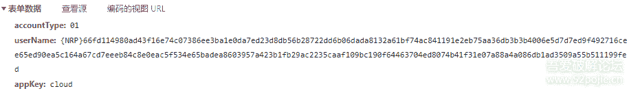
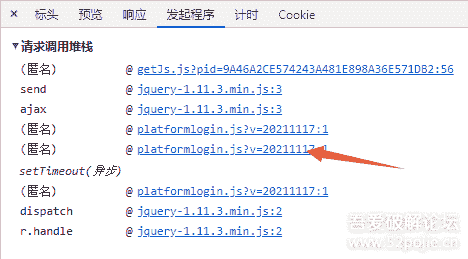
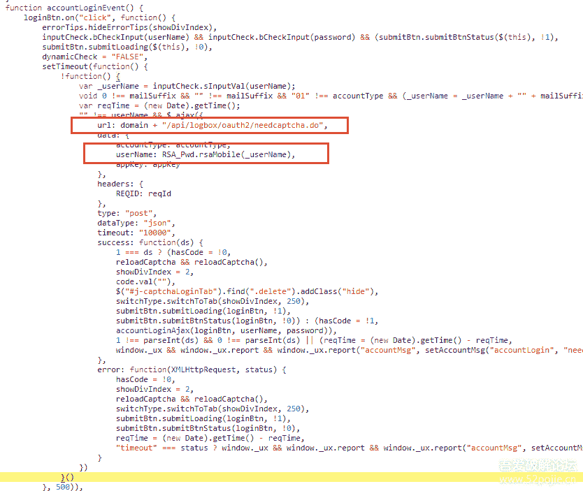
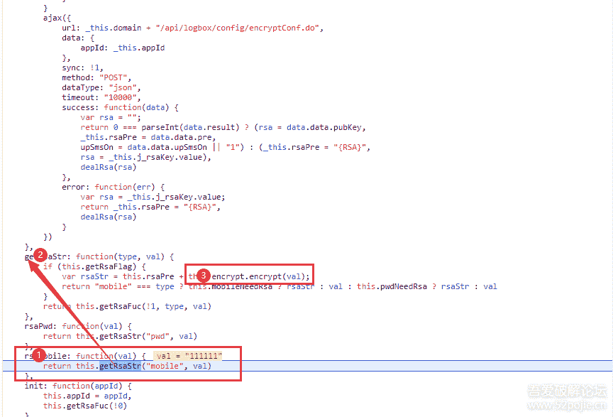
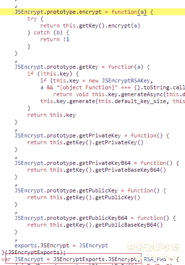
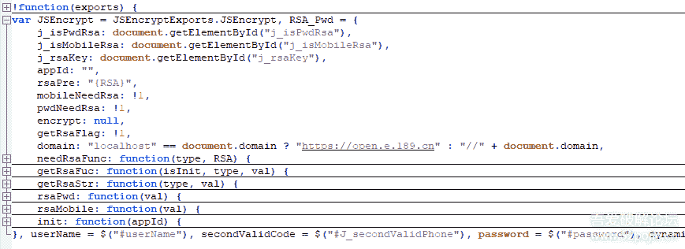
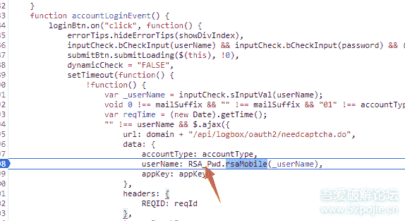
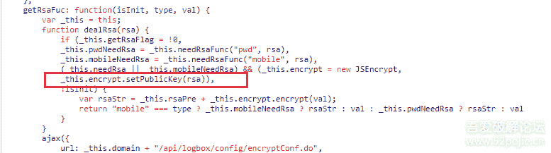

# [Web逆向] 【JS逆向学习实践】某翼云盘登录从头分析（一）

- 原帖: https://www.52pojie.cn/forum.php?mod=viewthread&tid=1627920
- 抓取时间: 2026-11-01T23:27:42

又找来一个练手站点，地址就不放了，有兴趣的可以自己去找，首先抓包分析



1.png (55.62 KB, 下载次数: 1)

[href="forum.php?mod=attachment&aid=MjUxNzM3NXxiODQ3YzkzM3wxNzkzNTc1NjYwfDE2ODA4NnwxNjI3OTIw&nothumb=yes" target="_blank"](https://www.52pojie.cn/forum.php?mod=attachment&aid=MjUxNzM3NXxiODQ3YzkzM3wxNzkzNTc1NjYwfDE2ODA4NnwxNjI3OTIw&nothumb=yes)

2022-4-26 11:00 上传

可以看到出现图片验证码，请求中有一项`needCapture`的请求，这是判断是否需要验证码其返回值为1则为需要，为0则不需要，看下请求数据



2.png (21.2 KB, 下载次数: 1)

[href="forum.php?mod=attachment&aid=MjUxNzM3NnxlZGZmOTJhNXwxNzkzNTc1NjYwfDE2ODA4NnwxNjI3OTIw&nothumb=yes" target="_blank"](https://www.52pojie.cn/forum.php?mod=attachment&aid=MjUxNzM3NnxlZGZmOTJhNXwxNzkzNTc1NjYwfDE2ODA4NnwxNjI3OTIw&nothumb=yes)

2022-4-26 11:02 上传

一共三项数据，只有`userName`是动态变化的，明显看到是经过加密的，先解密吧，从入口跟进去



3.png (27.03 KB, 下载次数: 0)

[href="forum.php?mod=attachment&aid=MjUxNzM3N3xhNzRmOTYwNHwxNzkzNTc1NjYwfDE2ODA4NnwxNjI3OTIw&nothumb=yes" target="_blank"](https://www.52pojie.cn/forum.php?mod=attachment&aid=MjUxNzM3N3xhNzRmOTYwNHwxNzkzNTc1NjYwfDE2ODA4NnwxNjI3OTIw&nothumb=yes)

2022-4-26 11:03 上传

跟进去之后可以看到，请求地址一样，将`userName`进行了`RSA`加密



4.png (84.65 KB, 下载次数: 0)

[href="forum.php?mod=attachment&aid=MjUxNzM3OHw4MjI3Mzk2ZXwxNzkzNTc1NjYwfDE2ODA4NnwxNjI3OTIw&nothumb=yes" target="_blank"](https://www.52pojie.cn/forum.php?mod=attachment&aid=MjUxNzM3OHw4MjI3Mzk2ZXwxNzkzNTc1NjYwfDE2ODA4NnwxNjI3OTIw&nothumb=yes)

2022-4-26 11:05 上传

`Rsa`可以抠代码也可以套用现成的库，我这里抠加密代码，下断点



5.png (61.28 KB, 下载次数: 1)

[href="forum.php?mod=attachment&aid=MjUxNzM3OXw3ZmI5M2VhNnwxNzkzNTc1NjYwfDE2ODA4NnwxNjI3OTIw&nothumb=yes" target="_blank"](https://www.52pojie.cn/forum.php?mod=attachment&aid=MjUxNzM3OXw3ZmI5M2VhNnwxNzkzNTc1NjYwfDE2ODA4NnwxNjI3OTIw&nothumb=yes)

2022-4-26 11:07 上传

跟进去看到实际上调用了`encrypt`的`encrypt`的方法进行加密，看下`encrypt`是`JSEncrypt`，将他抠出来



7.png (44.67 KB, 下载次数: 1)

[href="forum.php?mod=attachment&aid=MjUxNzM4MHw4MzYyMDNlZnwxNzkzNTc1NjYwfDE2ODA4NnwxNjI3OTIw&nothumb=yes" target="_blank"](https://www.52pojie.cn/forum.php?mod=attachment&aid=MjUxNzM4MHw4MzYyMDNlZnwxNzkzNTc1NjYwfDE2ODA4NnwxNjI3OTIw&nothumb=yes)

2022-4-26 11:12 上传

是一个导出函数，跟进去将他们全部抠出来就行了



8.png (44.71 KB, 下载次数: 0)

[href="forum.php?mod=attachment&aid=MjUxNzQwNXxmZTVkYjUzOHwxNzkzNTc1NjYwfDE2ODA4NnwxNjI3OTIw&nothumb=yes" target="_blank"](https://www.52pojie.cn/forum.php?mod=attachment&aid=MjUxNzQwNXxmZTVkYjUzOHwxNzkzNTc1NjYwfDE2ODA4NnwxNjI3OTIw&nothumb=yes)

2022-4-26 12:10 上传

将全部代码复制出来，折叠方便看，可以看到下面有一个`var JSEncrypt = JSEncryptExports.JSEncrypt`，这个`JSEncrypt`就是上面的那个对象了，再看一下加密函数



9.png (38.73 KB, 下载次数: 1)

[href="forum.php?mod=attachment&aid=MjUxNzQwNnwzYjkyOWI2M3wxNzkzNTc1NjYwfDE2ODA4NnwxNjI3OTIw&nothumb=yes" target="_blank"](https://www.52pojie.cn/forum.php?mod=attachment&aid=MjUxNzQwNnwzYjkyOWI2M3wxNzkzNTc1NjYwfDE2ODA4NnwxNjI3OTIw&nothumb=yes)

2022-4-26 12:13 上传

它是由`RSA_Pwd`这个对象调用的，看下这个对象，里面有一个`setPublicKey`



10.png (32.13 KB, 下载次数: 0)

[href="forum.php?mod=attachment&aid=MjUxNzQwOHw4YzI1Y2M2OHwxNzkzNTc1NjYwfDE2ODA4NnwxNjI3OTIw&nothumb=yes" target="_blank"](https://www.52pojie.cn/forum.php?mod=attachment&aid=MjUxNzQwOHw4YzI1Y2M2OHwxNzkzNTc1NjYwfDE2ODA4NnwxNjI3OTIw&nothumb=yes)

2022-4-26 12:14 上传

分析可以看到，这个`Key`是动态请求的，我们为了方便测试直接写固定的，下面是调用代码

```
function getRsa(val){
    // key动态获取
    key = "MIGfMA0GCSqGSIb3DQEBAQUAA4GNADCBiQKBgQCZLyV4gHNDUGJMZoOcYauxmNEsKrc0TlLeBEVVIIQNzG4WqjimceOj5R9ETwDeeSN3yejAKLGHgx83lyy2wBjvnbfm/nLObyWwQD/09CmpZdxoFYCH6rdDjRpwZOZ2nXSZpgkZXoOBkfNXNxnN74aXtho2dqBynTw3NFTWyQl8BQIDAQAB"
    var jSEncrypt = new JSEncrypt
    jSEncrypt.setPublicKey(key)
    var rsaStr = "{NRP}" + jSEncrypt.encrypt(val);
    console.log(rsaStr)

}
```

这样就得出加密后的`userName`了
