# [原创] PC端同花顺公式指标解密机制分析

- 原帖: https://www.52pojie.cn/forum.php?mod=viewthread&tid=1629341
- 抓取时间: 2026-11-01T23:27:32

## 收集目标信息

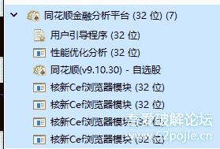
1.png (20.19 KB, 下载次数: 1)
[href="forum.php?mod=attachment&aid=MjUxODM2MXxlMmUzMTA1MHwxNzkzNTc1NjUwfDE2ODA4NnwxNjI5MzQx&nothumb=yes" target="_blank"](https://www.52pojie.cn/forum.php?mod=attachment&aid=MjUxODM2MXxlMmUzMTA1MHwxNzkzNTc1NjUwfDE2ODA4NnwxNjI5MzQx&nothumb=yes)
2022-4-29 19:38 上传

1.1.png (2.33 KB, 下载次数: 1)
[href="forum.php?mod=attachment&aid=MjUxODM2Mnw3NWFhZGQ3ZHwxNzkzNTc1NjUwfDE2ODA4NnwxNjI5MzQx&nothumb=yes" target="_blank"](https://www.52pojie.cn/forum.php?mod=attachment&aid=MjUxODM2Mnw3NWFhZGQ3ZHwxNzkzNTc1NjUwfDE2ODA4NnwxNjI5MzQx&nothumb=yes)
2022-4-29 19:38 上传
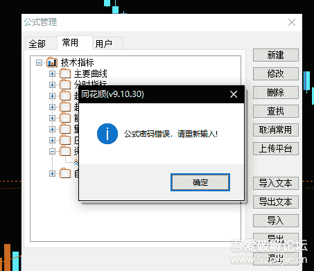
3.png (23.81 KB, 下载次数: 1)
[href="forum.php?mod=attachment&aid=MjUxODM2M3w5N2FhNWFjMnwxNzkzNTc1NjUwfDE2ODA4NnwxNjI5MzQx&nothumb=yes" target="_blank"](https://www.52pojie.cn/forum.php?mod=attachment&aid=MjUxODM2M3w5N2FhNWFjMnwxNzkzNTc1NjUwfDE2ODA4NnwxNjI5MzQx&nothumb=yes)
2022-4-29 19:38 上传
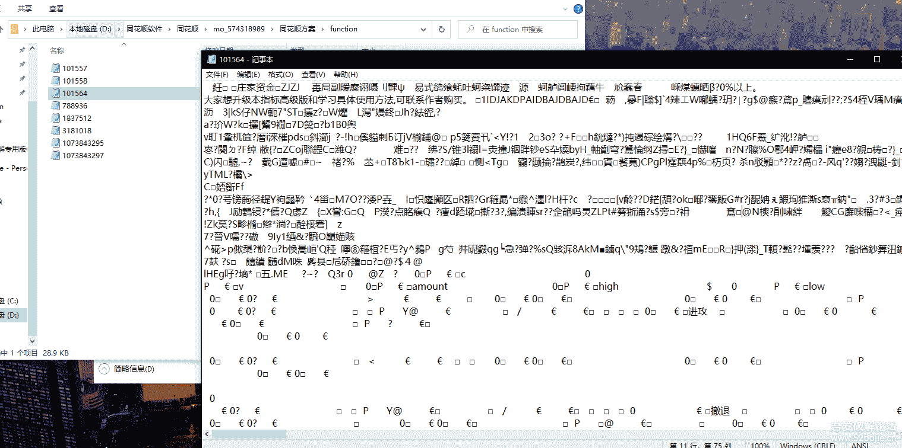
1.2.png (315.46 KB, 下载次数: 0)
[href="forum.php?mod=attachment&aid=MjUxODM2NHxiNTkwMjQxNHwxNzkzNTc1NjUwfDE2ODA4NnwxNjI5MzQx&nothumb=yes" target="_blank"](https://www.52pojie.cn/forum.php?mod=attachment&aid=MjUxODM2NHxiNTkwMjQxNHwxNzkzNTc1NjUwfDE2ODA4NnwxNjI5MzQx&nothumb=yes)
2022-4-29 19:38 上传
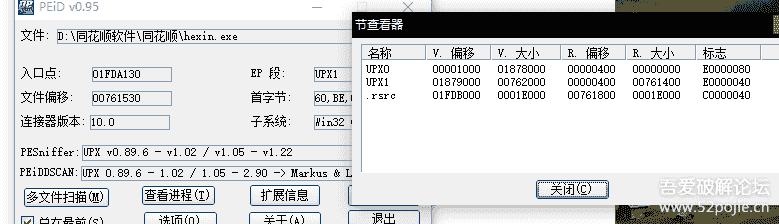
2.png (29.19 KB, 下载次数: 0)
[href="forum.php?mod=attachment&aid=MjUxODM2OXwyNTE2YzYzZHwxNzkzNTc1NjUwfDE2ODA4NnwxNjI5MzQx&nothumb=yes" target="_blank"](https://www.52pojie.cn/forum.php?mod=attachment&aid=MjUxODM2OXwyNTE2YzYzZHwxNzkzNTc1NjUwfDE2ODA4NnwxNjI5MzQx&nothumb=yes)
2022-4-29 20:00 上传

## 软件信息

软件名称：同花顺
主程序名称：`hexin.exe`
目标模块：公式指标
文件格式：`HXF`
提示信息：失败提示“公式密码错误，请重新输入” 成功提示“”
壳信息：压缩壳
反调试：有

## 选择工具

[//www.52pojie.cn/thread-350397-1-1.html" target="_blank" class="relatedlink"](https://www.52pojie.cn/thread-350397-1-1.html:href="https)（吾爱）
IDA7.6（吾爱）
PEid（吾爱）
16进制计算器

## 正文

附加载入程序，让程序跑起来解码，跳转到`401000`搜索提示信息字符串
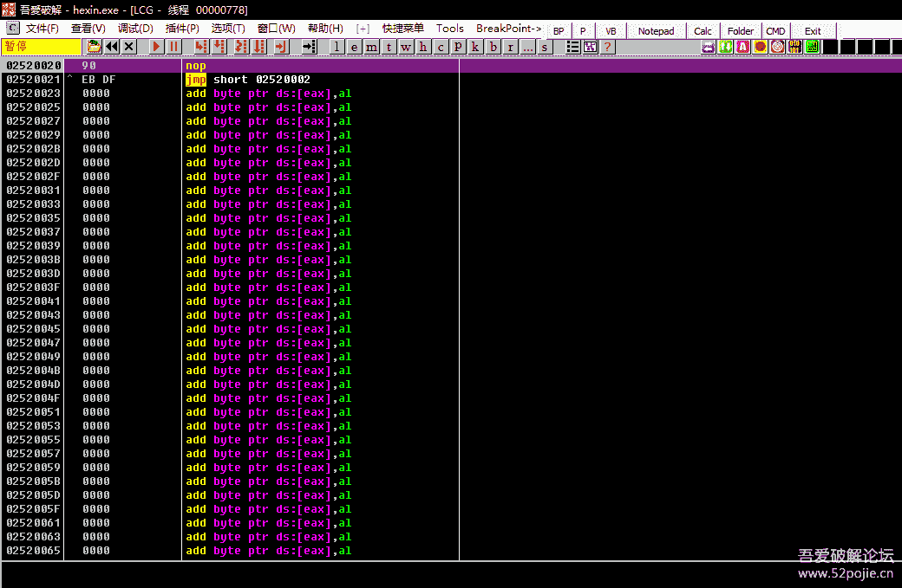
4.png (48.91 KB, 下载次数: 2)
[href="forum.php?mod=attachment&aid=MjUxODE1MXwyOTYyZjM3MXwxNzkzNTc1NjUwfDE2ODA4NnwxNjI5MzQx&nothumb=yes" target="_blank"](https://www.52pojie.cn/forum.php?mod=attachment&aid=MjUxODE1MXwyOTYyZjM3MXwxNzkzNTc1NjUwfDE2ODA4NnwxNjI5MzQx&nothumb=yes)
2022-4-28 23:08 上传
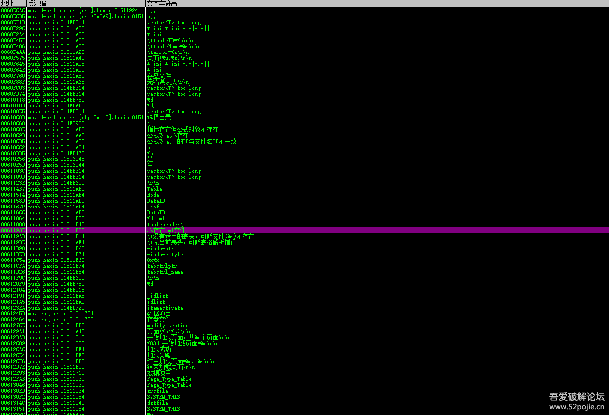
5.png (47.38 KB, 下载次数: 1)
[href="forum.php?mod=attachment&aid=MjUxODE1Mnw0M2I0OGQ3ZHwxNzkzNTc1NjUwfDE2ODA4NnwxNjI5MzQx&nothumb=yes" target="_blank"](https://www.52pojie.cn/forum.php?mod=attachment&aid=MjUxODE1Mnw0M2I0OGQ3ZHwxNzkzNTc1NjUwfDE2ODA4NnwxNjI5MzQx&nothumb=yes)
2022-4-28 23:08 上传
没有搜索到字符串，转为函数做进入点。有弹窗提示断`MessageBox`，`F8`返回程序代码段，并在段首和`MessageBox`设下断点（防止程序不经过段首）。
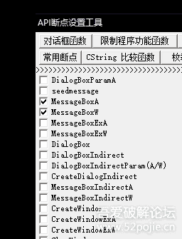
6.png (12.32 KB, 下载次数: 2)
[href="forum.php?mod=attachment&aid=MjUxODM3MHw1MTlkN2NiMHwxNzkzNTc1NjUwfDE2ODA4NnwxNjI5MzQx&nothumb=yes" target="_blank"](https://www.52pojie.cn/forum.php?mod=attachment&aid=MjUxODM3MHw1MTlkN2NiMHwxNzkzNTc1NjUwfDE2ODA4NnwxNjI5MzQx&nothumb=yes)
2022-4-29 20:01 上传
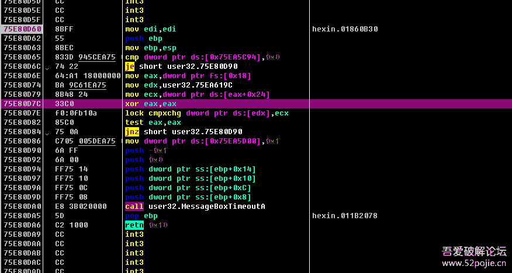
7.png (23.35 KB, 下载次数: 3)
[href="forum.php?mod=attachment&aid=MjUxODE1NnxkYWVkNzg5NnwxNzkzNTc1NjUwfDE2ODA4NnwxNjI5MzQx&nothumb=yes" target="_blank"](https://www.52pojie.cn/forum.php?mod=attachment&aid=MjUxODE1NnxkYWVkNzg5NnwxNzkzNTc1NjUwfDE2ODA4NnwxNjI5MzQx&nothumb=yes)
2022-4-28 23:11 上传
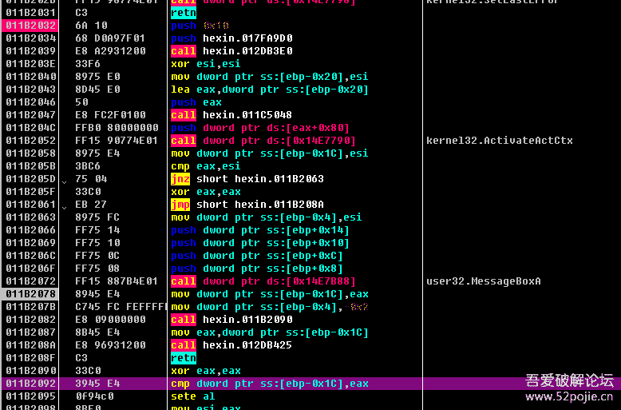
8.png (28.71 KB, 下载次数: 1)
[href="forum.php?mod=attachment&aid=MjUxODE1N3w4N2YwMTdjMXwxNzkzNTc1NjUwfDE2ODA4NnwxNjI5MzQx&nothumb=yes" target="_blank"](https://www.52pojie.cn/forum.php?mod=attachment&aid=MjUxODE1N3w4N2YwMTdjMXwxNzkzNTc1NjUwfDE2ODA4NnwxNjI5MzQx&nothumb=yes)
2022-4-28 23:14 上传
成功断在段首并且堆栈发现错误信息，直接执行到段尾并返回到调用代码段，继续段首和`Call`下断。（直接执行到段尾是因为堆栈已经压入错误提示信息，说明调用代码已经识别出密码错误）。
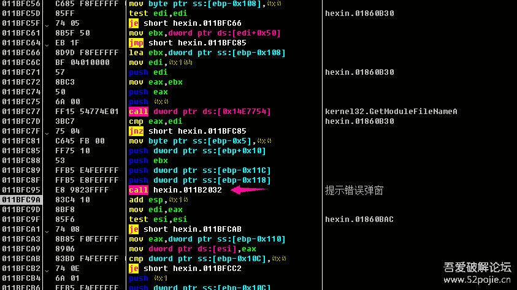
10.png (25.66 KB, 下载次数: 1)
[href="forum.php?mod=attachment&aid=MjUxODE1OHxmMDNhMmYyYnwxNzkzNTc1NjUwfDE2ODA4NnwxNjI5MzQx&nothumb=yes" target="_blank"](https://www.52pojie.cn/forum.php?mod=attachment&aid=MjUxODE1OHxmMDNhMmYyYnwxNzkzNTc1NjUwfDE2ODA4NnwxNjI5MzQx&nothumb=yes)
2022-4-28 23:21 上传
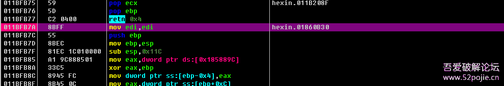
11.png (11.64 KB, 下载次数: 1)
[href="forum.php?mod=attachment&aid=MjUxODE2MXw3ODE5ZjJlYnwxNzkzNTc1NjUwfDE2ODA4NnwxNjI5MzQx&nothumb=yes" target="_blank"](https://www.52pojie.cn/forum.php?mod=attachment&aid=MjUxODE2MXw3ODE5ZjJlYnwxNzkzNTc1NjUwfDE2ODA4NnwxNjI5MzQx&nothumb=yes)
2022-4-28 23:23 上传
成功断在段首并提示错误信息，继续执行到段尾并返回调用代码段，发现堆栈提示了一串字符“13579888”，记录下来，继续返回调用代码段并在段首和`Call`下断（会连续返回几次调用代码，直接换上发现字符串信息的图）
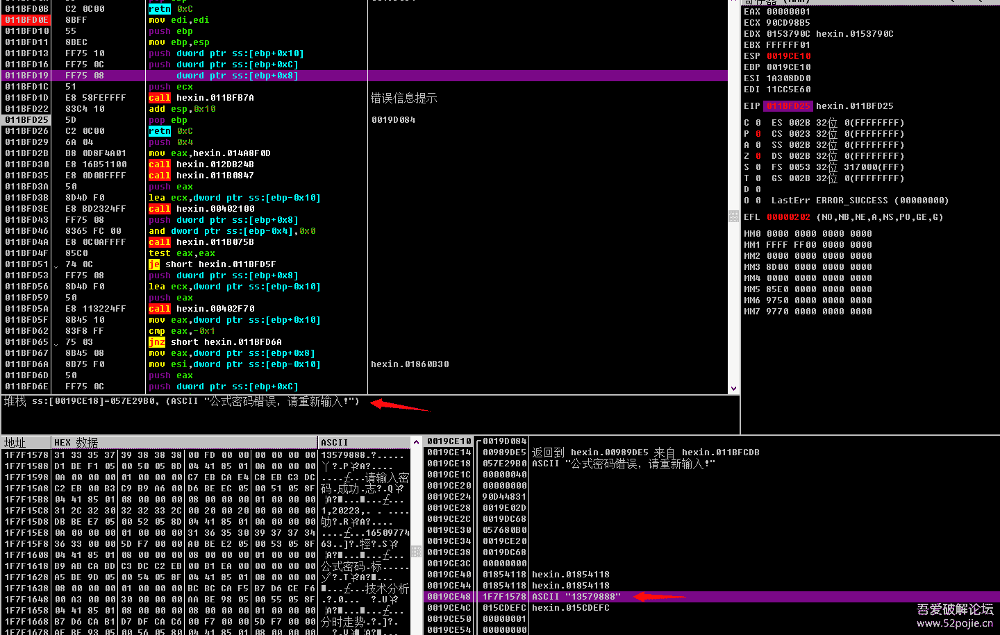
12.png (62.94 KB, 下载次数: 1)
[href="forum.php?mod=attachment&aid=MjUxODE2MnwzOGQyMTAzZXwxNzkzNTc1NjUwfDE2ODA4NnwxNjI5MzQx&nothumb=yes" target="_blank"](https://www.52pojie.cn/forum.php?mod=attachment&aid=MjUxODE2MnwzOGQyMTAzZXwxNzkzNTc1NjUwfDE2ODA4NnwxNjI5MzQx&nothumb=yes)
2022-4-28 23:29 上传
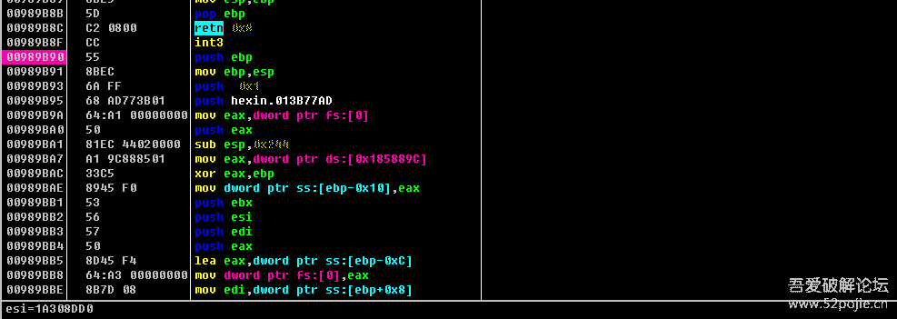
13.png (17.92 KB, 下载次数: 1)
[href="forum.php?mod=attachment&aid=MjUxODE2M3xiNWJlY2EwN3wxNzkzNTc1NjUwfDE2ODA4NnwxNjI5MzQx&nothumb=yes" target="_blank"](https://www.52pojie.cn/forum.php?mod=attachment&aid=MjUxODE2M3xiNWJlY2EwN3wxNzkzNTc1NjUwfDE2ODA4NnwxNjI5MzQx&nothumb=yes)
2022-4-28 23:32 上传
发现堆栈提示`Textchanged`事件信息。
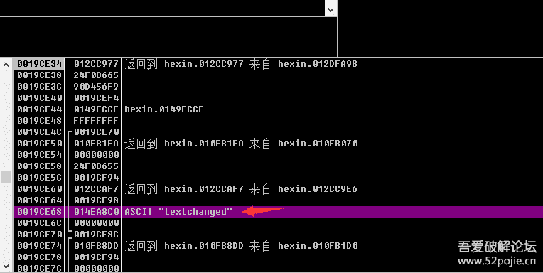
14.png (15.66 KB, 下载次数: 3)
[href="forum.php?mod=attachment&aid=MjUxODE2NHw4OTM2MjFjMXwxNzkzNTc1NjUwfDE2ODA4NnwxNjI5MzQx&nothumb=yes" target="_blank"](https://www.52pojie.cn/forum.php?mod=attachment&aid=MjUxODE2NHw4OTM2MjFjMXwxNzkzNTc1NjUwfDE2ODA4NnwxNjI5MzQx&nothumb=yes)
2022-4-28 23:37 上传
继续执行发现可疑字符串“1IDJAKDPAIDBAJDBAJD” “198236‘ ”399170“ 记录下来继续执行。
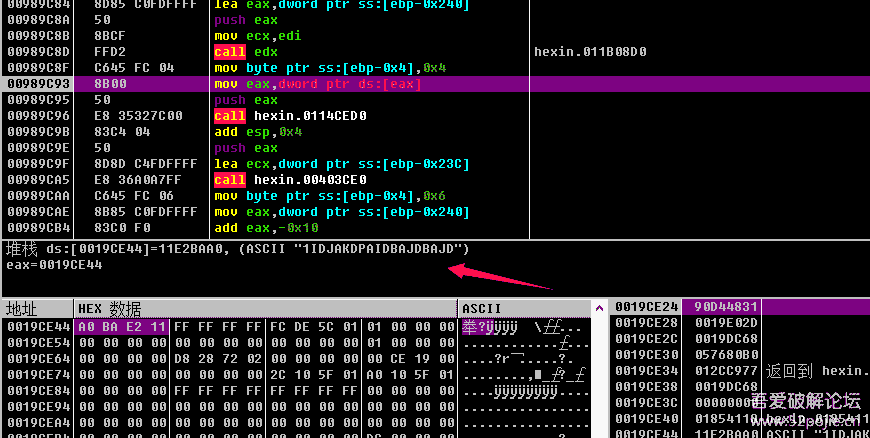
15.png (26.51 KB, 下载次数: 1)
[href="forum.php?mod=attachment&aid=MjUxODE2OXxlZDk1M2NkYXwxNzkzNTc1NjUwfDE2ODA4NnwxNjI5MzQx&nothumb=yes" target="_blank"](https://www.52pojie.cn/forum.php?mod=attachment&aid=MjUxODE2OXxlZDk1M2NkYXwxNzkzNTc1NjUwfDE2ODA4NnwxNjI5MzQx&nothumb=yes)
2022-4-28 23:44 上传
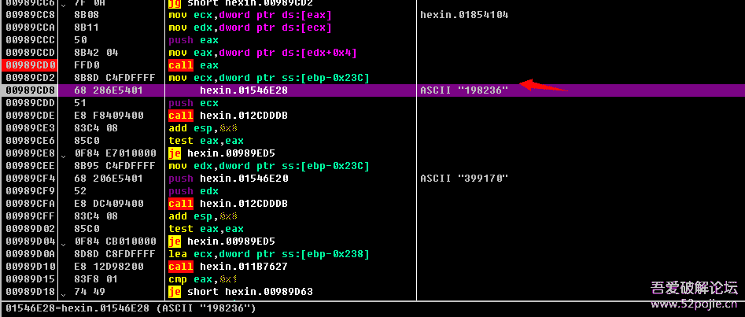
16.png (23.3 KB, 下载次数: 2)
[href="forum.php?mod=attachment&aid=MjUxODE3MHw3NmRmZjViNXwxNzkzNTc1NjUwfDE2ODA4NnwxNjI5MzQx&nothumb=yes" target="_blank"](https://www.52pojie.cn/forum.php?mod=attachment&aid=MjUxODE3MHw3NmRmZjViNXwxNzkzNTc1NjUwfDE2ODA4NnwxNjI5MzQx&nothumb=yes)
2022-4-28 23:44 上传
继续执行弹出密码错误信息窗口，发现上方`test`对比和`je`条件跳转。重新执行`test`指令开始的代码并更改标志位测试其他结果，分析出跳向密码成功和密码失败。
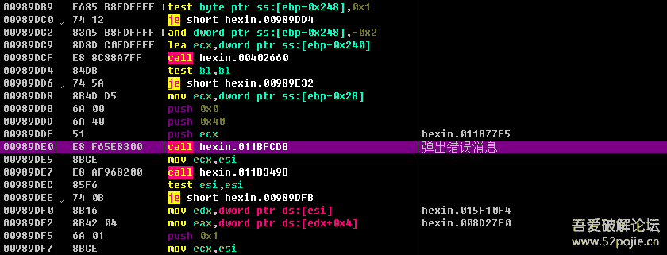
17.png (19.21 KB, 下载次数: 0)
[href="forum.php?mod=attachment&aid=MjUxODE3MXw5NGFlNTNjMXwxNzkzNTc1NjUwfDE2ODA4NnwxNjI5MzQx&nothumb=yes" target="_blank"](https://www.52pojie.cn/forum.php?mod=attachment&aid=MjUxODE3MXw5NGFlNTNjMXwxNzkzNTc1NjUwfDE2ODA4NnwxNjI5MzQx&nothumb=yes)
2022-4-28 23:45 上传
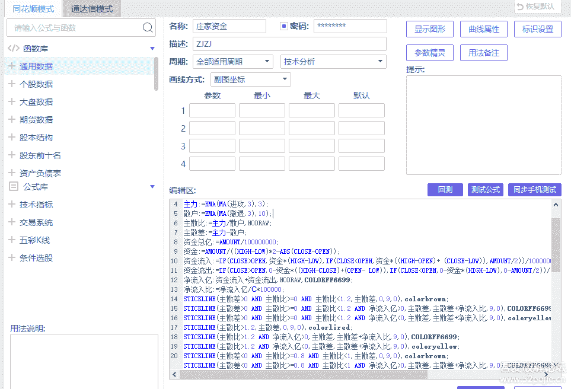
19.png (66.96 KB, 下载次数: 1)
[href="forum.php?mod=attachment&aid=MjUxODE3NnwzYzE1NWM4M3wxNzkzNTc1NjUwfDE2ODA4NnwxNjI5MzQx&nothumb=yes" target="_blank"](https://www.52pojie.cn/forum.php?mod=attachment&aid=MjUxODE3NnwzYzE1NWM4M3wxNzkzNTc1NjUwfDE2ODA4NnwxNjI5MzQx&nothumb=yes)
2022-4-28 23:55 上传
在`Test`指令上方还有对比和跳转指令，重新执行整个代码段，详细分析流程。
[Asm] 纯文本查看 复制代码


# HXF文件解密分析

## 关键判断代码段

```asm
00989D9C    8378 F4 00      cmp dword ptr ds:[eax-0xC],0x0           ; 核心判断
00989DA0    C785 B8FDFFFF 0>mov dword ptr ss:[ebp-0x248],0x1
00989DAA    74 04           je short hexin.00989DB0                  ; 关键跳转
00989DAC    32DB            xor bl,bl
00989DAE    EB 02           jmp short hexin.00989DB2
00989DB0    B3 01           mov bl,0x1
00989DB2    C745 FC 0600000>mov dword ptr ss:[ebp-0x4],0x6
00989DB9    F685 B8FDFFFF 0>test byte ptr ss:[ebp-0x248],0x1
00989DC0    74 12           je short hexin.00989DD4
00989DC2    83A5 B8FDFFFF F>and dword ptr ss:[ebp-0x248],-0x2
00989DC9    8D8D C0FDFFFF   lea ecx,dword ptr ss:[ebp-0x240]
00989DCF    E8 8C88A7FF     call hexin.00402660
00989DD4    84DB            test bl,bl
00989DD6    74 5A           je short hexin.00989E32
00989DD8    8B4D D5         mov ecx,dword ptr ss:[ebp-0x2B]
00989DDB    6A 00           push 0x0
00989DDD    6A 40           push 0x40
00989DDF    51              push ecx
00989DE0    E8 F65E8300     call hexin.011BFCDB                      ; 弹出错误消息
```

### 密码错误

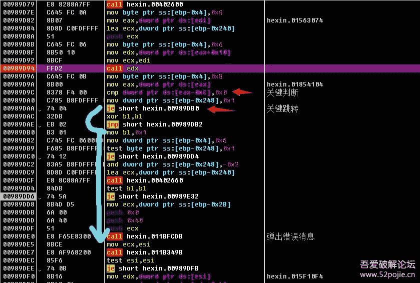

失败.jpg (139.62 KB, 下载次数: 1)

[附件下载](https://www.52pojie.cn/forum.php?mod=attachment&aid=MjUxODE3OHxmYWIxMTc0NnwxNzkzNTc1NjUwfDE2ODA4NnwxNjI5MzQx&nothumb=yes)

2022-4-29 00:20 上传

### 密码成功

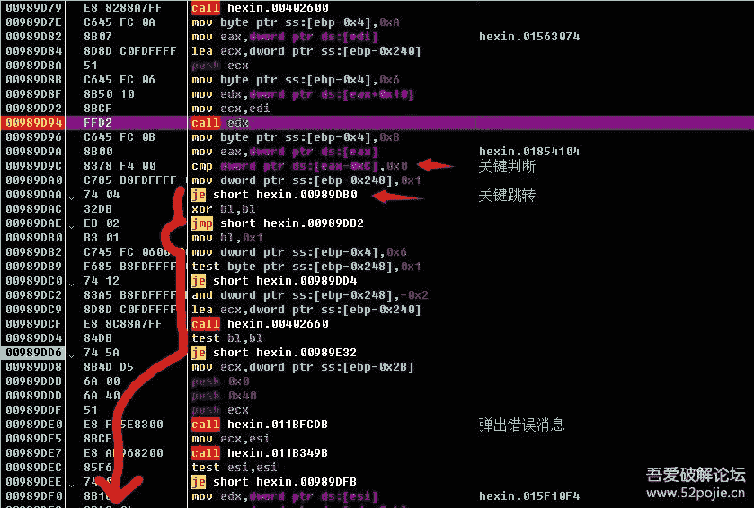

成功.jpg (139.59 KB, 下载次数: 0)

[附件下载](https://www.52pojie.cn/forum.php?mod=attachment&aid=MjUxODE3OXw2YTAyZjU1NHwxNzkzNTc1NjUwfDE2ODA4NnwxNjI5MzQx&nothumb=yes)

2022-4-29 00:20 上传

## 定位目标代码段

初步确定这就是要定位的目标代码段，重新载入程序逆向往上分析，每一个上方`Call`都断点`F7`进入分析，断点`Call`出来后重新载入程序。（重新载入是为了清除内存残留数据）

一路往上分析到`00989D57    E8 0489A7FF     call hexin.00402660`这里会处理输入的假码存放和转存。

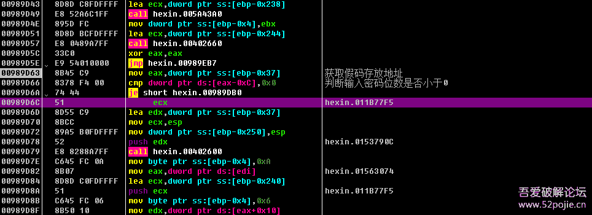

20.png (23.26 KB, 下载次数: 1)

[附件下载](https://www.52pojie.cn/forum.php?mod=attachment&aid=MjUxODE4MHwwZGViNjdiYXwxNzkzNTc1NjUwfDE2ODA4NnwxNjI5MzQx&nothumb=yes)

2022-4-29 00:29 上传

继续向上分析，`00989D10    E8 12D98200     call hexin.011B7627`这里会弹出密码输入窗口。

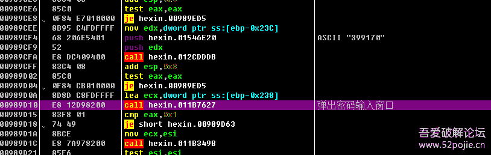

21.png (16.36 KB, 下载次数: 1)

[附件下载](https://www.52pojie.cn/forum.php?mod=attachment&aid=MjUxODE4MXxhNDNjZGVkM3wxNzkzNTc1NjUwfDE2ODA4NnwxNjI5MzQx&nothumb=yes)

2022-4-29 00:36 上传

这里`Push EAX`出现了真码的信息，上方有一个`Call`，`F7`进入。

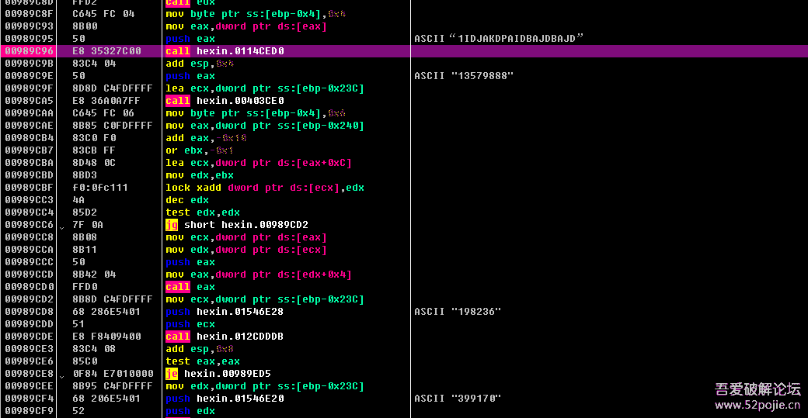

22.png (28.4 KB, 下载次数: 2)

[附件下载](https://www.52pojie.cn/forum.php?mod=attachment&aid=MjUxODE4Mnw0Nzg2NDZkMXwxNzkzNTc1NjUwfDE2ODA4NnwxNjI5MzQx&nothumb=yes)

2022-4-29 00:40 上传

## 追踪真码来源

进去一路分析到接近段尾，发现真码存放地址。

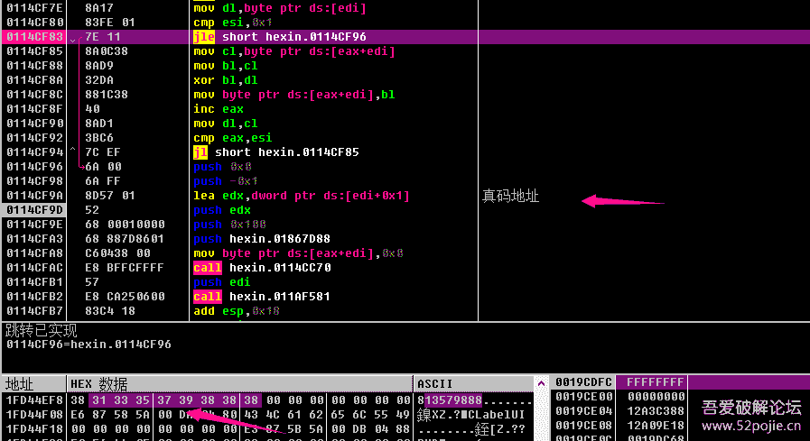

23.png (26.44 KB, 下载次数: 0)

[附件下载](https://www.52pojie.cn/forum.php?mod=attachment&aid=MjUxODE4M3wyNmMxNTEzZXwxNzkzNTc1NjUwfDE2ODA4NnwxNjI5MzQx&nothumb=yes)

2022-4-29 00:41 上传

真码地址上方发现循环运算和转存的行为。分析发现真码就是由此计算出，但来源数值很可疑，继续往上分析发现还有一处循环计算和转存，也就是说是两次解密操作。

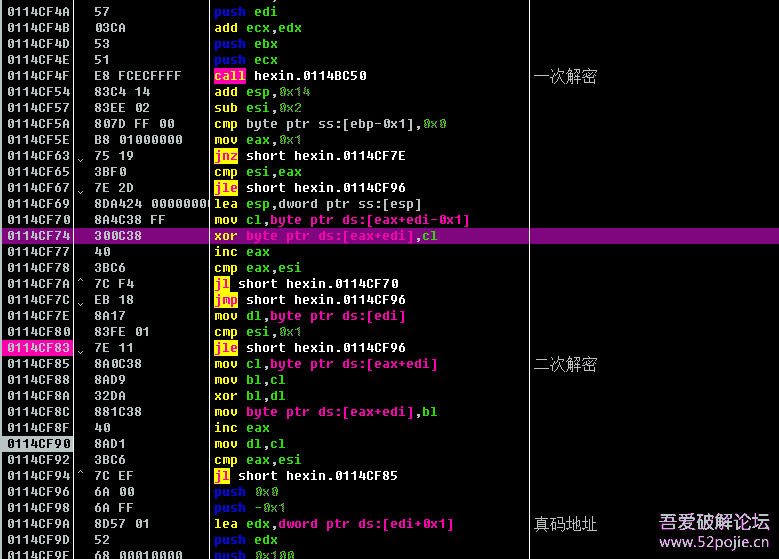

24.png (26.2 KB, 下载次数: 3)

[附件下载](https://www.52pojie.cn/forum.php?mod=attachment&aid=MjUxODE4NHw2YzgwYzhkYXwxNzkzNTc1NjUwfDE2ODA4NnwxNjI5MzQx&nothumb=yes)

2022-4-29 00:45 上传

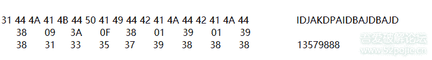

25.png (10.47 KB, 下载次数: 1)

[附件下载](https://www.52pojie.cn/forum.php?mod=attachment&aid=MjUxODE4NXw1Mjk1YmIxMnwxNzkzNTc1NjUwfDE2ODA4NnwxNjI5MzQx&nothumb=yes)

2022-4-29 00:47 上传

此处直接获得了两次解密的算法，基本确定这是一个解码的`Call`，但还要追踪一个问题，那便是`"1IDJAKDPAIDBAJDBAJD"`，继续逆向分析。

进入上一个`Call`发现`"1IDJAKDPAIDBAJDBAJD"`出现于`00AF16BA    8B41 60         mov eax,dword ptr ds:[ecx+0x60]`处。

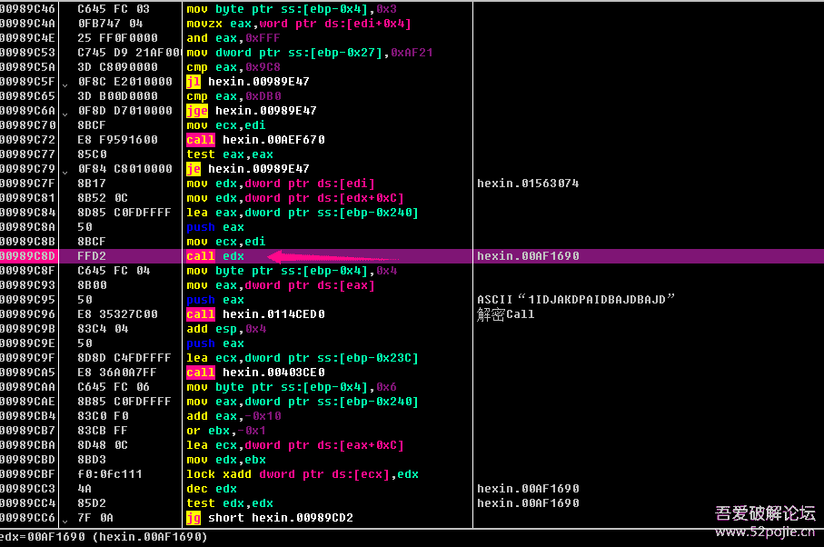

55.png (31.01 KB, 下载次数: 0)

[附件下载](https://www.52pojie.cn/forum.php?mod=attachment&aid=MjUxODE4Nnw3ZDlkNTcyNXwxNzkzNTc1NjUwfDE2ODA4NnwxNjI5MzQx&nothumb=yes)

2022-4-29 00:56 上传


26.png (7.38 KB, 下载次数: 0)

[附件下载](https://www.52pojie.cn/forum.php?mod=attachment&aid=MjUxODE4N3w3ZWZmNjcyYXwxNzkzNTc1NjUwfDE2ODA4NnwxNjI5MzQx&nothumb=yes)

2022-4-29 00:56 上传

分析发现这个地址是存放真码的地址，重点追踪`ECX`。返回调用代码一眼就看到了`MOV ECX,EDI`，追踪`ECX`变成`EDI`。

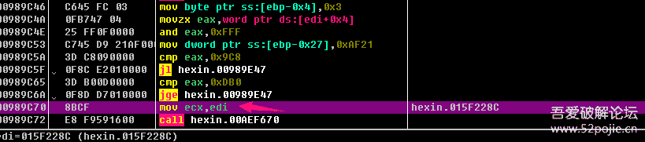

27.png (15.17 KB, 下载次数: 1)

[附件下载](https://www.52pojie.cn/forum.php?mod=attachment&aid=MjUxODE4OHw1YTQzMWY0Y3wxNzkzNTc1NjUwfDE2ODA4NnwxNjI5MzQx&nothumb=yes)

2022-4-29 00:58 上传

继续分析发现`EDI`来源于堆栈中，追踪由`EDI`变为`EBP`。

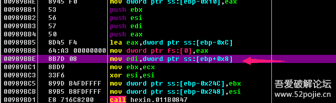

EBP.png (13.45 KB, 下载次数: 1)

[附件下载](https://www.52pojie.cn/forum.php?mod=attachment&aid=MjUxODE5MHw4NzkwZGM4NnwxNzkzNTc1NjUwfDE2ODA4NnwxNjI5MzQx&nothumb=yes)

2022-4-29 01:04 上传

`EBP`来源于`ESP`.....`00989B91    8BEC            mov ebp,esp`

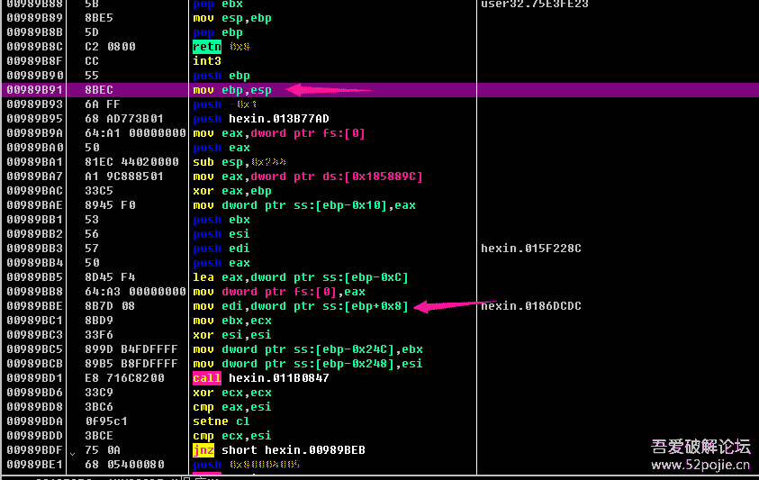

28.png (26.1 KB, 下载次数: 0)

[附件下载](https://www.52pojie.cn/forum.php?mod=attachment&aid=MjUxODE5MXwxMDRjMWEwOHwxNzkzNTc1NjUwfDE2ODA4NnwxNjI5MzQx&nothumb=yes)

2022-4-29 01:05 上传

```asm
MOV EBP,ESP
MOV EDI,DWORD PTR SS:{EBP+0x8}
MOV ECX,EDI
```

`ECX+0x60=1IDJAKDPAIDBAJDBAJD`的地址

`08`应该是一个对象，`60`则是这个对象的成员。

这个位置已经到达了段首，那么基本可以确定并不是在打开目标模块的时候才读取文件加密信息，而是程序在启动时便加载了文件夹里所有的HXF加密信息。源假码在启动时便压入了堆栈。

## HXF文件解密的一个流程

```asm
；软件启动获得加密文件源假码信息并把地址Push
0098BC9E    E8 EDDEFFFF     call hexin.00989B90                               ; 解密模块
00989C96    E8 35327C00     call hexin.0114CED0                               ; 两次解密源假码得到真码      
00989D10    E8 12D98200     call hexin.011B7627                               ; 弹出密码输入窗口
00989D66    8378 F4 00      cmp dword ptr ds:[eax-0xC],0x0                    ; 判断输入密码位数是否小于0
没截图                                                                             ；转存真假码对比结果，00 or 01
00989D9C    8378 F4 00      cmp dword ptr ds:[eax-0xC],0x0                    ; cmp 对比结果，0x00
00989DAA   /74 04           je short hexin.00989DB0                           ; 跳转
00989DE0    E8 F65E8300     call hexin.011BFCDB                               ; 密码错误窗口Call
```
