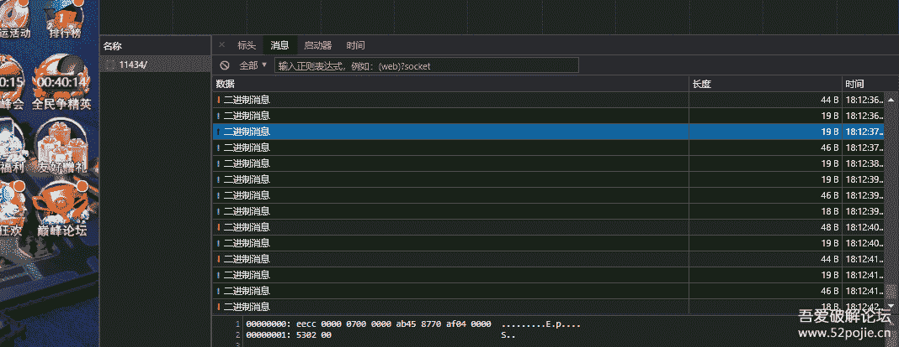
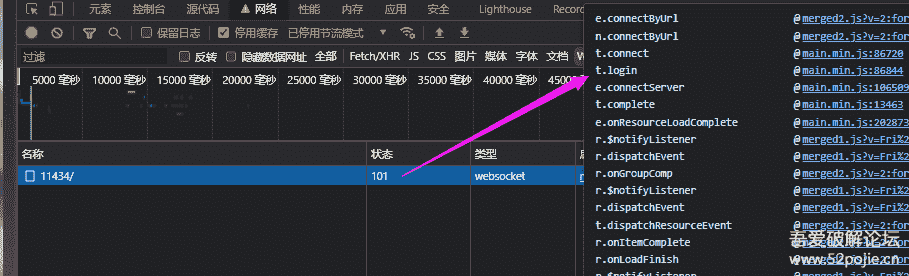
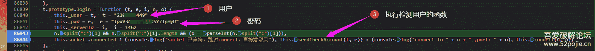
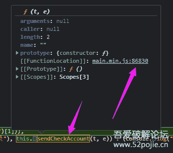
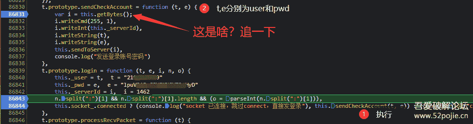
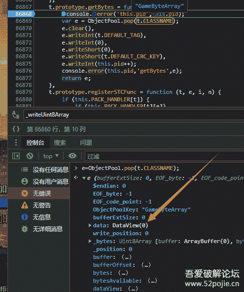

# [Web逆向] H5游戏（一）登录某某首富H5游戏之WebSockets初涉

- 原帖：<https://www.52pojie.cn/forum.php?mod=viewthread&tid=1629782>
- 抓取时间：2026-11-01T23:27:28

## H5游戏（二）给游戏做内挂

链接：<https://www.52pojie.cn/thread-1631515-1-1.html>

## 前景

H5游戏可跨平台（PC、平板、手机、电视机等都可运行）。

实际上他就是一个网页。。所以能打开网页的地方就可能能打开H5游戏（当然了，还有APP嵌套SDK+网页实现的那种）。

几年前的农场，不知道大家用过没有，那种只有一个界面就可以实现自动帮你玩游戏的软件，简直是一款神器。

所以我也想着针对这一款H5游戏，弄一款不用看游戏界面就可以自动帮你玩的小软件。

【备注：图中因为要调试很多信息，所以用到了F12中本地替换JS文件的做法，来打印各种信息等】

## 开始分析

### 从 `wss` 连接找到切入点

打开网页，登录帐号，打开F12开发者模式，进入游戏。

抓包页面能看到一个 `wss` 的连接地址和端口，消息中全部都是二进制数据。



`1.wss二进制截图.png`（150.42 KB，下载次数：257）

从启动器中，能看到第一个可能是发送登录游戏的函数在 `main.min.js` 的 86844 行。



`2.login函数.png`（64.13 KB，下载次数：258）

我们断点这个函数，刷新网页之后调试一番。

### 分析 `sendCheckAccount()`

然后我们看到了如果已经连接 `wss` 的话，会执行 `sendCheckAccount()` 函数。



`3.发现sendCheckAccount.png`（45.63 KB，下载次数：267）



`3.找到sendCheckAccount.png`（23.76 KB，下载次数：263）

那我们去打断点，找到一个 `this.getBytes()`。



`4.找到getBytes.png`（59.68 KB，下载次数：274）

#### `getBytes()`

鼠标放在 `this.getBytes()` 上，查看这个函数是什么。



`5.getBytes函数.png`（87.98 KB，下载次数：264）

`e` 实际上是一个空白 `DataView`，再：

```
        var e = ObjectPool.pop(t.CLASSNAME);
        e.clear(),
        e.writeInt(t.DEFAULT_TAG),        //常量52462
        e.writeInt(0),
        e.writeShort(0),
        e.writeShort(t.DEFAULT_CRC_KEY),        //常量30301
        e.writeInt(this.pid++);                        //每次都会+1
```

我们再查看 `sendCheckAccount()` 后续对 `i` 参数的操作。

#### 分析 `sendCheckAccount()` 后续

```
        var i = this.getBytes();        //刚才已经看过了

        i.writeCmd(255, 1),

        i.writeInt(this._serverId),

        i.writeString(t),

        i.writeString(e),

        this.sendToServer(i),

        console.log("发送登录账号密码")
```

跳转一下 `writeCmd()`：

```
    e.prototype.writeCmd = function (t, e) {
        this.writeByte(t),
        this.writeByte(e)
    },
```

再跳转看一下 `sendToServer()` 函数：

```
    t.prototype.sendToServer = function (t) {

        this.send(t),

        //省略一些//

    },
```

再看 `send()`：

```
    t.prototype.send = function (e) {
        return this._socketStatus == t.STATUS_COMMUNICATION ? (this.sendPack(e), !0) : (console.log("发送数据时没和服务连接或者未进入通信状态"), !1)
    },
```

如果是链接状态，则 `sendPack(e)`：

```
    t.prototype.sendPack = function (e) {//e实际上 在易语言中就是字节集

        if (null == e || 0 == e.length)

            throw new egret.error("创建客户端数据包时数据不能为空！");

        var i = t.HEAD_SIZE;        //常量12

        e.position = 4,                        //设置位置是4

        e.writeInt(e.length - i);//写整数e.length - i

        var n = Encrypt.getCRC16ByPos(e, i);

        e.position = 8,                        //设置位置是8

        e.writeShort(n);                //写短整数n

        var o = Encrypt.getCRC16(e, i);

        e.position = 10;                //设置位置是10

        e.writeShort(o);                //写短整数o

        Encrypt.encode(e, 8, 4);

        this.socket_.writeBytes(e)        //发送给wss服务器e数据

    },
```

又发现两个新的函数 `Encrypt.getCRC16ByPos()` 和 `Encrypt.getCRC16()`，分别跳转一下可发现（这个是 CRC16 校验吗？）。

他俩都调用了 `CRC16.update()`，但是传参有所不同。

```
    t.getCRC16ByPos = function (t, e, i) {
        return void 0 === e && (e = 0),
        void 0 === i && (i = 0),
        CRC16.update(t, e, i)
    },
    t.getCRC16 = function (t, e) {
        return void 0 === e && (e = 0),
        CRC16.update(t, 0, e)
    },
```

因为 `CRC16` 几乎都用到了，所以我们分析 `CRC16`。

```
var CRC16 = function () {

    function t() {}

    return t.update = function (e, i, n) {

        console.error('update的参数：',e,i,n);//手动添加的打印

        void 0 === i && (i = 0),

        void 0 === n && (n = 0);

        var o = 0,

        a = 0;

        0 == n && (n = e.length),

        e.position = i;

        for (var r = i; n > r; ++r)

            a = 255 & t.CRCBitReflect(e.readByte(), 8) ^ o >> 8 & 16777215, a &= 255, o = t.CRCTable[a] ^ o  n; ++n) {

            e = n  o; ++o)

                e = 32768 & e ? e = a; ++a)

            o = i - a, 1 & e && (n |= 1 > 1 & 2147483647;

                //console.error('CRCBitReflect的结果：',n);//手动添加的打印

        return n

    },

    t.POLYNOMIAL = 4129,

    t.CRCTable = t.makeCRCTable(),

    t.DropBits = [4294967295, 4294967294, 4294967292, 4294967288, 4294967280, 4294967264, 4294967232, 4294967168, 4294967040, 4294966784, 4294966272, 4294965248, 4294963200, 4294959104, 4294950912, 4294934528],

    t

}

();
```

`CRC16.update()` 一目了然，那么接下来，就可以实现用易语言模拟H5游戏的登录了吧。

### 利用易语言实现模拟登录游戏

#### 用到的模块

1. `Buffer` 模块（有模块守护、用来读写 `DataView`，某易论坛下载）
2. 精易模块

#### 先固定几个写死的函数

1. `sendToServer()`（其实是 `sendPack()`）
2. `this.getBytes()`
3. `Encrypt.getCRC16ByPos()` 和 `Encrypt.getCRC16()`（也就是 `CRC16.update()`）

| JavaScript 位运算符 | 易语言 |
| --- | --- |
| `^` |  |
