# [原创] 练习笔记之160Crackme-007

- 原帖: https://www.52pojie.cn/forum.php?mod=viewthread&tid=1629880
- 抓取时间: 2026-11-01T23:27:26

## 160CM-007

### 1.爆破

这道题和上一道类似，要求逆算法的，但不管他，先爆破一下试试，爽爽再说。

从爆破的角度来看，这道题其实难度和上一道一样，`Delphi`编程（可以`IDR`反编译）、字符串未加密（可以字符串搜索）。先拖进`IDR`中看一下，可以发现图片实际有两个按钮控件，一个是`register`，一个是`again`，分别对应一个`OnClick`的事件，双击事件函数可以直接查看到函数对应的代码。

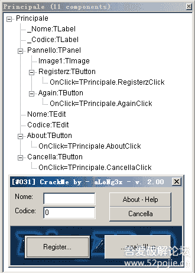

12.png (25.56 KB, 下载次数: 3)

[href="forum.php?mod=attachment&aid=MjUxODQ3Nnw4NDA3YTAwMXwxNzkzNTc1NjQzfDE2ODA4NnwxNjI5ODgw&nothumb=yes" target="_blank"](https://www.52pojie.cn/forum.php?mod=attachment&aid=MjUxODQ3Nnw4NDA3YTAwMXwxNzkzNTc1NjQzfDE2ODA4NnwxNjI5ODgw&nothumb=yes)

2022-4-30 11:37 上传

`IDR`可以直接识别一些`delphi`的函数，但是`OD`识别不了，因为跟踪调试还是需要`OD`,因此需要在`OD`中对调用的函数设置一下标签，这样方便阅读理解代码。`register`对应的函数代码如下：

```
00442F28 >/.  55            push ebp                                 ;  reg_click
00442F29  |.  8BEC          mov ebp,esp
00442F2B  |.  83C4 F8       add esp,-0x8
00442F2E  |.  53            push ebx
00442F2F  |.  56            push esi
00442F30  |.  33C9          xor ecx,ecx
00442F32  |.  894D F8       mov [local.2],ecx
00442F35  |.  8BD8          mov ebx,eax
00442F37  |.  33C0          xor eax,eax
00442F39  |.  55            push ebp
00442F3A  |.  68 22304400   push aLoNg3x_.00443022
00442F3F  |.  64:FF30       push dword ptr fs:[eax]
00442F42  |.  64:8920       mov dword ptr fs:[eax],esp
00442F45  |.  8D55 F8       lea edx,[local.2]
00442F48  |.  8B83 DC020000 mov eax,dword ptr ds:[ebx+0x2DC]
00442F4E  |.  E8 ED02FEFF   call 
00442F53  |.  8B45 F8       mov eax,[local.2]                        ;  comctl32.5D176109
00442F56  |.  8D55 FC       lea edx,[local.1]
00442F59  |.  E8 FAF9FBFF   call 
00442F5E  |.  8BF0          mov esi,eax
00442F60  |.  837D FC 00    cmp [local.1],0x0
00442F64  |.  74 37         je short aLoNg3x_.00442F9D               ;  判断是否非数字
00442F66  |.  B8 38304400   mov eax,aLoNg3x_.00443038                ;  ASCII 59,"ou MUST insert a valid Long Integer Value in the Code Editor... Thank you :)"
00442F6B  |.  E8 00F6FFFF   call 
00442F70  |.  8D55 F8       lea edx,[local.2]
00442F73  |.  8B83 DC020000 mov eax,dword ptr ds:[ebx+0x2DC]
00442F79  |.  E8 C202FEFF   call 
00442F7E  |.  8B45 F8       mov eax,[local.2]                        ;  comctl32.5D176109
00442F81  |.  E8 06FBFFFF   call                   ;  算法函数1 计算edi
00442F86  |.  A3 30584400   mov dword ptr ds:[0x445830],eax
00442F8B  |.  BA 90304400   mov edx,aLoNg3x_.00443090                ;  UNICODE "0"
00442F90  |.  8B83 DC020000 mov eax,dword ptr ds:[ebx+0x2DC]
00442F96  |.  E8 D502FEFF   call 
00442F9B  |.  EB 6F         jmp short aLoNg3x_.0044300C
00442F9D  |>  85F6          test esi,esi
00442F9F  |.  7E 5A         jle short aLoNg3x_.00442FFB
00442FA1  |.  8D55 F8       lea edx,[local.2]
00442FA4  |.  8B83 D8020000 mov eax,dword ptr ds:[ebx+0x2D8]
00442FAA  |.  E8 9102FEFF   call 
00442FAF  |.  8B4D F8       mov ecx,[local.2]                        ;  comctl32.5D176109
00442FB2  |.  8BD6          mov edx,esi
00442FB4  |.  A1 30584400   mov eax,dword ptr ds:[0x445830]
00442FB9  |.  E8 EAF9FFFF   call                   ;  算法函数2
00442FBE  |.  84C0          test al,al
00442FC0  |.  74 30         je short                ;  判断是否正确
00442FC2  |.  33D2          xor edx,edx
00442FC4  |.  8B83 CC020000 mov eax,dword ptr ds:[ebx+0x2CC]
00442FCA  |.  E8 6101FEFF   call               ；设置可见属性
00442FCF  |.  B2 01         mov dl,0x1
00442FD1  |.  8B83 E8020000 mov eax,dword ptr ds:[ebx+0x2E8]
00442FD7  |.  E8 5401FEFF   call               ；设置可见属性
00442FDC  |.  33D2          xor edx,edx
00442FDE  |.  8B83 D8020000 mov eax,dword ptr ds:[ebx+0x2D8]
00442FE4  |.  8B08          mov ecx,dword ptr ds:[eax]
00442FE6  |.  FF51 60       call dword ptr ds:[ecx+0x60]             ;  SetEnable
```

从上述代码可以看到有两处调用的`SetVisable`函数，用于设置控件的可见属性。我们可以看一下这段代码：

```
00442FC2  |.  33D2          xor edx,edx

00442FC4  |.  8B83 CC020000 mov eax,dword ptr ds:[ebx+0x2CC]

00442FCA  |.  E8 6101FEFF   call   
```

代码第一行将`edx`清零，第二行将一个内存地址送如`eax`，第三行调用子函数。从这个地方可以很清楚的看出，第一行设置的是可见属性（0，隐藏；1，显示），第二行设置是是控件对应的ID。这就是一个典型的函数调用过程，`call`之前的代码都是为了将参数传递给子函数。

因此爆破的话就是要控制程序执行流程进入到`00442FC2`地址，因此直接将`je`改成`jmp`跳转。

```
00442F64     /74 37         je short aLoNg3x_.00442F9D
改成：
00442F64     /EB 5C         jmp short aLoNg3x_.00442FC2
```

改完以后运行，会发现`register`按钮隐藏了，另一个`again`按钮显示出来了。同样的办法进入到`again` `Onclick`函数里面，可以发现程序过程和`register` `Onclick`函数基本相同，因此同样做一下修改：

```
004430F6     /74 3A         je short aLoNg3x_.00443132

改成：

004430F6     /EB 63         jmp short aLoNg3x_.0044315B
```

复制修改、保存，然后运行，依次点击`register`按钮和`again`按钮，按钮全部隐藏完毕。

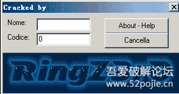

09.png (22.33 KB, 下载次数: 1)

[href="forum.php?mod=attachment&aid=MjUxODQ3M3xhOWQwNWU0ZHwxNzkzNTc1NjQzfDE2ODA4NnwxNjI5ODgw&nothumb=yes" target="_blank"](https://www.52pojie.cn/forum.php?mod=attachment&aid=MjUxODQ3M3xhOWQwNWU0ZHwxNzkzNTc1NjQzfDE2ODA4NnwxNjI5ODgw&nothumb=yes)

2022-4-30 11:37 上传

### 2.算法分析

通过前面的爆破分析，其实对于这个程序的结构已经比较了解了，在`OD`中将`IDR`识别的函数都进行标签标识后可以发现，仅剩两个函数没有识别出来（红框部分），应该对应为验证算法函数。

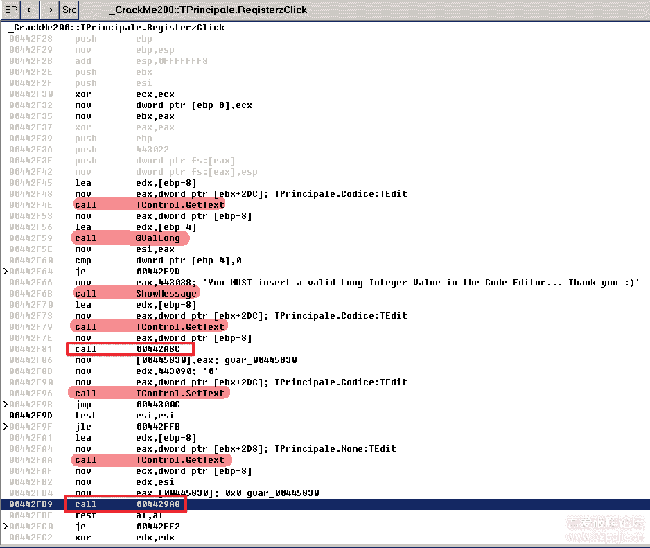

08.png (33.13 KB, 下载次数: 1)

[href="forum.php?mod=attachment&aid=MjUxODQ3MnxhMTdiMjUyZHwxNzkzNTc1NjQzfDE2ODA4NnwxNjI5ODgw&nothumb=yes" target="_blank"](https://www.52pojie.cn/forum.php?mod=attachment&aid=MjUxODQ3MnxhMTdiMjUyZHwxNzkzNTc1NjQzfDE2ODA4NnwxNjI5ODgw&nothumb=yes)

2022-4-30 11:37 上传

运行程序，输入`name`和`Code`，`F8`跟踪，可以发现程序直接跳过`00442F81`，执行到`00442FB9`代码段，因此先分析一下函数`4429A8`。函数`4429A8`的主要算法代码如下图：

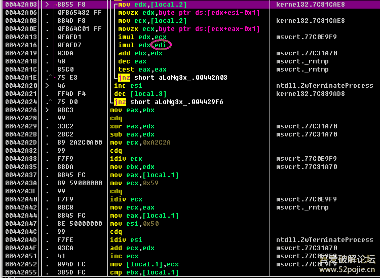

13.png (29.74 KB, 下载次数: 2)

[href="forum.php?mod=attachment&aid=MjUxODQ3N3xmMGUxMTJkOXwxNzkzNTc1NjQzfDE2ODA4NnwxNjI5ODgw&nothumb=yes" target="_blank"](https://www.52pojie.cn/forum.php?mod=attachment&aid=MjUxODQ3N3xmMGUxMTJkOXwxNzkzNTc1NjQzfDE2ODA4NnwxNjI5ODgw&nothumb=yes)

2022-4-30 11:37 上传

在`IDA`中`F5`得到对应的伪代码如下：

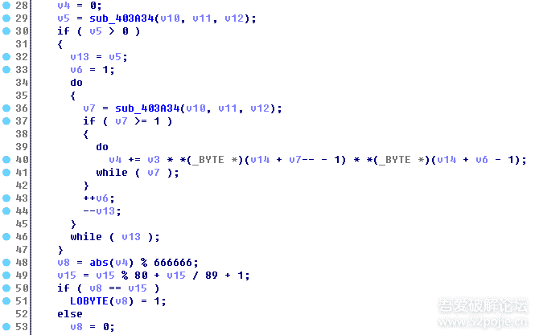

06.png (17.36 KB, 下载次数: 2)

[href="forum.php?mod=attachment&aid=MjUxODQ3MHw5MWI3NmMwM3wxNzkzNTc1NjQzfDE2ODA4NnwxNjI5ODgw&nothumb=yes" target="_blank"](https://www.52pojie.cn/forum.php?mod=attachment&aid=MjUxODQ3MHw5MWI3NmMwM3wxNzkzNTc1NjQzfDE2ODA4NnwxNjI5ODgw&nothumb=yes)

2022-4-30 11:37 上传

这个代码通常看起来有点一头雾水，因为我们不知道其中变量`v4~v15`到底代表什么内容，这时就需要`F8`单步跟踪一下程序运行过程，将变量根据实际含义修改一下名字，最终能得到如下图的代码：

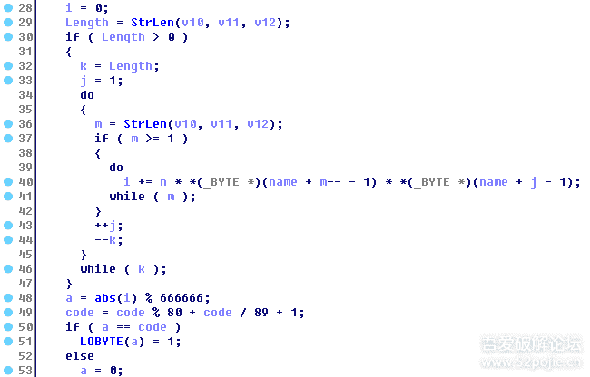

07.png (16.91 KB, 下载次数: 2)

[href="forum.php?mod=attachment&aid=MjUxODQ3MXwyMGQ5NGRjYnwxNzkzNTc1NjQzfDE2ODA4NnwxNjI5ODgw&nothumb=yes" target="_blank"](https://www.52pojie.cn/forum.php?mod=attachment&aid=MjUxODQ3MXwyMGQ5NGRjYnwxNzkzNTc1NjQzfDE2ODA4NnwxNjI5ODgw&nothumb=yes)

2022-4-30 11:37 上传

将代码复制到`vs`中，将其中不符合`C`语言语法的部分修改整理一下，就能得到下面的代码：

```
    i=0;
    if ( Length > 0 )
    {
      k = Length;
      j = 1;
      do
      {
        m =Length;
        if ( m >= 1 )
        {
          do
    {
     i=i+n*str1[m-- -1]*str1[j-1];
    }
          while ( m );
        }
        ++j;
        --k;
      }
      while ( k );
    }
    a = abs(i) % 666666;
    code = code % 80 + code/ 89 + 1;
    if ( a == code )
      result = 1;  
    else
      result = 0;
```

其中有个参数`n`，对应汇编代码中`edi`地址中的参数，在`F8`跟踪时发现这个数值一直是`0`，将`n=0`代入计算算法中，发现无论输入什么字符串，计算出来的`a`值都是零，不可能等于`code`，无法通过算法验证。

```
00442A16  |.  0FAFD7        ||imul edx,edi
```

因此，我们还需要找一下，程序哪里对这个`n`进行了赋值。我们往前查看一下代码，发现算法函数中，只有`4429B7`位置将`eax`赋值给了`edi`。

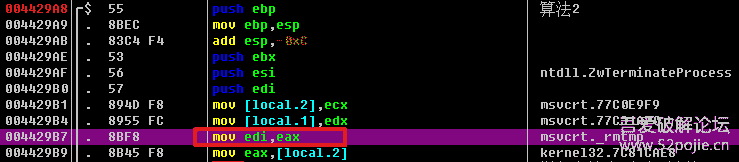

14.png (14.49 KB, 下载次数: 2)

[href="forum.php?mod=attachment&aid=MjUxODQ3OHwwNjk4YjFjY3wxNzkzNTc1NjQzfDE2ODA4NnwxNjI5ODgw&nothumb=yes" target="_blank"](https://www.52pojie.cn/forum.php?mod=attachment&aid=MjUxODQ3OHwwNjk4YjFjY3wxNzkzNTc1NjQzfDE2ODA4NnwxNjI5ODgw&nothumb=yes)

2022-4-30 11:37 上传

再往前查，发现在进入算法调用前，在`442FB4`位置对`eax`进行了赋值，将地址`445830`的数值赋给了`eax`。

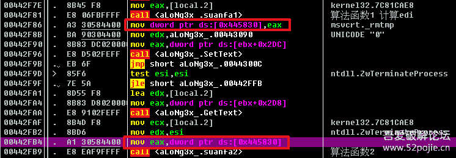

15.png (22.04 KB, 下载次数: 3)


# 注册码算法分析

## 定位地址常量

[附件下载](https://www.52pojie.cn/forum.php?mod=attachment&aid=MjUxODQ3OXw2NDA1M2YwNHwxNzkzNTc1NjQzfDE2ODA4NnwxNjI5ODgw&nothumb=yes)

2022-4-30 11:37 上传

那就先查一下什么地方对地址`445830`进行，在地址`445830`处[右键]-[查找参考]-[地址常量]，可以查找到程序中所有涉及到这个地址常量的位置。


17.png (9.91 KB, 下载次数: 1)

[附件下载](https://www.52pojie.cn/forum.php?mod=attachment&aid=MjUxODQ4MHxlZTkyNjRhZnwxNzkzNTc1NjQzfDE2ODA4NnwxNjI5ODgw&nothumb=yes)

2022-4-30 11:37 上传

如下图，一共找出不少位置，依次排查，我们可以发现`442F86`就在算法2稍微前面一点的位置，在算法1执行完成后就将`eax`赋值给`445830`。其他位置除`again Onclick`中也有一处外，都是将`445830`进行清零的操作。

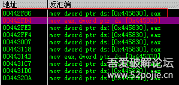

16.png (10.8 KB, 下载次数: 3)

[附件下载](https://www.52pojie.cn/forum.php?mod=attachment&aid=MjUxODQ4M3wzYjJiOWRiOXwxNzkzNTc1NjQzfDE2ODA4NnwxNjI5ODgw&nothumb=yes)

2022-4-30 11:39 上传

稍微往前查看一下程序代码就可以发现，前面有一处判断输入的`code`是否是数字，如果不是数字，就弹窗提示对话框告诉你`code`必须输入数字，然后执行算法1，跳过算法2；是数字的话，就跳过算法1，执行算法2。呃，原来是这里放了个烟雾弹迷惑人的，想要正确完成注册的话需要先在`code`其余输入非数字字符串，通过算法1的验证后，再输入数字字符串，通过算法2的验证。

## 还原算法

同样的方法，通过 IDA 获得算法的伪代码后，稍加改造，就能得到对应的 C 代码如下：

```
int Length2 = strlen(str2);
n=0;
i = 891;
m =Length2 - 1;
if ( m > 0 )
{
  j = 1;
  do
  {
    i = i + str2[j-1]*(str2[j] % 17 + 1);
    ++j;
    --m;
  }
  while ( m );
}
printf("i=%d\n",i);
n= abs(i % 29000);
printf("n=%d\n",n);
```

这样就能通过输入的注册码字符串计算得到`n`的大小。

由于算法2中对注册码的校验中的计算过程是`code = code % 80 + code/ 89 + 1`，这里面用了除余，没办法直接反向求解，只能用穷举法了算一下。

```
i=1;
do
{
  i++;
  code=i%80+i/89+1;
}
while (code!=a);
```

最终完成的注册码计算算法如下：

```
#include "stdafx.h"
#include 
#include

int _tmain(int argc, _TCHAR* argv[])
{
 char str1[30],str2[30];
 int i,j,k,m,n,a,result,code=0;
 printf("请输入用户名(长度5~10)：");
    scanf_s("%s",str1,30);
 printf("请输入注册码字符(长度6以上)：");
    scanf_s("%s",str2,30);
    int Length = strlen(str1);
 int Length2 = strlen(str2);
 n=0;
 i = 891;
    m =Length2 - 1;
    if ( m > 0 )
    {
      j = 1;
      do
      {
        i = i + str2[j-1]*(str2[j] % 17 + 1);
        ++j;
        --m;
      }
      while ( m );
    }
 printf("i=%d\n",i);
 n= abs(i % 29000);
 printf("n=%d\n",n);

 i=0;
    if ( Length > 0 )
    {
      k = Length;
      j = 1;
      do
      {
        m =Length;
        if ( m >= 1 )
        {
          do
    {
     i=i+n*str1[m-- -1]*str1[j-1];
    }
          while ( m );
        }
        ++j;
        --k;
      }
      while ( k );
    }
    a = abs(i) % 666666;
    code = code % 80 + code/ 89 + 1;
 printf("a=%d\n",a);
 printf("code=%d\n",code);
 /*
    if ( a == code )
  result = 1;  
    else
      result = 0;
   */
 i=1;
 do
 {
  i++;
  code=i%80+i/89+1;
 }
 while (code!=a);

 printf("用户名为:%s\n",str1);
 printf("注册码为:%d \n",i);
 system("pause");
 return 0;
}
```

## 验证注册流程

运行注册码程序，输入用户名和注册码字符，结果如下：

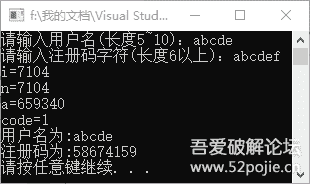

01.png (12.26 KB, 下载次数: 1)

[附件下载](https://www.52pojie.cn/forum.php?mod=attachment&aid=MjUxODQ2NXxiYjJjYTVlM3wxNzkzNTc1NjQzfDE2ODA4NnwxNjI5ODgw&nothumb=yes)

2022-4-30 11:36 上传

运行`aLoNg3x.2.exe`程序，输入用户名`abcde`，注册码`abcdef`，注册。

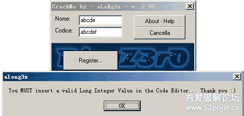

02.png (22.49 KB, 下载次数: 2)

[附件下载](https://www.52pojie.cn/forum.php?mod=attachment&aid=MjUxODQ2NnwyOTE1ZTVmZHwxNzkzNTc1NjQzfDE2ODA4NnwxNjI5ODgw&nothumb=yes)

2022-4-30 11:36 上传

然后再输入注册码`58674159`，注册，注册按钮隐藏了。

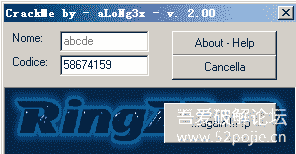

03.png (21.14 KB, 下载次数: 1)

[附件下载](https://www.52pojie.cn/forum.php?mod=attachment&aid=MjUxODQ2N3w4NTcwYWVkZXwxNzkzNTc1NjQzfDE2ODA4NnwxNjI5ODgw&nothumb=yes)

2022-4-30 11:36 上传

注册按钮隐藏了，但是又出来一个`again`按钮，同样分析`again Onclick`函数，可以发现程序流程和`register Onclick`函数一样，算法也一样，因此输入注册码`abcdef`，点击`again`按钮。

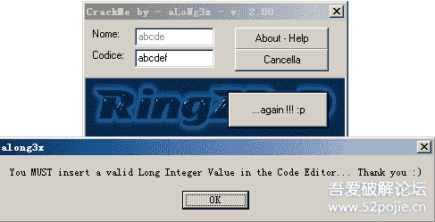

04.png (23.79 KB, 下载次数: 2)

[附件下载](https://www.52pojie.cn/forum.php?mod=attachment&aid=MjUxODQ2OHw3MzRlYjI1Y3wxNzkzNTc1NjQzfDE2ODA4NnwxNjI5ODgw&nothumb=yes)

2022-4-30 11:37 上传

再输入注册码`58674159`，点击`again`按钮，完成。

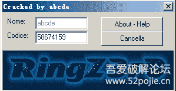

05.png (22.94 KB, 下载次数: 1)

[附件下载](https://www.52pojie.cn/forum.php?mod=attachment&aid=MjUxODQ2OXwzMDg4ZDE3Y3wxNzkzNTc1NjQzfDE2ODA4NnwxNjI5ODgw&nothumb=yes)

2022-4-30 11:37 上传

## 3. 总结

到目前为止，已经成功完成了几个算法题，想想之前都只敢四处改跳转爆破，一看算法就头大，还是很有成就感的。

如果大家想试试算法，从这几个入手，感觉还是不错的，不会直接打击到没有信心。不理解的汇编命令，百度一下，不理解的delphi函数，百度一下，一回生，二回熟，渐渐的就不怕他们了。

附：百度一下“Delphi反汇编内部字符串处理函数/过程不完全列表”，基本上反汇编后常见的delphi函数的功能都能查到。
