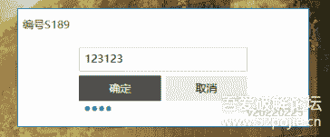
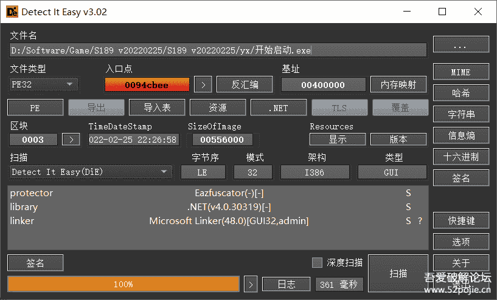
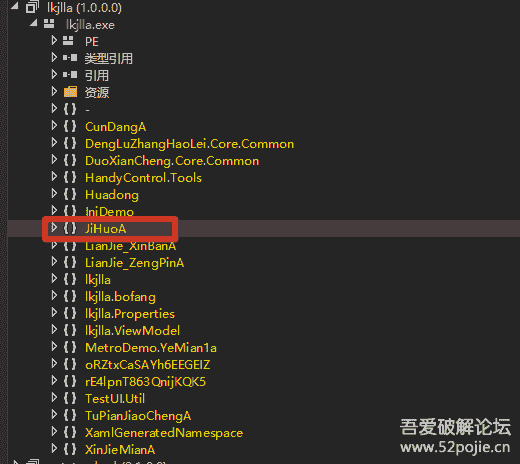
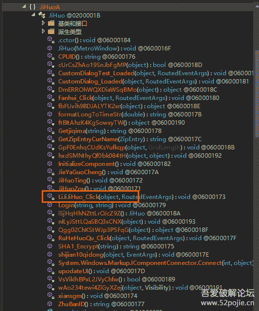
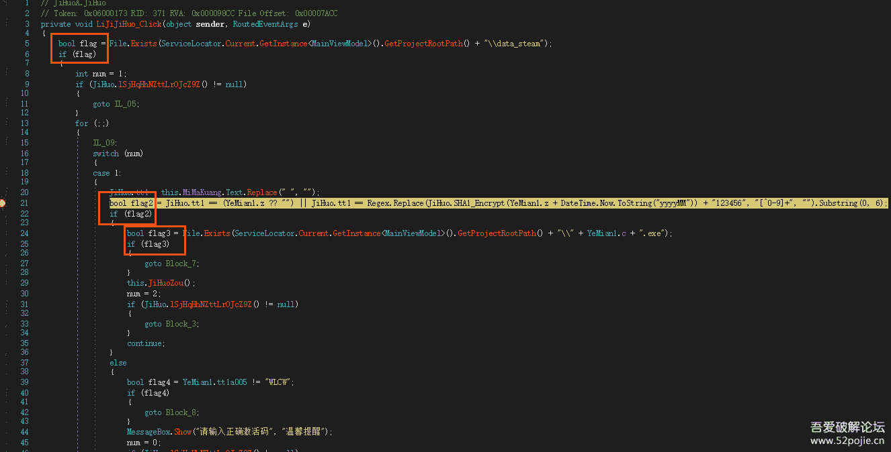
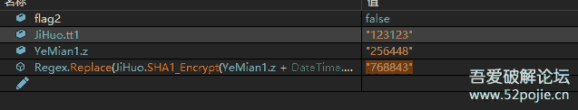
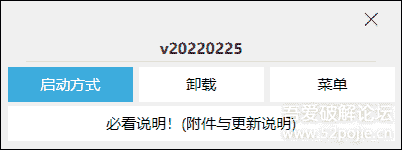

# [.NET逆向] 记一次简单的dotnet逆向

- 原帖: https://www.52pojie.cn/forum.php?mod=viewthread&tid=1631011
- 抓取时间: 2026-11-01T23:27:17

## 前言

偶然发现某宝某商家卖盗版游戏还私自给上自己的激活码验证，于是就分析分析看看是怎么个验证：

`image-20220503154956-ffriphj.png` (37.19 KB, 下载次数: 1)

[href="forum.php?mod=attachment&aid=MjUxOTI1OHxkMGFiZDQ3MHwxNzkzNTc1NjM0fDE2ODA4NnwxNjMxMDEx&nothumb=yes" target="_blank"](https://www.52pojie.cn/forum.php?mod=attachment&aid=MjUxOTI1OHxkMGFiZDQ3MHwxNzkzNTc1NjM0fDE2ODA4NnwxNjMxMDEx&nothumb=yes)

2022-5-3 16:05 上传

## .NET逆向分析验证逻辑

首先查看程序是啥语言写的：

`image-20220503155323-jkoy88s.png` (37.14 KB, 下载次数: 1)

[href="forum.php?mod=attachment&aid=MjUxOTI2MHxmZDgzNDI5ZHwxNzkzNTc1NjM0fDE2ODA4NnwxNjMxMDEx&nothumb=yes" target="_blank"](https://www.52pojie.cn/forum.php?mod=attachment&aid=MjUxOTI2MHxmZDgzNDI5ZHwxNzkzNTc1NjM0fDE2ODA4NnwxNjMxMDEx&nothumb=yes)

2022-5-3 16:06 上传

dotNET程序，好家伙，可以直接看源码，使用`dnSpy`打开，可以看到这里有个很明显的类：`JiHuoA`（激活）

`image-20220503153953-tahw0s9.png` (34.3 KB, 下载次数: 0)

[href="forum.php?mod=attachment&aid=MjUxOTI1NHxmZTdiZjQ3Y3wxNzkzNTc1NjM0fDE2ODA4NnwxNjMxMDEx&nothumb=yes" target="_blank"](https://www.52pojie.cn/forum.php?mod=attachment&aid=MjUxOTI1NHxmZTdiZjQ3Y3wxNzkzNTc1NjM0fDE2ODA4NnwxNjMxMDEx&nothumb=yes)

2022-5-3 16:05 上传

点进去之后，又有一个很明显的方法：`立即激活`哈哈哈哈

`image-20220503154058-fjoejka.png` (109.27 KB, 下载次数: 1)

[href="forum.php?mod=attachment&aid=MjUxOTI1NXw3YzM2YTVlZHwxNzkzNTc1NjM0fDE2ODA4NnwxNjMxMDEx&nothumb=yes" target="_blank"](https://www.52pojie.cn/forum.php?mod=attachment&aid=MjUxOTI1NXw3YzM2YTVlZHwxNzkzNTc1NjM0fDE2ODA4NnwxNjMxMDEx&nothumb=yes)

2022-5-3 16:05 上传

点进去，调试：

`image-20220503154317-hrq4ufh.png` (34.74 KB, 下载次数: 1)

[href="forum.php?mod=attachment&aid=MjUxOTI1NnwzYzNjZDZjN3wxNzkzNTc1NjM0fDE2ODA4NnwxNjMxMDEx&nothumb=yes" target="_blank"](https://www.52pojie.cn/forum.php?mod=attachment&aid=MjUxOTI1NnwzYzNjZDZjN3wxNzkzNTc1NjM0fDE2ODA4NnwxNjMxMDEx&nothumb=yes)

2022-5-3 16:05 上传

可以看到明显有3个`if`判断，下断点，调试，发现第一个`flag`在不管输入啥的时候都是`true`，就不管了，看`flag2`

`image-20220503154401-8z4txap.png` (15.71 KB, 下载次数: 2)

[href="forum.php?mod=attachment&aid=MjUxOTI1N3xjOTJiMDM0MHwxNzkzNTc1NjM0fDE2ODA4NnwxNjMxMDEx&nothumb=yes" target="_blank"](https://www.52pojie.cn/forum.php?mod=attachment&aid=MjUxOTI1N3xjOTJiMDM0MHwxNzkzNTc1NjM0fDE2ODA4NnwxNjMxMDEx&nothumb=yes)

2022-5-3 16:05 上传

在胡乱输入的时候，`falg2`是`false`，进入`false`分支就是返回退出了，所以这里`flag2`应该是`true`才行

`flag2`是`true`的条件很明显，就是当我们的输入（`JiHuo.tt1`）为固定值（256448或者768843）的时候则进入`true`分支

然后`flag3`是验证一个文件是否存在，不存在就去释放出来，存在就跳转去去下一个页面，这个文件是用来启动游戏用的：

`image-20220503155054-j8s0o97.png` (12.49 KB, 下载次数: 2)

[href="forum.php?mod=attachment&aid=MjUxOTI1OXxjZjJlODllZXwxNzkzNTc1NjM0fDE2ODA4NnwxNjMxMDEx&nothumb=yes" target="_blank"](https://www.52pojie.cn/forum.php?mod=attachment&aid=MjUxOTI1OXxjZjJlODllZXwxNzkzNTc1NjM0fDE2ODA4NnwxNjMxMDEx&nothumb=yes)

2022-5-3 16:06 上传

综上可以看出，这里的验证逻辑就是，输入激活码正确了，就释放启动器文件，允许启动游戏，如果输入激活码错误了，没有启动器，也就没法启动游戏，而验证激活码则是最基础最基础的`if`判断

这里的`YeMian1.z`是个固定值，看起来应该就是为了方便商家针对不同游戏进行修改用的

## 总结

像这种验证逻辑简直就是小白学破解第一课的水平哈哈哈哈哈哈，就这，还要卖激活码，牛的
