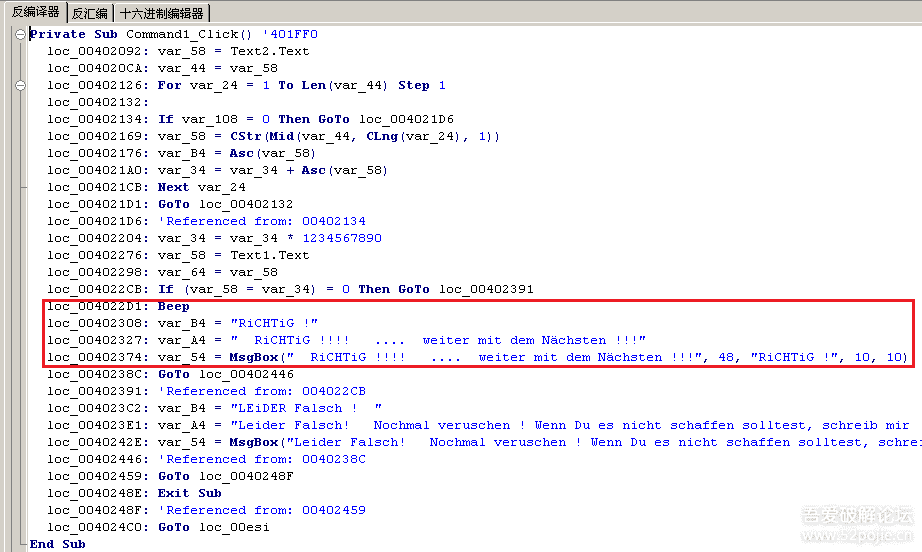
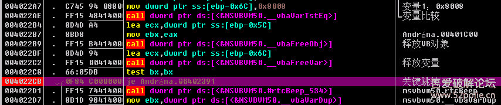
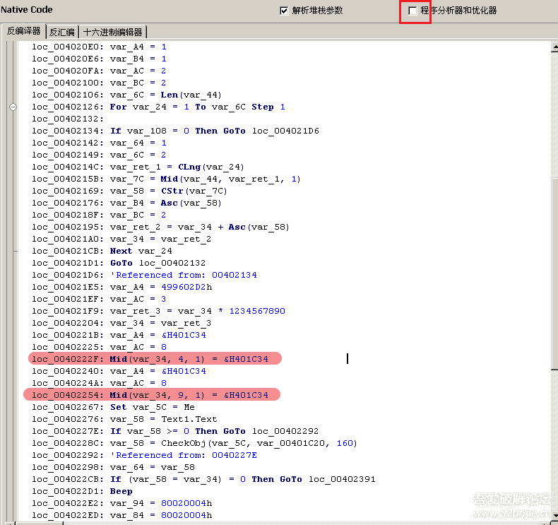
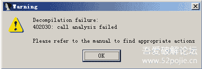
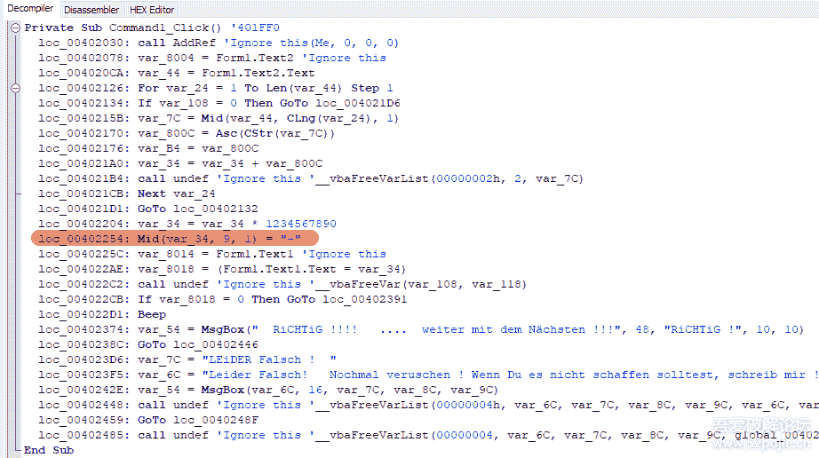
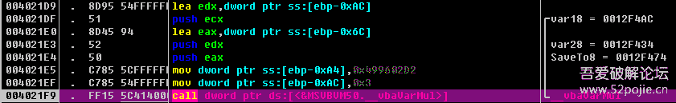

# [原创] 练习笔记之160Crackme-009

- 原帖: https://www.52pojie.cn/forum.php?mod=viewthread&tid=1631096
- 抓取时间: 2026-11-01T23:27:15

## 160CM-009
008太简单了，固定明码字符串，直接一看就知道了，因此跳到009。

### 1.爆破
先拖到PE中查一下，无壳，VB，请出`VB Decompiler`，很容易找到函数入口地址以及关键跳转地址（`4022CB`）。


04.png (29.16 KB, 下载次数: 0)
[href="forum.php?mod=attachment&aid=MjUxOTMxOXw0ZDQ5ZGI2MnwxNzkzNTc1NjMzfDE2ODA4NnwxNjMxMDk2&nothumb=yes" target="_blank"](https://www.52pojie.cn/forum.php?mod=attachment&aid=MjUxOTMxOXw0ZDQ5ZGI2MnwxNzkzNTc1NjMzfDE2ODA4NnwxNjMxMDk2&nothumb=yes)
2022-5-3 20:47 上传
`OD`中将`4022CB`行的`je`改成`jnz`即可爆破成功。


06.png (19.77 KB, 下载次数: 1)
[href="forum.php?mod=attachment&aid=MjUxOTMyMXwyOGUyNzg2YXwxNzkzNTc1NjMzfDE2ODA4NnwxNjMxMDk2&nothumb=yes" target="_blank"](https://www.52pojie.cn/forum.php?mod=attachment&aid=MjUxOTMyMXwyOGUyNzg2YXwxNzkzNTc1NjMzfDE2ODA4NnwxNjMxMDk2&nothumb=yes)
2022-5-3 20:47 上传

### 2.算法
根据`VB Decompiler`反编译出来的VB代码，其中有的VB函数不是很确定的话，百度一下也就搞定了，可以很方便的得出算法的C代码。

```
 char str1[30];
 int i,m,code;
 double f;
 printf("请输入用户名：");
    scanf_s("%s",str1,30);
 m=0;
 for (i=0;i
```

输入用户名abc，发现输出结果为-2109260500。呃。。。好像溢出了，把这个结果输入到程序中，发现失败。取出中间值m（294），用计算器算一下结果是362962959660，输入进去还是失败。
在`OD`中`F8`跟踪了一下程序，发现算法中的中间值`m`计算是没有问题的，后面好像也是乘1234567890的计算，但是这个函数调用过程好像很奇怪，根据函数的参数变量地址，根本找不到对应的运算结果。
在`VB Decompiler`中，去掉“程序分析器和优化器”选项，重新反编译一下，得到的反编译代码如下图所示。


07.png (32.33 KB, 下载次数: 1)
[href="forum.php?mod=attachment&aid=MjUxOTMyMnwwYTAxMTJhY3wxNzkzNTc1NjMzfDE2ODA4NnwxNjMxMDk2&nothumb=yes" target="_blank"](https://www.52pojie.cn/forum.php?mod=attachment&aid=MjUxOTMyMnwwYTAxMTJhY3wxNzkzNTc1NjMzfDE2ODA4NnwxNjMxMDk2&nothumb=yes)
2022-5-3 20:47 上传
其中可以发现和前面的反汇编结果比较，代码可读性更差了，多出来很多看起来没有用处的变量赋值，而且还有两行代码`40222F`和`402254`是前面的反汇编代码里面没有的，好像是前一种反汇编方式有问题，漏掉了部分有用的代码。
本来想用`IDA`来分析一下算法，结果`IDA`中没法直接识别到`401FF0`这个函数，手动创建函数后，按`F5`，结果显示“Call analysid failed”，百度了半天，也没找到解决办法，只能放弃。


08.png (13.23 KB, 下载次数: 0)
[href="forum.php?mod=attachment&aid=MjUxOTMyM3w4YTJiMTBjOXwxNzkzNTc1NjMzfDE2ODA4NnwxNjMxMDk2&nothumb=yes" target="_blank"](https://www.52pojie.cn/forum.php?mod=attachment&aid=MjUxOTMyM3w4YTJiMTBjOXwxNzkzNTc1NjMzfDE2ODA4NnwxNjMxMDk2&nothumb=yes)
2022-5-3 20:47 上传
重新下载了一个最新的`VB Decompiler Pro v11.5`，同样反汇编一下，发现和第一次反汇编的结果相比，多出来`402254`这一行。按这个代码去算一个注册码，发现还是不对。看来还是要到`OD`里面看看汇编代码，看看到底是怎么回事。


05.png (69.44 KB, 下载次数: 2)
[href="forum.php?mod=attachment&aid=MjUxOTMyMHxjY2VmODgyYnwxNzkzNTc1NjMzfDE2ODA4NnwxNjMxMDk2&nothumb=yes" target="_blank"](https://www.52pojie.cn/forum.php?mod=attachment&aid=MjUxOTMyMHxjY2VmODgyYnwxNzkzNTc1NjMzfDE2ODA4NnwxNjMxMDk2&nothumb=yes)
2022-5-3 20:47 上传
进入`OD`里面`F8`跟踪运行了一遍，发现有点懵圈（懵了整整一上午……）。以前调试跟踪的时候，汇编的函数调用之前，要么通过寄存器、要么通过指针传值，而这个程序里面，虽然套路也差不多，函数调用前`push`一堆地址进去，调用完成后有一堆数据更新了，但是查查对应地址的数据，前前后后没有一个对得上。
比如`vbaVarMul`函数，百度得到的信息是：
`__vbaVarMul` ;变体变量相乘

```
lea eax,var1
push eax ;被乘数
lea ecx,var2
push ecx ;乘数
lea edx,var3
push edx ;结果
call __vbaVarMul ;变量相乘，在eax中返回
```
在`OD`中，对应的代码也类似，而且`OD`中的右侧的注释中已经自动将`var1`、`var2`和`SaveTo`识别出来了，该函数应该是将`var1`和`var2`相乘，结果放入`SaveTo`位置。但是`F8`跟踪的时候发现，函数调用前，`var1`为指针地址`12F4AC`，指向的变量数值为`0x2`，`var2`为指针地址`12F434`，指向的变量数值为`0x3`，`SaveTo`为指针地址`12F474`，指向的变量数值为`0`。函数调用后，`var1`的数值为仍`0x2`，`var2`的数值为仍`0x3`，`SaveTo`的数值变成了`0x5`。
呃……，这哪哪都不对啊。。。


01.png (12.84 KB, 下载次数: 1)
[href="forum.php?mod=attachment&aid=MjUxOTMxNnw1ZWQwNTJiZnwxNzkzNTc1NjMzfDE2ODA4NnwxNjMxMDk2&nothumb=yes" target="_blank"](https://www.52pojie.cn/forum.php?mod=attachment&aid=MjUxOTMxNnw1ZWQwNTJiZnwxNzkzNTc1NjMzfDE2ODA4NnwxNjMxMDk2&nothumb=yes)
2022-5-3 20:47 上传
在整整懵逼了一上午后，终于找到了一篇介绍VB变量体数据类型的文章，文章地址为[//blog.csdn.net/vbsourcecode/article/details/18662089"](https://blog.csdn.net/vbsourcecode/article/details/18662089:rel="nofollow noopener" href="https)。
根据介绍，一个VB简单Variant（变量体数据）的表示至少需要12个字节。通常前2个字节是表示类型信息的。从第5个字节到第8个字节并不总是使用到，实际上很少被使用。我们不妨先叫它辅助类型信息。从第9个字节开始就是真正的变量的值了。这里有可能存储一个指针值，也可能是数据，具体是什么取决于变量类型。另一个值得注意的事实是VB的内存是以4个字节对齐的。即使你使用一个字节，那至少也要4个字节来表示。而且编译器只初始化它需要的那些字节，剩余的字节可能是随机数据。

==Variant变量的内部表示==
符号常量 |
函数值 |
数值类型 |
V_Empty
