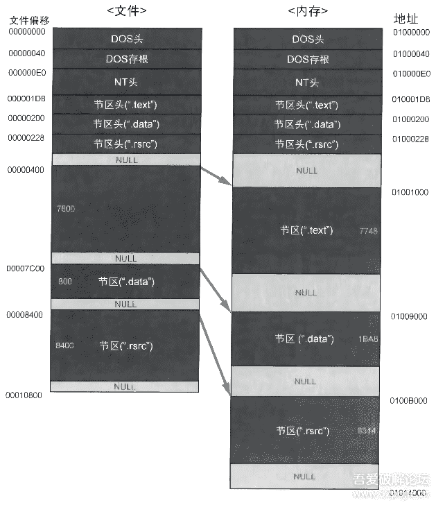

# [分享] 快速查询PE文件知识点和PE文件解析（上）

- 原帖：`https://www.52pojie.cn/forum.php?mod=viewthread&tid=1631165`
- 抓取时间：`2026-11-01T23:27:13`

## PE（Portable Executable）

PE文件的全称是Portable Executable，意为可移植的可执行文件，常见的有EXE，DLL，SYS，COM，OCX，PE文件是微软Windows操作系统上的程序文件。

`pe文件内存映射.png`（361.13 KB，下载次数：1）

[下载附件](https://www.52pojie.cn/forum.php?mod=attachment&aid=MjUxOTM2OXwyZTU4ODMxMXwxNzkzNTc1NjMwfDE2ODA4NnwxNjMxMTY1&nothumb=yes)

2022-5-4 00:57 上传

## PE节节名
