# [Web逆向] 某医学网站的加密 `M3U8` 分析

- 原帖：https://www.52pojie.cn/forum.php?mod=viewthread&tid=1635800
- 抓取时间：2026-11-01T23:26:30

## 抓取媒体文件

正常打开网页，`F12`，开始寻找媒体文件。

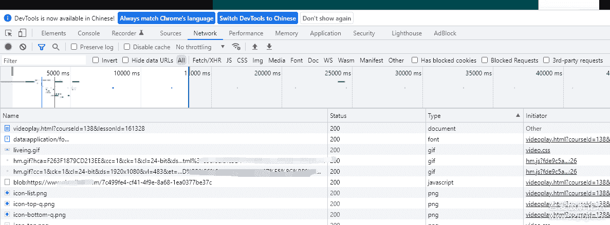

QQ截图20220513223807.png（65.9 KB，下载次数：3）

[附件下载](https://www.52pojie.cn/forum.php?mod=attachment&aid=MjUyMTgwOXw3NWNhOGMxNHwxNzkzNTc1NTg4fDE2ODA4NnwxNjM1ODAw&nothumb=yes)

2022-5-13 23:57 上传

### 审查元素

没有找到常规媒体文件（`mp4`，`avi`），逐步往下看，发现是 `m3u8` 流媒体。

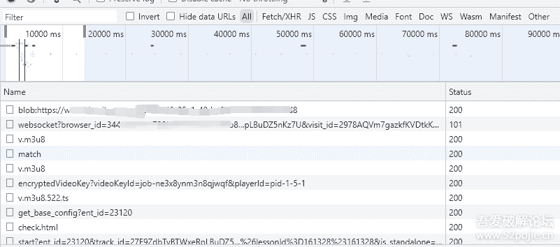

QQ截图20220513224019.png（37.64 KB，下载次数：5）

[附件下载](https://www.52pojie.cn/forum.php?mod=attachment&aid=MjUyMTgxMHwwMTQ4MjEyOXwxNzkzNTc1NTg4fDE2ODA4NnwxNjM1ODAw&nothumb=yes)

2022-5-13 23:57 上传

### 尝试下载

拿取连接开始用下载器下载，失败，为 `m3u8` 加密，需要 `key` 解密才可以正常解析。

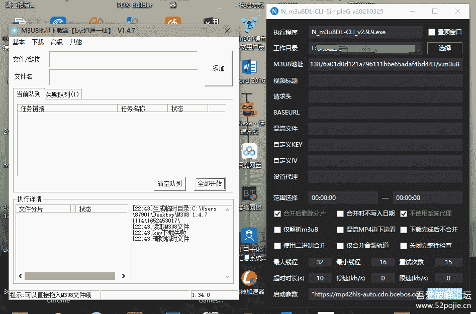

QQ截图20220513224417.png（151.17 KB，下载次数：1）

[附件下载](https://www.52pojie.cn/forum.php?mod=attachment&aid=MjUyMTgxMXw5MWU3MTM4MnwxNzkzNTc1NTg4fDE2ODA4NnwxNjM1ODAw&nothumb=yes)

2022-5-13 23:57 上传

视频嗅探器也无法直接下载，只能录屏。果断放弃录屏。

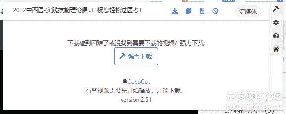

QQ截图20220513223458.png（25.98 KB，下载次数：2）

[附件下载](https://www.52pojie.cn/forum.php?mod=attachment&aid=MjUyMTgxMnxkMTNjNTA3OXwxNzkzNTc1NTg4fDE2ODA4NnwxNjM1ODAw&nothumb=yes)

2022-5-13 23:58 上传

## 正文开始

分析 `m3u8` 文件，得知，为某度类，其文件包括了 `IV`、`key` 地址，及 `key` 二次加密方式：`AES-128`。

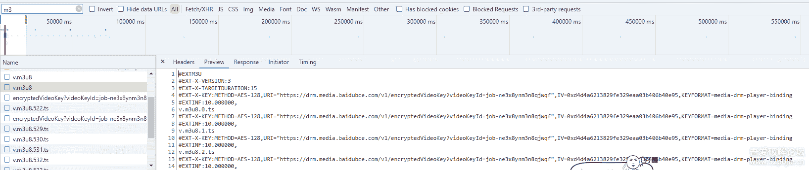

QQ截图20220513224816.png（77.65 KB，下载次数：4）

[附件下载](https://www.52pojie.cn/forum.php?mod=attachment&aid=MjUyMTgxM3wxMzQ5OWViYnwxNzkzNTc1NTg4fDE2ODA4NnwxNjM1ODAw&nothumb=yes)

2022-5-13 23:58 上传

访问 `key` 连接，看来不能直接访问。

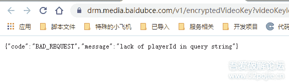

QQ截图20220513225119.png（17.27 KB，下载次数：2）

[附件下载](https://www.52pojie.cn/forum.php?mod=attachment&aid=MjUyMTgxNHxjMDM3MmYxNXwxNzkzNTc1NTg4fDE2ODA4NnwxNjM1ODAw&nothumb=yes)

2022-5-13 23:59 上传

无效，换一种方式，咱们找找 `key`。

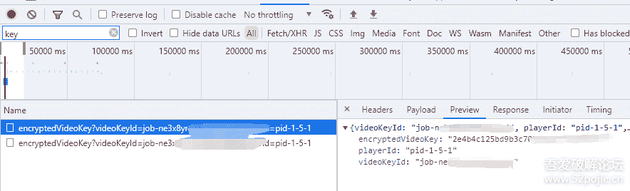

QQ截图20220513225315.png（34.39 KB，下载次数：3）

[附件下载](https://www.52pojie.cn/forum.php?mod=attachment&aid=MjUyMTgxNnw5ZTQ0Y2M4OHwxNzkzNTc1NTg4fDE2ODA4NnwxNjM1ODAw&nothumb=yes)

2022-5-13 23:59 上传

得到 `key`。

Shell 代码：
```text
2e4b4c125bd9b3c7034b8a6f700e6688
```

于是在下载器中填写 `key` 和 `iv` 值，但是事情有我们想象的这么简单吗？

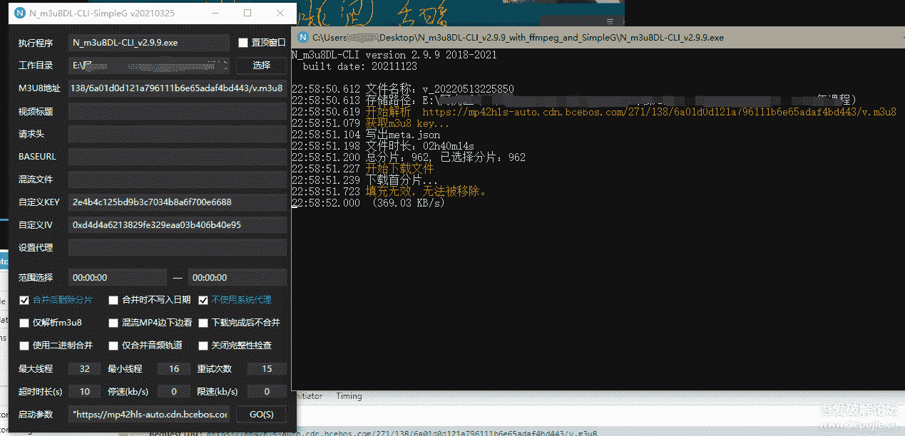

QQ截图20220513225910.png（102.9 KB，下载次数：2）

[附件下载](https://www.52pojie.cn/forum.php?mod=attachment&aid=MjUyMTgxOXxkZjczODE2ZXwxNzkzNTc1NTg4fDE2ODA4NnwxNjM1ODAw&nothumb=yes)

2022-5-14 00:01 上传

`key` 无效。

看来没法下载，开始分析。

- 首先我们知道 `m3u8` 的 `key` 应该是一段 `base64` 或 `hex`。
- 其次如果这么容易就下载了，我的钱不是白花了吗。
- 再次，咱们还知道了是 `aes-128` 加密，加密解密还没弄呢，怎么就一个 `key` 就出来了。
- 最关键的是，如果此 `key` 是 `aes128` 加密的，那么它应该还有一个解密的秘钥，我们需要找到这个秘钥，才能解密此 `key`。

## 从播放器 `js` 入手

那就从播放器下手吧，找到播放器的 `js`。

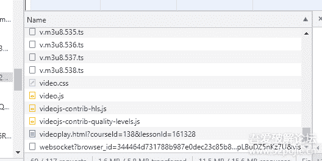

QQ截图20220513230758.png（24.25 KB，下载次数：4）

[附件下载](https://www.52pojie.cn/forum.php?mod=attachment&aid=MjUyMTgyM3w3MWMwMTEyYnwxNzkzNTc1NTg4fDE2ODA4NnwxNjM1ODAw&nothumb=yes)

2022-5-14 00:04 上传

善用搜索找一找 `key` 这个关键词。

天啊，这么多怎么早，看到眼睛都疼了。但是动动脑筋，有注释，虽然是英文的。

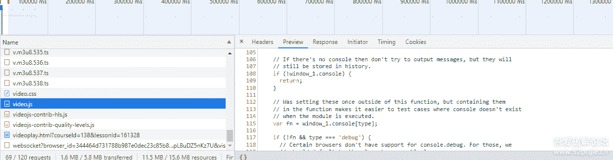

QQ截图20220513231028.png（53.02 KB，下载次数：1）

[附件下载](https://www.52pojie.cn/forum.php?mod=attachment&aid=MjUyMTgyN3w1MWE4NjQ2ZXwxNzkzNTc1NTg4fDE2ODA4NnwxNjM1ODAw&nothumb=yes)

2022-5-14 00:05 上传

但是咱们有翻译啊。`change`; `transform`; `convert`; `switch`，咱们找找。

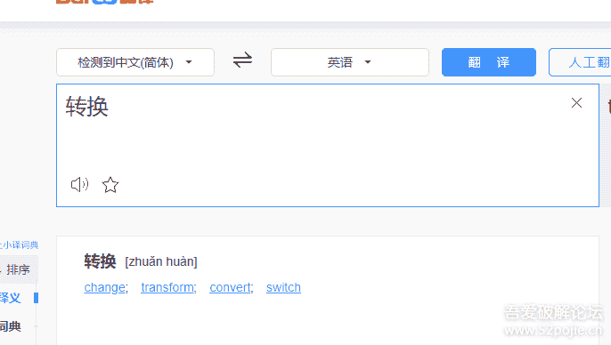

QQ截图20220513231506.png（23.48 KB，下载次数：1）

[附件下载](https://www.52pojie.cn/forum.php?mod=attachment&aid=MjUyMTgyOHwzZjVlMzVlM3wxNzkzNTc1NTg4fDE2ODA4NnwxNjM1ODAw&nothumb=yes)

2022-5-14 00:06 上传

## 定位 `convert`

最后固定在关键词 `convert`。

你很可以的大兄弟。

Lua 代码（纯文本）：
```text
Handle responses for key data and convert the key data to the correct format（用我大学英语不及格我都能看到） convert the key data to the correct format（转变key成正确的格式）
```

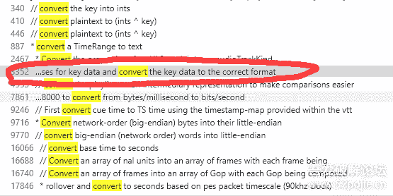

QQ截图20220513231651.png（47.17 KB，下载次数：3）

[附件下载](https://www.52pojie.cn/forum.php?mod=attachment&aid=MjUyMTgyOXwwYWI0N2RmNnwxNzkzNTc1NTg4fDE2ODA4NnwxNjM1ODAw&nothumb=yes)

2022-5-14 00:06 上传

往下找几行，很可疑的一串码出来了。

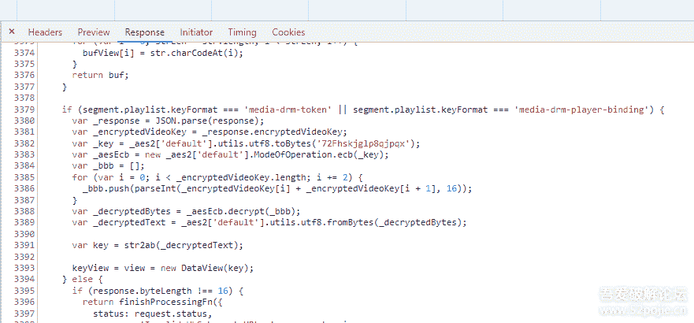

QQ截图20220513231910.png（55.53 KB，下载次数：3）

[附件下载](https://www.52pojie.cn/forum.php?mod=attachment&aid=MjUyMTgzMHwwNDY1MTA0N3wxNzkzNTc1NTg4fDE2ODA4NnwxNjM1ODAw&nothumb=yes)

2022-5-14 00:07 上传

## 获取解密密钥

解密的秘钥。

Asm 代码：
```text
72Fhskjglp8qjpqx
```

试一试吧。

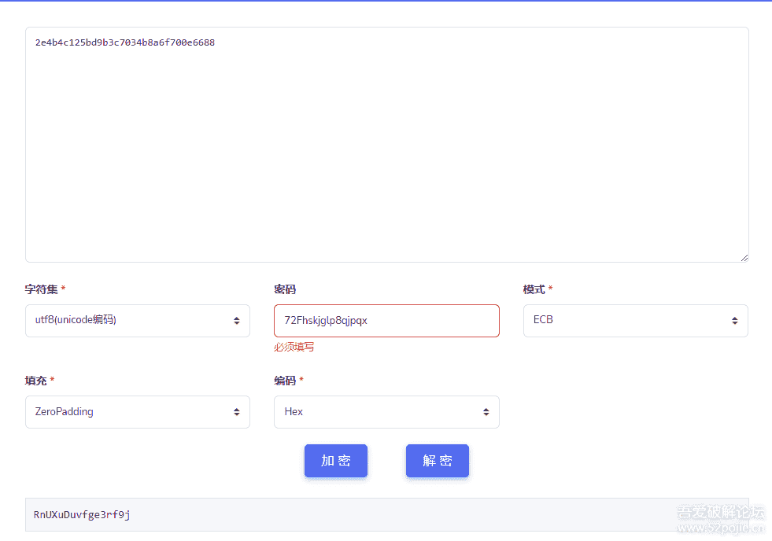

QQ截图20220513232106.png（30.35 KB，下载次数：3）

[附件下载](https://www.52pojie.cn/forum.php?mod=attachment&aid=MjUyMTgzMXwxN2I3ODBmNXwxNzkzNTc1NTg4fDE2ODA4NnwxNjM1ODAw&nothumb=yes)

2022-5-14 00:07 上传

## 验证并成功下载

有戏，由于我用的下载器用的是 `base64` 格式，做一个转化，得到 `key`。

Asm 代码：
```text
Um5VWHVEdXZmZ2UzcmY5ag==
```

最后下载器填写好 `m3u8` 地址、`iv` 值、处理好的 `key`，成功下载。

笔者就不上图了。因为已经下载好了。
