# [Web逆向] 永久保存已购学习视频(更新修复图片)

- 原帖: https://www.52pojie.cn/forum.php?mod=viewthread&tid=1637348
- 抓取时间: 2026-11-01T23:26:22

2022年5月31日更新，补充下内容：
-----------------------------------------
1.首先声明一点，技术来源于大佬，我贴出来源了，只是写的更细一点，让更多的人看懂一点，解密过程有了，我也没详细去分析，发此贴没有引流的目的。
2.小白如果看不懂，或者觉得太啰嗦了，如果懂一点`Python`，就用这个兄弟的帖子，[//www.52pojie.cn/thread-1640483-1-1.html" target="_blank"](https://www.52pojie.cn/thread-1640483-1-1.html:href="https)
-----------------------------------------
最近在网校买课学习，提升自己，不过对方规则是你买的课程过期就不给你学习了。
技术非常好，有效期内可以下载可以看，过期了，对不起，下载的也不给看了。
基于这个来研究下视频加密技术。
首先非常感谢这篇文章
[//www.52pojie.cn/thread-1585958-1-1.html" target="_blank"](https://www.52pojie.cn/thread-1585958-1-1.html:href="https)
这篇文章都是对的，但是逻辑上有些地方会让人误解，属于大神一看就懂，小白一看就懵懂。
最后这个小白很执着，提问，终于让人看懂了
[//www.52pojie.cn/thread-1616380-1-1.html" target="_blank"](https://www.52pojie.cn/thread-1616380-1-1.html:href="https)
基于以上文章我来重新整理下。写本片文章的目的是为了让小白看懂并操作，特自花了半天时间整理，重新编辑发出。
文章还备份在 [//www.cfw.vip/233.html" target="_blank"](https://www.cfw.vip/233.html:rel="nofollow noopener" href="https)
1.打开学习教程视频，开发人员工具搜索`m3u8`，发现2个文件，第1个是清晰度，第二个是实际下载地址
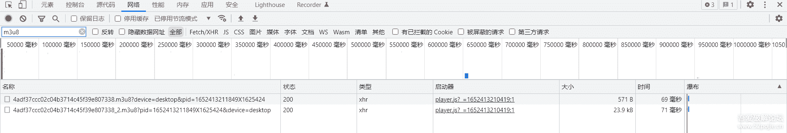
`233-m3u8.png` (56.93 KB, 下载次数: 3)
[href="forum.php?mod=attachment&aid=MjYxMTg4NHxlY2ZiMDM4ZXwxNzkzNTc1NTc5fDE2ODA4NnwxNjM3MzQ4&nothumb=yes" target="_blank"](https://www.52pojie.cn/forum.php?mod=attachment&aid=MjYxMTg4NHxlY2ZiMDM4ZXwxNzkzNTc1NTc5fDE2ODA4NnwxNjM3MzQ4&nothumb=yes)
2023-5-3 17:16 上传
2.该网校的网课有一部分是直接可以下载的，有一部分是加密的。
下载我们要使用一个工具，这里我推荐一格最好用的,[//github.com/HeiSir2014/M3U8-Downloader" target="_blank"](https://github.com/HeiSir2014/M3U8-Downloader:rel="nofollow noopener" href="https),是开放源码编译的，所以工具安全性是很可靠，不放心的自己编译，想省事的，直接下载，这款神器叫`M3U8-Downloader`
3.因为我要保存超清版的，所以把格式切换为超清模式
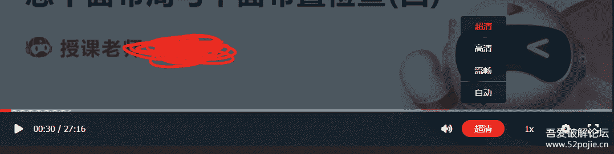
`233-m3u8-2.png` (99.89 KB, 下载次数: 1)
[href="forum.php?mod=attachment&aid=MjYxMTg4NXw4MTVmYjYwMHwxNzkzNTc1NTc5fDE2ODA4NnwxNjM3MzQ4&nothumb=yes" target="_blank"](https://www.52pojie.cn/forum.php?mod=attachment&aid=MjYxMTg4NXw4MTVmYjYwMHwxNzkzNTc1NTc5fDE2ODA4NnwxNjM3MzQ4&nothumb=yes)
2023-5-3 17:16 上传
4.从课程导学开始，将第二个`m3u8`地址复制（如下图），打开`M3U8-Downloader`点击“新建下载”，将复制地址填入视频源，其它项为空，详见下图，下载自动完成，该校未加密地址一般可以下14个左右，详见下图。
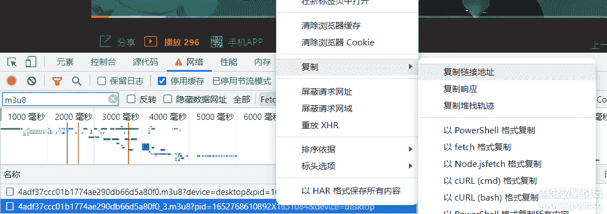
`233-m3u8-3.png` (104.88 KB, 下载次数: 4)
[href="forum.php?mod=attachment&aid=MjYxMTg4OHxkMTc1ZGU0MXwxNzkzNTc1NTc5fDE2ODA4NnwxNjM3MzQ4&nothumb=yes" target="_blank"](https://www.52pojie.cn/forum.php?mod=attachment&aid=MjYxMTg4OHxkMTc1ZGU0MXwxNzkzNTc1NTc5fDE2ODA4NnwxNjM3MzQ4&nothumb=yes)
2023-5-3 17:16 上传
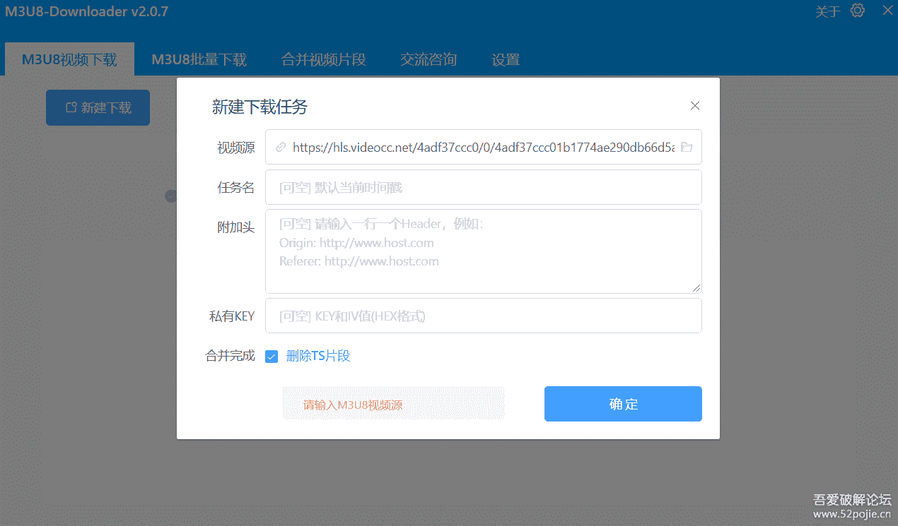
`233-m3u8-4.png` (62.34 KB, 下载次数: 3)
[href="forum.php?mod=attachment&aid=MjYxMTg4OXxhNWVlY2ZlMHwxNzkzNTc1NTc5fDE2ODA4NnwxNjM3MzQ4&nothumb=yes" target="_blank"](https://www.52pojie.cn/forum.php?mod=attachment&aid=MjYxMTg4OXxhNWVlY2ZlMHwxNzkzNTc1NTc5fDE2ODA4NnwxNjM3MzQ4&nothumb=yes)
2023-5-3 17:16 上传
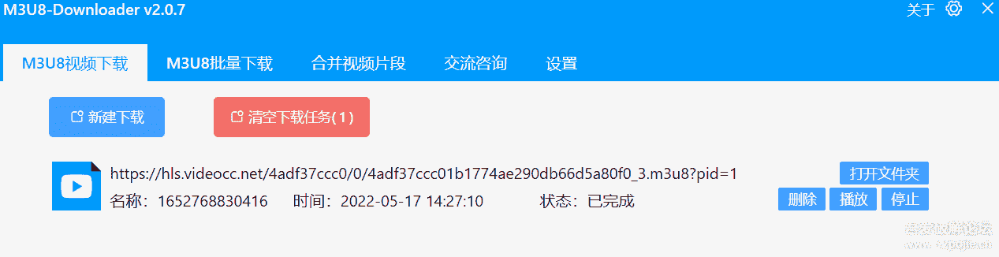
`233-m3u8-5.png` (47.68 KB, 下载次数: 3)
[href="forum.php?mod=attachment&aid=MjYxMTg5MHxjYWFiNzQ0NHwxNzkzNTc1NTc5fDE2ODA4NnwxNjM3MzQ4&nothumb=yes" target="_blank"](https://www.52pojie.cn/forum.php?mod=attachment&aid=MjYxMTg5MHxjYWFiNzQ0NHwxNzkzNTc1NTc5fDE2ODA4NnwxNjM3MzQ4&nothumb=yes)
2023-5-3 17:16 上传
5.如此重复下载大概第15个就无法下载了，会报错。报错信息详见下图。状态显示“初始化”，长时间等待会变成“多次尝试，下载片段失败”。为什么无法下载呢？`m3u8`提供有`key`了，我们需要进一步分析失败原因。
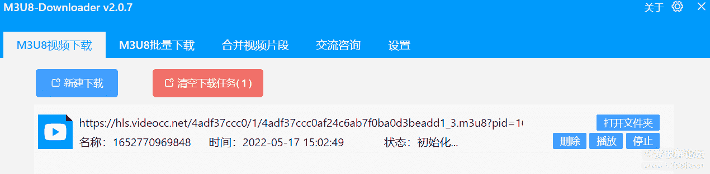
`233-m3u8-6.png` (48.28 KB, 下载次数: 3)
[href="forum.php?mod=attachment&aid=MjYxMTg5MXw3YThhODIxM3wxNzkzNTc1NTc5fDE2ODA4NnwxNjM3MzQ4&nothumb=yes" target="_blank"](https://www.52pojie.cn/forum.php?mod=attachment&aid=MjYxMTg5MXw3YThhODIxM3wxNzkzNTc1NTc5fDE2ODA4NnwxNjM3MzQ4&nothumb=yes)
2023-5-3 17:16 上传
6.分析失败原因就需要下载`key`，查看这个`key`的返回值。如下图，我们发现`key`值像一个乱码数据，正常的`key`值是16位的16进制编码，比如这样“`FF18DDC0BEB30F5C4BD9F3F1733DDE75`”，这又这样的`key`，软件才能识别并计算，把文件下载下来。那么出现非正常的`key`，就可以断定是对`key`进行了加密，不许解密还原才可以下载。
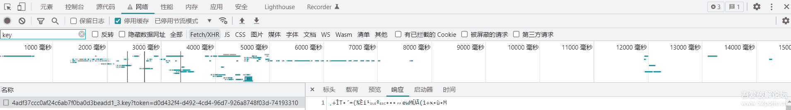
`233-m3u8-7.png` (60.83 KB, 下载次数: 3)
[href="forum.php?mod=attachment&aid=MjYxMTg5Mnw4YmNlMzRlYXwxNzkzNTc1NTc5fDE2ODA4NnwxNjM3MzQ4&nothumb=yes" target="_blank"](https://www.52pojie.cn/forum.php?mod=attachment&aid=MjYxMTg5Mnw4YmNlMzRlYXwxNzkzNTc1NTc5fDE2ODA4NnwxNjM3MzQ4&nothumb=yes)
2023-5-3 17:16 上传
7.因为本人也是小白，所以不介绍分析过程，只介绍如何去做，如何分析请看上文引用的大拿地址。
我们来找一个`json`文件，如下图所示，在响应里`body`内容是一串看不懂的字符串，还特别长，这个`json`里的字符串有非常有用的信息，我们下一步就是把这个字符串翻译过来，翻译成我们能够看懂的字符串。
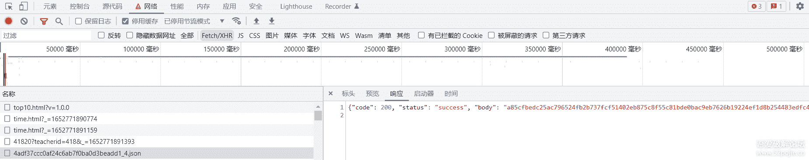
`233-m3u8-8.png` (61.47 KB, 下载次数: 2)
[href="forum.php?mod=attachment&aid=MjYxMTg5M3xkMzhiZmJhNXwxNzkzNTc1NTc5fDE2ODA4NnwxNjM3MzQ4&nothumb=yes" target="_blank"](https://www.52pojie.cn/forum.php?mod=attachment&aid=MjYxMTg5M3xkMzhiZmJhNXwxNzkzNTc1NTc5fDE2ODA4NnwxNjM3MzQ4&nothumb=yes)
2023-5-3 17:16 上传
8.算法大拿已经给我们了，遗憾的是他就点到为止，下面我来把他讲明白，这个`json`的文件名是“`4adf37ccc0af24c6ab7f0ba0d3beadd1_4`”,这个就是大拿说的`vid`，有些人取值“`4adf37ccc0af24c6ab7f0ba0d3beadd1`”是错误的，一定是“`4adf37ccc0af24c6ab7f0ba0d3beadd1_4`”。要完整的解密我们要用到密码工具箱了，工具叫“`ToolsFx`”，是“`leon406`”无偿开发的，在这里致敬下。为了少去东奔西跑，我把地址找出来了，发布的贴子是 [//www.52pojie.cn/thread-1501153-1-1.html" target="_blank"](https://www.52pojie.cn/thread-1501153-1-1.html:href="https) ，源码的地址是： [//github.com/Leon406/ToolsFx" target="_blank"](https://github.com/Leon406/ToolsFx:rel="nofollow noopener" href="https)，如果你有墙访问不了github，那就去论坛下载。为了防止工具丢失你可以github上fork一份或者下载下来存档。国外github太慢，作者也分享了其它下载地址，
下载加速 [//leon.lanzoui.com/b0d9av2kb" target="_blank"](https://leon.lanzoui.com/b0d9av2kb:rel="nofollow noopener" href="https) 提取码：52pj
插件下载 [//leon.lanzoub.com/b0d9w4cof" target="_blank"](https://leon.lanzoub.com/b0d9w4cof:rel="nofollow noopener" href="https) 提取码：ax63
截至今天是V1.13版本，如下图所示，不下载也没关系，百度在线工具也可以，建议下载，按照本文图片省事。
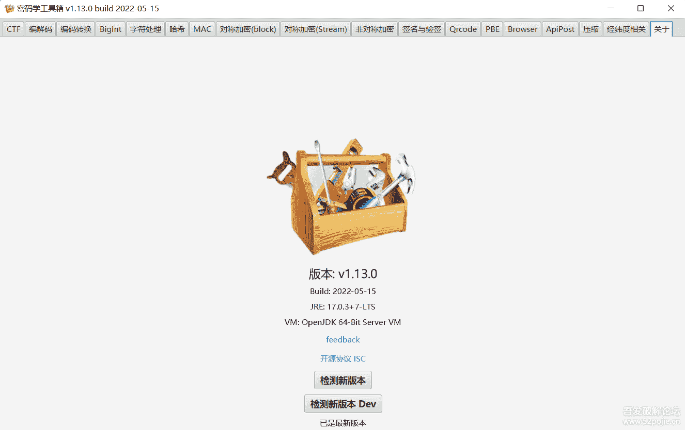
`233-m3u8-toolsfx.png` (144.82 KB, 下载次数: 4)
[href="forum.php?mod=attachment&aid=MjYxMTg5OHwwZDk5Y2I5M3wxNzkzNTc1NTc5fDE2ODA4NnwxNjM3MzQ4&nothumb=yes" target="_blank"](https://www.52pojie.cn/forum.php?mod=attachment&aid=MjYxMTg5OHwwZDk5Y2I5M3wxNzkzNTc1NTc5fDE2ODA4NnwxNjM3MzQ4&nothumb=yes)
2023-5-3 17:16 上传
8.工具确定下载完成了，我们要把“`4adf37ccc0af24c6ab7f0ba0d3beadd1_4`”进行`md5`加密，注意是不含引号的啊。点击运行一下，得到“`142572a1e3661b91ad17ae24ce47f959`”，这是32位的取前16位“`142572a1e3661b91`”为对称加密的`key`和后16位“`ad17ae24ce47f959`”为对称加密的`iv`，注意和`m3u8`没有一点关系哈。
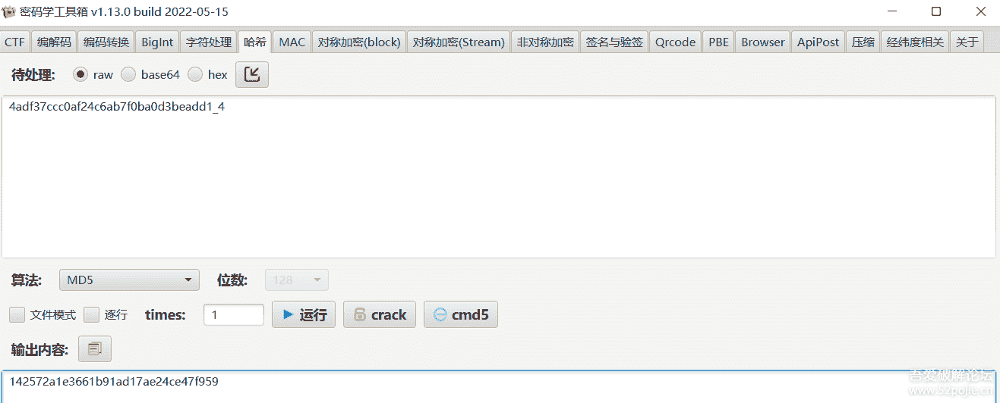
`233-m3u8-toolsfx2.png` (53.42 KB, 下载次数: 1)
[href="forum.php?mod=attachment&aid=MjYxMTg5OXxkMjdhZDFhNnwxNzkzNTc1NTc5fDE2ODA4NnwxNjM3MzQ4&nothumb=yes" target="_blank"](https://www.52pojie.cn/forum.php?mod=attachment&aid=MjYxMTg5OXxkMjdhZDFhNnwxNzkzNTc1NTc5fDE2ODA4NnwxNjM3MzQ4&nothumb=yes)
2023-5-3 17:16 上传
9.前16位“`142572a1e3661b91`”为对称加密的`key`和后16位“`ad17ae24ce47f959`”为对称加密的`iv`，复制如下图，选择对称加密“`142572a1e3661b91`”粘贴到`key`，把“`ad17ae24ce47f959`”粘贴到`iv`，注意不要有空白，把`json`里的返回值`body`内容，就是第7步里的看不懂字符串粘贴进工具箱，注意要删除掉前后的引号。待处理后面要选择下，默认`raw`改为`hex`
如果没有错误的话，默认为“加密”
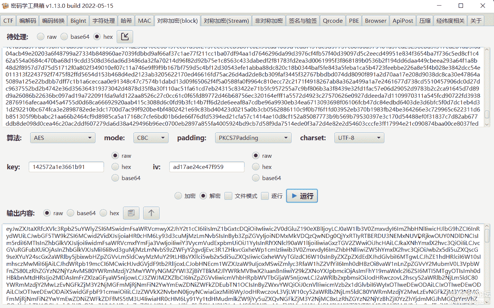
`233-m3u8-toolsfx3.png` (215.58 KB, 下载次数: 2)
[href="forum.php?mod=attachment&aid=MjYxMTkwMHw1M2E1NWE0N3wxNzkzNTc1NTc5fDE2ODA4NnwxNjM3MzQ4&nothumb=yes" target="_blank"](https://www.52pojie.cn/forum.php?mod=attachment&aid=MjYxMTkwMHw1M2E1NWE0N3wxNzkzNTc1NTc5fDE2ODA4NnwxNjM3MzQ4&nothumb=yes)
2023-5-3 17:17 上传
要选择“解密”，运行一下，输出内容一大推看不懂的字符串，如果没有输出内容，请检查，哪个地方肯定有错误。请看上面的图片选择。
10.把输出内容复制出来，这里要进入“编解码”，而不是“编码转换”，输出内容有网址了，这段内容保存下。
[img=1322,940]
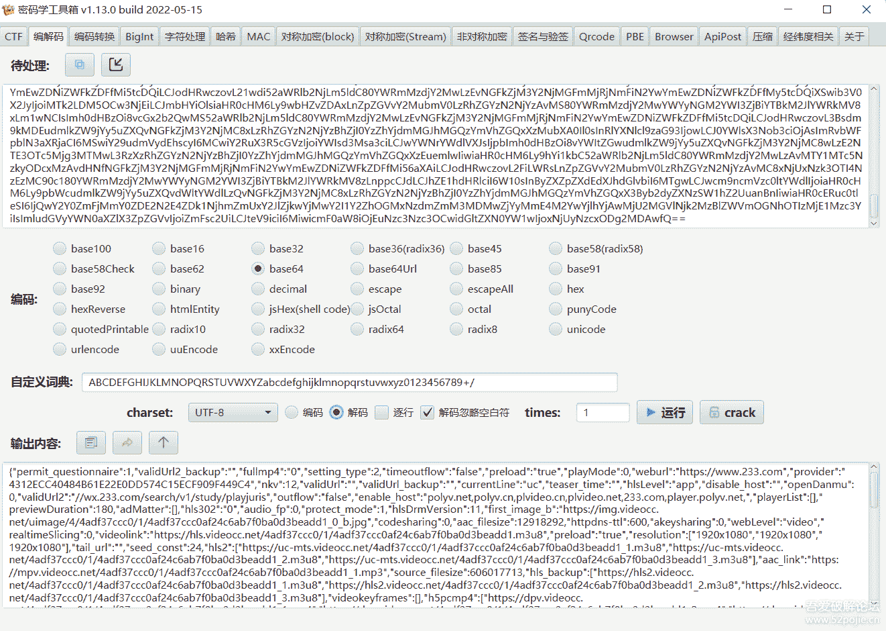
`233-m3u8-toolsfx4-1.png` (217.59 KB, 下载次数: 2)
[href="forum.php?mod=attachment&aid=MjYxMTkwMnw4MDNiNTQ5M3wxNzkzNTc1NTc5fDE2ODA4NnwxNjM3MzQ4&nothumb=yes" target="_blank"](https://www.52pojie.cn/forum.php?mod=attachment&aid=MjYxMTkwMnw4MDNiNTQ5M3wxNzkzNTc1NTc5fDE2ODA4NnwxNjM3MzQ4&nothumb=yes)
2023-5-3 17:17 上传
11.把刚才保存内容里搜索`seed_const`，得到数字24，下图所示我是用工具格式化代码，实际上把代码粘贴到记事本，搜索下也可以。


## 11. 获取数字 24

到此，`json` 解密完成，我们只为了取得一个数字，那就是 24。卧槽，忙了半天就是要一个数字。感叹下继续。

## 12. 下面解密 `key` 了

把 `seed_const` 的值 24 进行 `md5` 下得到 `1ff1de774005f8da13f42943881c655f`，取前 16 位 `1ff1de774005f8da` 为 `key`，`AQIDBQcLDRETFx0HBQMCAQ==` 为 `IV`。小白这个地方是比较模糊的，怎么得出的 `IV`？我告诉你大拿给的，你拿着用就好了。

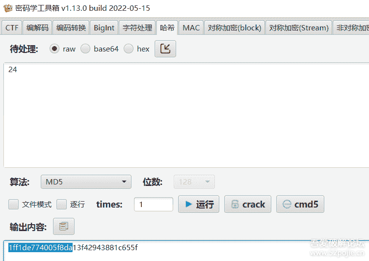

`233-m3u8-toolsfx5.png`（43.98 KB，下载次数：1）  
[附件下载](https://www.52pojie.cn/forum.php?mod=attachment&aid=MjYxMTkwM3wwNWZiMGM4ZHwxNzkzNTc1NTc5fDE2ODA4NnwxNjM3MzQ4&nothumb=yes)

2023-5-3 17:17 上传

## 13. 打开 Pycharm

没有就去安装下。

新建一个 Python 文件，把代码粘贴进去，代码如下：

```python
import os
from Crypto.Cipher import AES
import base64

filename = '1.key.txt'

# 把文件内容以byte字节形式读写到缓冲区中。
def read_into_buffer(filename):
    buf = bytearray(os.path.getsize(filename))
    with open(filename, 'rb') as f:
        f.readinto(buf)
        f.close()
    return buf

print(list(read_into_buffer(filename)))

password = '1ff1de774005f8da'.encode()  # 秘钥，b就是表示为bytes类型,此处为必须修改项其它勿动
iv = base64.b64decode('AQIDBQcLDRETFx0HBQMCAQ==')  # iv偏移量，bytes类型
text = read_into_buffer(filename)  # 需要加密的内容，bytes类型

# AES.MODE_CBC 表示模式是CBC模式
aes = AES.new(password, AES.MODE_CBC, iv)  # CBC模式下解密需要重新创建一个aes对象
den_text = aes.decrypt(text)
print("明文：", list(den_text))

keys = list(den_text)
hex16 = []
for i in keys[:16]:
    hex16.append(i)

def print_bytes_hex(data):
    lin = ['%02X' % i for i in data]
    print(" ".join(lin))

print_bytes_hex(hex16)
```

你要修改代码中的 `password` 后面的密钥就是第 11 步的数字 24 进行 `md5` 加密的前 16 位。

## 14. 下载加密 `key`

把加密 `key` 下载下来 `4adf37ccc0af24c6ab7f0ba0d3beadd1_3.key`，重命名为 `1.key.txt`，复制到 Python 文件同一个目录下，运行一下。

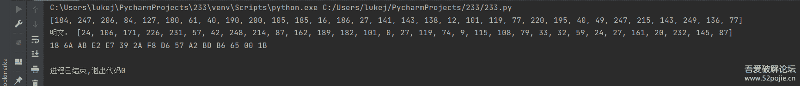

`233-m3u8-pycharm.png`（34.9 KB，下载次数：2）  
[附件下载](https://www.52pojie.cn/forum.php?mod=attachment&aid=MjYxMTg5N3xmNWRkNDVlM3wxNzkzNTc1NTc5fDE2ODA4NnwxNjM3MzQ4&nothumb=yes)

2023-5-3 17:16 上传

复制最后 1 行，这个就是 `key`，`CF 77 67 B4 C3 59 68 7E F7 8B D7 82 41 47 E8 A4`，去掉空格得到 `CF7767B4C359687EF78BD7824147E8A4`，这个就是真 `key` 了。

## 15. 下载测试

打开第 4 步给大家分享的 M3U8-Downloader，按顺序填入 `m3u8` 地址和 `key` 地址，不填 `IV`，如下图：

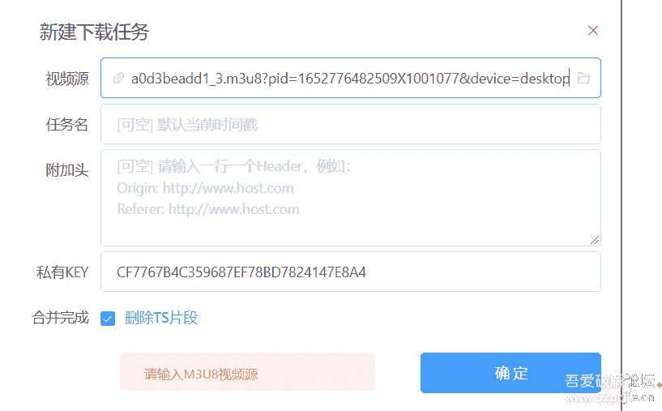

`233-m3u8-9-1.png`（44.34 KB，下载次数：4）  
[附件下载](https://www.52pojie.cn/forum.php?mod=attachment&aid=MjYxMTg5NXwxYjNiODI3ZXwxNzkzNTc1NTc5fDE2ODA4NnwxNjM3MzQ4&nothumb=yes)

2023-5-3 17:16 上传

## 16. 开心的下载好了

本教程应该结束了。

## 17. 其实还有问题

你发现下载全部完成了，在合并的时候出错了，这是怎么回事？

你的 `key` 解密密码不对。
