# [Web逆向] Ast入门使用

- 原帖: https://www.52pojie.cn/forum.php?mod=viewthread&tid=1638602
- 抓取时间: 2026-11-01T23:25:03

## 前置条件

1. 一台可以用的电脑
2. 双手和大脑
3. JavaScript语法基础

## 环境

1. `node`
2. `Pycharm`编译器

## 正文

### 1. 改变对象属性的访问方式

编写一个简单的加法。

#### 方法一

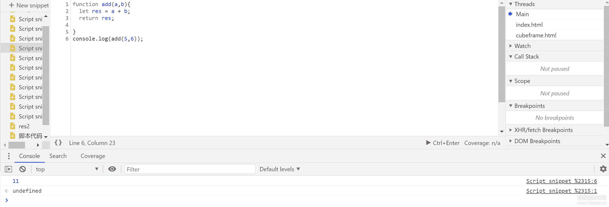

`图片.png` (127.17 KB, 下载次数: 1)，2022-5-20 10:17 上传，[下载附件](https://www.52pojie.cn/forum.php?mod=attachment&aid=MjUyMzIyMHw3MDRlYTcyZnwxNzkzNTc1NTAxfDE2ODA4NnwxNjM4NjAy&nothumb=yes)

#### 方法二

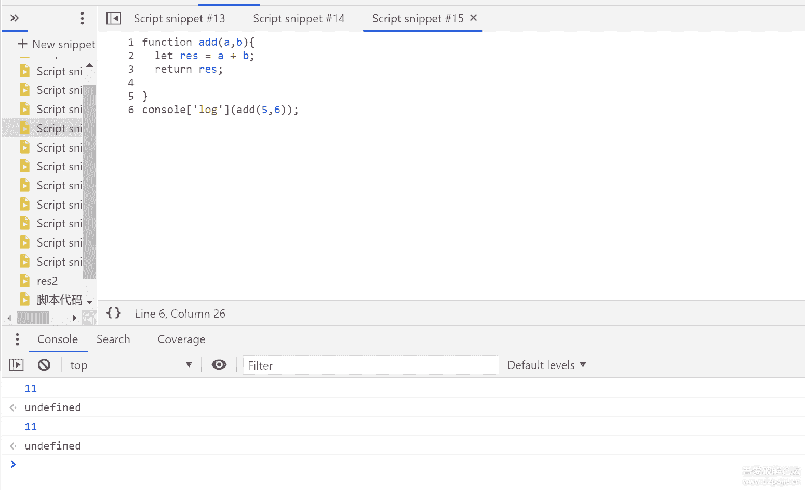

`图片.png` (90.66 KB, 下载次数: 1)，2022-5-20 10:17 上传，[下载附件](https://www.52pojie.cn/forum.php?mod=attachment&aid=MjUyMzIyMXw5YmJmYjI2MXwxNzkzNTc1NTAxfDE2ODA4NnwxNjM4NjAy&nothumb=yes)

可以看到两种方法都是可以的。

```js
function add(a,b){
  let res = a + b;
  return res;
}
console['log'](add(5,6));
```

来到[`https://astexplorer.net/`](https://astexplorer.net/)。可以看到点出来的`log`的两个属性分别是`Identifier`和`false`。

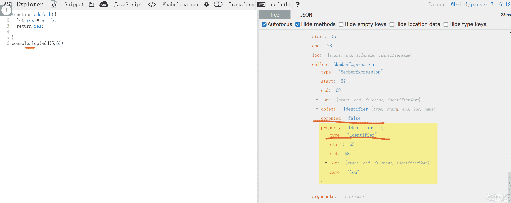

`图片.png` (146.76 KB, 下载次数: 2)，2022-5-20 10:21 上传，[下载附件](https://www.52pojie.cn/forum.php?mod=attachment&aid=MjUyMzIyM3xkYWQwZWE2MnwxNzkzNTc1NTAxfDE2ODA4NnwxNjM4NjAy&nothumb=yes)

再来看`[]`形式的，注意看黄色部分。

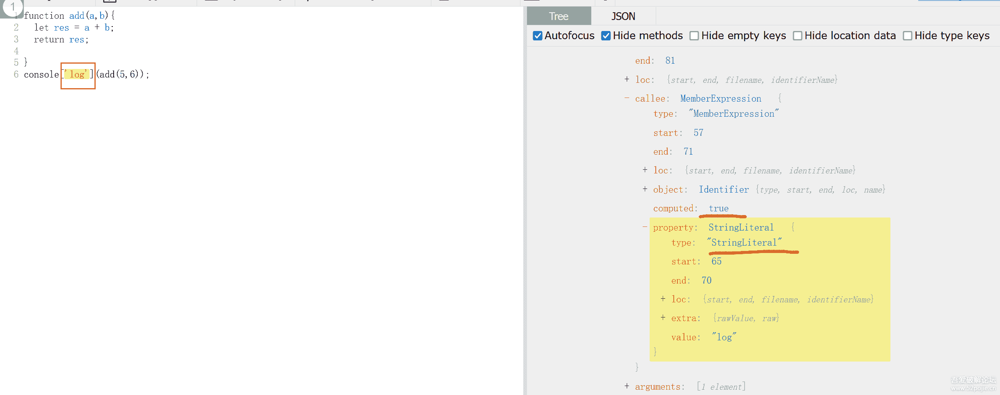

`图片.png` (120.96 KB, 下载次数: 1)，2022-5-20 10:23 上传，[下载附件](https://www.52pojie.cn/forum.php?mod=attachment&aid=MjUyMzIyN3xkNmEwZjk4YXwxNzkzNTc1NTAxfDE2ODA4NnwxNjM4NjAy&nothumb=yes)

来编写`AST`转换代码，以获取当前时间为例。

```js
Date.prototype.format = function (formatStr) {
    var str = formatStr;
    var Week = ['日', '一', '二', '三', '四', '五', '六'];
    str = str.replace(/yyyy|YYYY/, this.getFullYear());
    str = str.replace(/MM/, (this.getMonth() + 1) > 9 ? (this.getMonth() + 1).toString() : '0' + (this.getMonth() + 1));
    str = str.replace(/dd|DD/, this.getDate() > 9 ? this.getDate().toString() : '0' + this.getDate());
    return str;
}
console.log(new Date().format('yyyy-MM-dd'));
```

`astcode`

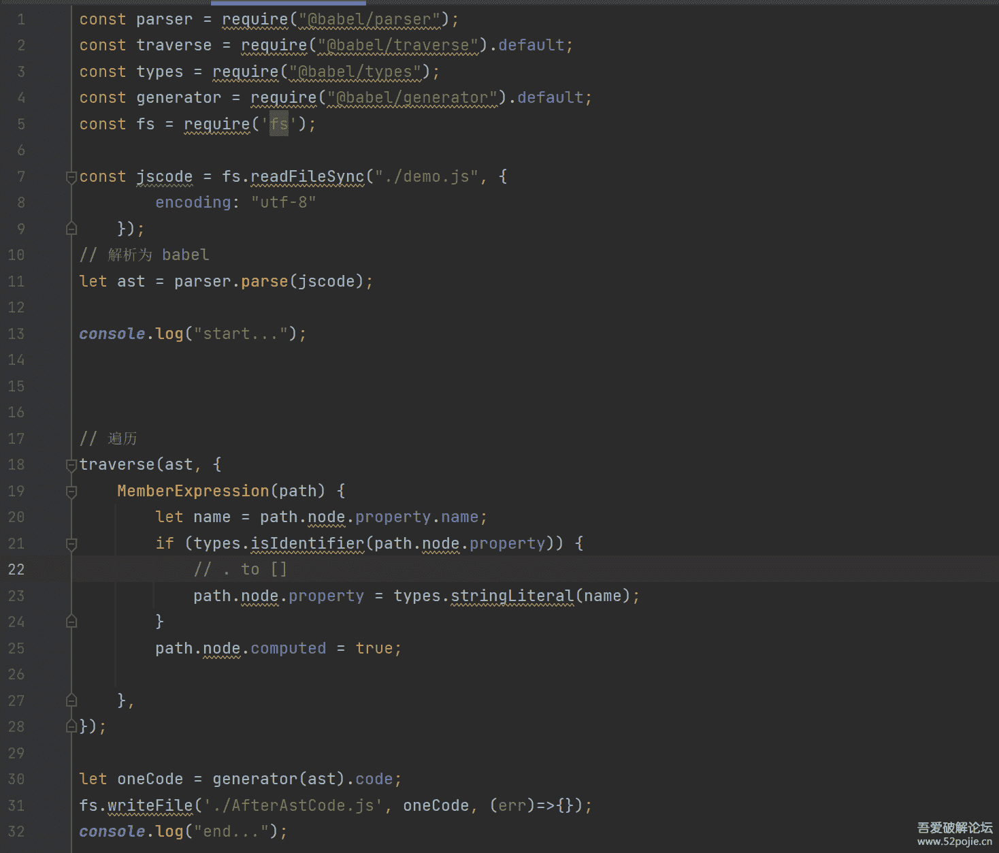

`3.png` (181.58 KB, 下载次数: 1)，2022-5-20 10:29 上传，[下载附件](https://www.52pojie.cn/forum.php?mod=attachment&aid=MjUyMzIzMXw2OTQ2ZGZkY3wxNzkzNTc1NTAxfDE2ODA4NnwxNjM4NjAy&nothumb=yes)

执行之后

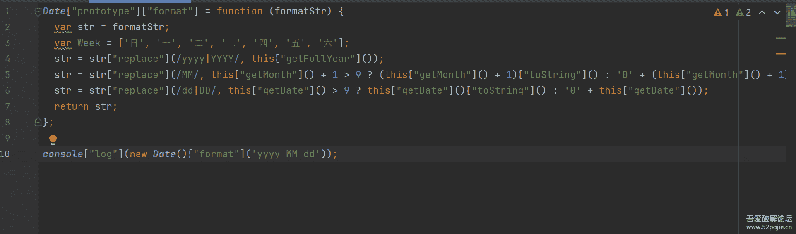

`1-2.png` (80.84 KB, 下载次数: 3)，2022-5-20 10:30 上传，[下载附件](https://www.52pojie.cn/forum.php?mod=attachment&aid=MjUyMzIzM3xjZmIzNTc4ZXwxNzkzNTc1NTAxfDE2ODA4NnwxNjM4NjAy&nothumb=yes)

正常运行

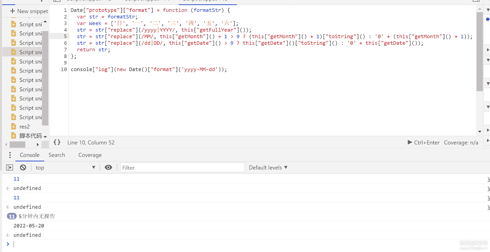

`1-3.png` (159.21 KB, 下载次数: 2)，2022-5-20 10:30 上传，[下载附件](https://www.52pojie.cn/forum.php?mod=attachment&aid=MjUyMzIzNHwzOWUyZDZkN3wxNzkzNTc1NTAxfDE2ODA4NnwxNjM4NjAy&nothumb=yes)

### 2. JS内置对象的处理

例如这个`window`可以处理一下

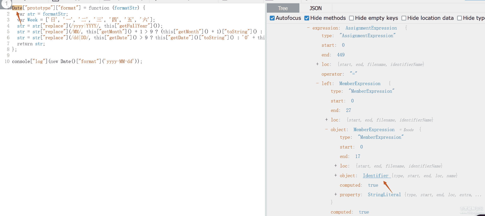

`2.2.png` (193.26 KB, 下载次数: 2)，2022-5-20 10:38 上传，[下载附件](https://www.52pojie.cn/forum.php?mod=attachment&aid=MjUyMzI0M3wyNDFhZjQ2MXwxNzkzNTc1NTAxfDE2ODA4NnwxNjM4NjAy&nothumb=yes)

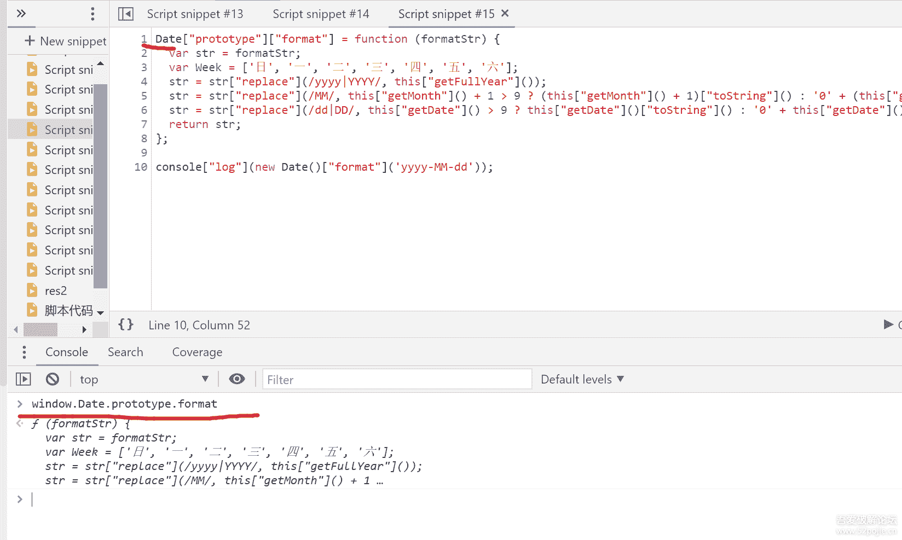

`2.1.png` (185.7 KB, 下载次数: 2)，2022-5-20 10:36 上传，[下载附件](https://www.52pojie.cn/forum.php?mod=attachment&aid=MjUyMzI0Mnw4NjhjYzg4NXwxNzkzNTc1NTAxfDE2ODA4NnwxNjM4NjAy&nothumb=yes)

astCode and result

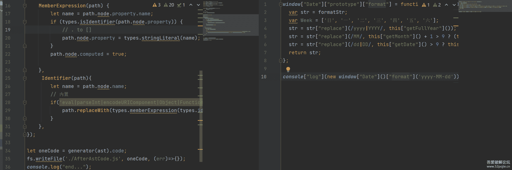

`2.3.png` (194.03 KB, 下载次数: 2)，2022-5-20 10:41 上传，[下载附件](https://www.52pojie.cn/forum.php?mod=attachment&aid=MjUyMzI0NXxiNWJlMzRlYnwxNzkzNTc1NTAxfDE2ODA4NnwxNjM4NjAy&nothumb=yes)

### 3. 常量与标识符的混淆

一个简单的位运算，不懂的看`console`。

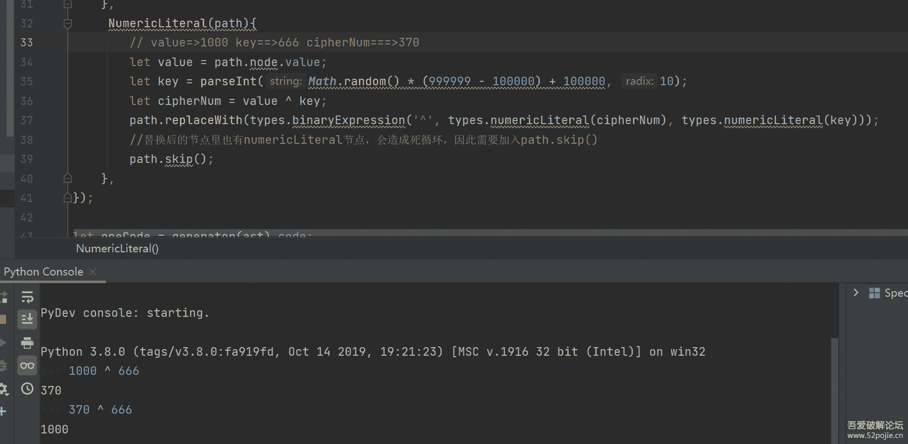

`3.1.png` (134.72 KB, 下载次数: 2)，2022-5-20 10:45 上传，[下载附件](https://www.52pojie.cn/forum.php?mod=attachment&aid=MjUyMzI0OHwxZTBmNjg0M3wxNzkzNTc1NTAxfDE2ODA4NnwxNjM4NjAy&nothumb=yes)

result

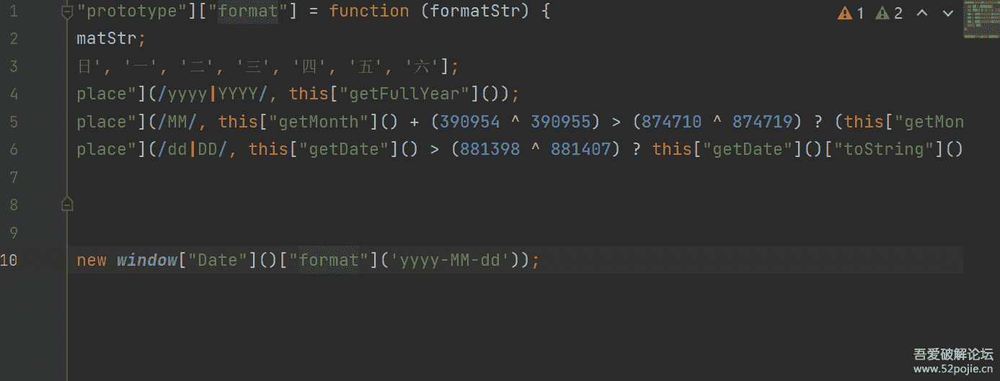

`3.2.png` (67.44 KB, 下载次数: 2)，2022-5-20 10:46 上传，[下载附件](https://www.52pojie.cn/forum.php?mod=attachment&aid=MjUyMzI1MHw5MTg1YTI5NHwxNzkzNTc1NTAxfDE2ODA4NnwxNjM4NjAy&nothumb=yes)

进行`base64`转换

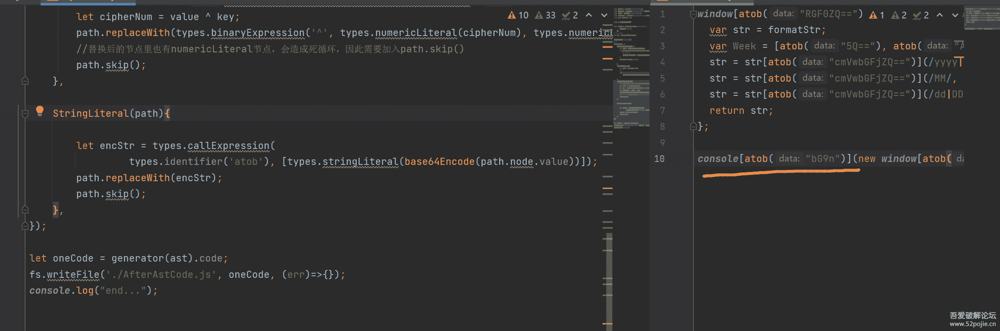

`3.3.png` (189.77 KB, 下载次数: 1)，2022-5-20 10:50 上传，[下载附件](https://www.52pojie.cn/forum.php?mod=attachment&aid=MjUyMzI1NHxmNzMxODYzMXwxNzkzNTc1NTAxfDE2ODA4NnwxNjM4NjAy&nothumb=yes)

也可以把这些常量放到一个数组里面提取出来

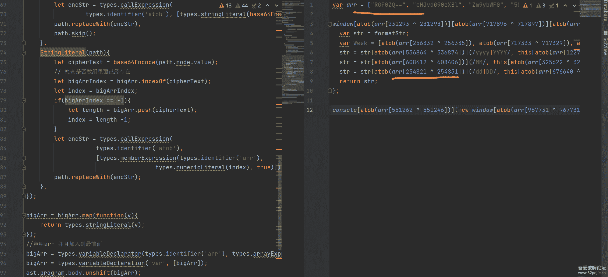

`3.4.png` (302.13 KB, 下载次数: 0)，2022-5-20 10:54 上传，[下载附件](https://www.52pojie.cn/forum.php?mod=attachment&aid=MjUyMzI1OXw5MTZkNDBjMXwxNzkzNTc1NTAxfDE2ODA4NnwxNjM4NjAy&nothumb=yes)

对其进行十六进制的混淆

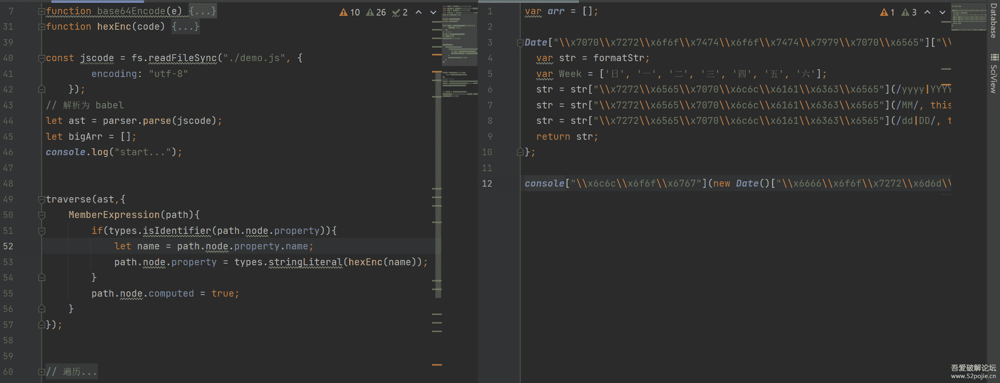

`3.5.png` (198.11 KB, 下载次数: 1)，2022-5-20 10:59 上传，[下载附件](https://www.52pojie.cn/forum.php?mod=attachment&aid=MjUyMzI2MXw1ZWViMGI1MnwxNzkzNTc1NTAxfDE2ODA4NnwxNjM4NjAy&nothumb=yes)

标识符的混淆，也就是作用域有引用的，第五行就没有引用到

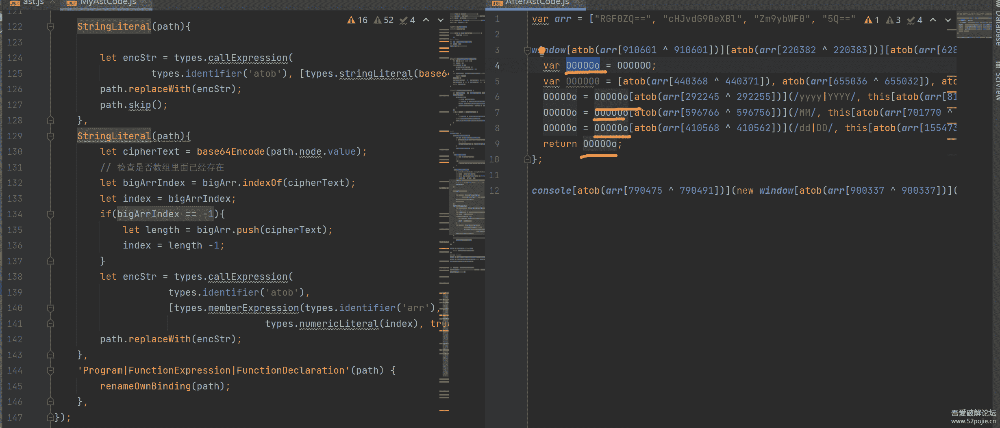

`3.6.png` (287.05 KB, 下载次数: 0)，2022-5-20 11:04 上传，[下载附件](https://www.52pojie.cn/forum.php?mod=attachment&aid=MjUyMzI2NHw0NmMwNDg4NXwxNzkzNTc1NTAxfDE2ODA4NnwxNjM4NjAy&nothumb=yes)

我们要找到代码的作用域

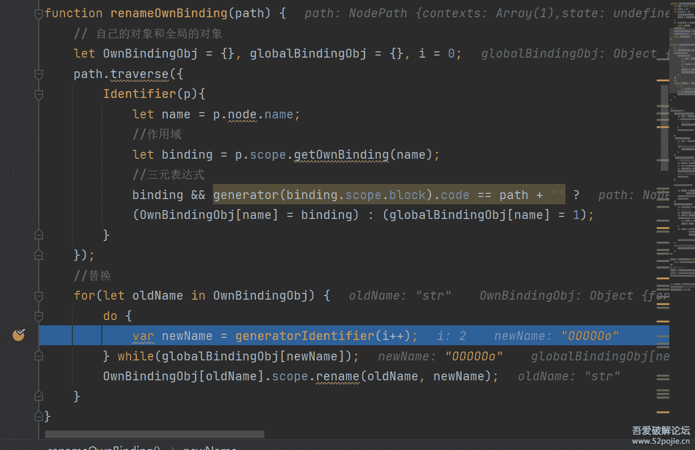

`3.7.png` (156.18 KB, 下载次数: 0)，2022-5-20 11:20 上传，[下载附件](https://www.52pojie.cn/forum.php?mod=attachment&aid=MjUyMzI2N3w5MjFhY2JhN3wxNzkzNTc1NTAxfDE2ODA4NnwxNjM4NjAy&nothumb=yes)

生成随机`o0O`代码

```js
function generatorIdentifier(decNum){
        let flag = ['O', 'o', '0'];
        let retval = [];
        while(decNum > 0){
                retval.push(decNum % 3);
                decNum = parseInt(decNum / 3);
        }
        let Identifier = retval.reverse().map(function(v){
                return flag[v]
        }).join('');
        Identifier.length
```

#### 全部代码

```js
const parser = require("@babel/parser");
const traverse = require("@babel/traverse").default;
```


```javascript
const types = require("@babel/types");

const generator = require("@babel/generator").default;

const fs = require('fs');

function base64Encode(e) {
    var r, a, c, h, o, types, base64EncodeChars = 'ABCDEFGHIJKLMNOPQRSTUVWXYZabcdefghijklmnopqrstuvwxyz0123456789+/';

    for (c = e.length, a = 0, r = ''; a > 2),

            r += base64EncodeChars.charAt((3 & h) > 2),

            r += base64EncodeChars.charAt((3 & h) > 4),

            r += base64EncodeChars.charAt((15 & o) > 2),

        r += base64EncodeChars.charAt((3 & h) > 4),

        r += base64EncodeChars.charAt((15 & o) > 6),

        r += base64EncodeChars.charAt(63 & types)

    }

    return r
}

function hexEnc(code) {
    for (var hexStr = [], i = 0, s; i  0){
        retval.push(decNum % 3);

        decNum = parseInt(decNum / 3);
    }

    let Identifier = retval.reverse().map(function(v){
        return flag[v]
    }).join('');

    Identifier.length 1000 key==>666 cipherNum===>370

    let value = path.node.value;

    let key = parseInt(Math.random() * (999999 - 100000) + 100000, 10);

    let cipherNum = value ^ key;

    path.replaceWith(types.binaryExpression('^', types.numericLiteral(cipherNum), types.numericLiteral(key)));

    //替换后的节点里也有numericLiteral节点，会造成死循环，因此需要加入path.skip()

    path.skip();
},

StringLiteral(path){
    let encStr = types.callExpression(
             types.identifier('atob'), [types.stringLiteral(base64Encode(path.node.value))]);

    path.replaceWith(encStr);

    path.skip();
},

StringLiteral(path){
    let cipherText = base64Encode(path.node.value);

    // 检查是否数组里面已经存在

    let bigArrIndex = bigArr.indexOf(cipherText);

    let index = bigArrIndex;

    if(bigArrIndex == -1){
        let length = bigArr.push(cipherText);

        index = length -1;
    }

    let encStr = types.callExpression(
                types.identifier('atob'),

                [types.memberExpression(types.identifier('arr'),
                                 types.numericLiteral(index), true)]);

    path.replaceWith(encStr);
},

'Program|FunctionExpression|FunctionDeclaration'(path) {
    renameOwnBinding(path);
},

});

bigArr = bigArr.map(function(v){
    return types.stringLiteral(v);
});

//声明arr 并且加入到最前面

bigArr = types.variableDeclarator(types.identifier('arr'), types.arrayExpression(bigArr));

bigArr = types.variableDeclaration('var', [bigArr]);

ast.program.body.unshift(bigArr);

let oneCode = generator(ast).code;

fs.writeFile('./AfterAstCode.js', oneCode, (err)=>{});

console.log("end...");
```
