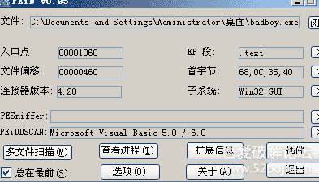
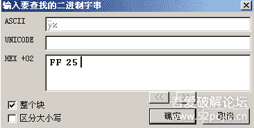
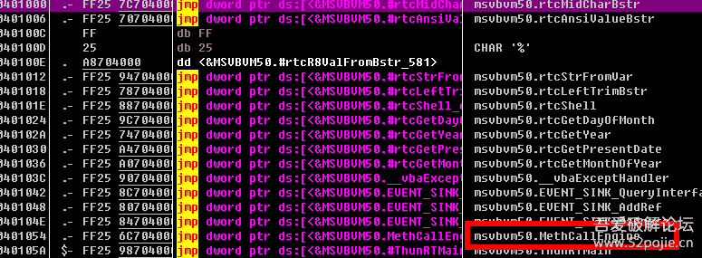
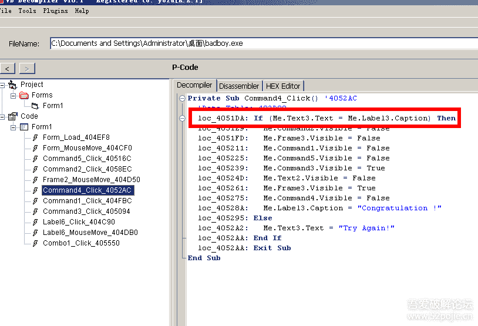
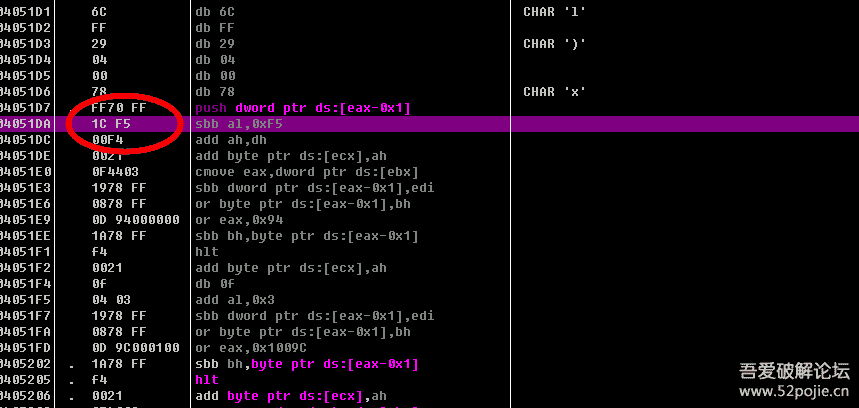

# [原创] `VB`（`p-code`）程序 `cm` 三步轻松破解，附过程，菜鸟也可以操作！

- 原帖：https://www.52pojie.cn/forum.php?mod=viewthread&tid=1639141
- 抓取时间：2026-11-01T23:25:00

`image.png` (45.61 KB, 下载次数: 1)

[附件下载](https://www.52pojie.cn/forum.php?mod=attachment&aid=MjUyMzUzMnw3NmY1M2QwNHwxNzkzNTc1NDk4fDE2ODA4NnwxNjM5MTQx&nothumb=yes)

2022-5-21 16:58 上传

在这里找到了下载地址，文末我也会单独把今天的 `cm` 作为附件贴出来。

`PEID` 查壳发现是 `VB` 编写的。

`image.png` (17.95 KB, 下载次数: 1)

[附件下载](https://www.52pojie.cn/forum.php?mod=attachment&aid=MjUyMzUzNHw2MjlmYmFhNnwxNzkzNTc1NDk4fDE2ODA4NnwxNjM5MTQx&nothumb=yes)

2022-5-21 17:02 上传

载入 `OD`，开始查字符串，下断点，都无效。大家有兴趣可以去试试。

然后我换了另一种思路，就是在 `OD` 里面快捷键 `Ctrl+b` 使用十六进制码搜索 `FF25`，这个命令。

`image.png` (12.46 KB, 下载次数: 0)

[附件下载](https://www.52pojie.cn/forum.php?mod=attachment&aid=MjUyMzUzNXxkY2E5ODE2YnwxNzkzNTc1NDk4fDE2ODA4NnwxNjM5MTQx&nothumb=yes)

2022-5-21 17:05 上传

看见没有，所有的跳转都会被找到。为什么要找这个呢？因为 `vb` 程序，在面临注册成功或者注册错误的时候，都会用到跳转，而所有的跳转都集中在这里。

把程序跑起来，进行注册，发现断在了倒数第二个 `jmp` 上面。

`image.png` (26.93 KB, 下载次数: 1)

[附件下载](https://www.52pojie.cn/forum.php?mod=attachment&aid=MjUyMzUzNnw4NWM5MGZlZXwxNzkzNTc1NDk4fDE2ODA4NnwxNjM5MTQx&nothumb=yes)

2022-5-21 17:06 上传

面对这个函数比较陌生，所以去百度里面查了一下，一身冷汗。

`image.png` (22.94 KB, 下载次数: 1)

[附件下载](https://www.52pojie.cn/forum.php?mod=attachment&aid=MjUyMzUzOXw2ODQzMTdlMnwxNzkzNTc1NDk4fDE2ODA4NnwxNjM5MTQx&nothumb=yes)

2022-5-21 17:10 上传

难怪我断不下来它，字符串也查不到，原来是 `p-code` 程序。

怎么办呢？然后又在网上疯狂查找资料，发现了比较有趣的帖子。

`image.png` (28.35 KB, 下载次数: 1)

[附件下载](https://www.52pojie.cn/forum.php?mod=attachment&aid=MjUyMzU0MHwzYWZiMWRmYnwxNzkzNTc1NDk4fDE2ODA4NnwxNjM5MTQx&nothumb=yes)

2022-5-21 17:13 上传

这个一开始没看懂什么意思，后来仔细一想 `1c`、`1d`、`1e` 应该是和刚刚我输入的 `ff25` 是一个意思才对。

那我只需要找到判断的位置就可以了。

于是，第一步打开了 `p-code` 利器，载入 `cm`，然后就可以看到判断的位置，也就是下图，红框的位置。

`image.png` (29.04 KB, 下载次数: 0)

[附件下载](https://www.52pojie.cn/forum.php?mod=attachment&aid=MjUyMzU0MXwwY2Q4ZTBmM3wxNzkzNTc1NDk4fDE2ODA4NnwxNjM5MTQx&nothumb=yes)

2022-5-21 17:16 上传

接下来 `OD` 载入，`Ctrl+g` 进入到 `4051DA` 这个位置。

`image.png` (20.92 KB, 下载次数: 1)

[附件下载](https://www.52pojie.cn/forum.php?mod=attachment&aid=MjUyMzU0M3xkNTBkMDc2NXwxNzkzNTc1NDk4fDE2ODA4NnwxNjM5MTQx&nothumb=yes)

2022-5-21 17:20 上传

是不是果然有 `1c`，最后我们改成 `1d` 运行一下。就这三步！是不是很简单！

`image.png` (11.02 KB, 下载次数: 1)

[附件下载](https://www.52pojie.cn/forum.php?mod=attachment&aid=MjUyMzU0NHw3ODVmOGJjZHwxNzkzNTc1NDk4fDE2ODA4NnwxNjM5MTQx&nothumb=yes)

2022-5-21 17:21 上传

我破解了 1.0，2.0 交给你们啦！谢谢大家！

`image.png` (10.56 KB, 下载次数: 1)

[附件下载](https://www.52pojie.cn/forum.php?mod=attachment&aid=MjUyMzU0NXw3YzIxYTQwZHwxNzkzNTc1NDk4fDE2ODA4NnwxNjM5MTQx&nothumb=yes)

2022-5-21 17:22 上传

[附件下载](https://www.52pojie.cn/forum.php?mod=attachment&aid=MjUyMzUzM3wyNTBjZTQyZnwxNzkzNTc1NDk4fDE2ODA4NnwxNjM5MTQx)

(7.24 KB, 下载次数: 34)

2022-5-21 17:00 上传

点击文件名下载附件

下载积分：吾爱币 `-1 CB`
