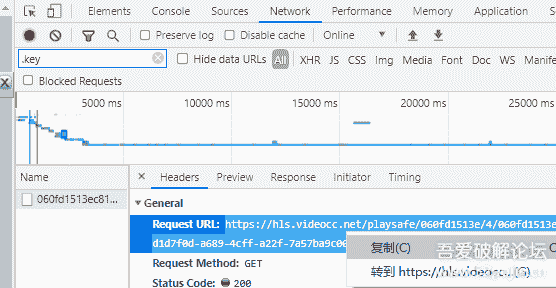
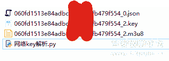
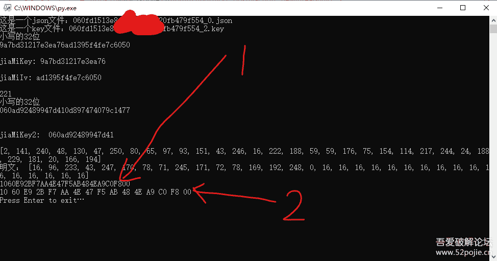

# [Web逆向] `M3U8` 加密 `key` 计算

- 原帖：https://www.52pojie.cn/forum.php?mod=viewthread&tid=1640483
- 抓取时间：2026-11-01T23:24:48

看了这个兄弟的帖子：[https://www.52pojie.cn/thread-1637348-1-1.html](https://www.52pojie.cn/thread-1637348-1-1.html)，觉得挺有意思的，但是操作比较麻烦，所以现学了 `python` 操作了下。

## 使用方法

### 1. 下载视频的 `.key`、`M3U8`、`.json` 文件

浏览器打开视频 → `F12` → `network` → `filter`，分别过滤 `.key`、`M3U8`、`.json` 关键字，选中 `request URL` → 右键 → 复制，下载或者直接点转到，会跳转下载。

注意：下载 `M3U8` 时要注意，有些视频因为可以选择清晰度，所以会有多个 `M3U8` 文件，自己注意判断。

`插图3.png`（38.84 KB，下载次数：0）

[附件](https://www.52pojie.cn/forum.php?mod=attachment&aid=MjUyNDQyOHw5YjIwZGFjOHwxNzkzNTc1NDg1fDE2ODA4NnwxNjQwNDgz&nothumb=yes)

2022-5-24 17:43 上传

### 2. 将脚本放在 `.key`、`M3U8`、`.json` 同一文件夹下

`插图.png`（12.45 KB，下载次数：0）

[附件](https://www.52pojie.cn/forum.php?mod=attachment&aid=MjUyNDQyMnxiY2EwMDNhNnwxNzkzNTc1NDg1fDE2ODA4NnwxNjQwNDgz&nothumb=yes)

2022-5-24 17:29 上传

### 3. 运行脚本得到 `key`

标记1和标记2的计算结果是一样的，只是用空格隔开了而已。

`插图2.png`（33.45 KB，下载次数：0）

[附件](https://www.52pojie.cn/forum.php?mod=attachment&aid=MjUyNDQyNHw1ZGQ5MmZhNXwxNzkzNTc1NDg1fDE2ODA4NnwxNjQwNDgz&nothumb=yes)

2022-5-24 17:35 上传

[附件](https://www.52pojie.cn/forum.php?mod=attachment&aid=MjUyNDQyM3xjMGFmMDE3OHwxNzkzNTc1NDg1fDE2ODA4NnwxNjQwNDgz)

（1.47 KB，下载次数：575）

2022-5-24 17:35 上传

点击文件名下载附件

`python` 脚本

下载积分：吾爱币 -1 CB

## 扩展思考

其实第3步生成的 `key` 就是下载的 `.key` 文件的解密版本；加密的 `.key` 文件用 `HEX` 查看器看可以看到是32位的；用我们计算到的 `key` 用 `HEX` 编辑器编辑好就是解密后的 `.key` 文件了。

而一些视频是可以离线缓存的，查看缓存文件，可以发现除了切片后的 `TS` 文件也有 `.key`、`M3U8`、`.json` 文件；所以说，我们如果懒得一个一个的从网站抓，可以用缓存文件直接解密、合并 `TS` 文件生成目标视频；但是经过验证，没成功；发现的问题如下：

1. 缓存文件的 `.key` 文件和网页抓的 `.key` 文件是不同的；
2. `json` 文件名不一样，发现只是命名规则做了修改，如把末尾的 `_0` 改成了 `_2`，调整了脚本，发现 `json` 文件解析出来的 `json` 结构体内容是相同的，最重要的是 `seed` 值是一样的；——> 由1、2两条可知计算到的 `key` 值是不一样的；
3. 但是！！用网页抓的 `.key` 文件计算到的 `key` 值可以把缓存的 `ts` 文件解密合并生成目标视频；

我猜测是缓存文件的 `.key` 文件所用的 `AES` 加密的 `iv` 值和网页视频用的不一样。

如果有那位能好心人能给我解惑或者将 `iv` 值告诉我将不胜感激。
