# [原创] 各种程序的OEP入口特征汇总整理！专为小白总结！

- 原帖：https://www.52pojie.cn/forum.php?mod=viewthread&tid=1640646
- 抓取时间：2026-11-01T23:24:46

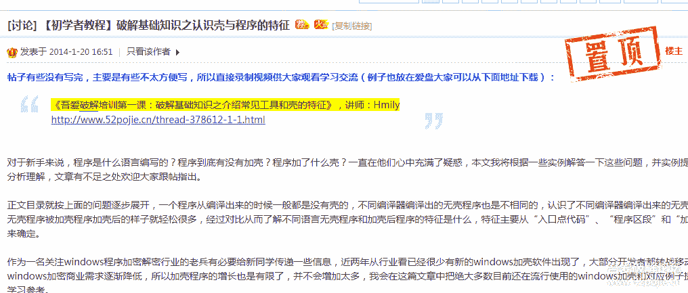

`image.png` (87.5 KB，下载次数：0)

[附件下载](https://www.52pojie.cn/forum.php?mod=attachment&aid=MjUyNDUwNnxlMDYwYjI1ZHwxNzkzNTc1NDgzfDE2ODA4NnwxNjQwNjQ2&nothumb=yes)

（2022-5-25 05:59 上传）

之前大佬总结了一篇文章，是关于入口特征的。但只是贴出了部分入口特征的截图，我这里汇总一下所有的入口特征，这样方便小白了解不同的程序OEP入口特征。同时也讲下不同程序的破解窍门。

---

## MASM 程序入口

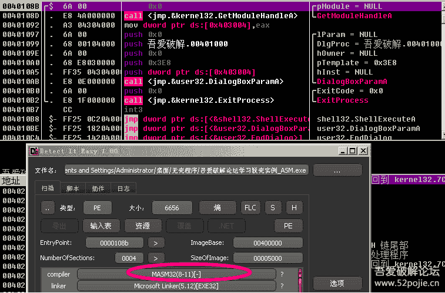

`image.png` (40.07 KB，下载次数：0)

[附件下载](https://www.52pojie.cn/forum.php?mod=attachment&aid=MjUyNDUwN3wxYmQ4MzgwN3wxNzkzNTc1NDgzfDE2ODA4NnwxNjQwNjQ2&nothumb=yes)

（masm，2022-5-25 06:06 上传）

这个程序比较老，现在基本不怎么遇到了，大家记住就可以。

特征为：

```
push 0x0
jmp.&kernel32.GetModuleHandleA
```

---

## AutoIt 程序入口

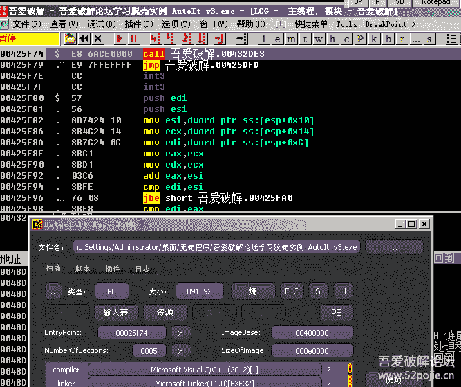

`image.png` (45.73 KB，下载次数：0)

[附件下载](https://www.52pojie.cn/forum.php?mod=attachment&aid=MjUyNDUwOHw0MWM3MTJlYXwxNzkzNTc1NDgzfDE2ODA4NnwxNjQwNjQ2&nothumb=yes)

（auto，2022-5-25 06:13 上传）

AutoIt 最新是 v3 版本，这是一个使用类似 BASIC 脚本语言。

特征为：

```
call ？？？？
jmp ？？？？
int3
int3
push edi
push esi
```

---

## BC++ 程序入口

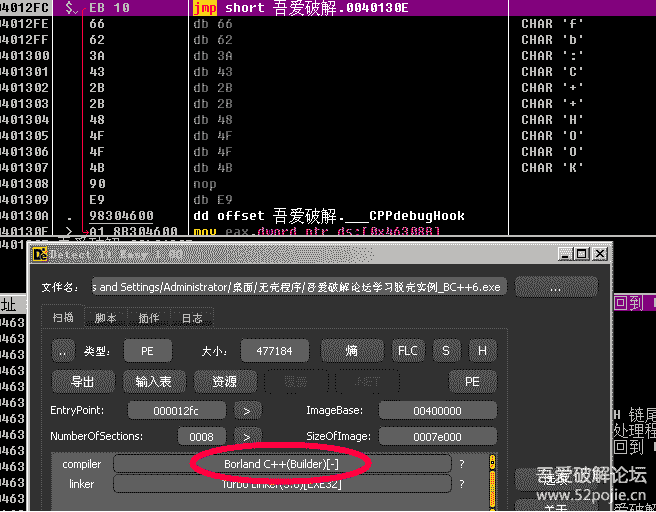

`image.png` (35.22 KB，下载次数：0)

[附件下载](https://www.52pojie.cn/forum.php?mod=attachment&aid=MjUyNDUwOXwzOGUwYzdjZnwxNzkzNTc1NDgzfDE2ODA4NnwxNjQwNjQ2&nothumb=yes)

（BC++，2022-5-25 06:16 上传）

特征为：删除模块分析后是这样的。

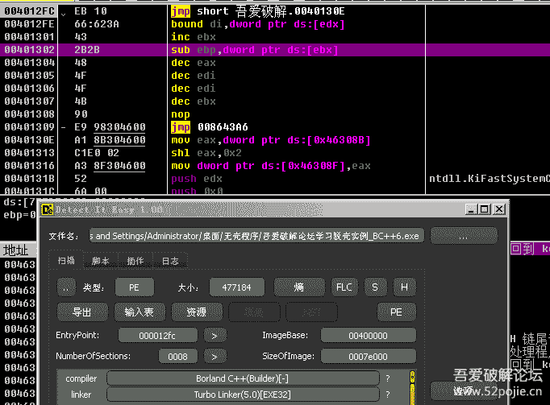

`image.png` (33.69 KB，下载次数：0)

[附件下载](https://www.52pojie.cn/forum.php?mod=attachment&aid=MjUyNDUxMHwxMTcxYWMwM3wxNzkzNTc1NDgzfDE2ODA4NnwxNjQwNjQ2&nothumb=yes)

（BC++，2022-5-25 06:19 上传）

---

## Borland Delphi 程序入口

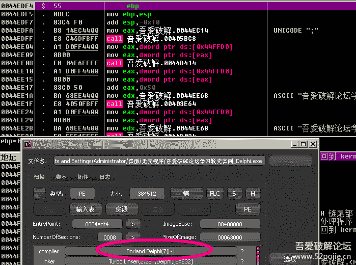

`image.png` (41.26 KB，下载次数：0)

[附件下载](https://www.52pojie.cn/forum.php?mod=attachment&aid=MjUyNDUxMXwxZDY2OGEzNHwxNzkzNTc1NDgzfDE2ODA4NnwxNjQwNjQ2&nothumb=yes)

（Borland Delphi，2022-5-25 06:23 上传）

个人认为这个程序是最好识别的！

特征为：

```
push ebp
mov ebp,esp
add esp,-0x10
mov eax,？？？？
```

破解方法：用 `dededark` 找按钮事件就可以了。

---

## VB 程序入口

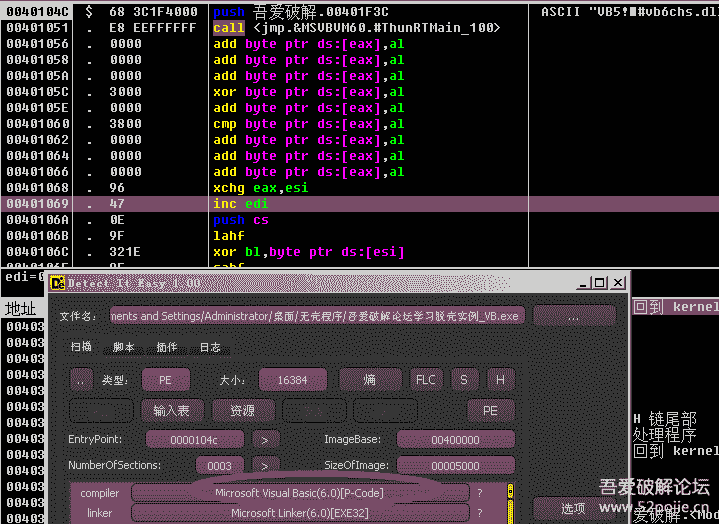

`image.png` (38.49 KB，下载次数：0)

[附件下载](https://www.52pojie.cn/forum.php?mod=attachment&aid=MjUyNDUxMnw2NDNhNDU2NnwxNzkzNTc1NDgzfDE2ODA4NnwxNjQwNjQ2&nothumb=yes)

（VB，2022-5-25 06:26 上传）

特征为：

```
push ？？？？
call
```

破解方法：VB 有两种不同类型的程序，一种就是普通的，我们可以用 `VB Decompilier` 工具找按钮事件。另一种是 `p-code`（找不到按钮事件）：之前专门有篇文章就是讲解破解 VB 的 `p-code` 版本程序的，感兴趣可以去看。

https://www.52pojie.cn/thread-1639141-1-1.html

---

## VC++ 程序入口

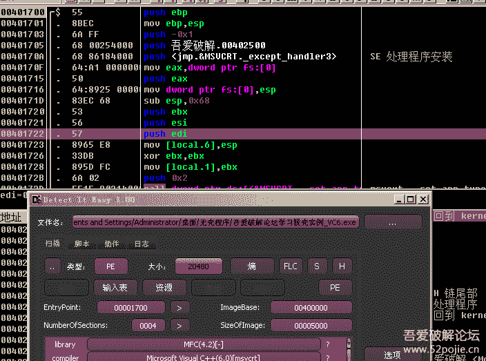

`image.png` (36.7 KB，下载次数：0)

[附件下载](https://www.52pojie.cn/forum.php?mod=attachment&aid=MjUyNDUxM3wwZjNiNWJkOXwxNzkzNTc1NDgzfDE2ODA4NnwxNjQwNjQ2&nothumb=yes)

（VC++，2022-5-25 06:31 上传）

特征为：程序一开始就会有 `MSVCRT._except_handler3` 的调用。

---

## 易语言程序入口

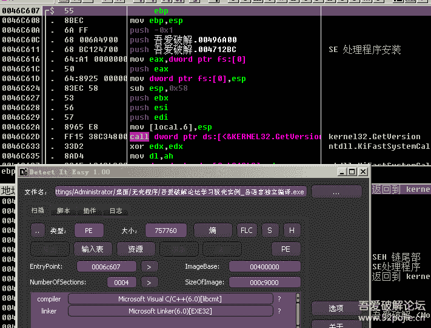

`image.png` (38.09 KB，下载次数：0)

[附件下载](https://www.52pojie.cn/forum.php?mod=attachment&aid=MjUyNDUxNXw2ODRlOWY1M3wxNzkzNTc1NDgzfDE2ODA4NnwxNjQwNjQ2&nothumb=yes)

（易语言，2022-5-25 06:44 上传）

特征为：这个跟上面的 VC++ 入口很像，那么怎么判断呢？在 `OD` 里面 `Ctrl+G` 输入 `401000` 来到这里：

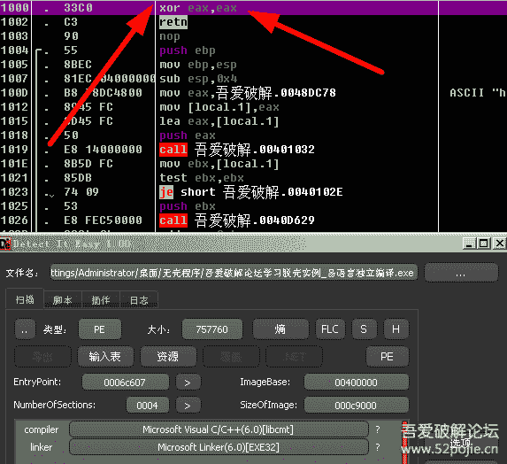

`image.png` (35 KB，下载次数：0)

[附件下载](https://www.52pojie.cn/forum.php?mod=attachment&aid=MjUyNDUxNnw0YjAxODE4NXwxNzkzNTc1NDgzfDE2ODA4NnwxNjQwNjQ2&nothumb=yes)

（2022-5-25 06:45 上传）

所有的易语言，在 `401000` 这个位置的代码都是这个 `xor eax,eax`。

破解方法：使用 `E-DEBUG` 工具找按钮事件。

---

## 非独立编译易语言程序入口

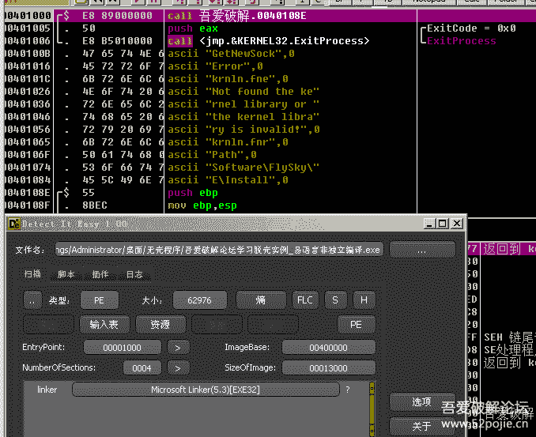

`image.png` (37.55 KB，下载次数：1)

[附件下载](https://www.52pojie.cn/forum.php?mod=attachment&aid=MjUyNDUxN3w5NGRhZmYxYXwxNzkzNTc1NDgzfDE2ODA4NnwxNjQwNjQ2&nothumb=yes)

（非独立编译易语言，2022-5-25 06:53 上传）

入口特征：一上来就退出 `call`。

---

## VS 程序入口

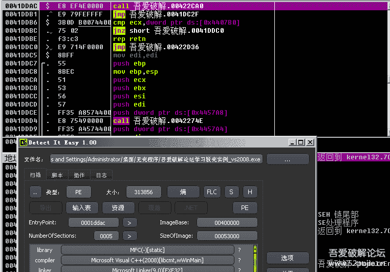

`image.png` (37.92 KB，下载次数：1)

[附件下载](https://www.52pojie.cn/forum.php?mod=attachment&aid=MjUyNDUxNHwwYTc3NGE1N3wxNzkzNTc1NDgzfDE2ODA4NnwxNjQwNjQ2&nothumb=yes)

（VS，2022-5-25 06:39 上传）

入口特征：把图片上面的特征认真记住就可以了。

---

## Qt 程序入口

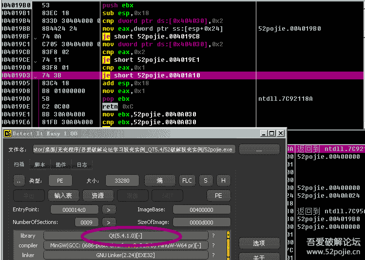

`image.png` (39.77 KB，下载次数：0)

[附件下载](https://www.52pojie.cn/forum.php?mod=attachment&aid=MjUyNDUxOXw5ODk2MjU1Y3wxNzkzNTc1NDgzfDE2ODA4NnwxNjQwNjQ2&nothumb=yes)

（Qt，2022-5-25 06:56 上传）

Qt 是一个 1991 年由 Qt Company 开发的跨平台 C++ 图形用户界面应用程序开发框架。它既可以开发 GUI 程序，也可用于开发非 GUI 程序，比如控制台工具和服务器。

入口特征类似于 VC++。

先总结到这里吧。课件用到的程序都是这个帖子的，感兴趣大家可以去下载：

https://www.52pojie.cn/thread-234739-1-1.html

---

最后把不同程序按钮事件特征码放出来，方便大家破解不同程序时候，直接使用。

## 不同程序按钮事件特征码汇总

- BC++ 的特征码是：`740E8BD38B83????????FF93????????`
- Delphi 和的特征码：`FF 93 20 01 00 00 5B C3 53`
- VB 使用同样的方法搜索 VB 的特征码：`816C24`
- MFC 程序，在 `E` 窗口中双击 `mfc42.dll`，跟进去，然后反汇编窗口中右键 -> 查找 -> 命令：`sub eax,0a`，找到之后，在特征码的下面会有一个 `je` 跳转，选中 `je` 命令行，然后按回车，程序会跟随到跳转处，来到目标地址，找下面的一个 `CALL`，下断点
- 易语言的按钮事件：二进制字符串 `FF 55 FC 5F 5E`
- VC++ 按钮事件查找方法：直接 `OD` 载入程序，在反汇编窗口右键 -> 查找 -> 所有命令，输入特征码：`sub eax,0a`

使用方法：`OD` 载入程序 -> `F9` 运行 -> `Alt+M` 打开内存镜像 -> `Ctrl+B` 搜索特征码 -> `Ctrl+G` 跳到找到的地址 -> `F2` 下断 -> 点击按钮 -> 断下后 `F7` 进入 `CALL`（此处即为事件代码）

---

## 万能断点

不需要知道程序使用的编译器和编译语言，直接 `OD` 载入程序，直接运行程序，输入假码之后，不要点击按钮，查看 `user32` 模块搜索特征码，右键 -> 查找 -> 二进制字符串：`F3A58BC883E103F3A4E8`


[附件下载](https://www.52pojie.cn/forum.php?mod=attachment&aid=MjUyNTIyMHwyYzg3ZDQwNXwxNzkzNTc1NDgzfDE2ODA4NnwxNjQwNjQ2)

(288.24 KB，下载次数：252)

（2022-5-27 16:58 上传）

点击文件名下载附件

下载积分：吾爱币 -1 CB
