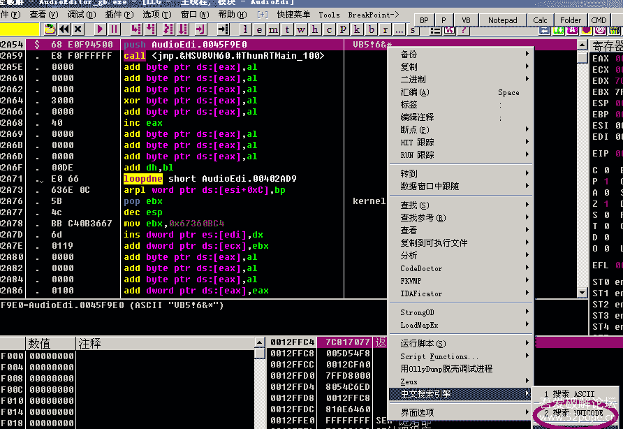
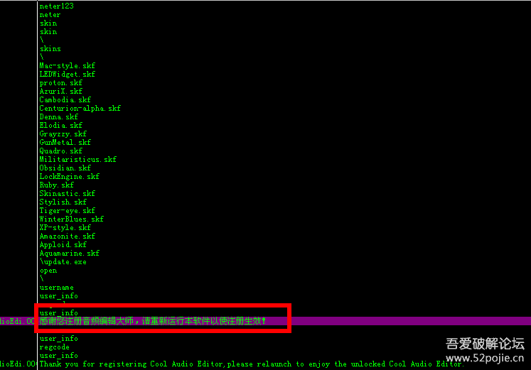
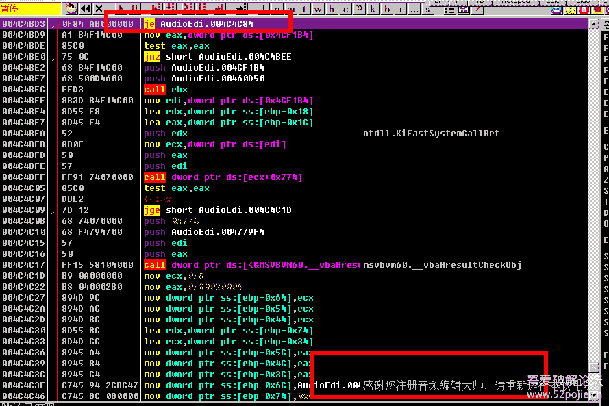
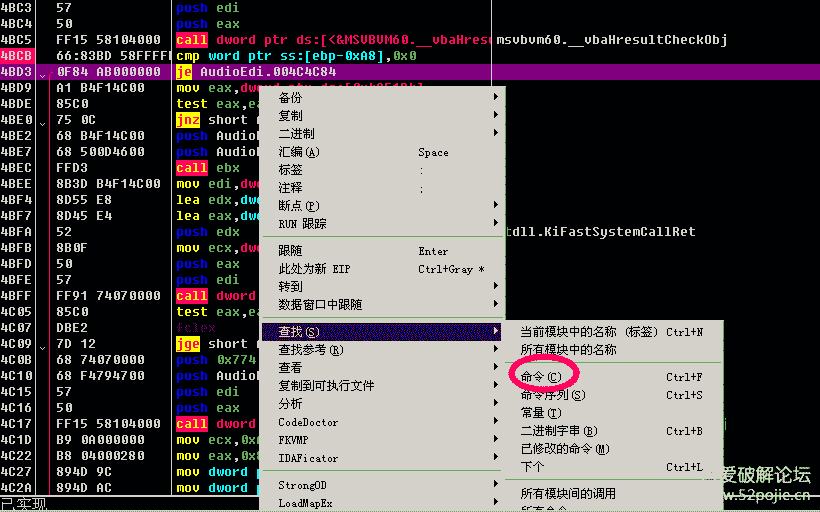
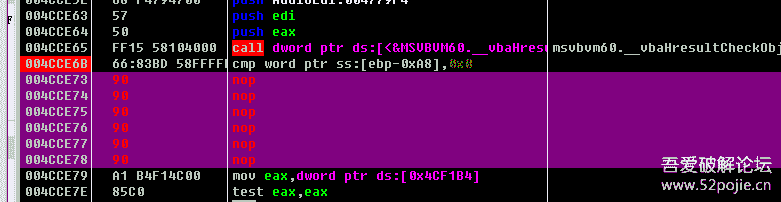
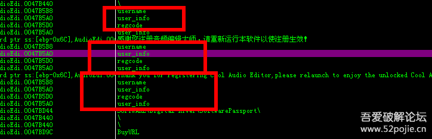
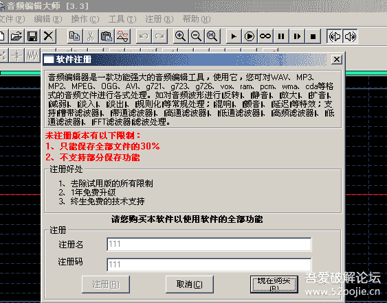
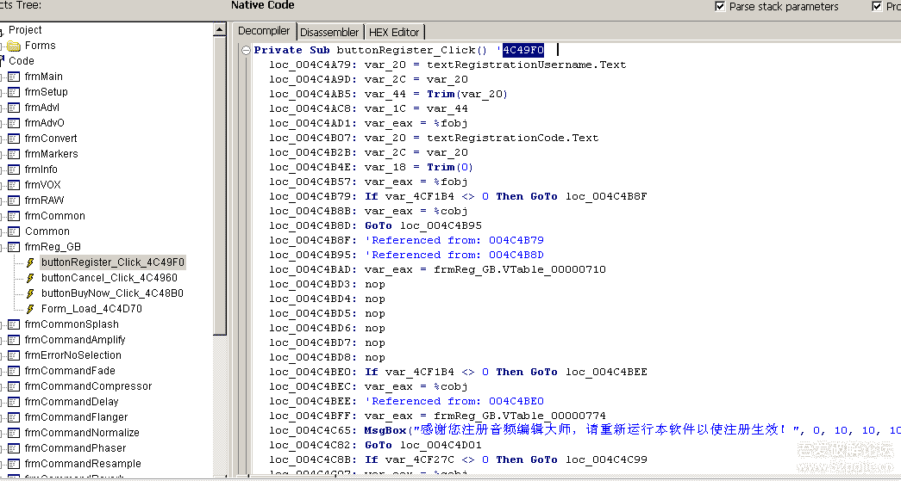

# [原创] ini 文件重启验证程序破解方法详解！小白可操作！

- 原帖：https://www.52pojie.cn/forum.php?mod=viewthread&tid=1642189
- 抓取时间：2026-11-01T23:23:21

今天分享一个 VB 的软件，这个软件来自小生我怕怕的教程第五课，我也会把软件放置在文章最后。

## 查找关键跳

直接开始了。首先用 `OD` 载入程序，查找字符串。



`image.png`（54.93 KB，下载次数：0）

[查看附件](https://www.52pojie.cn/forum.php?mod=attachment&aid=MjUyNTQwNnwzM2Y3ZDc3OHwxNzkzNTc1Mzk5fDE2ODA4NnwxNjQyMTg5&nothumb=yes)

2022-5-28 12:24 上传

如果你之前和我一样运行过这个软件，你就知道，注册时候的关键词有“注册”这个词，我们在字符串里面直接搜索。



`image.png`（16.51 KB，下载次数：0）

[查看附件](https://www.52pojie.cn/forum.php?mod=attachment&aid=MjUyNTQwN3xjOTBkYzcwY3wxNzkzNTc1Mzk5fDE2ODA4NnwxNjQyMTg5&nothumb=yes)

2022-5-28 12:25 上传

我们通过这句话了解到，这是一个重启验证的程序。双击这句话，然后往上翻，我们要找一下关键跳。

什么是关键跳呢？

```text
call 计算地址

cmp 比较真假码

je 如果假，就跳转到失败，否则不跳

..

..

成功提示

..

跳转到开始注册程序

..

失败提示

..
```

上面的就是常见的验证代码，我们截图看下真实的。



`image.png`（43.84 KB，下载次数：1）

[查看附件](https://www.52pojie.cn/forum.php?mod=attachment&aid=MjUyNTQwOHw4Y2NlYTZiYnwxNzkzNTc1Mzk5fDE2ODA4NnwxNjQyMTg5&nothumb=yes)

2022-5-28 12:33 上传

明显上面的已经跳过了注册成功，所以我们把这个称为关键跳。很多人着急着就开始修改这个关键跳了，看了小生的教程，我才知道，不要着急，我们还有个步骤没有做。

那就是使用命令，找一下是不是只有这一个关键跳呢？大家想一下，一个软件不可能只验证一次注册码，对不对？那怎么办？很简单，我们只要复制关键跳上面一段的对比代码（`cmp word ptr ss:[ebp-0xA8],0x0`），查找就可以了。



`image.png`（33.21 KB，下载次数：0）

[查看附件](https://www.52pojie.cn/forum.php?mod=attachment&aid=MjUyNTQxNXxjYWY4OGY0NnwxNzkzNTc1Mzk5fDE2ODA4NnwxNjQyMTg5&nothumb=yes)

2022-5-28 12:43 上传

记得按 `F2` 下断点，避免丢失。查找下一个按 `Ctrl+L`。经过查找，我们发现一共两个关键跳的对比。我们直接把它们下面的关键跳 `nop` 掉，这样只能跳转到成功了。



`image.png`（13.94 KB，下载次数：0）

[查看附件](https://www.52pojie.cn/forum.php?mod=attachment&aid=MjUyNTQxN3xiNjM4NzAwMXwxNzkzNTc1Mzk5fDE2ODA4NnwxNjQyMTg5&nothumb=yes)

2022-5-28 12:50 上传

## 处理重启验证

好了，接下来我们需要处理重启验证的问题，我们回过来再看下字符串。



`image.png`（13.85 KB，下载次数：1）

[查看附件](https://www.52pojie.cn/forum.php?mod=attachment&aid=MjUyNTQxOXw2YjhjZDYyMnwxNzkzNTc1Mzk5fDE2ODA4NnwxNjQyMTg5&nothumb=yes)

2022-5-28 12:54 上传

这里三次出现了注册信息，我们可以分别跟进去看一看。最后你会发现，最后两组是存在关键跳的，果断 `nop` 掉，然后运行程序，成功！



`image.png`（27.29 KB，下载次数：1）

[查看附件](https://www.52pojie.cn/forum.php?mod=attachment&aid=MjUyNTQyMHxiNThkZmFkZHwxNzkzNTc1Mzk5fDE2ODA4NnwxNjQyMTg5&nothumb=yes)

2022-5-28 12:58 上传

要多观察字符串才可以！

还有一种方法更简单，你直接打开 `VB Decompiler`，后面直接操作不用我讲了吧。这种太野蛮了……



`image.png`（36.76 KB，下载次数：0）

[查看附件](https://www.52pojie.cn/forum.php?mod=attachment&aid=MjUyNTQ3NHxhOGRhNTM1NHwxNzkzNTc1Mzk5fDE2ODA4NnwxNjQyMTg5&nothumb=yes)

2022-5-28 16:37 上传

我自己下断点找了很久 ini 文件，想通过判断文件的方式破解，但是一直没找到，有哪个大佬知道的，请赐教下，感激不尽！

## 帖子用到的软件

链接：https://pan.baidu.com/s/1wnJTXUlFndZqxha17rJQFA?pwd=7vps

提取码：`7vps`
