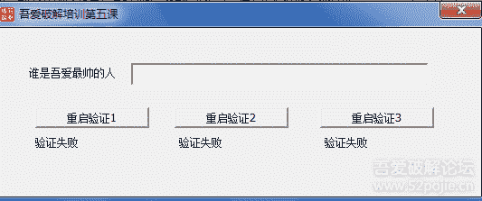
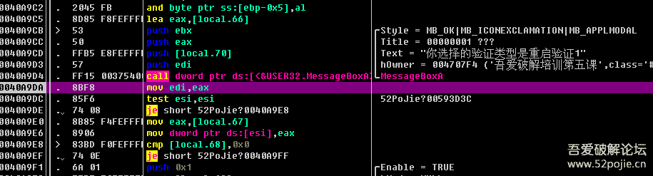
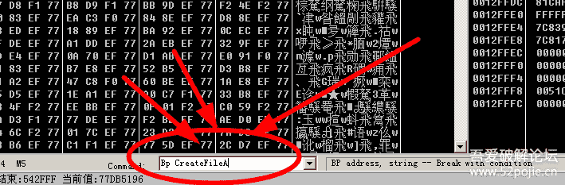
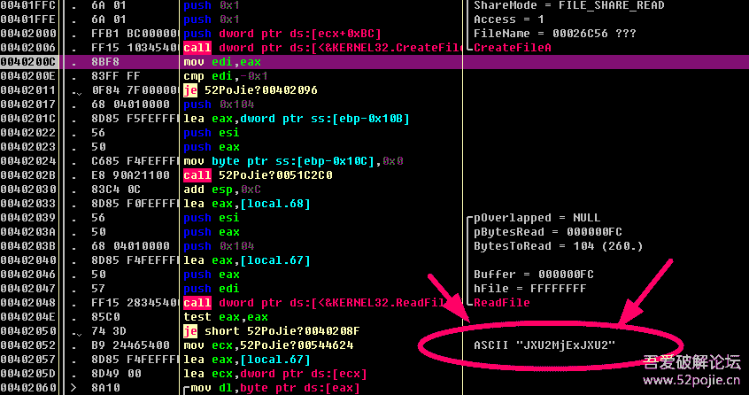
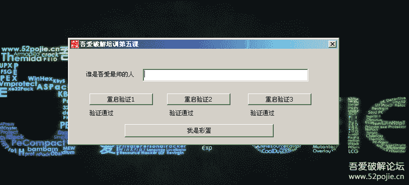

# [原创] 小白入门教程：重启验证破解看这一篇足够！

- 原帖：<https://www.52pojie.cn/forum.php?mod=viewthread&tid=1643482>
- 抓取时间：2026-11-01T23:23:01

重启验证就是在程序启动时验证注册信息是否正确。

---

程序运行-->注册信息输入-->程序重启-->执行验证机制-->正确就显示已注册/错误则不变动。

---

从上面的程序运行流程发现，程序计算验证是在重启以后，我们就不能用常规下断点的方法了。

## 重启验证类型软件的验证方式

1. 注册表类型：`Bp RegOpenKeyA(W)`、`Bp RegOpenKeyExA(W)`
2. `ini` 文件类型（`*.reg`/`*.ini`）：`Bp GetPrivateProfileStringA`
3. 其他文件类型（`*.dat`/`*.lict`/`*.txt`…）：`Bp CreateFileA(W)`、`Bp ReadFile`

上面三种验证方式是99%的重启验证软件都在使用的，掌握了它们，你就再也不用怕这类型的软件了！

## 有请今天的主角

image.png (23.63 KB, 下载次数: 1)

[附件下载](https://www.52pojie.cn/forum.php?mod=attachment&aid=MjUyNjY0MHw4NGY1ODU5NXwxNzkzNTc1Mzc5fDE2ODA4NnwxNjQzNDgy&nothumb=yes)

2022-5-31 16:54 上传

非常感谢[吾爱破解](https://www.52pojie.cn)，有这么好的东西分享练手。第一个验证的是 `txt` 文件，第二个验证 `ini` 文件，第三个验证注册表。

好了我们OD载入开始，加入我们一开始不知道是什么验证，不要紧，运行，输入注册码，验证，提示框出现。然后我们按`F12`暂停。`alt+F9`返回到这个界面

image.png (18.04 KB, 下载次数: 1)

[附件下载](https://www.52pojie.cn/forum.php?mod=attachment&aid=MjUyNjY1MHxiN2U3ODljZnwxNzkzNTc1Mzc5fDE2ODA4NnwxNjQzNDgy&nothumb=yes)

2022-5-31 17:08 上传

往下运行，返回到上面几层的程序里面，会发现这几个函数，同时桌面出现了一个`52Pojie.txt`（因为这个cm就放在桌面），还记得上面那个函数吗？

怎么用呢？很简单！看下图

image.png (32.73 KB, 下载次数: 1)

[附件下载](https://www.52pojie.cn/forum.php?mod=attachment&aid=MjUyNjY3M3w2M2E5YTk0OXwxNzkzNTc1Mzc5fDE2ODA4NnwxNjQzNDgy&nothumb=yes)

2022-5-31 17:31 上传

重新OD载入程序，输入命令以后，直接按下回车（没有任何提示信息，就是正常）。然后直接`F9`运行。

image.png (29.82 KB, 下载次数: 1)

[附件下载](https://www.52pojie.cn/forum.php?mod=attachment&aid=MjUyNjY3NHw0YzM1MmY3OXwxNzkzNTc1Mzc5fDE2ODA4NnwxNjQzNDgy&nothumb=yes)

2022-5-31 17:32 上传

看到这个了？其实不管是它自己悄悄运算还是，给我们明码。关键点已经找到了，破解就可以了！

---

接下来是`ini`文件验证和注册表验证我就不往出贴了，都是一样的方法，感兴趣的可以去试试

image.png (242.04 KB, 下载次数: 1)

[附件下载](https://www.52pojie.cn/forum.php?mod=attachment&aid=MjUyNjY3NnwwZTc1Y2VhY3wxNzkzNTc1Mzc5fDE2ODA4NnwxNjQzNDgy&nothumb=yes)

2022-5-31 17:52 上传

[附件下载](https://www.52pojie.cn/forum.php?mod=attachment&aid=MjUyNjY3N3xiMjQ2NDgwMXwxNzkzNTc1Mzc5fDE2ODA4NnwxNjQzNDgy)

(1.58 MB, 下载次数: 229)

2022-5-31 17:53 上传

点击文件名下载附件

下载积分: 吾爱币 -1 CB
