# [Web逆向] 某乎x96jsvmp算法还原新手初体验

- 原帖: https://www.52pojie.cn/forum.php?mod=viewthread&tid=1645300
- 抓取时间: 2026-11-01T23:22:48

[https://www.52pojie.cn/home.php?mod=space&uid=557195](https://www.52pojie.cn/home.php?mod=space&uid=557195) 跟栈跟值分析移步大佬文章 没人比大佬更详细 这里主要分析还原算法

样本：`aHR0cHM6Ly93d3cuemhpaHUuY29tLw==`

## 主要日志断点位置

- `e.r[this.s][r](i[0], i[1])` --> 主要是`charCodeAt`和`charAt`
- `e.r[this.c] + e.r[this.n]` --> 密文拼接
- `e.r[this.c] | e.r[this.n]` --> 对每组每个元素的运算
- `e.r[this.c] & e.r[this.n]` --> 密文运算
- `e.r[this.c] >>> e.r[this.n]` --> 每组二 三 四次密文运算

## 算法分析

不妙 这里说完了怎么分析 直接进入算法分析环节

查看日志 从结果反跟 获得信息：密文为`'aXFqc4uykHtY6Rt0M_Y8FD98e8NpgU28G0Yyo09yoTNX'` 当然这里是正确的结果

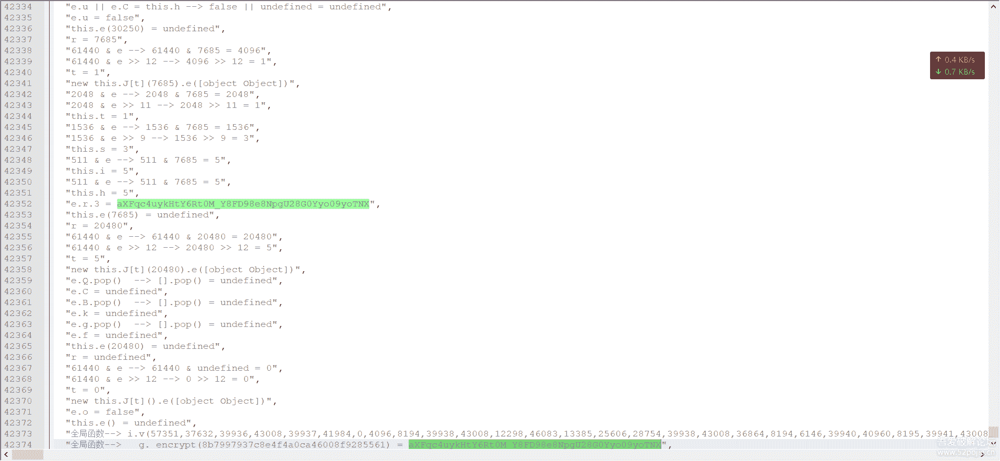

`image.png` (124.65 KB, 下载次数: 0)

[附件](https://www.52pojie.cn/forum.php?mod=attachment&aid=MjUyODE1N3w0NjFmNjg1MHwxNzkzNTc1MzY2fDE2ODA4NnwxNjQ1MzAw&nothumb=yes)

2022-6-6 08:18 上传

再往上看 发现 是计算出每个值并拼接而成 且仔细的靓仔也发现了`"X"`来自`对照表.charAt(4,)` 那么`"4"`来自哪里内 我们接着往上

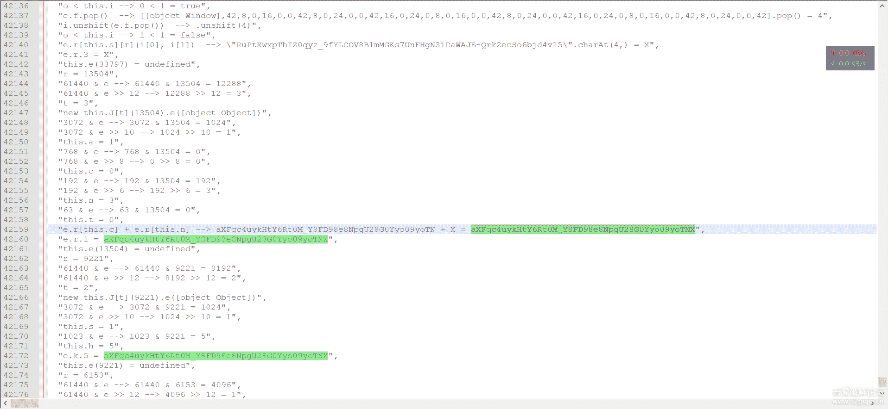

`image.png` (130.29 KB, 下载次数: 0)

[附件](https://www.52pojie.cn/forum.php?mod=attachment&aid=MjUyODE1OXxjNTM2YjJlZHwxNzkzNTc1MzY2fDE2ODA4NnwxNjQ1MzAw&nothumb=yes)

2022-6-6 08:20 上传

`push(4)` `pop(4)`没用 接着往上

锵锵 对`left`值进行`& 63`得到 那么接着跟`left`的4

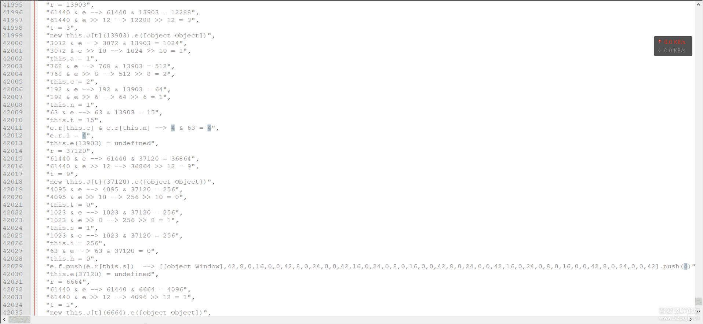

`image.png` (112.68 KB, 下载次数: 0)

[附件](https://www.52pojie.cn/forum.php?mod=attachment&aid=MjUyODE2MHw4ZmY5YWQ5OXwxNzkzNTc1MzY2fDE2ODA4NnwxNjQ1MzAw&nothumb=yes)

2022-6-6 08:21 上传

又是两个值运算 注意这两个值 经过`1204791 >>>`得到4 `charAt(4,)` = “X” 当然还对`1204791`有兴趣 上跟

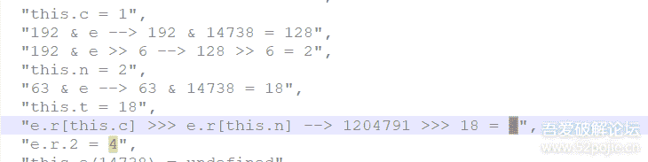

`image.png` (19.42 KB, 下载次数: 0)

[附件](https://www.52pojie.cn/forum.php?mod=attachment&aid=MjUyODE2MXw5YmNkZWRiNXwxNzkzNTc1MzY2fDE2ODA4NnwxNjQ1MzAw&nothumb=yes)

2022-6-6 08:22 上传

没有发现`right`值18 反倒是一直在用`left`的值`1204791` 又对其`12- 6- 63`运算 并得到了密文后四位`"oTNX"` 继续跟`1204791`的生成 搜索`= 1204791`

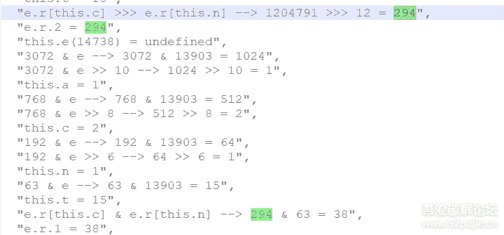

`image.png` (31.46 KB, 下载次数: 0)

[附件](https://www.52pojie.cn/forum.php?mod=attachment&aid=MjUyODE2MnxjMjUzODMwMnwxNzkzNTc1MzY2fDE2ODA4NnwxNjQ1MzAw&nothumb=yes)

2022-6-6 08:24 上传

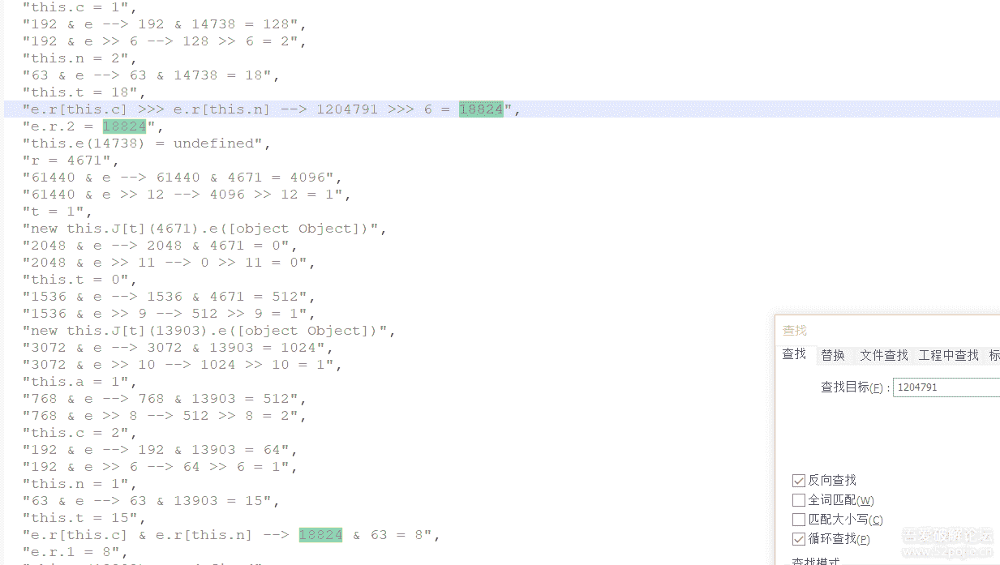

`image.png` (67.38 KB, 下载次数: 0)

[附件](https://www.52pojie.cn/forum.php?mod=attachment&aid=MjUyODE2M3w2ZjQ3YWYzMXwxNzkzNTc1MzY2fDE2ODA4NnwxNjQ1MzAw&nothumb=yes)

2022-6-6 08:25 上传

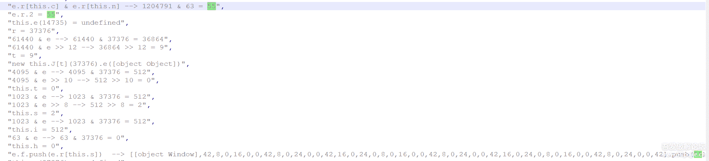

`image.png` (43.55 KB, 下载次数: 0)

[附件](https://www.52pojie.cn/forum.php?mod=attachment&aid=MjUyODE2NHw5N2RkMDhjYXwxNzkzNTc1MzY2fDE2ODA4NnwxNjQ1MzAw&nothumb=yes)

2022-6-6 08:26 上传

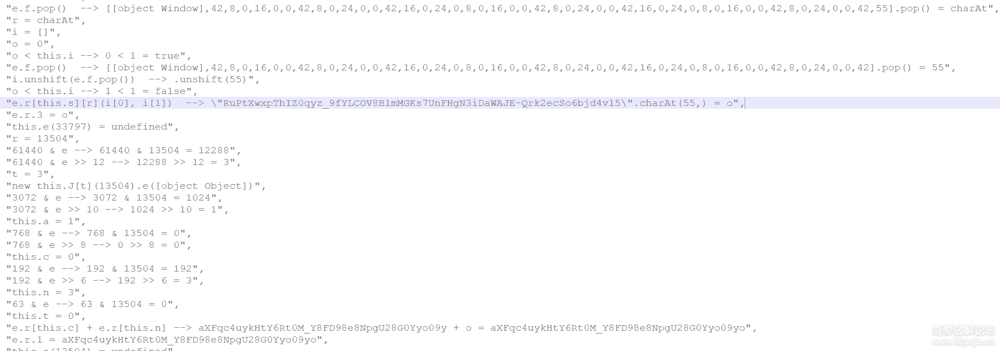

`image.png` (70.89 KB, 下载次数: 0)

[附件](https://www.52pojie.cn/forum.php?mod=attachment&aid=MjUyODE2N3xhMjk3ZDFhOXwxNzkzNTc1MzY2fDE2ODA4NnwxNjQ1MzAw&nothumb=yes)

2022-6-6 08:36 上传

也是两个值运算得到`right`值就在上面 这么近先跟它

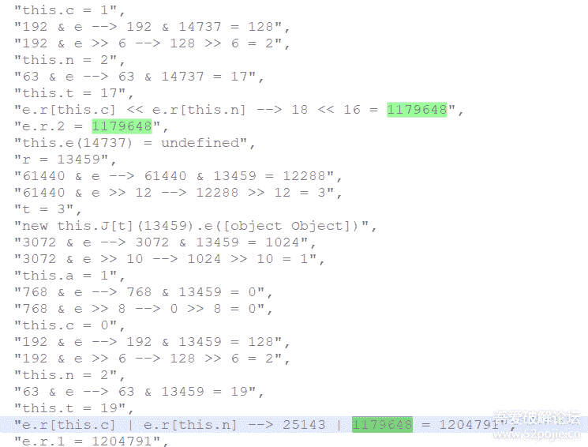

`image.png` (48.82 KB, 下载次数: 0)

[附件](https://www.52pojie.cn/forum.php?mod=attachment&aid=MjUyODE2OHw0NGUxNTE2ZnwxNzkzNTc1MzY2fDE2ODA4NnwxNjQ1MzAw&nothumb=yes)

2022-6-6 08:39 上传

两个值运算 好家伙永无止境了嘛 不是

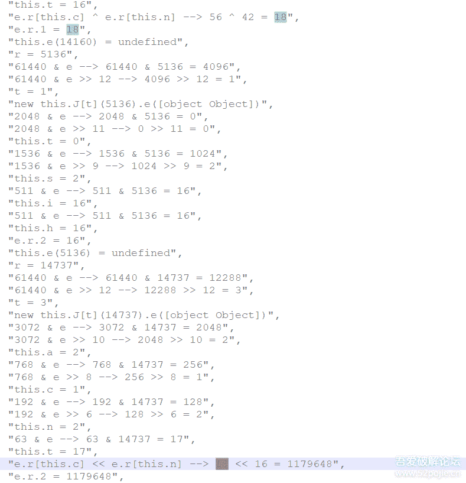

`image.png` (63.18 KB, 下载次数: 0)

[附件](https://www.52pojie.cn/forum.php?mod=attachment&aid=MjUyODE2OXxlNGQzMzVmNHwxNzkzNTc1MzY2fDE2ODA4NnwxNjQ1MzAw&nothumb=yes)

2022-6-6 08:40 上传

终于看到传入的明文了 取了下标0并`charCodeAt` 明明是最后一个密文拼接还取0 搜索`"8b7997937c8e4f4a0ca46008f9285561\u0000\".charCodeAt(` 嗯 是倒着取明文的

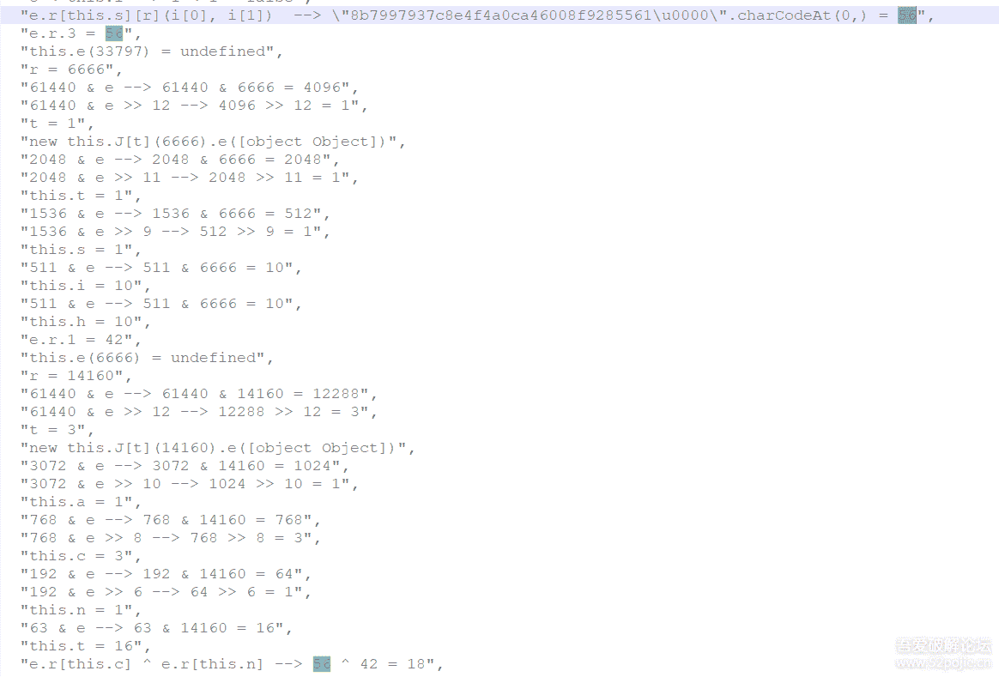

`image.png` (64.46 KB, 下载次数: 0)

[附件](https://www.52pojie.cn/forum.php?mod=attachment&aid=MjUyODE3MHw1ZTI2ZTMwYXwxNzkzNTc1MzY2fDE2ODA4NnwxNjQ1MzAw&nothumb=yes)

2022-6-6 08:41 上传

所以前面`1204791`的`right`值= `charCodeAt(0,) ^ 42`

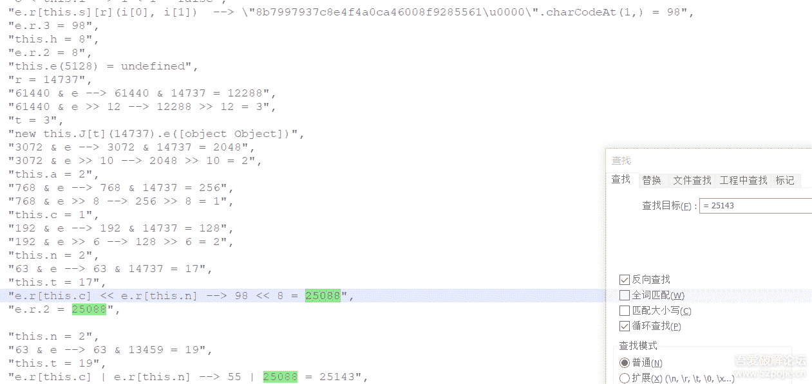

`image.png` (62.63 KB, 下载次数: 0)

[附件](https://www.52pojie.cn/forum.php?mod=attachment&aid=MjUyODE3MXw2ZGU0NzI5ZXwxNzkzNTc1MzY2fDE2ODA4NnwxNjQ1MzAw&nothumb=yes)

2022-6-6 08:43 上传

只对`charCodeAt(1,) ^ 0` 嗯 四个密文到头了 取了前三个下标内容 猜测就是倒序3个一组

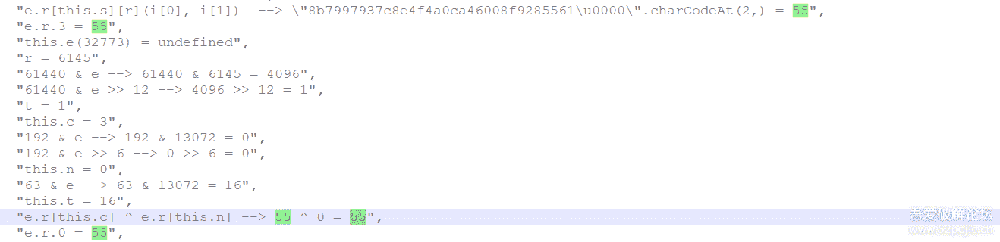

`image.png` (31.56 KB, 下载次数: 0)

[附件](https://www.52pojie.cn/forum.php?mod=attachment&aid=MjUyODE3MnxlNWUwNDg4M3wxNzkzNTc1MzY2fDE2ODA4NnwxNjQ1MzAw&nothumb=yes)

2022-6-6 08:46 上传

单单一组`"oTNX"`的结束了 纵观全局也是这样处理的 无非运算时对几个固定值随加密轮数变化

## 结论

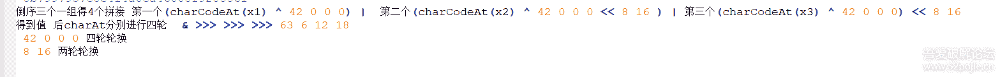

`image.png` (16.8 KB, 下载次数: 0)

[附件](https://www.52pojie.cn/forum.php?mod=attachment&aid=MjUyODE1Nnw2NDhjZWVmOXwxNzkzNTc1MzY2fDE2ODA4NnwxNjQ1MzAw&nothumb=yes)

2022-6-6 08:17 上传

## 算法

测试这个函数，与浏览器生成的值是一样的 当然可以写的更优雅点

`JavaScript` 纯文本查看 复制代码

```javascript
var jjj = "RuPtXwxpThIZ0qyz_9fYLCOV8B1mMGKs7UnFHgN3iDaWAJE-Qrk2ecSo6bjd4vl5"
function sign(data){
	let a = b = c = 0
	let A = [42,0,0,0]
	let B = [8,16,8,16] 
	let C = [63,6,12,18]
	let len = data.length
	len % 3 == 1 ? data += "\u0000\u0000" : len % 3 == 2 ? data += "\u0000" : null
	len = data.length
	let result = ''
	function AA(){
		a == A.length ? a = 0:null
		return A[a++]
	}
	function BB(){
		b == B.length ? b = 0:null
		return B[b++]
	}
	function CC(){
		c == C.length ? c = 0:null
		return C[c++]
	}
	for(;len > 0; len = len-3) {
		let D = (data.charCodeAt(len -1) ^ AA()) | ((data.charCodeAt(len -2) ^ AA()) >> CC()) & 63)
		result += jjj.charAt((E >>> CC()) & 63)
		result += jjj.charAt((E >>> CC()) & 63)
	}
	return result
}
//sign(data)
```
