# [原创] 练习笔记之手撕常见压缩壳

- 原帖：https://www.52pojie.cn/forum.php?mod=viewthread&tid=1646466
- 抓取时间：2026-11-01T23:22:44

## 手撕压缩壳练习

这个是对之前网友“关于压缩壳脱壳步骤详解！看这一篇足够。”（[//www.52pojie.cn/thread-1641368-1-1.html](https://www.52pojie.cn/thread-1641368-1-1.html)）的练习文件进行练习的一点记录，写的比较流水帐，非菜鸟建议直接看结论就够了。

### 1. UPX v3.91

#### 1.1 `ESP`定律

`F8`单步，运行到寄存器只有`ESP`和`EIP`为红色（有的程序运行一步就可以，有的需要多步），右键`ESP`的地址，选择在数据窗口跟随，然后在数据窗口右键该地址，设置硬件访问断点，然后`F9`运行。

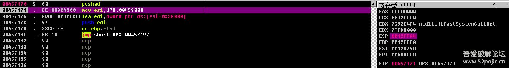

`upx-01.png` (14.82 KB, 下载次数: 1) [附件链接](https://www.52pojie.cn/forum.php?mod=attachment&aid=MjUyODY0NHw1ZmU5YWE1NXwxNzkzNTc1MzYyfDE2ODA4NnwxNjQ2NDY2&nothumb=yes) 2022-6-8 13:53 上传

程序断在457348这行，单步运行到47355这个地址，后面都是0，看多了就知道这个是UPX的特征。

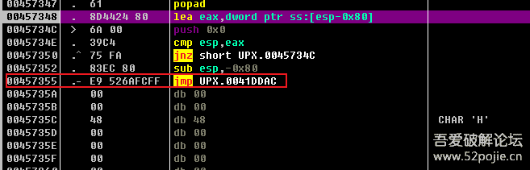

`upx-02.png` (11.71 KB, 下载次数: 2) [附件链接](https://www.52pojie.cn/forum.php?mod=attachment&aid=MjUyODY0NXw0NjNkOTVhOXwxNzkzNTc1MzYyfDE2ODA4NnwxNjQ2NDY2&nothumb=yes) 2022-6-8 13:53 上传

这个跳转过去的地址就是到了41DDAC，再往下单步执行，41DDB1的跳转跳过去就到了OEP（OEP就是程序没加壳前的入口地址，不同编译软件编译出来的代码特征各不相同，但大部分都是`push XX`开头）。

```
0041DDAC    E8 EF4E0000     call UPX.00422CA0
0041DDB1  ^ E9 79FEFFFF     jmp UPX.0041DC2F        ;大跳转
;跳过去后的代码
0041DC2F    6A 58           push 0x58
0041DC31    68 D0C74300     push UPX.0043C7D0
0041DC36    E8 C12A0000     call UPX.004206FC
0041DC3B    33F6            xor esi,esi
0041DC3D    8975 FC         mov dword ptr ss:[ebp-0x4],esi
0041DC40    8D45 98         lea eax,dword ptr ss:[ebp-0x68]
0041DC43    50              push eax
0041DC44    FF15 74214300   call dword ptr ds:[0x432174]             ; kernel32.GetStartupInfoW
```

#### 1.2 特征搜索

这个方法针对UPX壳的特征（大跳转后面接着是大块的0），直接在代码区`Ctrl+B`搜索二进制字符串，输入一长串的0，然后搜索，找到的位置往上看，就是一个大跳转，单步跟踪两步就到了OEP。

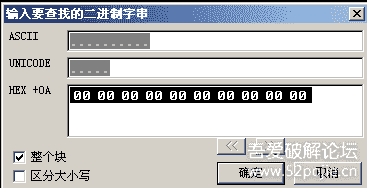

`upx-03.png` (12.63 KB, 下载次数: 1) [附件链接](https://www.52pojie.cn/forum.php?mod=attachment&aid=MjUyODY0NnwyNDE1OWU1M3wxNzkzNTc1MzYyfDE2ODA4NnwxNjQ2NDY2&nothumb=yes) 2022-6-8 13:53 上传

#### 1.3 直接往下翻代码法

按大佬的说法，UPX壳太简单了，直接往下翻就是。OD打开程序后，直接停在`00457170 > $  60  pushad`位置（如果没有停在这个位置，打开调试选项按下图将第一次暂停设置在主模块入口点），然后往下翻大概5页代码，就到了457355这个大跳转（跳的距离比较远）位置，后面都是一堆的0。这个时候到41DDAC看的话，都是0，这个是正常的，因为壳程序还没运行，内容还没解压出来。在457355行按`F2`设下断点，`F9`运行后，再到41DDAC看，程序代码就都出来了，这个往下单步跟踪两步就到OEP了。

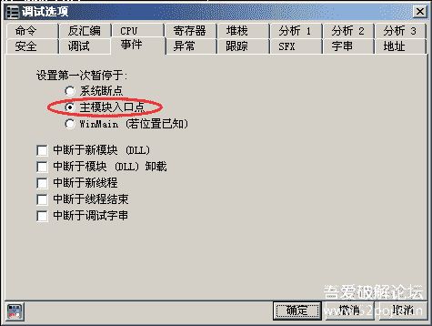

`upx-04.png` (20.54 KB, 下载次数: 2) [附件链接](https://www.52pojie.cn/forum.php?mod=attachment&aid=MjUyODY0N3wyYjdjYzk0YXwxNzkzNTc1MzYyfDE2ODA4NnwxNjQ2NDY2&nothumb=yes) 2022-6-8 13:53 上传

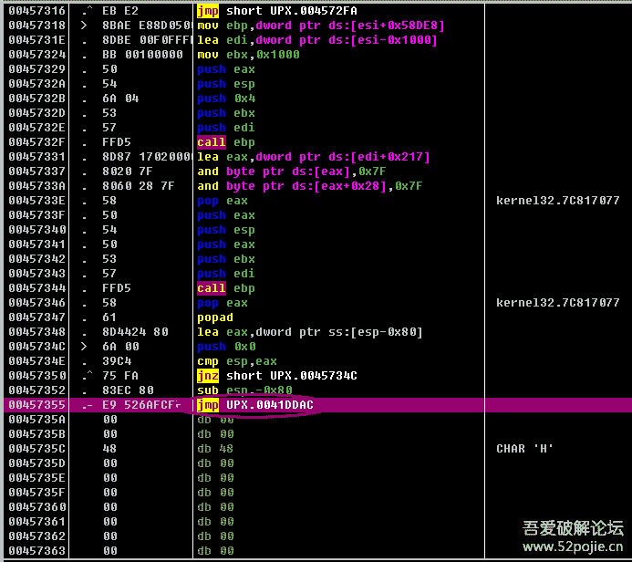

`upx-05.png` (28.19 KB, 下载次数: 0) [附件链接](https://www.52pojie.cn/forum.php?mod=attachment&aid=MjUyODY0OHw0ZGFiY2JjOHwxNzkzNTc1MzYyfDE2ODA4NnwxNjQ2NDY2&nothumb=yes) 2022-6-8 13:53 上传

#### 1.4 单步跟踪法

按介绍“单步（`F8`）、单步进入（`F7`）和运行到（`F4`）功能，完整走过程序的自脱壳过程（不断使用`F8`向下运行，遇见向上跳转的就用`F4`），跳过一些循环恢复代码的片段，并用单步进入确保程序不会略过OEP。”，其中`F4`在下拉菜单没有看到，百度了一下才知道这个快捷键的作用是“运行到所选择的那一行。作用就是直接运行到光标所在位置处暂停。”。之前只会在循环往上跳的下一行`F2`下断点后执行，现在学会了用`F4`，效率更高。

试着跟了一次，飞了……为什么？明明前面就两个系统函数调用，函数调用执行完程序没有飞啊。

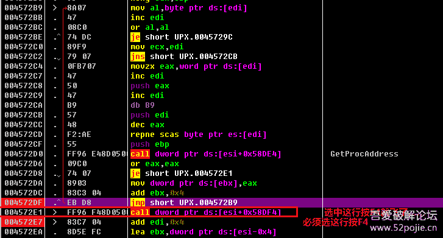

`upx-06.png` (28.17 KB, 下载次数: 1) [附件链接](https://www.52pojie.cn/forum.php?mod=attachment&aid=MjUyODY0OXw1OWZmOTA3YXwxNzkzNTc1MzYyfDE2ODA4NnwxNjQ2NDY2&nothumb=yes) 2022-6-8 13:54 上传

重新再来一次，发现4572DF这行有个向上跳转，选中它的下一行按`F4`就飞了……这对新手太不友好了吧～

只好仔细在看看循环部分的代码，发现里面有个跳转直接调到4572E7了，因此`Ctrl+F2`重来，直接选中4572E7按`F4`，终于没有飞，再往后`F8`就毫无波澜的来到了OEP。

#### 1.5 内存镜像法（二次断点法）

按攻略方法，试了n次，发现都不管用。百度了一下，发现大佬说UPX和ASPACK用这个方法不灵光，原因是这两种壳将`code`段解压完毕的时候马上就`JMP`到OEP去，所以第二次断点断不下来。具体原理可以再查查资料了解，对新手来说，知道这个方式不适用就行了，否则像我一样，一直怀疑是自己操作的姿势不对，反复操作，直到怀疑人生……

#### 1.6 一步到达OEP

`ctrl+f`查找`popad`，注意去掉整个块的勾选，第一个跳转就来到了457355附近。


`upx-07.png` (11.78 KB, 下载次数: 1) [附件链接](https://www.52pojie.cn/forum.php?mod=attachment&aid=MjUyODY1MHwwZGRiYTM3OXwxNzkzNTc1MzYyfDE2ODA4NnwxNjQ2NDY2&nothumb=yes) 2022-6-8 13:54 上传

#### 1.7 最后一次异常法

OD打开文件，按下`F9`。呃……直接程序界面出来了。把调试选型中的忽视异常选项全部去掉，把插件Strong OD中的“忽视”也取消掉了，重启OD，再次按下`F9`，程序界面又直接出来了。猜测是不是有哪个插件也有忽视异常的功能，导致停不下来。

关掉OD，找到OD目录下的`plugin`文件夹，将里面的文件全部移走，然后再试。结果，这感觉是吃了炫迈啊，完全停不下来……导致我怀疑是不是我的OD坏了。还好换个其他的壳试了试，至少是有异常断点能停下来的，只能说是UPX的壳没有异常断点事件，所以这个方法不好使。

#### 1.8 SFX大法

由于SFX大法使用的条件是“当程序载入OD之后，入口点必须是代码段之外才可以用”，UPX壳的入口地址为457170，正好在程序代码段地址范围内，因此该方法不适用。

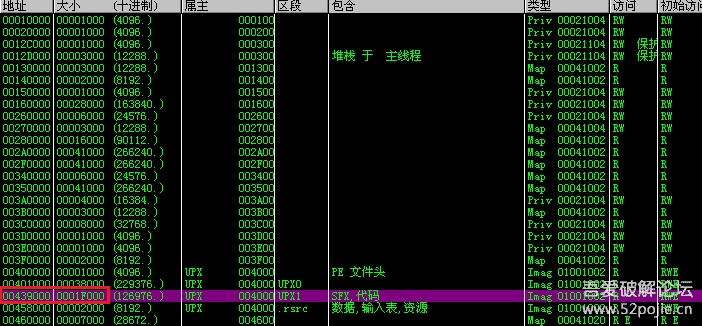

`upx-08.png` (23.08 KB, 下载次数: 0) [附件链接](https://www.52pojie.cn/forum.php?mod=attachment&aid=MjUyODY1MXxmZGVmYmJlMXwxNzkzNTc1MzYyfDE2ODA4NnwxNjQ2NDY2&nothumb=yes) 2022-6-8 13:54 上传

#### 1.9 Dump和IAT修复

UPX的壳只需要使用`ollydump`进行dump就可以直接运行了，不需要特别的IAT修复，具体操作步骤祥见3.9。

### 2. PECompact v2.78a ~ 3.11

#### 2.1 `ESP`定律

设置硬件断点后，会停在以下位置。

```
005AA203    53              push ebx
```

接着`F8`单步跟踪，下面找到一个大跳转，大跳转后面全是0。这个跳转过去后就是OEP了。

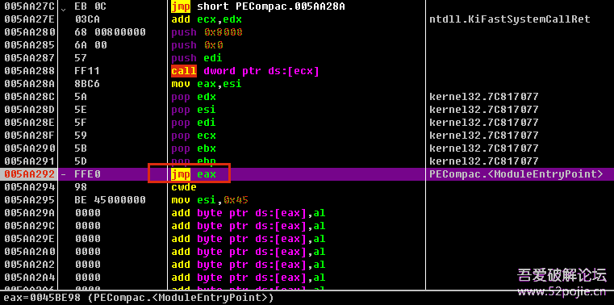

`PECompact-01.png` (20.38 KB, 下载次数: 0) [附件链接](https://www.52pojie.cn/forum.php?mod=attachment&aid=MjUyODY1M3xjYjYwMjljMnwxNzkzNTc1MzYyfDE2ODA4NnwxNjQ2NDY2&nothumb=yes) 2022-6-8 13:54 上传

#### 2.2 特征搜索

根据大佬的总结，PECompact壳的特征码为`03 CA 68 00 80 00 00 6A 00 57 FF 11 8B C6 5A 5E 5F 59 5B 5D`，看下面代码就可以看出，大跳转前的指令都是固定的。


```
005AA27E    03CA            add ecx,edx                              ; ntdll.KiFastSystemCallRet
005AA280    68 00800000     push 0x8000
005AA285    6A 00           push 0x0
005AA287    57              push edi
005AA288    FF11            call dword ptr ds:[ecx]
005AA28A    8BC6            mov eax,esi
005AA28C    5A              pop edx                                  ; kernel32.7C817077
005AA28D    5E              pop esi                                  ; kernel32.7C817077
005AA28E    5F              pop edi                                  ; kernel32.7C817077
005AA28F    59              pop ecx                                  ; kernel32.7C817077
005AA290    5B              pop ebx                                  ; kernel32.7C817077
005AA291    5D              pop ebp                                  ; kernel32.7C817077
005AA292  - FFE0            jmp eax                                  ; PECompac.
```

## 2. PECompact

### 2.2 特征搜索

OD打开程序后，直接`Ctrl+B`，输入十六进制特征码，搜索就可以直达大跳转位置，在大跳转上`F2`设置断点，运行过去就可以了。

但是这里也会翻车，我用OllyDbg吾爱专版，死活搜索不到，换成OllyDbgV2.01和X32dbg都可以，换成OllyICE吾爱扣扣专版和OllyICE原版都不行。查了一下发现这几个找不到的OD在载入代码的时候，最多载入到`5A7FFF`，后面就没有了，只有`Ctrl+G`跳转到后面的地址才能搜索到。找了半天也没找到问题出在哪个设置上，有哪位大佬知道的话麻烦告知一下。

### 2.3 直接往下翻代码法

呃，这个壳好像不行，前面的代码太长了，翻不到……

### 2.4 单步跟踪法

这个程序`F8`单步到`45BEAE`这一行时，执行一个`mov`指令会跳转到系统领空，不是很明白原理，可能是触发了异常，自动进入异常处理程序。

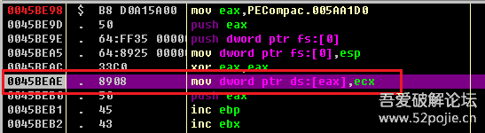

`PECompact-06.png` (10.29 KB, 下载次数: 0)

[href="forum.php?mod=attachment&aid=MjUyODY1OHw5YTQyMDNjM3wxNzkzNTc1MzYyfDE2ODA4NnwxNjQ2NDY2&nothumb=yes" target="_blank"](https://www.52pojie.cn/forum.php?mod=attachment&aid=MjUyODY1OHw5YTQyMDNjM3wxNzkzNTc1MzYyfDE2ODA4NnwxNjQ2NDY2&nothumb=yes)

2022-6-8 13:54 上传

没关系，继续单步跟踪，到`call ntdll.ZwContinue`这行时，就跑飞了。

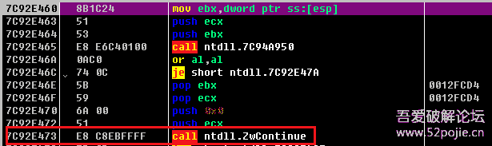

`PECompact-07.png` (11.01 KB, 下载次数: 0)

[href="forum.php?mod=attachment&aid=MjUyODY1OXw4NDQzYTg2YnwxNzkzNTc1MzYyfDE2ODA4NnwxNjQ2NDY2&nothumb=yes" target="_blank"](https://www.52pojie.cn/forum.php?mod=attachment&aid=MjUyODY1OXw4NDQzYTg2YnwxNzkzNTc1MzYyfDE2ODA4NnwxNjQ2NDY2&nothumb=yes)

2022-6-8 13:55 上传

因此需要重来，到这个位置按`F7`单步进入，结果在调用`ntdll.KiFastSystemCall`时，又跑飞了。再重来，两个跑飞的地方都单步进入，之后就应该能跟到`jmp eax`这个跳转位置了。

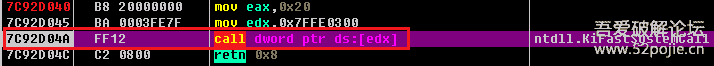

`PECompact-08.png` (9.63 KB, 下载次数: 1)

[href="forum.php?mod=attachment&aid=MjUyODY2MHxhMGFkODQ1MnwxNzkzNTc1MzYyfDE2ODA4NnwxNjQ2NDY2&nothumb=yes" target="_blank"](https://www.52pojie.cn/forum.php?mod=attachment&aid=MjUyODY2MHxhMGFkODQ1MnwxNzkzNTc1MzYyfDE2ODA4NnwxNjQ2NDY2&nothumb=yes)

2022-6-8 13:55 上传

### 2.5 内存镜像法（二次断点法）

尝试了一下，没有成功。再找了一下别人的教程，发现是也可以，但是操作的时候有个地方要特别注意。

载入程序后，按`Alt+M`，进入内存界面，找到第一个`.rsrc`，按`F2`下断点，然后`F9`运行。断下后，再按`Alt+M`，进入内存界面，找到之前那个上面的`.text`，按`F2`下断点，再`F9`运行。


`PECompact-03.png` (6.88 KB, 下载次数: 0)

[href="forum.php?mod=attachment&aid=MjUyODY1NXxiZTlkNWU3YXwxNzkzNTc1MzYyfDE2ODA4NnwxNjQ2NDY2&nothumb=yes" target="_blank"](https://www.52pojie.cn/forum.php?mod=attachment&aid=MjUyODY1NXxiZTlkNWU3YXwxNzkzNTc1MzYyfDE2ODA4NnwxNjQ2NDY2&nothumb=yes)

2022-6-8 13:54 上传

第二次断点后断下的位置如下图，注意它下面有个`retn`，不要单步运行这一行，否则后面的单步下去就会飞了，直接在`retn`下一行按`F2`设置断点，然后`F9`运行，断下后，在`F8`单步跟下去就能找到OEP了。这里还需要注意，不能选中`5AA1F3`这一行按`F4`，效果和`F2`下断点完全不一样。（菜鸟表示不明白为什么会这样）

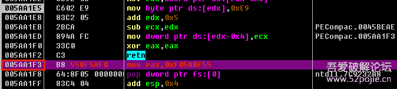

`PECompact-02.png` (13.31 KB, 下载次数: 1)

[href="forum.php?mod=attachment&aid=MjUyODY1NHw3ZTU5MGE5NHwxNzkzNTc1MzYyfDE2ODA4NnwxNjQ2NDY2&nothumb=yes" target="_blank"](https://www.52pojie.cn/forum.php?mod=attachment&aid=MjUyODY1NHw3ZTU5MGE5NHwxNzkzNTc1MzYyfDE2ODA4NnwxNjQ2NDY2&nothumb=yes)

2022-6-8 13:54 上传

### 2.6 一步到达OEP

用吾爱专用版OD因为载入不完整，查找是肯定找不到的。即使用其他办法的OD，`ctrl+f`查找`popad`，数量比较多，而且最后一个`popad`离跳转位置还是有点远的，不大容易发现，可以认为不适用。

### 2.7 最后一次异常法

注意准备工作做好，先打开调试选项，在异常页面将全部勾选项取消，然后如果插件有StrongOD的，到其选项设置界面中将`Skip some exception`取消勾选，然后重启OD。

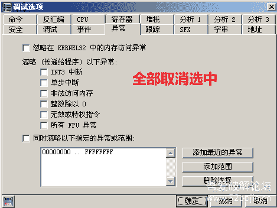

`PECompact-04.png` (24.67 KB, 下载次数: 1)

[href="forum.php?mod=attachment&aid=MjUyODY1NnxmODM1OWI1ZHwxNzkzNTc1MzYyfDE2ODA4NnwxNjQ2NDY2&nothumb=yes" target="_blank"](https://www.52pojie.cn/forum.php?mod=attachment&aid=MjUyODY1NnxmODM1OWI1ZHwxNzkzNTc1MzYyfDE2ODA4NnwxNjQ2NDY2&nothumb=yes)

2022-6-8 13:54 上传

按下`shift+F9`运行，出现异常断点后，再按`shift+F9`（不能按`F9`，因为有些异常按`F9`运行不下去）运行，发现只要三次就进入程序界面了。

`Ctrl+F2`重新运行，第一次出现异常断点后，再按`shift+F9`运行到第二个断点，程序停在`5AA1F3`行，如下图所示。接着`F8`单步很快就能找到OEP。

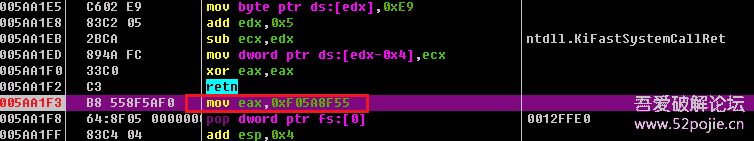

`PECompact-05.png` (12.47 KB, 下载次数: 1)

[href="forum.php?mod=attachment&aid=MjUyODY1N3wyZTk1N2RkN3wxNzkzNTc1MzYyfDE2ODA4NnwxNjQ2NDY2&nothumb=yes" target="_blank"](https://www.52pojie.cn/forum.php?mod=attachment&aid=MjUyODY1N3wyZTk1N2RkN3wxNzkzNTc1MzYyfDE2ODA4NnwxNjQ2NDY2&nothumb=yes)

2022-6-8 13:54 上传

此外，OllyDbg吾爱专版的插件中有一个叫异常计数器的插件，可以自动计数，先执行第一步：开始计数，然后重新运行，再选择第二步：带我到OEP，就能自动停在最后一个异常点上。

### 2.8 SFX大法

不适用，因为入口地址在代码段的地址范围内。

### 2.9 Dump和IAT修复

只需要使用`ollydump`进行dump就可以直接运行了，不需要特别的IAT修复，具体操作步骤祥见3.9。

## 3. FSG V2.0

### 3.1 ESP定律

这里需要注意，载入程序后按一下`F8`单步后，寄存器就只有`ESP`是红色了。这个时候去下硬件断点，发现可以直接断在大跳转位置。但是其实这个操作是不对的，因为我试了3个FSG V2.0的壳，其中有两个能正好跳到大跳转位置，另外一个直接飞了。正确的操作应该是在`popad`执行完后，再往下单步到寄存器只有`ESP`为红色的时候去下硬件断点。

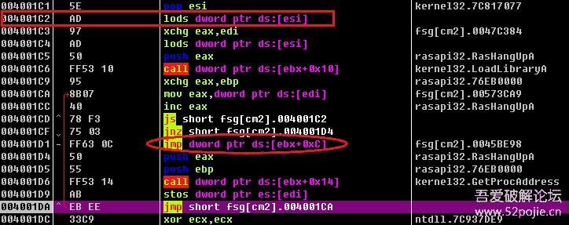

`FSG-13.png` (23.01 KB, 下载次数: 0)

[href="forum.php?mod=attachment&aid=MjUyODY3M3xlOTE3ZGQ0NnwxNzkzNTc1MzYyfDE2ODA4NnwxNjQ2NDY2&nothumb=yes" target="_blank"](https://www.52pojie.cn/forum.php?mod=attachment&aid=MjUyODY3M3xlOTE3ZGQ0NnwxNzkzNTc1MzYyfDE2ODA4NnwxNjQ2NDY2&nothumb=yes)

2022-6-8 13:56 上传

按`F9`运行，程序会停在`4001C2`这一行，这时记得将刚才设定的硬件断点取消（`[调试]→[硬件断点]`，删除），否则后面单步的时候会反复被断。然后单步运行到`4001DA`有个向上的跳转，这时候如果按`F4`运行到`4001DC`的话，程序就飞了。仔细看一下这断代码，我们发现`4001CF`有个判断，默认是跳过它下面的那个跳转的，而那个跳转看起来好眼熟，没错，这就是我们要找的大跳转。`F4`运行到这一行，然后再按`F8`单步，来到了一片陌生的领地……

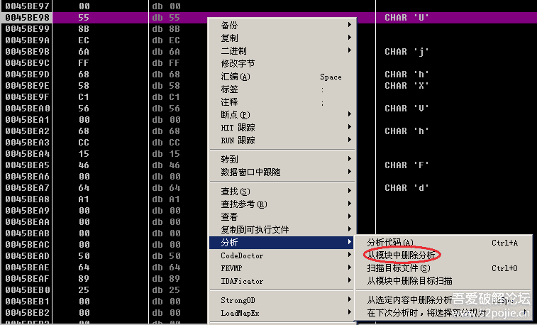

`FSG-14.png` (30.65 KB, 下载次数: 1)

[href="forum.php?mod=attachment&aid=MjUyODY4M3xjNTE1ODdlNHwxNzkzNTc1MzYyfDE2ODA4NnwxNjQ2NDY2&nothumb=yes" target="_blank"](https://www.52pojie.cn/forum.php?mod=attachment&aid=MjUyODY4M3xjNTE1ODdlNHwxNzkzNTc1MzYyfDE2ODA4NnwxNjQ2NDY2&nothumb=yes)

2022-6-8 14:04 上传

不要慌，这个时候只要右键，`[分析]→[从模块中删除分析]`，就可以见到我们熟悉的代码了。

### 3.2 特征搜索

FSG V2.0的OEP特征码为`95 8B 07 40 78 F3 75 03 FF 63 0C`，直接`Ctrl+B`搜索就可以直达OEP跳转位置。

### 3.3 直接往下翻代码法

往下翻两页，就能找到一个大跳转，跳过去一看，就是这个了。

### 3.4 单步跟踪法

因为OEP跳转位置离程序入口比较近，单步跟踪也很容易就能找到，有前面两个练习经验，这里就不再赘述了。

### 3.5 内存镜像法（二次断点法）

找到第一个`.rsrc`下断，运行，直接程序执行了，因此这个方法不大适用。

### 3.6 一步到达OEP

`ctrl+f`找了一下`popad`，就只有入口处一个，感觉意义不大。

### 3.7 最后一次异常法

完全停不下来，这个方法不适用。

### 3.8 SFX大法

入口地址在`400154`，并不在代码段范围内，因此可以用SFX方法。But，太慢了……我等到花儿也谢了……

### 3.9 Dump和IAT修复

按上述方法找到OEP后，打开插件OllyDump，选择脱壳在当前进程，界面如下所示。入口地址会自动修正为相对地址（OD中的OEP地址减去起始地址`400000`），如果自动获取不对的话，手动修改一下，其他按默认选项，点击脱壳进行脱壳。

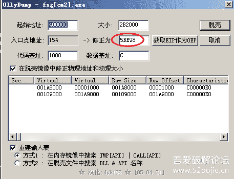

`FSG-01.png` (20.23 KB, 下载次数: 0)

[href="forum.php?mod=attachment&aid=MjUyODY2MXxjY2U2YWUwMHwxNzkzNTc1MzYyfDE2ODA4NnwxNjQ2NDY2&nothumb=yes" target="_blank"](https://www.52pojie.cn/forum.php?mod=attachment&aid=MjUyODY2MXxjY2U2YWUwMHwxNzkzNTc1MzYyfDE2ODA4NnwxNjQ2NDY2&nothumb=yes)

2022-6-8 13:55 上传

脱壳完成后，运行脱壳后的程序，发现无法正常运行，还需要进行IAT修复。打开Import REConstructor，在目标进程中选中未脱壳的程序进程，在OEP输入框中输入相对地址（OD中的OEP地址减去起始地址`400000`），然后点击`[AutoSearch]`进行搜索，正常会显示“Found Something！”对话框。

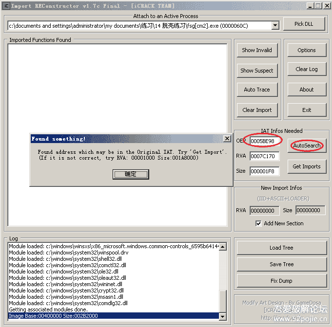

`FSG-02.png` (35.81 KB, 下载次数: 0)

[href="forum.php?mod=attachment&aid=MjUyODY2MnwzMTg4NWEzZHwxNzkzNTc1MzYyfDE2ODA4NnwxNjQ2NDY2&nothumb=yes" target="_blank"](https://www.52pojie.cn/forum.php?mod=attachment&aid=MjUyODY2MnwzMTg4NWEzZHwxNzkzNTc1MzYyfDE2ODA4NnwxNjQ2NDY2&nothumb=yes)

2022-6-8 13:55 上传

然后点击`[Get Imports]`，在左侧列表中会显示已经找到的API，如果都显示YES，则可以点击`[Fix Dump]`，选中上一步Dump出来无法正常运行的程序，确定。

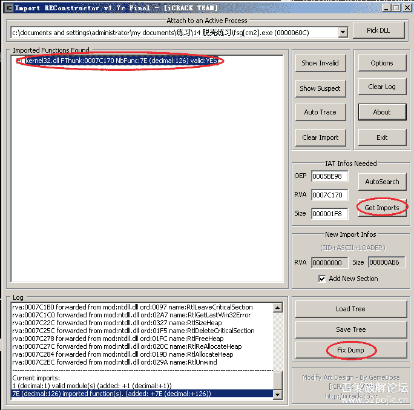

`FSG-03.png` (41.01 KB, 下载次数: 0)

[href="forum.php?mod=attachment&aid=MjUyODY2M3w3ZDczY2EzMnwxNzkzNTc1MzYyfDE2ODA4NnwxNjQ2NDY2&nothumb=yes" target="_blank"](https://www.52pojie.cn/forum.php?mod=attachment&aid=MjUyODY2M3w3ZDczY2EzMnwxNzkzNTc1MzYyfDE2ODA4NnwxNjQ2NDY2&nothumb=yes)

2022-6-8 13:55 上传

正常情况，到这一步以后，修复后的程序应该可以正常运行了，但是很遗憾，这个壳不行，还需要进一步修复。

起始如果多修复几种不同的壳程序我们就不难发现，这个壳`[Get Imports]`获取到的API只有`Kernel32.dll`下面的API，相比一次修复就正常的壳来说，少了不少dll文件。

这个时候我们需要在OD中回到OEP位置，然后向下找一下，可以找到一个系统API调用指令，其中调用指令的地址为`47C354`，选中这个地址，右键，选择在`[数据窗口中跟随]→[内存地址]`。

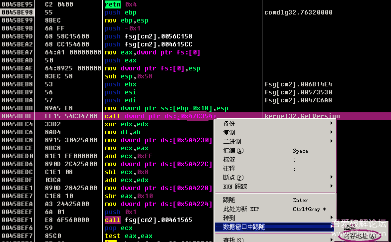

`FSG-04.png` (34.71 KB, 下载次数: 0)

[href="forum.php?mod=attachment&aid=MjUyODY2NHxlZDZmZmU2YnwxNzkzNTc1MzYyfDE2ODA4NnwxNjQ2NDY2&nothumb=yes" target="_blank"](https://www.52pojie.cn/forum.php?mod=attachment&aid=MjUyODY2NHxlZDZmZmU2YnwxNzkzNTc1MzYyfDE2ODA4NnwxNjQ2NDY2&nothumb=yes)

2022-6-8 13:55 上传

跳转后的数据区如下图所示。呃……这个其实不是大佬教程里展示给我们的界面。

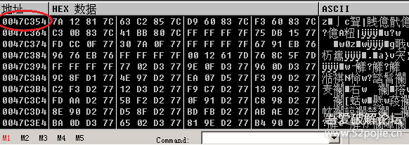

`FSG-05.png` (22 KB, 下载次数: 1)

[href="forum.php?mod=attachment&aid=MjUyODY2NXwxOTFkOWMyNXwxNzkzNTc1MzYyfDE2ODA4NnwxNjQ2NDY2&nothumb=yes" target="_blank"](https://www.52pojie.cn/forum.php?mod=attachment&aid=MjUyODY2NXwxOTFkOWMyNXwxNzkzNTc1MzYyfDE2ODA4NnwxNjQ2NDY2&nothumb=yes)

2022-6-8 13:55 上传

这里需要在数据区右键，选择`[长型]→[地址]`，这样会将程序所用到的系统API都列出来。

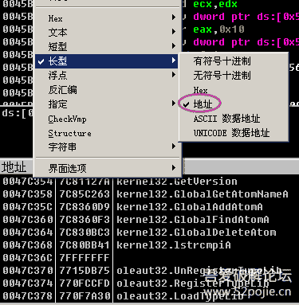

`FSG-06.png` (19.06 KB, 下载次数: 0)

[href="forum.php?mod=attachment&aid=MjUyODY2Nnw2MWZhODliNnwxNzkzNTc1MzYyfDE2ODA4NnwxNjQ2NDY2&nothumb=yes" target="_blank"](https://www.52pojie.cn/forum.php?mod=attachment&aid=MjUyODY2Nnw2MWZhODliNnwxNzkzNTc1MzYyfDE2ODA4NnwxNjQ2NDY2&nothumb=yes)

2022-6-8 13:56 上传

在数据区一直超上翻，翻到API前面是0的位置，如下图所示。记下地址`47C000`。

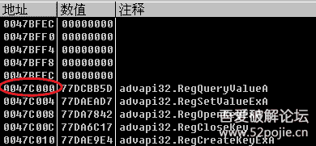

`FSG-07.png` (11.59 KB, 下载次数: 1)

[href="forum.php?mod=attachment&aid=MjUyODY2N3w4YzE1ZDVkY3wxNzkzNTc1MzYyfDE2ODA4NnwxNjQ2NDY2&nothumb=yes" target="_blank"](https://www.52pojie.cn/forum.php?mod=attachment&aid=MjUyODY2N3w4YzE1ZDVkY3wxNzkzNTc1MzYyfDE2ODA4NnwxNjQ2NDY2&nothumb=yes)

2022-6-8 13:56 上传

然后在数据区一直朝下翻，翻到API地址下方不在是API地址的地方，如下图所示。记下地址`47C6B4`。

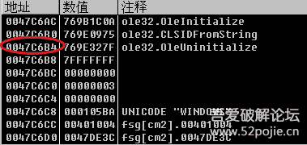

`FSG-08.png` (11.47 KB, 下载次数: 0)

[href="forum.php?mod=attachment&aid=MjUyODY2OHwzY2NmZTU2Y3wxNzkzNTc1MzYyfDE2ODA4NnwxNjQ2NDY2&nothumb=yes" target="_blank"](https://www.52pojie.cn/forum.php?mod=attachment&aid=MjUyODY2OHwzY2NmZTU2Y3wxNzkzNTc1MzYyfDE2ODA4NnwxNjQ2NDY2&nothumb=yes)

2022-6-8 13:56 上传

打开Import REConstructor，在目标进程中选中未脱壳的程序进程，在OEP输入框中输入相对地址（OD中的OEP地址减去起始地址`400000`），在`RVA`输入框中输入刚才记录下的API起始地址（OD中的地址值减去起始地址`400000`），在`Size`输入框输入大小（最小值为`47C6B4-47C000`，也可以输入稍大一些的值，比如`1000`），然后点击`[Get Imports]`，找到了一大批，但是后面都是NO。

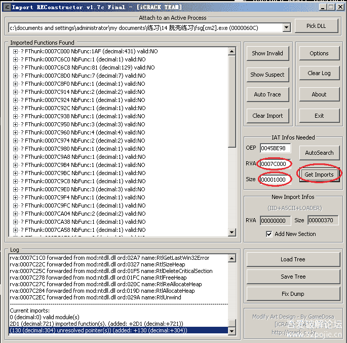

`FSG-09.png` (50.9 KB, 下载次数: 0)

[href="forum.php?mod=attachment&aid=MjUyODY2OXxhNTFjYzlhYXwxNzkzNTc1MzYyfDE2ODA4NnwxNjQ2NDY2&nothumb=yes" target="_blank"](https://www.52pojie.cn/forum.php?mod=attachment&aid=MjUyODY2OXxhNTFjYzlhYXwxNzkzNTc1MzYyfDE2ODA4NnwxNjQ2NDY2&nothumb=yes)

2022-6-8 13:56 上传

点击`[Show Invalid]`按钮，会自动将无效的API项显示出来，右键`[Cut thunks]`，一键将无效API信息删除。

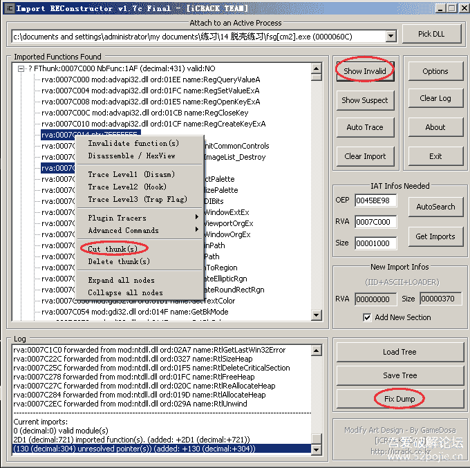

`FSG-10.png` (51.17 KB, 下载次数: 1)

[href="forum.php?mod=attachment&aid=MjUyODY3MHw2Y2NlM2Y3YXwxNzkzNTc1MzYyfDE2ODA4NnwxNjQ2NDY2&nothumb=yes" target="_blank"](https://www.52pojie.cn/forum.php?mod=attachment&aid=MjUyODY3MHw2Y2NlM2Y3YXwxNzkzNTc1MzYyfDE2ODA4NnwxNjQ2NDY2&nothumb=yes)

2022-6-8 13:56 上传

然后“Imported Functions”区域的API有效性都显示为YES，点击`[Fix Dump]`，选中从OD中Dump出来无法正常运行的程序，确定。这个时候再运行修复后的程序，可以正常运行了。

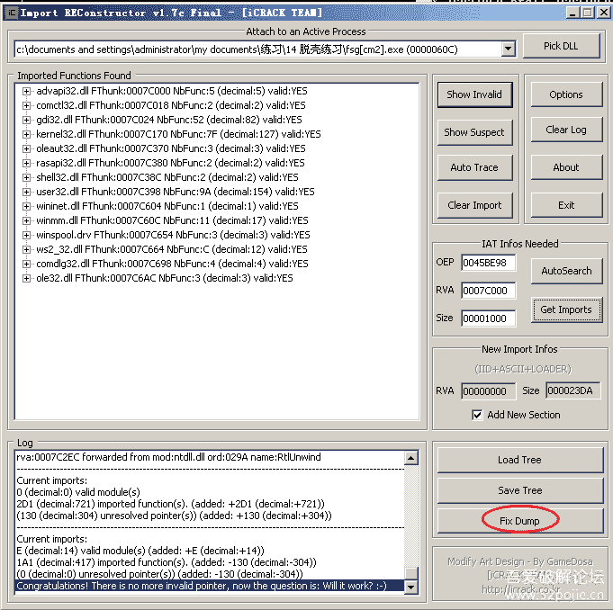

`FSG-11.png` (40.81 KB, 下载次数: 0)

[href="forum.php?mod=attachment&aid=MjUyODY3MXw5OGZlNGQ3ZnwxNzkzNTc1MzYyfDE2ODA4NnwxNjQ2NDY2&nothumb=yes" target="_blank"](https://www.52pojie.cn/forum.php?mod=attachment&aid=MjUyODY3MXw5OGZlNGQ3ZnwxNzkzNTc1MzYyfDE2ODA4NnwxNjQ2NDY2&nothumb=yes)

2022-6-8 13:56 上传

虽然脱壳后的程序功能正常了，但是用"Exeinfo PE"检查发现还是显示为有未知壳，不知道什么原因，我试了用专门的脱壳软件脱出来也是一样，估计是压缩的时候有部分信息被删除了，而"Exeinfo PE"是依靠这些信息来判断的。换用PEID查就能识别出来。

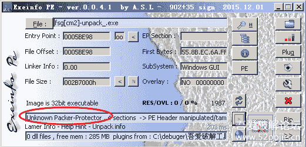

`FSG-12.png` (105.2 KB, 下载次数: 0)

[href="forum.php?mod=attachment&aid=MjUyODY4MnwwMDRjM2UxYXwxNzkzNTc1MzYyfDE2ODA4NnwxNjQ2NDY2&nothumb=yes" target="_blank"](https://www.52pojie.cn/forum.php?mod=attachment&aid=MjUyODY4MnwwMDRjM2UxYXwxNzkzNTc1MzYyfDE2ODA4NnwxNjQ2NDY2&nothumb=yes)

2022-6-8 14:04 上传

### 3.10 后记

为了庆祝学习手撕FSG顺利出师，随意找了两个160CrackMe里的练习题，用FSG 2.0加了个壳，然后再去脱壳。

找OEP是没问题了，但是按前面的修复方法进行修复，却翻车了……

第一个程序`Brad Soblesky.2.exe`，找OEP情况正常，修复时找API起始地址也正常，但是修复后双击程序，没有任何反应。尝试用x32dbg的Scylla插件进行dump和修复，修复完运行出错。

接着我又用`UnFSG2.0`工具脱了一下，呃，，，也是运行没有反应……

第二个程序`CKme.exe`，找OEP情况正常，默认代码被识别成数据，右键选择`[从模块中删除分析]`后，代码显示的的OEP入口地址就不见了，如下图。

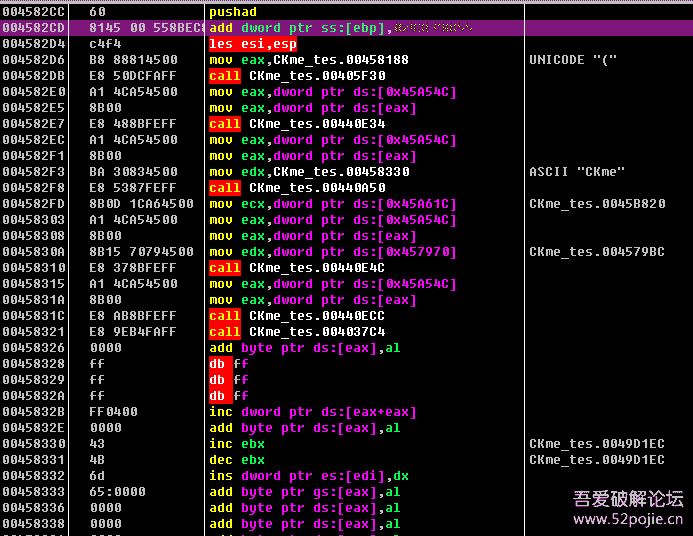

`FSG-15.png` (28.67 KB, 下载次数: 0)

[href="forum.php?mod=attachment&aid=MjUyODY3NXxiN2ZhNWQyNnwxNzkzNTc1MzYyfDE2ODA4NnwxNjQ2NDY2&nothumb=yes" target="_blank"](https://www.52pojie.cn/forum.php?mod=attachment&aid=MjUyODY3NXxiN2ZhNWQyNnwxNzkzNTc1MzYyfDE2ODA4NnwxNjQ2NDY2&nothumb=yes)

2022-6-8 13:56 上传

按`-`返回再按回去进入，能正常的看到入口地址和正确的代码，但是上下一滚动代码区，就右变回到上一个图片的样子了。这个暂时不知道怎么解决，然而这不是关键，关键的是这个程序代码后面没几行没看到API调用函数。

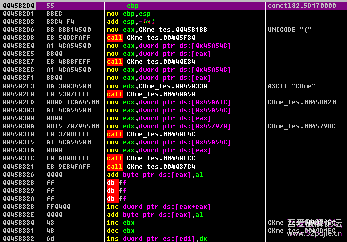

`FSG-16.png` (27.97 KB, 下载次数: 2)

[href="forum.php?mod=attachment&aid=MjUyODY4NHwwZDkzYWVlMnwxNzkzNTc1MzYyfDE2ODA4NnwxNjQ2NDY2&nothumb=yes" target="_blank"](https://www.52pojie.cn/forum.php?mod=attachment&aid=MjUyODY4NHwwZDkzYWVlMnwxNzkzNTc1MzYyfDE2ODA4NnwxNjQ2NDY2&nothumb=yes)

2022-6-8 14:04 上传

一时不知如何时候，后来单步跟踪了一下，发现倒数第二个调用函数进去后能找到`api`函数的`call`，再进去就能看到很多`api`函数的`jmp`，找一个靠前的地址（`45C000`，大小设置为`1000`），修复完成后总算可以运行了。

有些程序打开后无法停到程序入口，直接停在`ntdll`模块。后来发现是插件StrongOD的问题，这个问题出现在一些文件路径存在空格的程序中。目前发现的规律是有些程序，程序名存在空格，如果文件夹名称也存在空格，就有可能出现问题。如果单独把程序名或文件夹的空格去除，都能正常找到程序入口。但是不是所有程序都会有这个问题，有些程序即时路径和文件名都存在空格也能够停在程序入口。大家有兴趣可以试试这个文件`Brad Soblesky.2.exe`。

然而让人自闭的是，刚刚总结完成上述经验后，再次打开之前的程序`CKme.exe`，发现它在程序入口地址也停不下来了，反而是测试时改了名字的`CKme test.2.exe`能停下来。这这这……太不科学了吧。。。

## 4. Aspack v2.24 - 2.34

### 4.1 ESP定律

按一次`F8`后，寄存器区域就只有`ESP`为红色，右键`[在数据窗口跟随]`，然后设上硬件断点。运行断下后再`F8`单步，这里注意执行到一个`retn`后跳到的地方被识别成数据，需要右键`[分析]→[从模块中删除分析]`后才能见到代码模式，大跳转就在下面，跳过去一看，确定是OEP无误。


```
0041DDAC   .  E8 EF4E0000   call aspack.00422CA0

0041DDB1   .^ E9 79FEFFFF   jmp aspack.0041DC2F

;跳过去后的代码

0041DC2F   > /6A 58         push 0x58

0041DC31   . |68 D0C74300   push aspack.0043C7D0

0041DC36   . |E8 C12A0000   call aspack.004206FC

0041DC3B   . |33F6          xor esi,esi

0041DC3D   . |8975 FC       mov dword ptr ss:[ebp-0x4],esi

0041DC40   . |8D45 98       lea eax,dword ptr ss:[ebp-0x68]

0041DC43   . |50            push eax                                 ; /pStartupinfo = FE1C4DA1

0041DC44   . |FF15 74214300 call dword ptr ds:[0x432174]             ; \GetStartupInfoW

0041DC4A   . |6A FE         push -0x2

0041DC4C   . |5F            pop edi                                  ;  kernel32.7C817077

0041DC4D   . |897D FC       mov dword ptr ss:[ebp-0x4],edi           ;  ntdll.7C930208

0041DC50   . |B8 4D5A0000   mov eax,0x5A4D

0041DC55   . |66:3905 00004>cmp word ptr ds:[0x400000],ax
```

## 4. Aspack

### 4.2 特征搜索
不适用，大跳转附件的代码好像是壳运行后才解压出来的，在没运行的情况下根本搜不到。

### 4.3 直接往下翻代码法
大跳转在入口地址前面，而且是运行中解压出来的，这个方法不适用。

### 4.4 单步跟踪法
前面两个`call`需要`F7`单步跟进去，否则就飞了，其他一路`F8`也能找到`OEP`，需要跟几页代码才能到。

### 4.5 内存镜像法（二次断点法）
根据大佬的经验，`Aspack`这个壳也不适用二次断点法。

### 4.6 一步到达OEP
大跳转要运行后才会解压出来，因此这个方法应该不适用。

### 4.7 最后一次异常法
完全停不下来，不适用。

### 4.8 SFX大法
入口地址在代码段外面，应是可以用`SFX`大法的，但是太慢了，我没有等到……

### 4.9 Dump和IAT修复
只需要使用`ollydump`进行`dump`就可以直接运行了，不需要特别的`IAT`修复，具体操作步骤祥见3.9。

## 5. tElock V0.98

### 5.1 ESP定律
这个壳运行时，即时调试选项中将所有异常中断忽略都选上，在硬件断点断下后，取消硬件断点，之后`F8`跟踪还是会被其他异常中断，最终报错退出。在`StrongOD`中选择`skip some exception`后，硬件断点也断不下来。

### 5.2 特征搜索
由于大跳转位置的代码是壳运行之后才逐步解压出来的，因此该方法不适用。

### 5.3 直接往下翻代码法
不适用。

### 5.4 单步跟踪法
壳代码运行过程比较长，难度较大。

### 5.5 内存镜像法（二次断点法）
首先将调试选项中将所有异常中断忽略都选上，然后`Alt+M`打开内存界面，找到第一个`.rsrc`资源，按`F2`设下断点。按`F9`运行一次，再次打开内存界面，发现还没运行到设置的断点位置。再次按下`F9`，进入内存界面，发现断点状态已经被清除了，这是在`.rsrc`资源上面的`CODE`资源处按`F2`下断点，再按`F9`，断下的位置就是`OEP`了。

### 5.6 一步到达OEP
不适用。

### 5.7 最后一次异常法
先将调试选项中的异常忽略全部取消，如果有`StrongOD`，将`skip some exception`取消。按`Shif+F9`运行，记录到第17次时，程序已经启动。重新载入，`Shif+F9`运行16次，这时找到堆栈区的第一个`SE`处理程序对应的地址，然后在代码区按`Ctrl+G`跳转到`4657C7`，在这一行按`F2`设下断点，然后再按`Shif+F9`运行一次，接着就是`Shift+F8`单步跟踪。

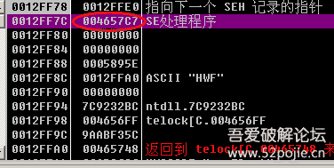

Telock-04.png (12.3 KB, 下载次数: 1)

[href="forum.php?mod=attachment&aid=MjUyODY4MHwzYWZkYjYxMXwxNzkzNTc1MzYyfDE2ODA4NnwxNjQ2NDY2&nothumb=yes" target="_blank"](https://www.52pojie.cn/forum.php?mod=attachment&aid=MjUyODY4MHwzYWZkYjYxMXwxNzkzNTc1MzYyfDE2ODA4NnwxNjQ2NDY2&nothumb=yes)

2022-6-8 13:58 上传

需要跟比较长的代码，大概有3～4页，然后就能到下图的位置，比较典型的，前面一个`popad`，后面跟一个大跳转，跳过去就是`OEP`，因此就是这个位置了。

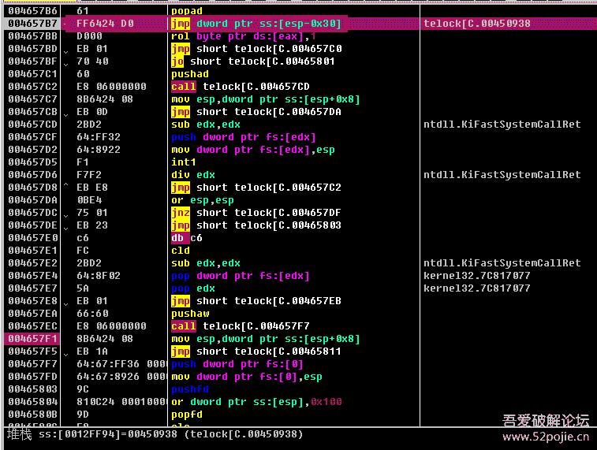

Telock-03.png (29.01 KB, 下载次数: 1)

[href="forum.php?mod=attachment&aid=MjUyODY3OXwwZTE4MjU5YXwxNzkzNTc1MzYyfDE2ODA4NnwxNjQ2NDY2&nothumb=yes" target="_blank"](https://www.52pojie.cn/forum.php?mod=attachment&aid=MjUyODY3OXwwZTE4MjU5YXwxNzkzNTc1MzYyfDE2ODA4NnwxNjQ2NDY2&nothumb=yes)

2022-6-8 13:58 上传

### 5.8 SFX大法
入口地址不在代码段范围内，应该是可以使用`SFX`大法，但是太慢了，我没能等到。

### 5.9 Dump和IAT修复
`OEP`找到后，使用`Ollydump`进行`dump`，发现提示“无法读取被调试进行（00400000..00466FFF）的内存”的错误。将内存界面里面能设置全部权限的项目都设置完后，还是同样的错误。换用`LordPE`还是`PETools`都显示无反问权限，不知道什么原因。

又尝试了其他几个版本的`OD`，发现`OD`吾爱论坛专用版、`ollyICE`吾爱扣扣专版这两个版本无法`dump`，而`ollyICE`原版可以用`ollydump`正常导出。

然后使用`Import REConstructor`进行`IAT`修复，按照`ximo`大佬的教程，进行`trace level3`的修复，但是提示“can't initialize the tracer”，修复后的程序点击运行后没有任何反应。

后来网上查找了半天，才搞清楚这个是`Import REC 1.7`版本的`bug`，`ximo`大佬使用的是`1.6`版的，没有这个问题。

`Import REC 1.7`版本在进行`trace level3`的修复时，需要手动在插件中选择`tELoxk V0.98`才能正确修复，然后再将无效引导删除，再进行`dump`修复就可以了。

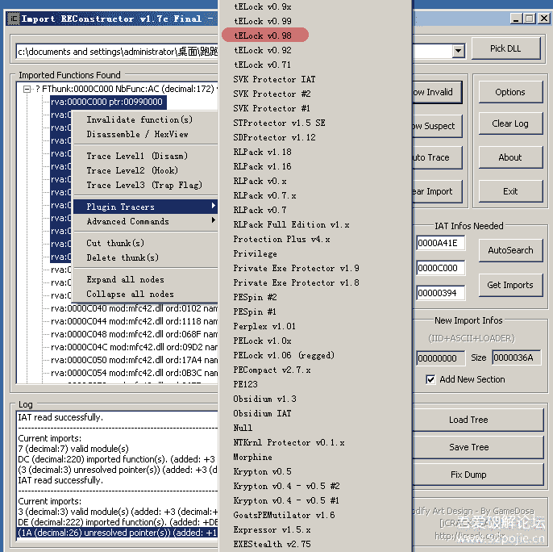

Telock-01.png (43.85 KB, 下载次数: 1)

[href="forum.php?mod=attachment&aid=MjUyODY3N3wwYjhlMTE5MnwxNzkzNTc1MzYyfDE2ODA4NnwxNjQ2NDY2&nothumb=yes" target="_blank"](https://www.52pojie.cn/forum.php?mod=attachment&aid=MjUyODY3N3wwYjhlMTE5MnwxNzkzNTc1MzYyfDE2ODA4NnwxNjQ2NDY2&nothumb=yes)

2022-6-8 13:58 上传

这里还需要注意的一个小细节是，进行`trace level3`的修复，`Import REC`选择的进程不能是`OD`载入的程序进行，必须选择另外单独打开的程序进程，否则修复时会程序死机。

## 6. WinUpack

### 6.1 ESP定律
按`ESP`定律操作流程，设定硬件断点停下后，清除硬件断点，然后一路`F8`跟踪，一直到`672DFB`位置，`retn`执行后，就来到了熟悉的`OEP`。

```
00672DF4    50              push eax
00672DF5    53              push ebx                                 ; comdlg32.76320000
00672DF6    FFD5            call ebp                                 ; kernel32.GetProcAddress
00672DF8    AB              stos dword ptr es:[edi]
00672DF9  ^ EB E7           jmp short WinUpack.00672DE2
00672DFB    C3              retn

;retn执行后到达
0045BE98    55              push ebp                                 ; kernel32.GetProcAddress
0045BE99    8BEC            mov ebp,esp
0045BE9B    6A FF           push -0x1
0045BE9D    68 58C15600     push WinUpack.0056C158
0045BEA2    68 CC154600     push WinUpack.004615CC
0045BEA7    64:A1 00000000  mov eax,dword ptr fs:[0]
0045BEAD    50              push eax
0045BEAE    64:8925 0000000>mov dword ptr fs:[0],esp
0045BEB5    83EC 58         sub esp,0x58
0045BEB8    53              push ebx                                 ; comdlg32.76320000
0045BEB9    56              push esi                                 ; WinUpack.005A9796
0045BEBA    57              push edi                                 ; WinUpack.0047C6A8
```

### 6.2 特征搜索
跳转部分的代码需要壳程序解压后才有，因此该方法不适用。

### 6.3 直接往下翻代码法
跳转部分的代码需要壳程序解压后才有，因此该方法不适用。

### 6.4 单步跟踪法
单步也能比较容易的跟到`OEP`位置，比`ESP`定律法跟踪的代码稍微多一点。

### 6.5 内存镜像法（二次断点法）
不适用，第一个断点就直接飞了。

### 6.6 一步到达OEP
跳转部分的代码需要壳程序解压后才有，不适用。

### 6.7 最后一次异常法
完全停不下来，这个方法不适用。

### 6.8 SFX大法
入口地址在代码段范围内，不适用。

### 6.9 Dump和IAT修复
按3.9的步骤进行操作就可以完成。

## 7. nsPack ver.3.x-4.1

### 7.1 ESP定律
按`ESP`定律的操作，在`popad`指令执行完后，下硬件断点，直接就断在`5AB833`，下一行就是大跳转。`OEP`入口的代码默认被识别成数据，需要右键`[分析]`→`[从模块中删除分析]`后，才能看到代码。

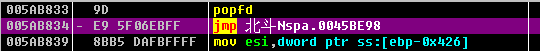

nspack-01.png (1.99 KB, 下载次数: 1)

[href="forum.php?mod=attachment&aid=MjUyODY4MXxlMjg2ODUzYnwxNzkzNTc1MzYyfDE2ODA4NnwxNjQ2NDY2&nothumb=yes" target="_blank"](https://www.52pojie.cn/forum.php?mod=attachment&aid=MjUyODY4MXxlMjg2ODUzYnwxNzkzNTc1MzYyfDE2ODA4NnwxNjQ2NDY2&nothumb=yes)

2022-6-8 14:01 上传

### 7.2 特征搜索
直接`Ctrl+B`搜索`61 9D E9`，找到的第一个位置就是大跳转位置。

### 7.3 直接往下翻代码法
直接往下翻5页左右，找到的第一个大跳转位置就是。

### 7.4 单步跟踪法
过程也比较简单，能够比较简单的找到。

### 7.5 内存镜像法（二次断点法）
不适用，第一个断点断不下来。

### 7.6 一步到达OEP
`ctrl+f`找了一下`popad`，大概第23个位置就是大跳转的位置。

### 7.7 最后一次异常法
`F9`运行过程中没有异常产生，因此该方法不适用。

### 7.8 SFX大法
当程序载入`OD`之后，入口点的地址在代码段之外，因此这个壳应该是可以用`SFX`大法的。尝试以块方式进行跟踪，等待很久后停在程序认为的入口位置，但是实际并不是准确的位置，正确的`OEP`在该地址前面一点位置。以字节方式进行跟踪，速度太慢，放弃。

### 7.9 Dump和IAT修复
直接使用插件`ollydump`进行操作，并不需要额外的`IAT`修复，程序直接可以运行。

## 8. 总结

### 8.1 统计
通过上述练习，基本熟悉了一些常用的压缩壳的脱壳方法，虽然对于加密壳、`VM`壳来说，要进一步学习的东西还有很多，但相比使用专用脱壳软件来说，应该是一大进步。根据上述过程，统计各种壳可以使用的查找`OEP`方法如下表：

壳类型 | 
ESP定律 | 
特征搜索 | 
直接翻代码 | 
单步跟踪法 | 
二次断点法 | 
一步达到OEP | 
最后一次异常法 | 
SFX法 | 
IAT修复 | 

UPX v3.91
```
