# [原创] 某数据恢复软件的破解过程

- 原帖: https://www.52pojie.cn/forum.php?mod=viewthread&tid=1648397
- 抓取时间: 2026-11-01T23:21:20

目标软件：Wise Data Recovery，免费版只能恢复2GB数据。

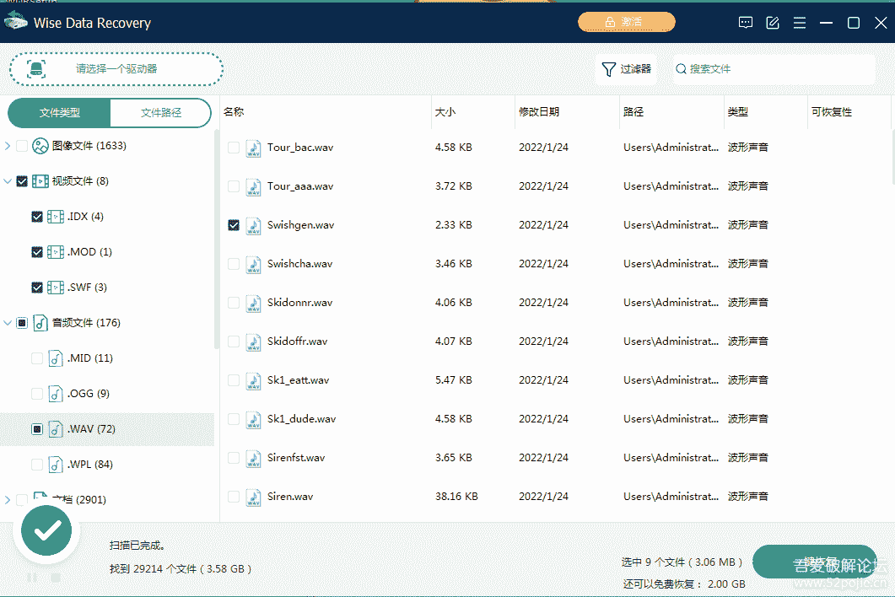

`QQ截图20220612213047.png` (102.09 KB, 下载次数: 1) [附件](https://www.52pojie.cn/forum.php?mod=attachment&aid=MjUyOTczMnxjNDlhODY1N3wxNzkzNTc1Mjc3fDE2ODA4NnwxNjQ4Mzk3&nothumb=yes) | 2022-6-12 21:30 上传

主程序拖入`PEID`，查壳，发现并没有加壳

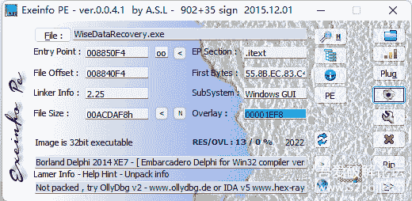

`QQ截图20220612234238.png` (136.32 KB, 下载次数: 1) [附件](https://www.52pojie.cn/forum.php?mod=attachment&aid=MjUyOTc3M3w3NGY0ODJkZnwxNzkzNTc1Mjc3fDE2ODA4NnwxNjQ4Mzk3&nothumb=yes) | 2022-6-12 23:42 上传

这次还是通过暂停+查看调用堆栈的方式[www.52pojie.cn](https://www.52pojie.cn)程序。

拖入`OD`，`F9`运行，打开注册框，用户名、邮箱、注册码随便输入，点击注册

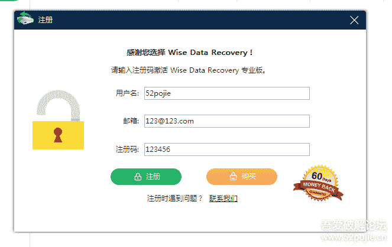

`QQ截图20220612213507.png` (37.93 KB, 下载次数: 1) [附件](https://www.52pojie.cn/forum.php?mod=attachment&aid=MjUyOTczNXwxNmIzMDA1M3wxNzkzNTc1Mjc3fDE2ODA4NnwxNjQ4Mzk3&nothumb=yes) | 2022-6-12 21:34 上传

当出现“注册码无效....”对话框时暂停程序

`QQ截图20220612213630.png` (20.42 KB, 下载次数: 1) [附件](https://www.52pojie.cn/forum.php?mod=attachment&aid=MjUyOTczNnwwMDM1OGYyMnwxNzkzNTc1Mjc3fDE2ODA4NnwxNjQ4Mzk3&nothumb=yes) | 2022-6-12 21:36 上传

此时`Alt+K`，查看调用堆栈，发现`OD`显示的调用堆栈不大正常（调用堆栈显示的不全，emmm，我也不知道怎么回事，希望大佬们指导）

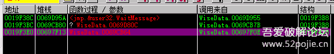

`QQ截图20220612215957.png` (10.92 KB, 下载次数: 1) [附件](https://www.52pojie.cn/forum.php?mod=attachment&aid=MjUyOTc0NXw3NTE0ZDAxMnwxNzkzNTc1Mjc3fDE2ODA4NnwxNjQ4Mzk3&nothumb=yes) | 2022-6-12 21:59 上传

我们还可以在堆栈窗口，往下翻，会发现“注册码无效....”，紧接着下面有个返回到`WiseData.00C44534`来自`WiseData.00BC0070`

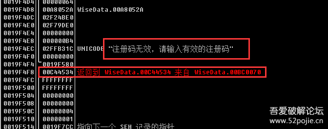

`QQ截图20220612215402.png` (12.79 KB, 下载次数: 1) [附件](https://www.52pojie.cn/forum.php?mod=attachment&aid=MjUyOTc0MnxmYTdjZjQwZXwxNzkzNTc1Mjc3fDE2ODA4NnwxNjQ4Mzk3&nothumb=yes) | 2022-6-12 21:53 上传

选中，按回车，来到判断注册是否成功的函数，往上看在`0xC444F1`的地方有个`je`，这个就是关键跳。

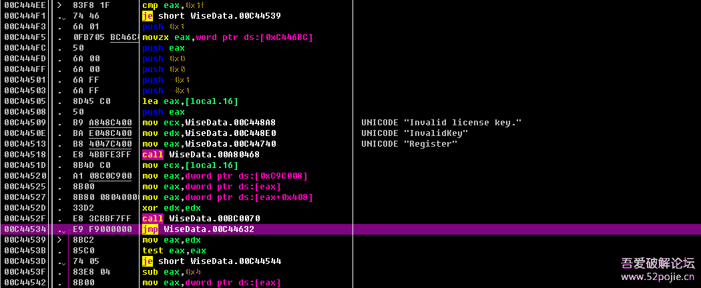

`33.png` (24.7 KB, 下载次数: 1) [附件](https://www.52pojie.cn/forum.php?mod=attachment&aid=MjUyOTc3Nnw1NjlhY2RiNnwxNzkzNTc1Mjc3fDE2ODA4NnwxNjQ4Mzk3&nothumb=yes) | 2022-6-13 00:00 上传

在`0xC444F1`下断点，运行程序，再次点击注册，程序会在这里断下，可以看到，此时跳转是没有实现的，继续运行就会显示“注册码无效...”,把它改成`jmp`，使跳转恒成立，`F9`运行程序，仍然显示“注册码无效...”，说明后面应该还有判断。

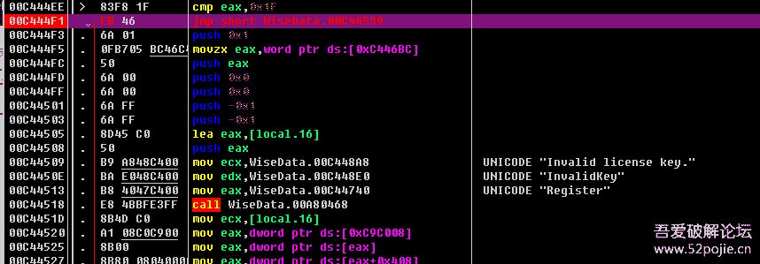

`QQ截图20220612224424.png` (19.14 KB, 下载次数: 0) [附件](https://www.52pojie.cn/forum.php?mod=attachment&aid=MjUyOTc1MnwyMmIxNWMxOHwxNzkzNTc1Mjc3fDE2ODA4NnwxNjQ4Mzk3&nothumb=yes) | 2022-6-12 22:44 上传

再点击一次注册按钮，停在`0xC444F1`后`F8`单步执行，发现第二个判断在`0xC44586`，现在这个跳转已实现，继续运行将显示“注册码无效...”，所以这个`je`要右键->二进制->`NOP`填充

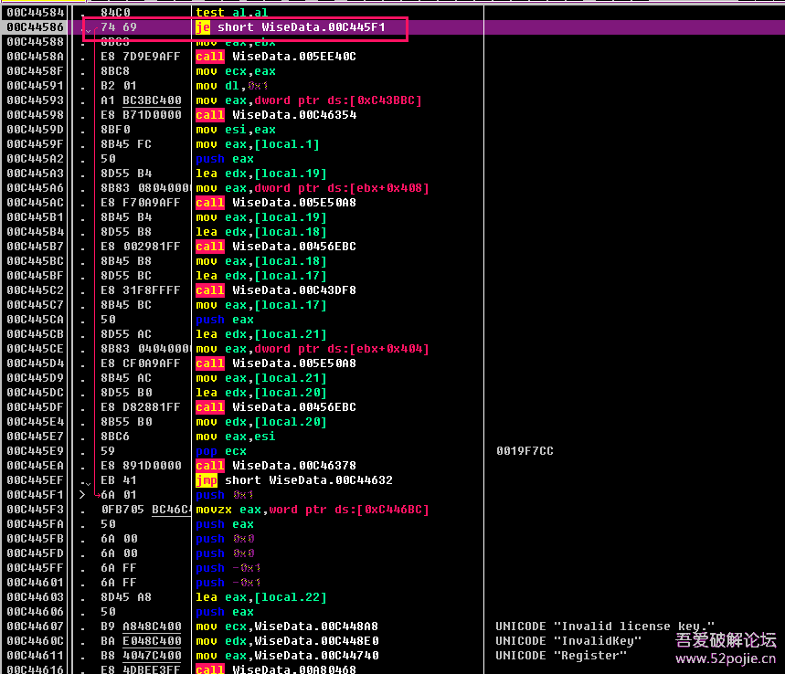

`QQ截图20220612221703.png` (35.71 KB, 下载次数: 1) [附件](https://www.52pojie.cn/forum.php?mod=attachment&aid=MjUyOTc0OHw1N2I3NzA3ZHwxNzkzNTc1Mjc3fDE2ODA4NnwxNjQ4Mzk3&nothumb=yes) | 2022-6-12 22:16 上传

`F9`运行程序，好家伙，联网验证。。。。

`QQ截图20220612224719.png` (41.68 KB, 下载次数: 0) [附件](https://www.52pojie.cn/forum.php?mod=attachment&aid=MjUyOTc1M3wxZDNmZjI3YXwxNzkzNTc1Mjc3fDE2ODA4NnwxNjQ4Mzk3&nothumb=yes) | 2022-6-12 22:47 上传

我们继续用调用堆栈法，出现这个对话框，暂停程序，在堆栈窗口往下翻，找到“很抱歉...”，下面有返回到`WiseData.00C4541B`来自`WiseData.00BC0070`，回车，来到网络验证函数

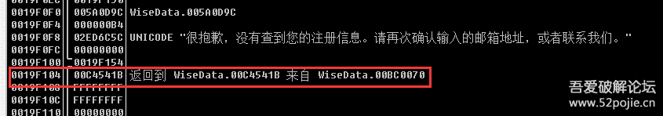

`QQ截图20220612224934.png` (11.17 KB, 下载次数: 1) [附件](https://www.52pojie.cn/forum.php?mod=attachment&aid=MjUyOTc1NHw5OGMwNTM5ZnwxNzkzNTc1Mjc3fDE2ODA4NnwxNjQ4Mzk3&nothumb=yes) | 2022-6-12 22:49 上传

很显然，这是一个`switch`分支结构，往上翻

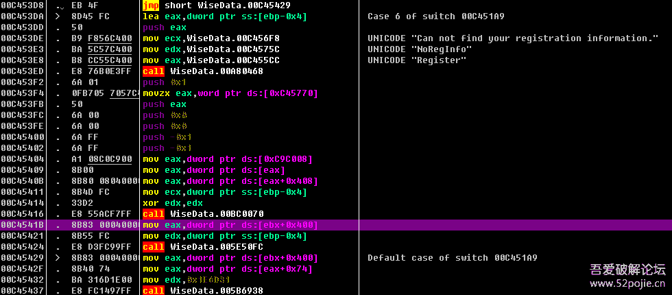

`QQ截图20220612225114.png` (26.5 KB, 下载次数: 1) [附件](https://www.52pojie.cn/forum.php?mod=attachment&aid=MjUyOTc1NXw5OGNjYjc0YXwxNzkzNTc1Mjc3fDE2ODA4NnwxNjQ4Mzk3&nothumb=yes) | 2022-6-12 22:51 上传

发现分支1（起始地址`0xC451DA`）是注册成功要执行的代码，我们可以把分支表上面的`jmp dword ptr ds:[eax*4+0xC451B9]`，改成`jmp 0xC451DA`，所有分支都跳到`0xC451DA`

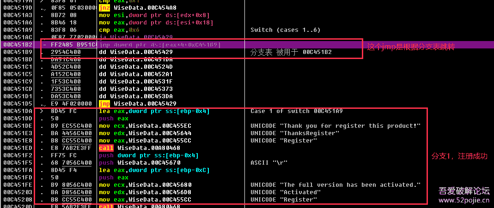

`QQ截图20220612225322.png` (33.99 KB, 下载次数: 1) [附件](https://www.52pojie.cn/forum.php?mod=attachment&aid=MjUyOTc1NnxlNWU1YmE5OXwxNzkzNTc1Mjc3fDE2ODA4NnwxNjQ4Mzk3&nothumb=yes) | 2022-6-12 22:53 上传

`F9`运行程序，再点一次注册，WTF？？？？虽然显示注册成功，但实际还是免费版。。。。

`QQ截图20220612225729.png` (76.84 KB, 下载次数: 1) [附件](https://www.52pojie.cn/forum.php?mod=attachment&aid=MjUyOTc1N3wzZmY4NTQ5Y3wxNzkzNTc1Mjc3fDE2ODA4NnwxNjQ4Mzk3&nothumb=yes) | 2022-6-12 22:57 上传

没办法，只能从分支1开始单步执行，看看到底哪里出了问题

。。。。。。。。。此处省略10000字。。。。。。。。。

经过反复调试发现，当分支1执行完后会跳转到`0xC45429`处，从`0xC45429`往下执行，在`0xC45450`处有个`je`，这个跳转是实现了的，实现了就不会解除限制，所以要把它用`NOP`填充才能解除限制。

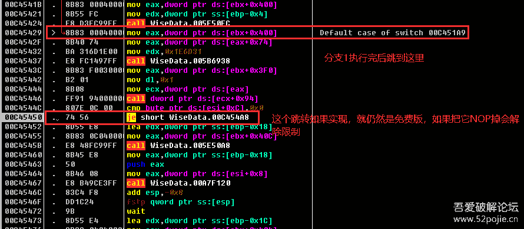

`QQ截图20220612230458.png` (31.07 KB, 下载次数: 1) [附件](https://www.52pojie.cn/forum.php?mod=attachment&aid=MjUyOTc1OXxlNzA5Y2M0Y3wxNzkzNTc1Mjc3fDE2ODA4NnwxNjQ4Mzk3&nothumb=yes) | 2022-6-12 23:04 上传

综上，把上面所有修改复制到可执行文件，再运行发现运行不了，有文件校验。。。。

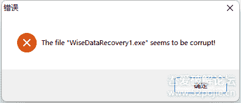

`QQ截图20220612231107.png` (12.58 KB, 下载次数: 1) [附件](https://www.52pojie.cn/forum.php?mod=attachment&aid=MjUyOTc2MHxlNTAwMWZlZXwxNzkzNTc1Mjc3fDE2ODA4NnwxNjQ4Mzk3&nothumb=yes) | 2022-6-12 23:10 上传

仍然用调用堆栈法破解。把修改后的文件载入`OD`，`F9`运行，出现这个错误框后暂停程序，`Alt+K`查看调用堆栈。

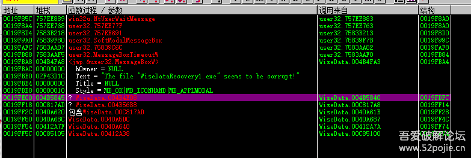

`QQ截图20220612231611.png` (20.7 KB, 下载次数: 1) [附件](https://www.52pojie.cn/forum.php?mod=attachment&aid=MjUyOTc2MnxkZDVmYTUwOHwxNzkzNTc1Mjc3fDE2ODA4NnwxNjQ4Mzk3&nothumb=yes) | 2022-6-12 23:16 上传

在如图所示位置右键->查看调用（至于为什么是这个位置，需要逐一右键->查看调用，找到可疑的`je`或`jnz`，并修改测试），在`CALL`上面有个`je`，现在错误框显示了，说明这个`CALL`被调用了，也就是说`je`没有实现，如果我们把`je`改成`jmp`就会跳过`CALL`，错误框就不会显示。

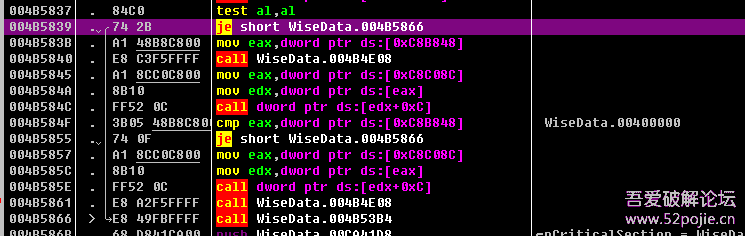
QQ截图20220612231918.png (17 KB, 下载次数: 1)
[href="forum.php?mod=attachment&aid=MjUyOTc2M3xkNGIzNTMwNXwxNzkzNTc1Mjc3fDE2ODA4NnwxNjQ4Mzk3&nothumb=yes" target="_blank"](https://www.52pojie.cn/forum.php?mod=attachment&aid=MjUyOTc2M3xkNGIzNTMwNXwxNzkzNTc1Mjc3fDE2ODA4NnwxNjQ4Mzk3&nothumb=yes)
2022-6-12 23:19 上传
把修改复制到可执行文件，成功绕过了文件校验。
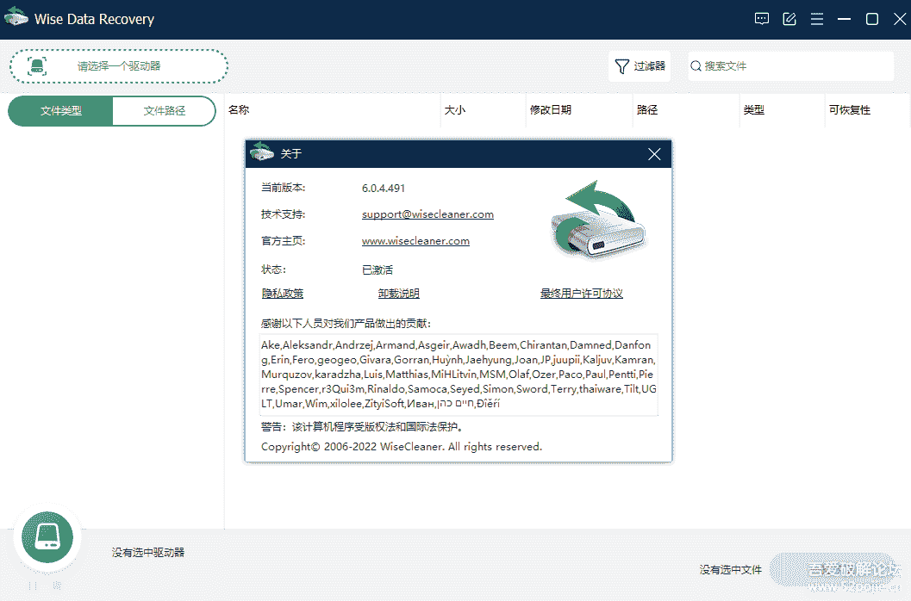
QQ截图20220612232406.png (84.75 KB, 下载次数: 1)
[href="forum.php?mod=attachment&aid=MjUyOTc2NHxjYTBlNzYxZXwxNzkzNTc1Mjc3fDE2ODA4NnwxNjQ4Mzk3&nothumb=yes" target="_blank"](https://www.52pojie.cn/forum.php?mod=attachment&aid=MjUyOTc2NHxjYTBlNzYxZXwxNzkzNTc1Mjc3fDE2ODA4NnwxNjQ4Mzk3&nothumb=yes)
2022-6-12 23:24 上传
现在还有一个问题，就是每次运行程序都要注册一次，比较麻烦。。。。
推测程序在启动时应该读取了注册表，通过注册表中的信息判断注册信息是否有效，如果注册信息无效就会变成免费版。载入修改好的程序，对注册表函数下断点
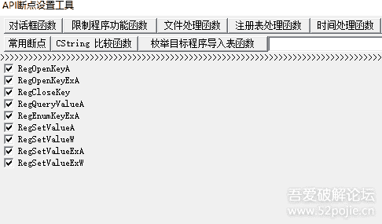
QQ截图20220612232851.png (12.29 KB, 下载次数: 1)
[href="forum.php?mod=attachment&aid=MjUyOTc2NXwxMWYwNmY5NHwxNzkzNTc1Mjc3fDE2ODA4NnwxNjQ4Mzk3&nothumb=yes" target="_blank"](https://www.52pojie.cn/forum.php?mod=attachment&aid=MjUyOTc2NXwxMWYwNmY5NHwxNzkzNTc1Mjc3fDE2ODA4NnwxNjQ4Mzk3&nothumb=yes)
2022-6-12 23:28 上传
不断按`F9`，直到堆栈窗口出现“`User Name`”
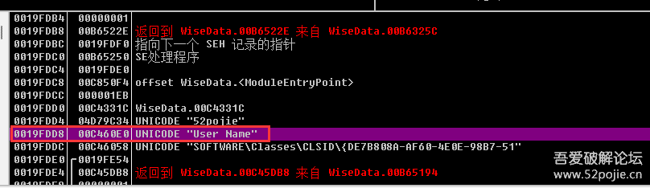
QQ截图20220612233009.png (14.43 KB, 下载次数: 1)
[href="forum.php?mod=attachment&aid=MjUyOTc2NnwzMWUwMGNlOHwxNzkzNTc1Mjc3fDE2ODA4NnwxNjQ4Mzk3&nothumb=yes" target="_blank"](https://www.52pojie.cn/forum.php?mod=attachment&aid=MjUyOTc2NnwzMWUwMGNlOHwxNzkzNTc1Mjc3fDE2ODA4NnwxNjQ4Mzk3&nothumb=yes)
2022-6-12 23:30 上传
`Alt+K`查看调用堆栈，在如图所示位置右键->显示调用
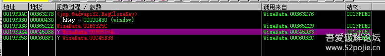
QQ截图20220612233113.png (11.86 KB, 下载次数: 1)
[href="forum.php?mod=attachment&aid=MjUyOTc2N3w4MWY1ZmEzNXwxNzkzNTc1Mjc3fDE2ODA4NnwxNjQ4Mzk3&nothumb=yes" target="_blank"](https://www.52pojie.cn/forum.php?mod=attachment&aid=MjUyOTc2N3w4MWY1ZmEzNXwxNzkzNTc1Mjc3fDE2ODA4NnwxNjQ4Mzk3&nothumb=yes)
2022-6-12 23:31 上传
来到启动时读取注册表并判断注册信息是否有效的函数，可以看到，程序启动时读取了用户名、邮箱、验证码
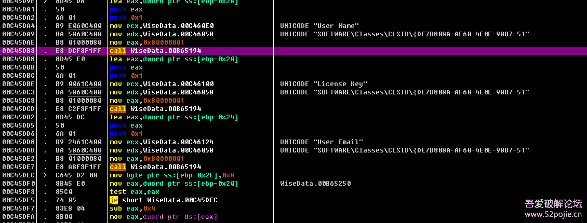
QQ截图20220612233238.png (28.2 KB, 下载次数: 1)
[href="forum.php?mod=attachment&aid=MjUyOTc2OHw3NmZlYTI3Y3wxNzkzNTc1Mjc3fDE2ODA4NnwxNjQ4Mzk3&nothumb=yes" target="_blank"](https://www.52pojie.cn/forum.php?mod=attachment&aid=MjUyOTc2OHw3NmZlYTI3Y3wxNzkzNTc1Mjc3fDE2ODA4NnwxNjQ4Mzk3&nothumb=yes)
2022-6-12 23:32 上传
取消注册表函数断点，单步运行，发现`0xC45DFF`处有个大的跳转，如果跳转实现，就是免费版，把这个`jnz`用`NOP`填充，成功得到永久免费版。
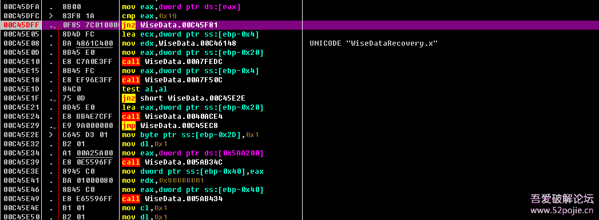
QQ截图20220612233951.png (24.04 KB, 下载次数: 1)
[href="forum.php?mod=attachment&aid=MjUyOTc3MXw2NGM1YzQ1N3wxNzkzNTc1Mjc3fDE2ODA4NnwxNjQ4Mzk3&nothumb=yes" target="_blank"](https://www.52pojie.cn/forum.php?mod=attachment&aid=MjUyOTc3MXw2NGM1YzQ1N3wxNzkzNTc1Mjc3fDE2ODA4NnwxNjQ4Mzk3&nothumb=yes)
2022-6-12 23:39 上传

QQ截图20220612232406.png (84.75 KB, 下载次数: 1)
[href="forum.php?mod=attachment&aid=MjUyOTc3Mnw0ODkwOGQ3NXwxNzkzNTc1Mjc3fDE2ODA4NnwxNjQ4Mzk3&nothumb=yes" target="_blank"](https://www.52pojie.cn/forum.php?mod=attachment&aid=MjUyOTc3Mnw0ODkwOGQ3NXwxNzkzNTc1Mjc3fDE2ODA4NnwxNjQ4Mzk3&nothumb=yes)
2022-6-12 23:41 上传
原版程序：https://pan.baidu.com/s/1VtZ6nrRSGdpS7BVbv7DP2Q 提取码：`tw7j`
## 补充知识
补充知识：`switch`代码在汇编层面是怎么实现的（不考虑分支数量大于256的情况）
当分支数（`case`+`default`）
当分支数>4时使用跳转表实现，编译器会将`case`语句按升序排好，然后全加上或减去一个数，使第一个`case`的值为0（比如`case 1,case 2,case 3`会全部减1变成`case 0,case 1,case 2`）。当执行`switch`语句时，先把传入的数和`case`的最大值比较，如果比最大值大会跳转到`default`，否则根据跳转表跳转。跳转表是一维数组，每个元素都是一个地址，占4字节。跳转表的0号元素对应`case 0`代码的首地址,1号元素对应`case 1`代码的首地址....以此类推，程序会使用`jmp dword ptr [table首址+传入的值*4]`跳转到对应代码去执行。
如果`case`不连续（比如`case 0,case 3,case 5`），则跳转表中的对应项填`default`代码的首地址。
