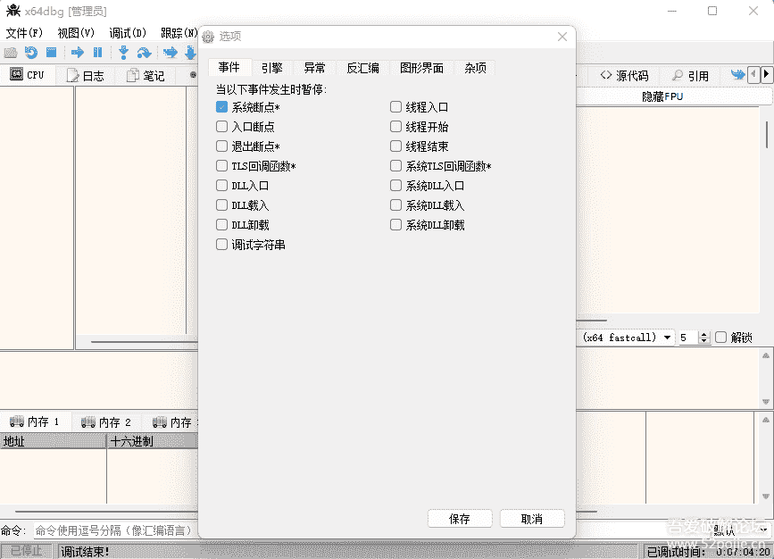
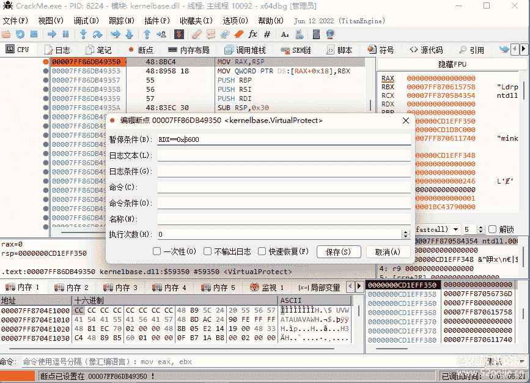
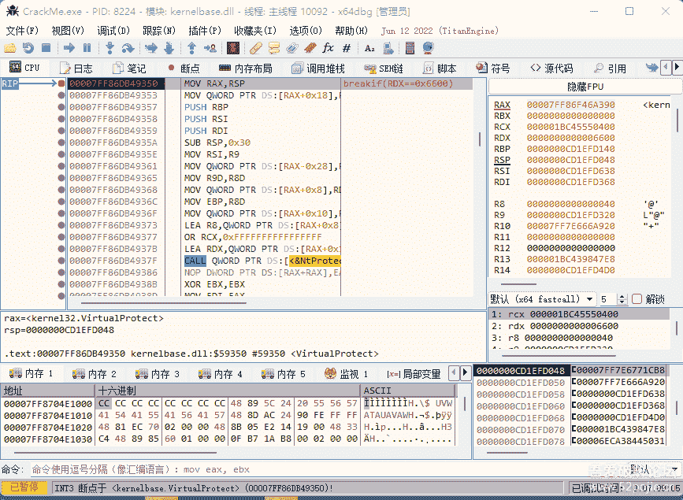
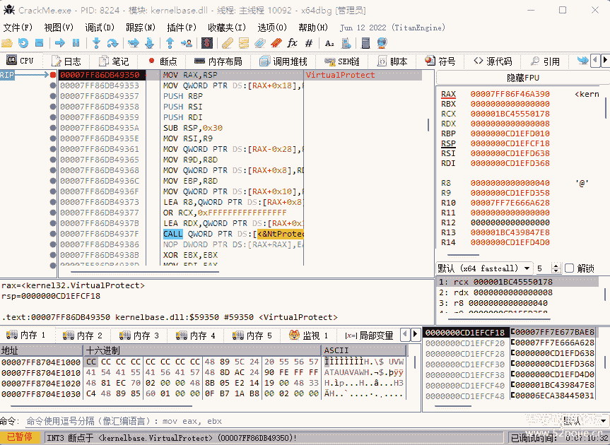
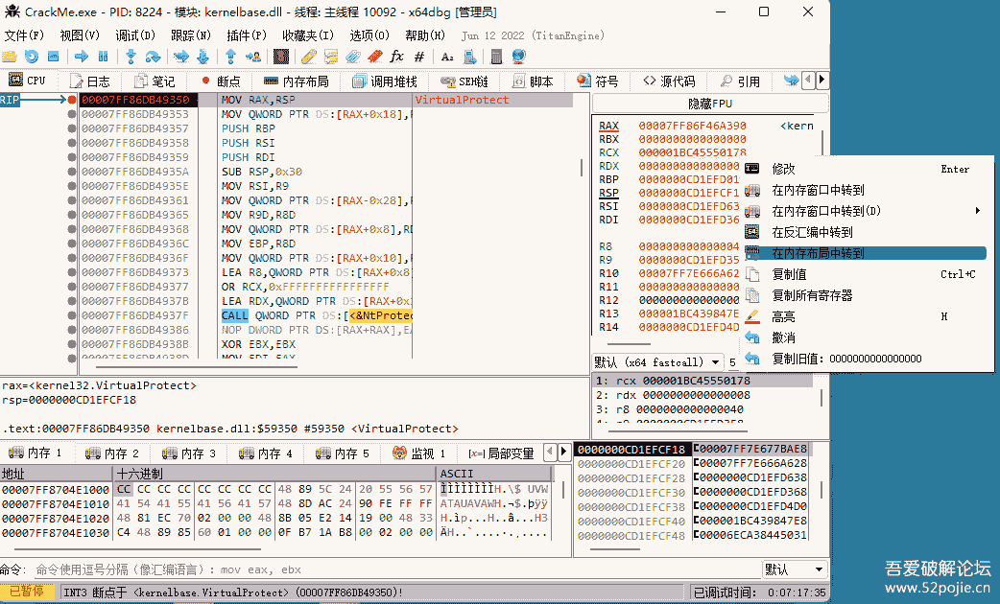
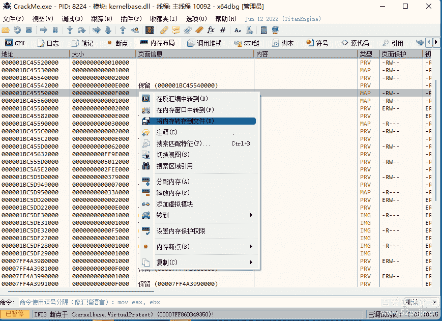
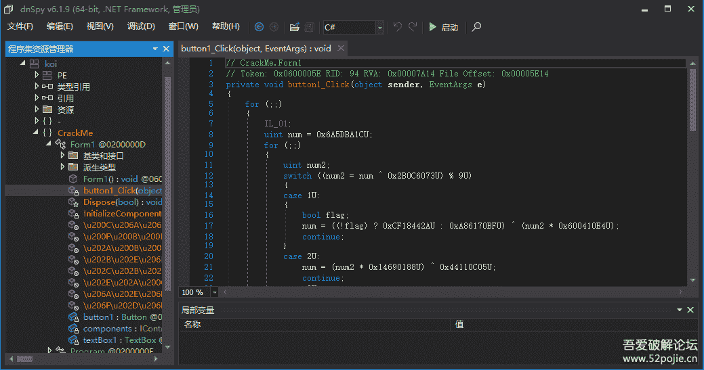
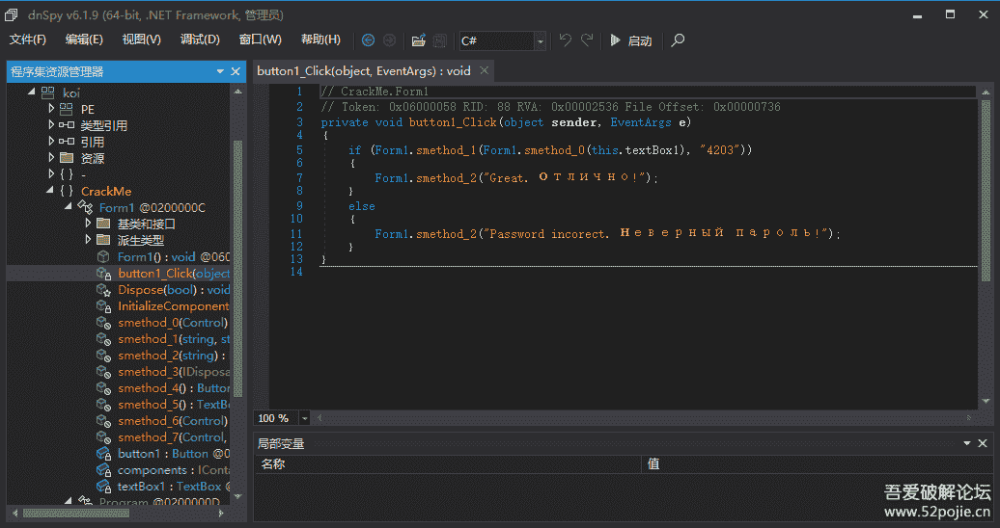

# [原创] “c# CrackMe 大佬来练练手！！！ ”的简单脱壳过程

- 原帖: https://www.52pojie.cn/forum.php?mod=viewthread&tid=1650561
- 抓取时间: 2026-11-01T23:19:55

看到论坛上这个`CrackMe`，有的大佬分分秒秒就搞定了。但除了`jy04468108`大大，其他人基本上没说具体的脱壳方法。

本人是`NET`脱壳的小白，花了几个小时总算也搞定了，将过程简单记录下，供和我一样的小白参考。

目标文件在：https://www.52pojie.cn/thread-1649380-1-1.html

## 脱壳过程

将`x64dbg`设置成系统断点:

然后载入`CrackMe.exe`

下断：`VirtualProtect` 用条件断点：`RDX`==`0x6600`

当`RDX`为`0x6600`时（`koi`模块的大小），后面就对`koi`模块的代码进行解密了。

断下后取消条件断点，改为普通断点，`F9`一次，断在：

此时，`RCX`==`0x1BC45550178`（基址可能不一样，但后面的`0x178`不会变）

接下去就要对文件头相关项进行擦除了。在文件头被擦除前保存模块。

在`RCX`上右键——》在内存布局中转到

在内存布局中，在地址`0x1BC45550000`上右键——》将内存转存到文件

保存为`koi.exe`

保存出来的文件是不能直接运行的。用`dnSpy.exe`查看一下

此时，代码还是混淆的：

用`de4dot.exe`去混淆后：

然后用`ildasm.exe`反编译，再修改`IL`文件，将所有与`Confuser`相关的代码全部删除，重新编译成`EXE`文件，即可。重新编译后的文件只有8K大小。
