# [原创] 最详细破解nessus(windows)教程 插件更新至20220613

- 原帖: https://www.52pojie.cn/forum.php?mod=viewthread&tid=1650667
- 抓取时间: 2026-11-01T23:19:53

Nessus 是全世界最多人使用的系统漏洞扫描与分析软件。总共有超过75,000个机构使用 Nessus 作为扫描该机构电脑系统的软件。企业安全的好伙伴

## 一、安装

### 1、 nessus官网下载安装包https://www.tenable.com/downloads/nessus
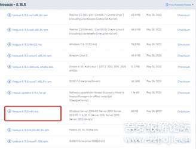
图片1.png (38.79 KB, 下载次数: 0)
[href="forum.php?mod=attachment&aid=MjUzMDg2NXw0Y2I5NTA4MXwxNzkzNTc1MTkxfDE2ODA4NnwxNjUwNjY3&nothumb=yes" target="_blank"](https://www.52pojie.cn/forum.php?mod=attachment&aid=MjUzMDg2NXw0Y2I5NTA4MXwxNzkzNTc1MTkxfDE2ODA4NnwxNjUwNjY3&nothumb=yes)
2022-6-17 17:07 上传

### 2、点击安装包进行安装，安装过程中如果出现这个问题，是由于已经在相关目录下新建了nessus目录，点“是”就行。
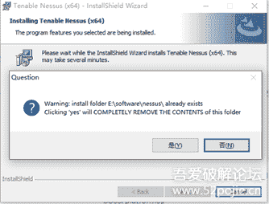
图片2.png (49.4 KB, 下载次数: 0)
[href="forum.php?mod=attachment&aid=MjUzMDg2NnwwYmE5Njc2NHwxNzkzNTc1MTkxfDE2ODA4NnwxNjUwNjY3&nothumb=yes" target="_blank"](https://www.52pojie.cn/forum.php?mod=attachment&aid=MjUzMDg2NnwwYmE5Njc2NHwxNzkzNTc1MTkxfDE2ODA4NnwxNjUwNjY3&nothumb=yes)
2022-6-17 17:07 上传

### 3、安装完成后，点击完成会自动跳转出nessus页面，或者打开浏览器访问：https://127.0.0.1:8834
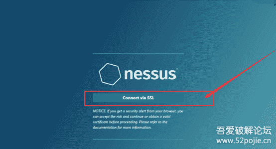
图片3.png (70.01 KB, 下载次数: 0)
[href="forum.php?mod=attachment&aid=MjUzMDg2N3xmM2I1ZWQ2ZnwxNzkzNTc1MTkxfDE2ODA4NnwxNjUwNjY3&nothumb=yes" target="_blank"](https://www.52pojie.cn/forum.php?mod=attachment&aid=MjUzMDg2N3xmM2I1ZWQ2ZnwxNzkzNTc1MTkxfDE2ODA4NnwxNjUwNjY3&nothumb=yes)
2022-6-17 17:07 上传

### 4、选择Managed scanner，然后Continue
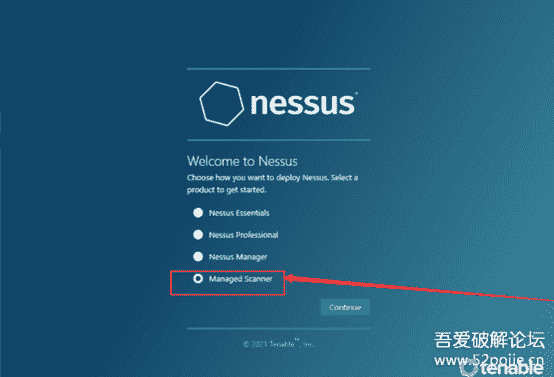
图片4.png (78.06 KB, 下载次数: 0)
[href="forum.php?mod=attachment&aid=MjUzMDg2OHxhMDhhZDk4YnwxNzkzNTc1MTkxfDE2ODA4NnwxNjUwNjY3&nothumb=yes" target="_blank"](https://www.52pojie.cn/forum.php?mod=attachment&aid=MjUzMDg2OHxhMDhhZDk4YnwxNzkzNTc1MTkxfDE2ODA4NnwxNjUwNjY3&nothumb=yes)
2022-6-17 17:07 上传

### 5、选择Tenable.sc，然后Continue
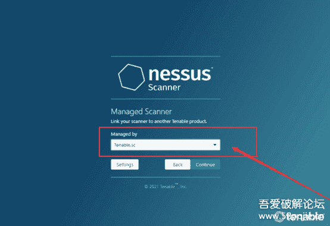
图片5.png (78.13 KB, 下载次数: 0)
[href="forum.php?mod=attachment&aid=MjUzMDg2OXw2NGZkM2NiZXwxNzkzNTc1MTkxfDE2ODA4NnwxNjUwNjY3&nothumb=yes" target="_blank"](https://www.52pojie.cn/forum.php?mod=attachment&aid=MjUzMDg2OXw2NGZkM2NiZXwxNzkzNTc1MTkxfDE2ODA4NnwxNjUwNjY3&nothumb=yes)
2022-6-17 17:07 上传

### 6、设置账户密码，然后Submit
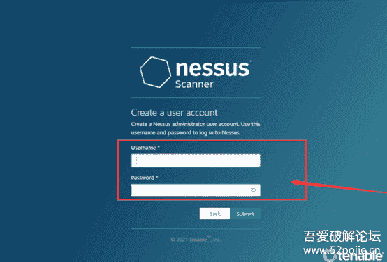
图片6.png (78.3 KB, 下载次数: 1)
[href="forum.php?mod=attachment&aid=MjUzMDg3MHxiZDQ3N2YzYnwxNzkzNTc1MTkxfDE2ODA4NnwxNjUwNjY3&nothumb=yes" target="_blank"](https://www.52pojie.cn/forum.php?mod=attachment&aid=MjUzMDg3MHxiZDQ3N2YzYnwxNzkzNTc1MTkxfDE2ODA4NnwxNjUwNjY3&nothumb=yes)
2022-6-17 17:07 上传

### 7、等待一会儿
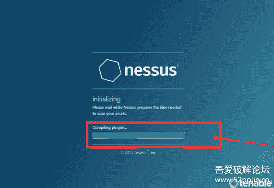
图片7.png (71.07 KB, 下载次数: 1)
[href="forum.php?mod=attachment&aid=MjUzMDg3MXxkODA1MTA5OHwxNzkzNTc1MTkxfDE2ODA4NnwxNjUwNjY3&nothumb=yes" target="_blank"](https://www.52pojie.cn/forum.php?mod=attachment&aid=MjUzMDg3MXxkODA1MTA5OHwxNzkzNTc1MTkxfDE2ODA4NnwxNjUwNjY3&nothumb=yes)
2022-6-17 17:07 上传

### 8、完成后是这样的界面，无法进行扫描。
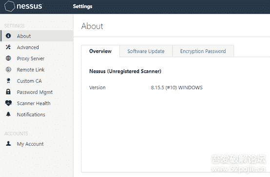
图片8.png (48.85 KB, 下载次数: 0)
[href="forum.php?mod=attachment&aid=MjUzMDg3MnwyMmZkYzBjYXwxNzkzNTc1MTkxfDE2ODA4NnwxNjUwNjY3&nothumb=yes" target="_blank"](https://www.52pojie.cn/forum.php?mod=attachment&aid=MjUzMDg3MnwyMmZkYzBjYXwxNzkzNTc1MTkxfDE2ODA4NnwxNjUwNjY3&nothumb=yes)
2022-6-17 17:07 上传

## 二、安装插件

### 1、使用管理员身份打开`cmd`，`cd`进入nessus安装目录，输入以下命令`nessuscli.exe fetch –challenge`，记录`Challenge code`。
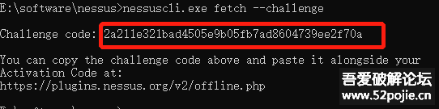
图片9.png (7.36 KB, 下载次数: 1)
[href="forum.php?mod=attachment&aid=MjUzMDg3M3xhZWNjZGMzOHwxNzkzNTc1MTkxfDE2ODA4NnwxNjUwNjY3&nothumb=yes" target="_blank"](https://www.52pojie.cn/forum.php?mod=attachment&aid=MjUzMDg3M3xhZWNjZGMzOHwxNzkzNTc1MTkxfDE2ODA4NnwxNjUwNjY3&nothumb=yes)
2022-6-17 17:08 上传

### 2、打开浏览器输入http://www.tenable.com/products/nessus-home其中`first name`和`last name`随便填，`businessemail`填写真实可用的邮箱（如果担心安全，可以百度“十分钟邮箱”示例：https://10minutemail.org/），填写完成后勾选上，点击get started。
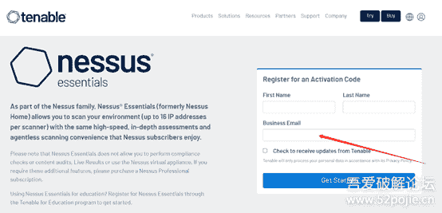
图片10.png (86.48 KB, 下载次数: 1)
[href="forum.php?mod=attachment&aid=MjUzMDg3NHxhM2EyOTkzYXwxNzkzNTc1MTkxfDE2ODA4NnwxNjUwNjY3&nothumb=yes" target="_blank"](https://www.52pojie.cn/forum.php?mod=attachment&aid=MjUzMDg3NHxhM2EyOTkzYXwxNzkzNTc1MTkxfDE2ODA4NnwxNjUwNjY3&nothumb=yes)
2022-6-17 17:08 上传

### 3、打开邮箱收邮件，记录收到的`activation code`值
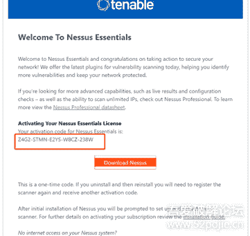
图片11.png (69.7 KB, 下载次数: 0)
[href="forum.php?mod=attachment&aid=MjUzMDg3NXw1OWQzZDU1N3wxNzkzNTc1MTkxfDE2ODA4NnwxNjUwNjY3&nothumb=yes" target="_blank"](https://www.52pojie.cn/forum.php?mod=attachment&aid=MjUzMDg3NXw1OWQzZDU1N3wxNzkzNTc1MTkxfDE2ODA4NnwxNjUwNjY3&nothumb=yes)
2022-6-17 17:08 上传

### 4、打开浏览器，输入https://plugins.nessus.org/v2/offline.php。分别输入第一步收集的`Challenge code`和第三步收集的`activation code`，输入完成后点击submit
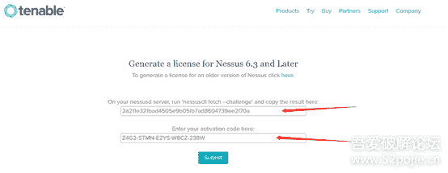
图片12.png (32.66 KB, 下载次数: 1)
[href="forum.php?mod=attachment&aid=MjUzMDg3NnxjNzczODZlZXwxNzkzNTc1MTkxfDE2ODA4NnwxNjUwNjY3&nothumb=yes" target="_blank"](https://www.52pojie.cn/forum.php?mod=attachment&aid=MjUzMDg3NnxjNzczODZlZXwxNzkzNTc1MTkxfDE2ODA4NnwxNjUwNjY3&nothumb=yes)
2022-6-17 17:08 上传

### 5、点击图示的两个位置，下载`all-2.0.tar.gz`和`nessus.license`文件
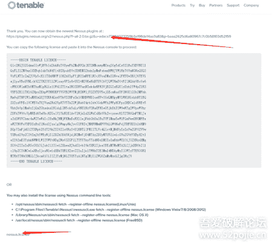
图片13.png (118.59 KB, 下载次数: 0)
[href="forum.php?mod=attachment&aid=MjUzMDg3N3w4NmIyZTAyOXwxNzkzNTc1MTkxfDE2ODA4NnwxNjUwNjY3&nothumb=yes" target="_blank"](https://www.52pojie.cn/forum.php?mod=attachment&aid=MjUzMDg3N3w4NmIyZTAyOXwxNzkzNTc1MTkxfDE2ODA4NnwxNjUwNjY3&nothumb=yes)
2022-6-17 17:08 上传

### 6、将`all-2.0.tar.gz`和`nessus.license`复制到nessus安装路径下
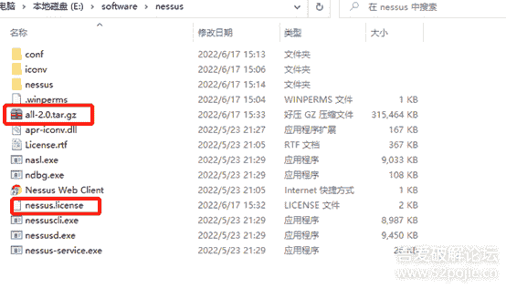
图片14.png (89.15 KB, 下载次数: 2)
[href="forum.php?mod=attachment&aid=MjUzMDg3OHw2MzU2N2ZkY3wxNzkzNTc1MTkxfDE2ODA4NnwxNjUwNjY3&nothumb=yes" target="_blank"](https://www.52pojie.cn/forum.php?mod=attachment&aid=MjUzMDg3OHw2MzU2N2ZkY3wxNzkzNTc1MTkxfDE2ODA4NnwxNjUwNjY3&nothumb=yes)
2022-6-17 17:08 上传

### 7、使用管理员身份在nessus路径下运行`nessuscli.exe update all-2.0.tar.gz`安装插件（时间有点儿长），安装完成后，记录图示中的数字
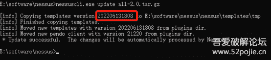
图片15.png (58.08 KB, 下载次数: 1)
[href="forum.php?mod=attachment&aid=MjUzMDg3OXw4OGNiYjcxNHwxNzkzNTc1MTkxfDE2ODA4NnwxNjUwNjY3&nothumb=yes" target="_blank"](https://www.52pojie.cn/forum.php?mod=attachment&aid=MjUzMDg3OXw4OGNiYjcxNHwxNzkzNTc1MTkxfDE2ODA4NnwxNjUwNjY3&nothumb=yes)
2022-6-17 17:08 上传

### 8、在任意地方创建文件`plugin_feed_info.inc`，输入以下内容，其中`PLUGIN_SET`值为第七步中的那串数字（不要删除，[//www.52pojie.cn" target="_blank" class="relatedlink"](https://www.52pojie.cn:href="https)阶段还需要使用）
```
PLUGIN_SET = "202206131808";
PLUGIN_FEED = "ProfessionalFeed(Direct)";
PLUGIN_FEED_TRANSPORT = "TenableNetwork Security Lightning";
```
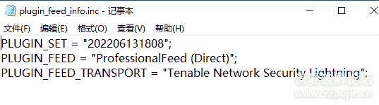
图片28.png (19.59 KB, 下载次数: 0)
[href="forum.php?mod=attachment&aid=MjUzMDg5MnwzMTdmNWVmM3wxNzkzNTc1MTkxfDE2ODA4NnwxNjUwNjY3&nothumb=yes" target="_blank"](https://www.52pojie.cn/forum.php?mod=attachment&aid=MjUzMDg5MnwzMTdmNWVmM3wxNzkzNTc1MTkxfDE2ODA4NnwxNjUwNjY3&nothumb=yes)
2022-6-17 17:12 上传

### 9、将`plugin_feed_info.inc`分别复制到安装目录`nessus\nessus`和`nessus\nessus\plugins`目录下。
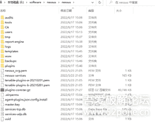
图片16.png (42.43 KB, 下载次数: 0)
[href="forum.php?mod=attachment&aid=MjUzMDg4MHxiNmMwMTRkN3wxNzkzNTc1MTkxfDE2ODA4NnwxNjUwNjY3&nothumb=yes" target="_blank"](https://www.52pojie.cn/forum.php?mod=attachment&aid=MjUzMDg4MHxiNmMwMTRkN3wxNzkzNTc1MTkxfDE2ODA4NnwxNjUwNjY3&nothumb=yes)
2022-6-17 17:08 上传

### 10、将`nessus\nessus\plugins`整个文件夹复制到电脑的其他位置待用（非常关键，破解阶段需要使用）。
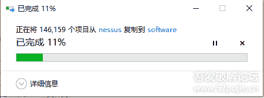
图片17.png (13.57 KB, 下载次数: 0)


[href="forum.php?mod=attachment&aid=MjUzMDg4MXwyOGNmZTcwNXwxNzkzNTc1MTkxfDE2ODA4NnwxNjUwNjY3&nothumb=yes" target="_blank"](https://www.52pojie.cn/forum.php?mod=attachment&aid=MjUzMDg4MXwyOGNmZTcwNXwxNzkzNTc1MTkxfDE2ODA4NnwxNjUwNjY3&nothumb=yes)

2022-6-17 17:08 上传

11、`plugins`文件夹复制完成后，输入`net stop "Tenable Nessus"`、`netstart "Tenable Nessus"`重启服务。

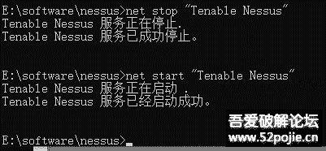

图片18.png (13.24 KB, 下载次数: 0)

[href="forum.php?mod=attachment&aid=MjUzMDg4MnxiM2Y0MDFjZXwxNzkzNTc1MTkxfDE2ODA4NnwxNjUwNjY3&nothumb=yes" target="_blank"](https://www.52pojie.cn/forum.php?mod=attachment&aid=MjUzMDg4MnxiM2Y0MDFjZXwxNzkzNTc1MTkxfDE2ODA4NnwxNjUwNjY3&nothumb=yes)

2022-6-17 17:08 上传

12、刷新浏览器界面，等待插件编译完成。

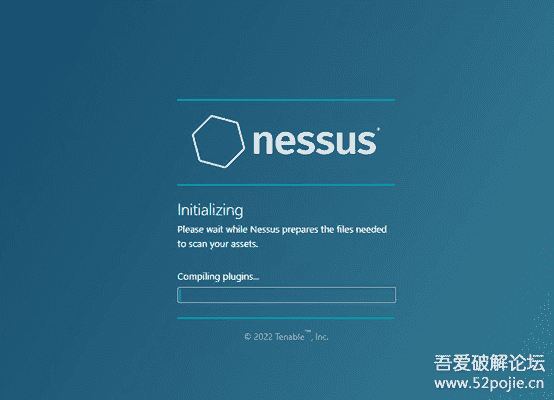

图片19.png (95.22 KB, 下载次数: 1)

[href="forum.php?mod=attachment&aid=MjUzMDg4M3w4MWEwNWQ1N3wxNzkzNTc1MTkxfDE2ODA4NnwxNjUwNjY3&nothumb=yes" target="_blank"](https://www.52pojie.cn/forum.php?mod=attachment&aid=MjUzMDg4M3w4MWEwNWQ1N3wxNzkzNTc1MTkxfDE2ODA4NnwxNjUwNjY3&nothumb=yes)

2022-6-17 17:08 上传

13、进入应用后，发现还是不能进行扫描（正常）。

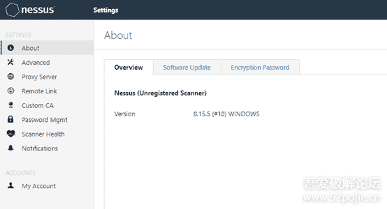

图片20.png (43.03 KB, 下载次数: 1)

[href="forum.php?mod=attachment&aid=MjUzMDg4NHxmNzRkOTIyZHwxNzkzNTc1MTkxfDE2ODA4NnwxNjUwNjY3&nothumb=yes" target="_blank"](https://www.52pojie.cn/forum.php?mod=attachment&aid=MjUzMDg4NHxmNzRkOTIyZHwxNzkzNTc1MTkxfDE2ODA4NnwxNjUwNjY3&nothumb=yes)

2022-6-17 17:08 上传

## 三、破解

1、停止服务`net stop "Tenable Nessus"`

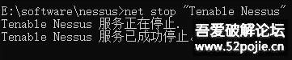

图片21.png (6.31 KB, 下载次数: 0)

[href="forum.php?mod=attachment&aid=MjUzMDg4NXw0NjAzOWJlZHwxNzkzNTc1MTkxfDE2ODA4NnwxNjUwNjY3&nothumb=yes" target="_blank"](https://www.52pojie.cn/forum.php?mod=attachment&aid=MjUzMDg4NXw0NjAzOWJlZHwxNzkzNTc1MTkxfDE2ODA4NnwxNjUwNjY3&nothumb=yes)

2022-6-17 17:08 上传

2、将`plugin_feed_info.inc`和`plugins`拷贝到安装目录`nessus\nessus`路径下进行替换。

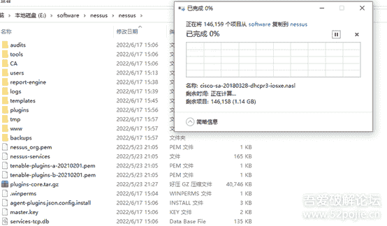

图片22.png (98.82 KB, 下载次数: 2)

[href="forum.php?mod=attachment&aid=MjUzMDg4NnwyYzcyMTM0MHwxNzkzNTc1MTkxfDE2ODA4NnwxNjUwNjY3&nothumb=yes" target="_blank"](https://www.52pojie.cn/forum.php?mod=attachment&aid=MjUzMDg4NnwyYzcyMTM0MHwxNzkzNTc1MTkxfDE2ODA4NnwxNjUwNjY3&nothumb=yes)

2022-6-17 17:08 上传

3、按顺序输入以下 3 个命令（实际路径需根据实际安装目录进行调整）。

```
attrib +s +r +h “E:\software\nessus\nessus\plugins\*.*”

attrib +s +r +h “E:\software\nessus\nessus\plugin_feed_info.inc”

attrib -s -r -h “E:\software\nessus\nessus\plugins\plugin_feed_info.inc”
```

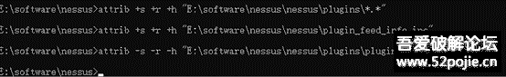

图片23.png (12.19 KB, 下载次数: 0)

[href="forum.php?mod=attachment&aid=MjUzMDg4N3wzNTRhNDgyNXwxNzkzNTc1MTkxfDE2ODA4NnwxNjUwNjY3&nothumb=yes" target="_blank"](https://www.52pojie.cn/forum.php?mod=attachment&aid=MjUzMDg4N3wzNTRhNDgyNXwxNzkzNTc1MTkxfDE2ODA4NnwxNjUwNjY3&nothumb=yes)

2022-6-17 17:08 上传

4、启动服务`net start "Tenable Nessus"`。

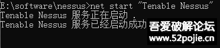

图片24.png (5.55 KB, 下载次数: 0)

[href="forum.php?mod=attachment&aid=MjUzMDg4OHw5ZDk2NDNmZnwxNzkzNTc1MTkxfDE2ODA4NnwxNjUwNjY3&nothumb=yes" target="_blank"](https://www.52pojie.cn/forum.php?mod=attachment&aid=MjUzMDg4OHw5ZDk2NDNmZnwxNzkzNTc1MTkxfDE2ODA4NnwxNjUwNjY3&nothumb=yes)

2022-6-17 17:08 上传

5、打开浏览器`https://127.0.0.1:8834`等待插件编译完成。

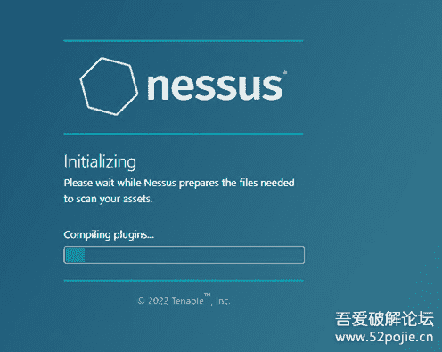

图片25.png (95.25 KB, 下载次数: 0)

[href="forum.php?mod=attachment&aid=MjUzMDg4OXwzMjZlYTVlY3wxNzkzNTc1MTkxfDE2ODA4NnwxNjUwNjY3&nothumb=yes" target="_blank"](https://www.52pojie.cn/forum.php?mod=attachment&aid=MjUzMDg4OXwzMjZlYTVlY3wxNzkzNTc1MTkxfDE2ODA4NnwxNjUwNjY3&nothumb=yes)

2022-6-17 17:08 上传

6、编译完成后，可以看到已经出现扫描功能。

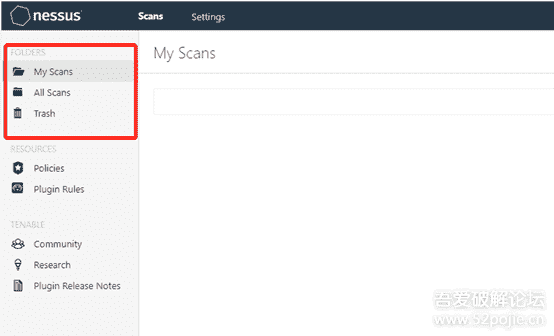

图片26.png (32.38 KB, 下载次数: 0)

[href="forum.php?mod=attachment&aid=MjUzMDg5MHw5YzU4ODc1NHwxNzkzNTc1MTkxfDE2ODA4NnwxNjUwNjY3&nothumb=yes" target="_blank"](https://www.52pojie.cn/forum.php?mod=attachment&aid=MjUzMDg5MHw5YzU4ODc1NHwxNzkzNTc1MTkxfDE2ODA4NnwxNjUwNjY3&nothumb=yes)

2022-6-17 17:08 上传

7、扫一扫试一下，完全没问题。

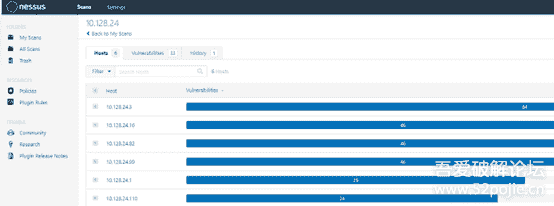

图片27.png (29.03 KB, 下载次数: 2)

[href="forum.php?mod=attachment&aid=MjUzMDg5MXw3NWYxMjlmOXwxNzkzNTc1MTkxfDE2ODA4NnwxNjUwNjY3&nothumb=yes" target="_blank"](https://www.52pojie.cn/forum.php?mod=attachment&aid=MjUzMDg5MXw3NWYxMjlmOXwxNzkzNTc1MTkxfDE2ODA4NnwxNjUwNjY3&nothumb=yes)

2022-6-17 17:08 上传
