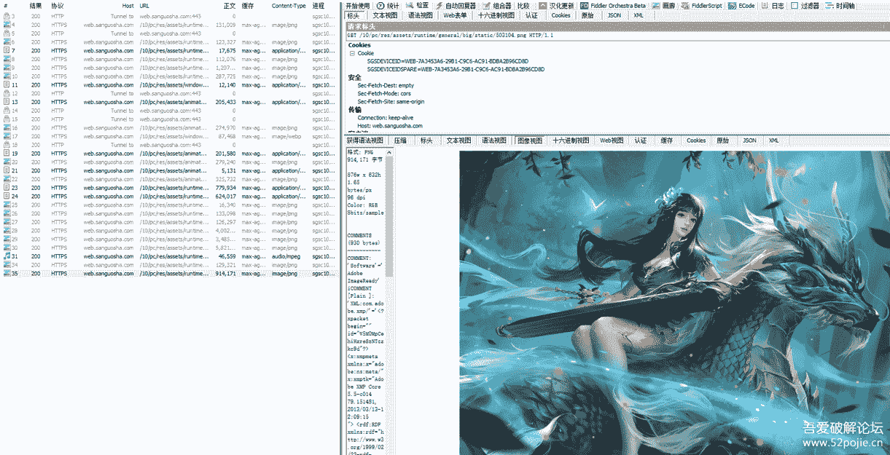
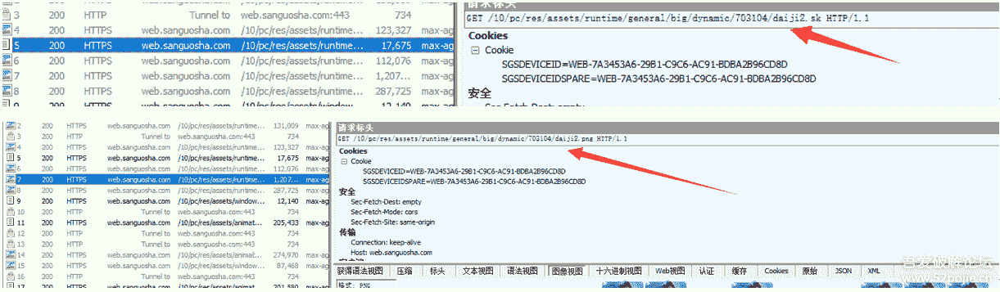
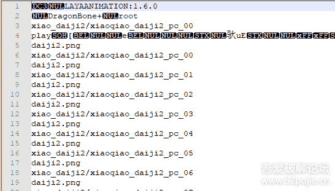
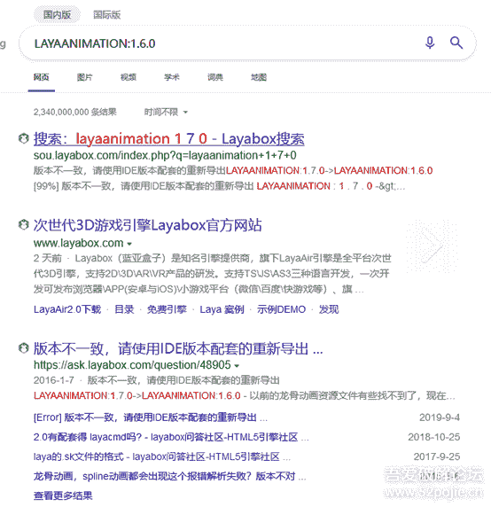
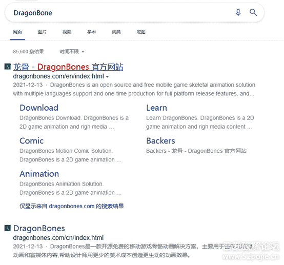
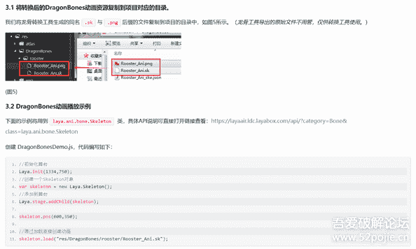
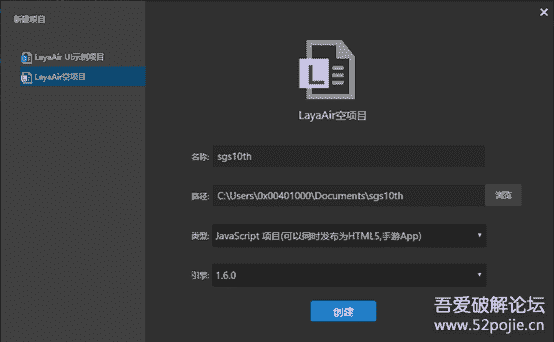
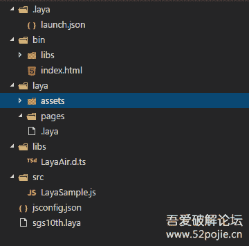
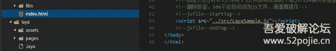
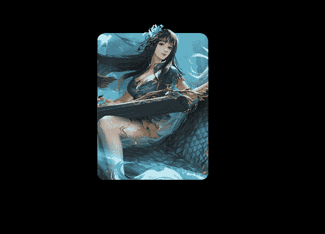

# [原创] 三国杀十周年动态皮肤资源提取

> 原帖：https://www.52pojie.cn/forum.php?mod=viewthread&tid=1654801
>
> 抓取时间：2026-11-01T23:14:42

## 背景与准备

起因是本人觉得小乔的战场皮肤很好看，就想提取出来当壁纸玩。

> 提示：本次测试环境为三国杀十周年 PC 微端，网页版原理大致相同。

先进行一次抓包，获取所需要的文件。



[下载附件](https://www.52pojie.cn/forum.php?mod=attachment&aid=MjUzMzIyMHxlNzQ2ZWUxZXwxNzkzNTc0ODc5fDE2ODA4NnwxNjU0ODAx&nothumb=yes)

1.png（806.79 KB，下载次数：0）；1；2022-6-28 19:18 上传

## 定位动态贴图与骨骼资源

寻找动态贴图文件和骨骼（直接保存下来或者浏览器访问该路径去下载）。



[下载附件](https://www.52pojie.cn/forum.php?mod=attachment&aid=MjUzMzIzMHw5NjNiOTY1N3wxNzkzNTc0ODc5fDE2ODA4NnwxNjU0ODAx&nothumb=yes)

3.png（303.44 KB，下载次数：0）；`2+3`；2022-6-28 19:26 上传

可以发现每个骨骼都对应着一张贴图。查看`.sk`文件特征。



[下载附件](https://www.52pojie.cn/forum.php?mod=attachment&aid=MjUzMjkxNXw3OTQ3ZTgwY3wxNzkzNTc0ODc5fDE2ODA4NnwxNjU0ODAx&nothumb=yes)

图片.png（32.75 KB，下载次数：0）；4；2022-6-27 20:23 上传

可以发现有`LAYAANIMATION:1.6.0`和`DragonBone`两个类似引擎名的字符串，以及下面的贴图名称。通过粗略的搜索可以得知，这个文件是由一个叫`LayAair`的引擎和一个叫`DragonBone`的引擎打包而来的。



[下载附件](https://www.52pojie.cn/forum.php?mod=attachment&aid=MjUzMjkxNnw2YmE4ZDMyYXwxNzkzNTc0ODc5fDE2ODA4NnwxNjU0ODAx&nothumb=yes)

图片.png（174.51 KB，下载次数：0）；5；2022-6-27 20:23 上传



[下载附件](https://www.52pojie.cn/forum.php?mod=attachment&aid=MjUzMjkxN3xkMmJiMTRjN3wxNzkzNTc0ODc5fDE2ODA4NnwxNjU0ODAx&nothumb=yes)

图片.png（116.92 KB，下载次数：1）；6；2022-6-27 20:23 上传

将两个引擎都下载下来进行探究。


[下载附件](https://www.52pojie.cn/forum.php?mod=attachment&aid=MjUzMjkxOHw4NGE5MDA2NXwxNzkzNTc0ODc5fDE2ODA4NnwxNjU0ODAx&nothumb=yes)

图片.png（3.31 KB，下载次数：0）；7；2022-6-27 20:24 上传

## `.sk` 文件的来源与播放

按照`LayaAir`的官方文档说明可以得知`.sk`文件是`LayAair`通过将`DragonBones`制作出的骨骼动画进行转换后得来的。并且官方文档中也详细说明了如何将`.sk`文件进行播放。

[官方文档](https://ldc.layabox.com/doc/?nav=zh-js-1-5-6)



[下载附件](https://www.52pojie.cn/forum.php?mod=attachment&aid=MjUzMjkxOXwzNjdiYWEzNnwxNzkzNTc0ODc5fDE2ODA4NnwxNjU0ODAx&nothumb=yes)

图片.png（82.38 KB，下载次数：0）；8；2022-6-27 20:24 上传

打开`Laya`引擎并创建一个新项目。



[下载附件](https://www.52pojie.cn/forum.php?mod=attachment&aid=MjUzMjkyMHw4NzRiM2RhMnwxNzkzNTc0ODc5fDE2ODA4NnwxNjU0ODAx&nothumb=yes)

图片.png（35.96 KB，下载次数：0）；9；2022-6-27 20:24 上传

项目创建后会生成一些模板，我们按照自己的需求来修改即可。



[下载附件](https://www.52pojie.cn/forum.php?mod=attachment&aid=MjUzMjkyMXw1OTJjMWY4NnwxNzkzNTc0ODc5fDE2ODA4NnwxNjU0ODAx&nothumb=yes)

图片.png（21.01 KB，下载次数：0）；10；2022-6-27 20:24 上传

打开`index.html`可得知我们需要修改的文件为`LayaSample.js`。



[下载附件](https://www.52pojie.cn/forum.php?mod=attachment&aid=MjUzMjkyMnw2ZTUzYWQ0MHwxNzkzNTc0ODc5fDE2ODA4NnwxNjU0ODAx&nothumb=yes)

图片.png（32.4 KB，下载次数：0）；11；2022-6-27 20:24 上传

复制示例代码并进行调整。

```javascript
// 初始化舞台
Laya.init(1334, 750); // 界面大小
// 创建一个 Skeleton 对象
var skeleton = new Laya.Skeleton();
// 添加到舞台
Laya.stage.addChild(skeleton);
skeleton.pos(600, 350); // 动画所在位置
// 通过加载直接创建动画
skeleton.load("../laya/assets/daiji2.sk");
```



[下载附件](https://www.52pojie.cn/forum.php?mod=attachment&aid=MjUzMjkyNnxkZDI4ZTVkN3wxNzkzNTc0ODc5fDE2ODA4NnwxNjU0ODAx&nothumb=yes)

图片1.gif（1.9 MB，下载次数：0）；2022-6-27 20:26 上传

动态动画提取成功。
