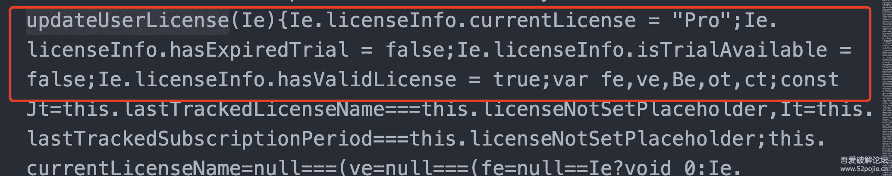

# [MacOS逆向] mac下fiddler everywhere 3.2.1 和谐版

- 原帖: https://www.52pojie.cn/forum.php?mod=viewthread&tid=1654857
- 抓取时间: 2026-11-01T23:14:40

3.3.0版本吾爱已发，https://www.52pojie.cn/thread-1659955-1-1.html

参考大佬的帖子：[https://www.52pojie.cn/thread-1654205-1-1.html](https://www.52pojie.cn/thread-1654205-1-1.html)。说白了，就拿大佬的想法在mac上实验了下,试验了mac下也是可以的

## 1. 修改 js

```
cd /Applications/Fiddler Everywhere.app/Contents/Resources/app/out/WebServer/ClientApp/dist
ls main*
```

打开列出的文件，搜索`updateUserLicense`。

插入代码：

```js
Ie.licenseInfo.currentLicense = "Pro";
Ie.licenseInfo.hasExpiredTrial = false;
Ie.licenseInfo.isTrialAvailable = false;
Ie.licenseInfo.hasValidLicense = true;
```

如图所示



`209281656342995_.pic.jpg` (159.85 KB, 下载次数: 0)

[附件下载](https://www.52pojie.cn/forum.php?mod=attachment&aid=MjUzMjk0MnwzMjM0ZDdhMnwxNzkzNTc0ODc4fDE2ODA4NnwxNjU0ODU3&nothumb=yes)

2022-6-27 23:24 上传

## 2. 替换 dll

由于反编译比较麻烦，我直接提供大佬修改后的成品，具体替换方法参考上面的帖子，路径为 `/Applications/Fiddler Everywhere.app/Contents/Resources/app/out/WebServer/`

就用 github 的成品。（[https://github.com/msojocs/fiddler-everywhere-crack](https://github.com/msojocs/fiddler-everywhere-crack)）

下载地址：[https://huachang.lanzouu.com/igZBQ070yskf](https://huachang.lanzouu.com/igZBQ070yskf)
