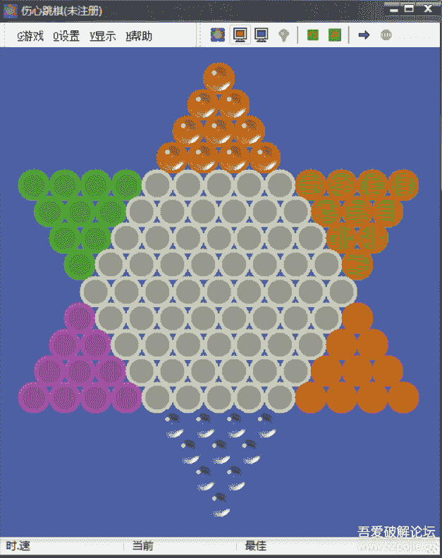
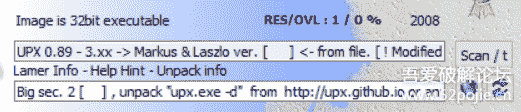
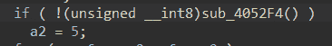
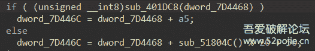
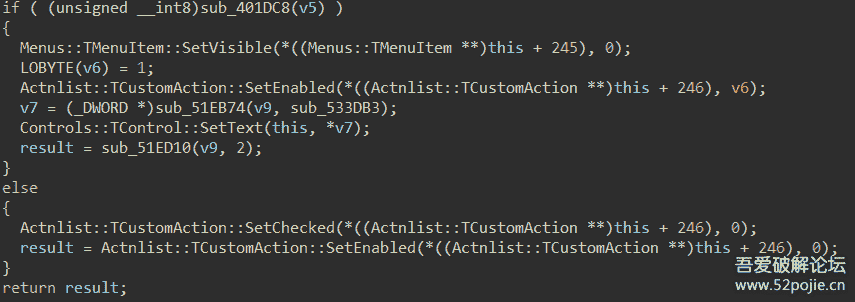
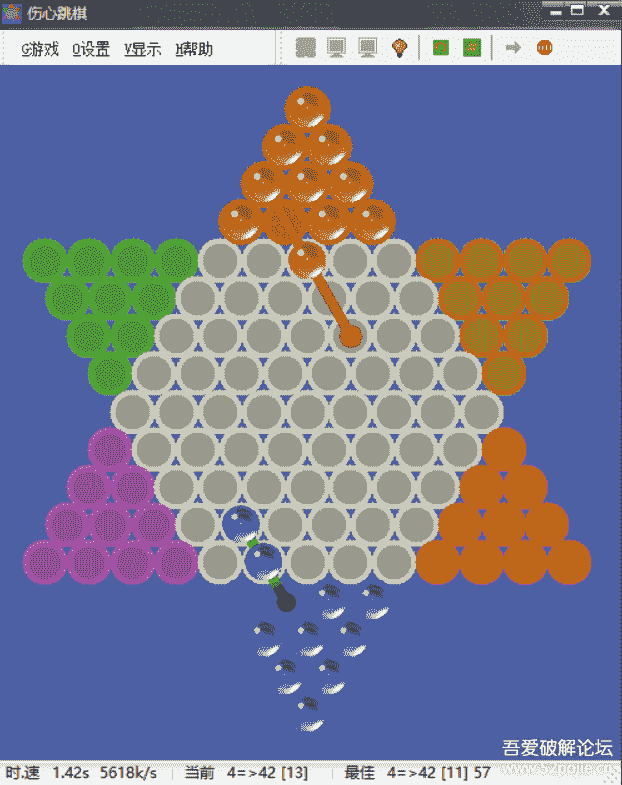

# [原创] 分析伤心跳棋注册验证

- 原帖：[https://www.52pojie.cn/forum.php?mod=viewthread&tid=1655767](https://www.52pojie.cn/forum.php?mod=viewthread&tid=1655767)
- 抓取时间：`2026-11-01T23:13:19`

文章首发于我的博客：[https://jameshoi.github.io/2021/03/30/note](https://jameshoi.github.io/2021/03/30/note)。

## 软件界面与未注册状态

先来看看这个软件界面，显示未注册，并且就算修改电脑思考时间也只能是 1 秒。

`image-20220629235220091.png`（187.15 KB，下载次数：1；2022-6-30 00:06 上传）

## 脱壳与验证位置

这个软件非常老，我找不到那个年代的 `UPX`（[https://www.52pojie.cn/forum-5-1.html](https://www.52pojie.cn/forum-5-1.html)），自己手脱会导致软件功能用不了（我修不好），不过脱壳后可以找到软件验证的位置。

`image-20210722124327765.png`（56.76 KB，下载次数：1；2022-6-30 00:07 上传）

## 绕过注册验证

要绕过注册验证很简单，软件在地址 `408727`、`40860B`、`402181` 有三次验证，全部跳过即可。很玄学的地方是 `402181` 不能用修改字节码的方式打补丁，否则会导致另外两处的验证就算成功，功能也还是用不了。

`image-20220629235426220.png`（3.3 KB，下载次数：1；2022-6-30 00:07 上传）

`image-20210722125502145.png`（14.77 KB，下载次数：1；2022-6-30 00:07 上传）

`image-20210722125427440.png`（38.29 KB，下载次数：2；2022-6-30 00:07 上传）

### 异常中断补丁

所以上图这个 `if` 最后打补丁是用异常中断补丁修改 `EIP` 成功的，可能软件有校验字节码是否被修改？最后附上补丁数据。

`image-20210722125854700.png`（24.52 KB，下载次数：1；2022-6-30 00:08 上传）

下图是选择 `修改EIP(NOP)`。

`image-20210722125924095.png`（21.61 KB，下载次数：2；2022-6-30 00:08 上传）

## 验证结果

之后左上角没有显示未注册，而且可以修改电脑思考时间。

`image-20210722130114886.png`（193.67 KB，下载次数：2；2022-6-30 00:09 上传）

## 注册算法与软件下载

软件注册算法有定位到，但我懒得看了，交给其他大家自己练手试试吧。

伤心跳棋原版软件：[`sxtq.exe`](https://jameshoi.github.io/2021/03/30/note/sxtq.exe)
