# [.NET逆向] 绕过某监考客户端检测

- 原帖: https://www.52pojie.cn/forum.php?mod=viewthread&tid=1657508
- 抓取时间: 2026-11-01T23:13:03

【文章首发于我的博客 [//jameshoi.github.io/2022/06/30/invigilate/](https://jameshoi.github.io/2022/06/30/invigilate/)】

现在的开发人员安全意识还是薄弱，用`C#`写的还就加了一点点混淆。本文章分两部分，一是开启软件时的校验，二是绕过软件检测系统。重点强调！！！本文章只限于交流逆向技术用途，请不要利用本文章做违反学校条例行为！！

## 文件校验

在加载的时候按暂停，很容易能找到检查软件版本的位置

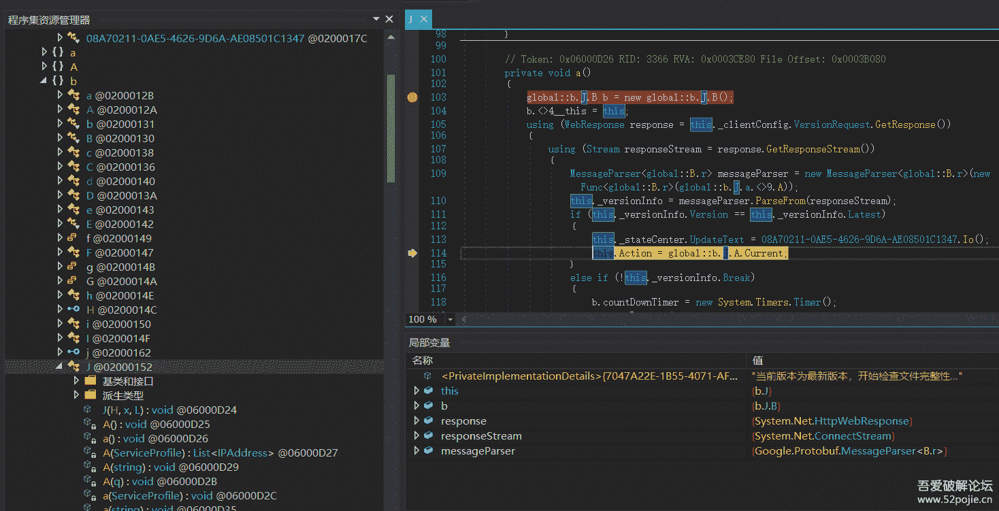

image-20220630012927916.png (136.71 KB, 下载次数: 1)

[forum.php?mod=attachment&aid=MjUzNDUxNHxkYzllNGYyOXwxNzkzNTc0NzgxfDE2ODA4NnwxNjU3NTA4&nothumb=yes](https://www.52pojie.cn/forum.php?mod=attachment&aid=MjUzNDUxNHxkYzllNGYyOXwxNzkzNTc0NzgxfDE2ODA4NnwxNjU3NTA4&nothumb=yes)

2022-7-4 17:20 上传

很明显是验证版本

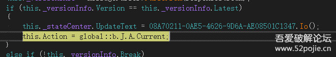

image-20220630013849100.png (10.93 KB, 下载次数: 0)

[forum.php?mod=attachment&aid=MjUzNDUxNXw0MzcxYTM1MXwxNzkzNTc0NzgxfDE2ODA4NnwxNjU3NTA4&nothumb=yes](https://www.52pojie.cn/forum.php?mod=attachment&aid=MjUzNDUxNXw0MzcxYTM1MXwxNzkzNTc0NzgxfDE2ODA4NnwxNjU3NTA4&nothumb=yes)

2022-7-4 17:21 上传

跟下去之后很容易找到校验位置，应该是一个任务组，运行其中一个任务

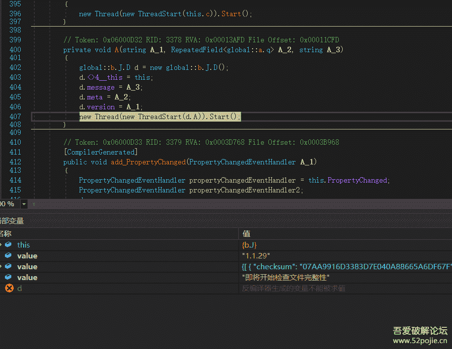

image-20220630014033290.png (44.52 KB, 下载次数: 1)

[forum.php?mod=attachment&aid=MjUzNDUxNnxkNzdmY2MxZnwxNzkzNTc0NzgxfDE2ODA4NnwxNjU3NTA4&nothumb=yes](https://www.52pojie.cn/forum.php?mod=attachment&aid=MjUzNDUxNnxkNzdmY2MxZnwxNzkzNTc0NzgxfDE2ODA4NnwxNjU3NTA4&nothumb=yes)

2022-7-4 17:21 上传

一直跟下去，能找到这个线程组的线程函数，可以看到有校验的函数。补充一句，软件是若校验本地`exe`和`dll`与校验码不一致则重新下载

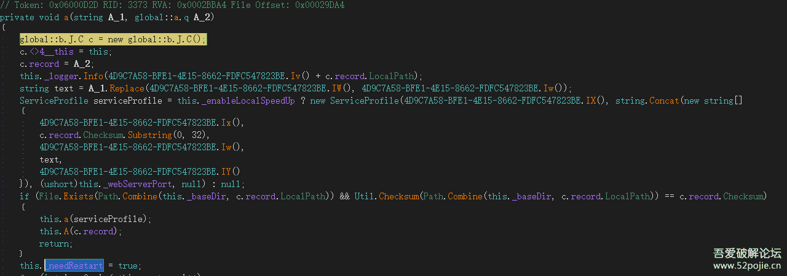

image-20220630015841487.png (28.69 KB, 下载次数: 2)

[forum.php?mod=attachment&aid=MjUzNDUxOHwyY2ZjMTc4NXwxNzkzNTc0NzgxfDE2ODA4NnwxNjU3NTA4&nothumb=yes](https://www.52pojie.cn/forum.php?mod=attachment&aid=MjUzNDUxOHwyY2ZjMTc4NXwxNzkzNTc0NzgxfDE2ODA4NnwxNjU3NTA4&nothumb=yes)

2022-7-4 17:26 上传

这里不再阐述如何修改，直接修改`IL`为`Nop`即可，上图最后有个`needRestart`，意思是更新软件重启，可见需要直接`return`，满足那个`if`条件。

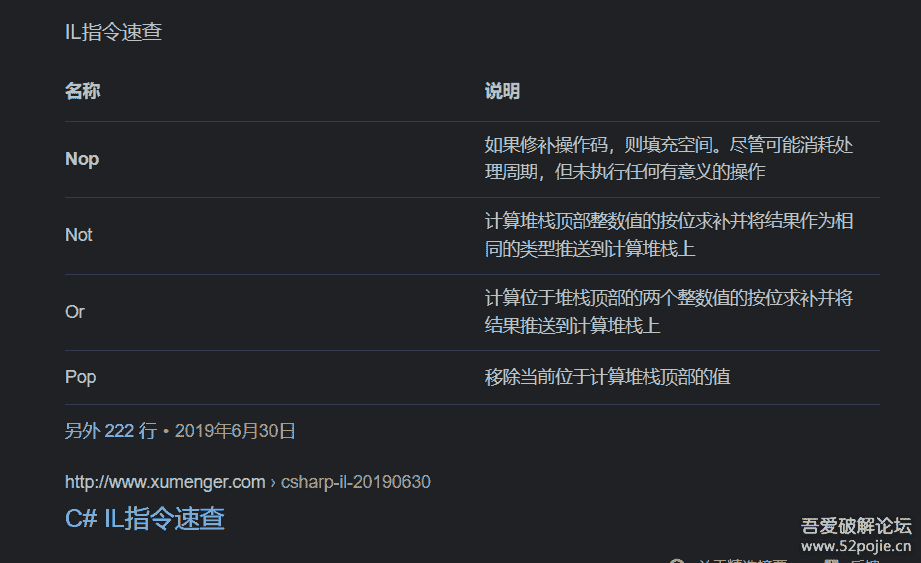

image-20220630015943782.png (57.22 KB, 下载次数: 3)

[forum.php?mod=attachment&aid=MjUzNDUxOXxjMGE4MThlYXwxNzkzNTc0NzgxfDE2ODA4NnwxNjU3NTA4&nothumb=yes](https://www.52pojie.cn/forum.php?mod=attachment&aid=MjUzNDUxOXxjMGE4MThlYXwxNzkzNTc0NzgxfDE2ODA4NnwxNjU3NTA4&nothumb=yes)

2022-7-4 17:26 上传

修改后变这样，用`dnspy`保存即可

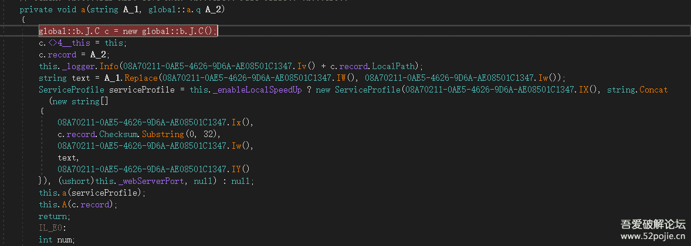

image-20220630020159471.png (27 KB, 下载次数: 2)

[forum.php?mod=attachment&aid=MjUzNDUyMHwwYjlkMmYxMHwxNzkzNTc0NzgxfDE2ODA4NnwxNjU3NTA4&nothumb=yes](https://www.52pojie.cn/forum.php?mod=attachment&aid=MjUzNDUyMHwwYjlkMmYxMHwxNzkzNTc0NzgxfDE2ODA4NnwxNjU3NTA4&nothumb=yes)

2022-7-4 17:27 上传

## 检测系统

当开着有通讯软件时会报错，显示要求关闭，甚至会发现是虚拟机，远程桌面等。

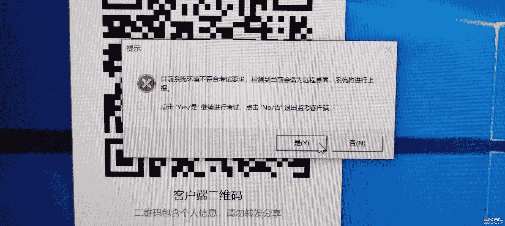

image-20220630020422779.jpg (584.33 KB, 下载次数: 2)

[forum.php?mod=attachment&aid=MjUzNDUyMXwzN2ViZWM4ZHwxNzkzNTc0NzgxfDE2ODA4NnwxNjU3NTA4&nothumb=yes](https://www.52pojie.cn/forum.php?mod=attachment&aid=MjUzNDUyMXwzN2ViZWM4ZHwxNzkzNTc0NzgxfDE2ODA4NnwxNjU3NTA4&nothumb=yes)

2022-7-4 17:27 上传

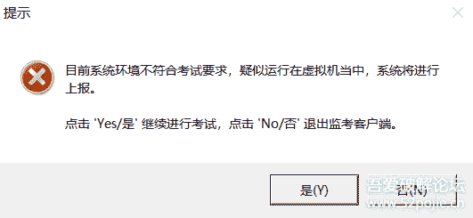

image-20220630020552928.png (20.29 KB, 下载次数: 2)

[forum.php?mod=attachment&aid=MjUzNDUyMnxiMDhiOWJiZXwxNzkzNTc0NzgxfDE2ODA4NnwxNjU3NTA4&nothumb=yes](https://www.52pojie.cn/forum.php?mod=attachment&aid=MjUzNDUyMnxiMDhiOWJiZXwxNzkzNTc0NzgxfDE2ODA4NnwxNjU3NTA4&nothumb=yes)

2022-7-4 17:27 上传

当显示提示的时候`dnspy`点暂停，很容易能找到相关位置

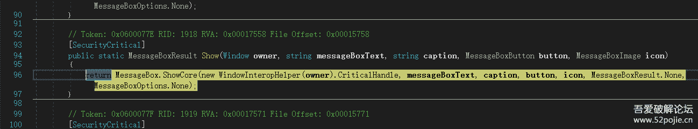

image-20220630020805763.png (20.09 KB, 下载次数: 1)

[forum.php?mod=attachment&aid=MjUzNDUyM3xmNWRiZDQ2Y3wxNzkzNTc0NzgxfDE2ODA4NnwxNjU3NTA4&nothumb=yes](https://www.52pojie.cn/forum.php?mod=attachment&aid=MjUzNDUyM3xmNWRiZDQ2Y3wxNzkzNTc0NzgxfDE2ODA4NnwxNjU3NTA4&nothumb=yes)

2022-7-4 17:27 上传

都叫`monitorSystem`了，明显`A`是检测函数，`nop`掉即可

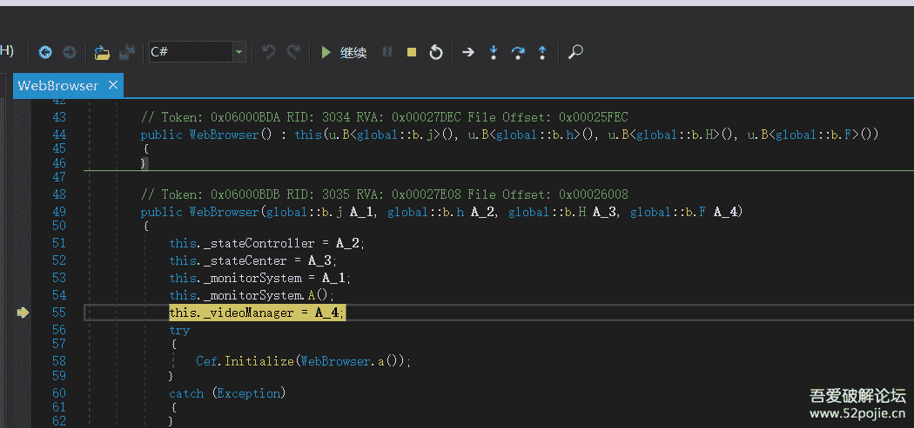

image-20220630021037756.png (34.9 KB, 下载次数: 2)

[forum.php?mod=attachment&aid=MjUzNDUyNHxmMjU3YjRiNHwxNzkzNTc0NzgxfDE2ODA4NnwxNjU3NTA4&nothumb=yes](https://www.52pojie.cn/forum.php?mod=attachment&aid=MjUzNDUyNHxmMjU3YjRiNHwxNzkzNTc0NzgxfDE2ODA4NnwxNjU3NTA4&nothumb=yes)

2022-7-4 17:28 上传

## 继续分析

前面两部分其实已经够了，这里再分析一下流程，先获取了学生信息，`videoMnager`打开摄像头，连接一个鼠标按下的`event`

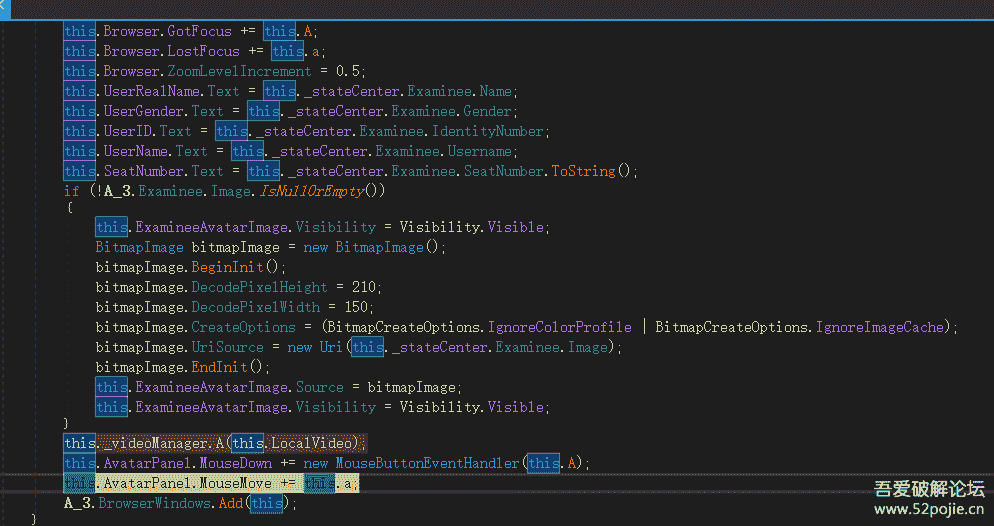

image-20220630025253191.png (37.56 KB, 下载次数: 2)

[forum.php?mod=attachment&aid=MjUzNDUyNXw0ZjVhMjhlZHwxNzkzNTc0NzgxfDE2ODA4NnwxNjU3NTA4&nothumb=yes](https://www.52pojie.cn/forum.php?mod=attachment&aid=MjUzNDUyNXw0ZjVhMjhlZHwxNzkzNTc0NzgxfDE2ODA4NnwxNjU3NTA4&nothumb=yes)

2022-7-4 17:28 上传

下图`a`函数应该是截图，查看电脑当前屏幕，有机会上传，另外那个`B`函数有机会是上传系统环境进程，这里调试不了，可能需要实际考试才能进入这个函数。

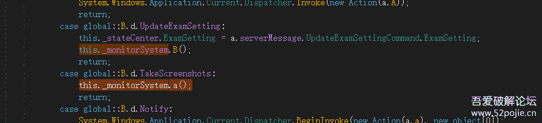

image-20220630034935539.png (17.71 KB, 下载次数: 2)

[forum.php?mod=attachment&aid=MjUzNDUyNnxmOWY1MDI4ZnwxNzkzNTc0NzgxfDE2ODA4NnwxNjU3NTA4&nothumb=yes](https://www.52pojie.cn/forum.php?mod=attachment&aid=MjUzNDUyNnxmOWY1MDI4ZnwxNzkzNTc0NzgxfDE2ODA4NnwxNjU3NTA4&nothumb=yes)

2022-7-4 17:28 上传

## 结果

可以看到打开`QQ`，甚至是虚拟机的情况下都能正常运行。这里没有继续分析监考客户端是否有其他监控过程，所以就算你一意孤行打算作弊，也请你也自行斟酌带来的风险和后果。有时间研究逆向破解监考客户端，不如多花些时间学习！

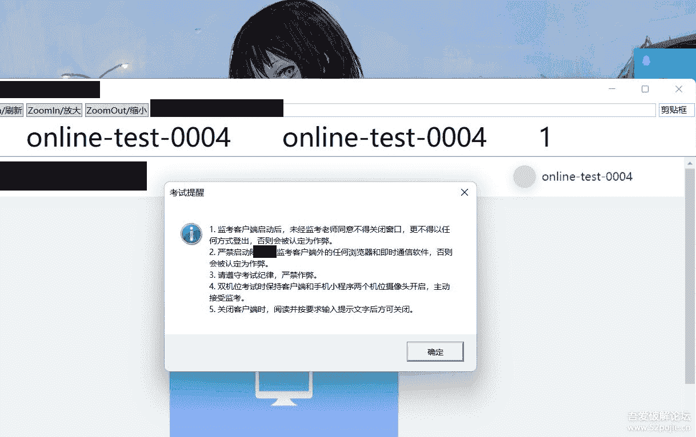

image-20220630021423710.png (392.48 KB, 下载次数: 2)

[forum.php?mod=attachment&aid=MjUzNDUyOHxkY2U3NTk5ZnwxNzkzNTc0NzgxfDE2ODA4NnwxNjU3NTA4&nothumb=yes](https://www.52pojie.cn/forum.php?mod=attachment&aid=MjUzNDUyOHxkY2U3NTk5ZnwxNzkzNTc0NzgxfDE2ODA4NnwxNjU3NTA4&nothumb=yes)

2022-7-4 17:30 上传

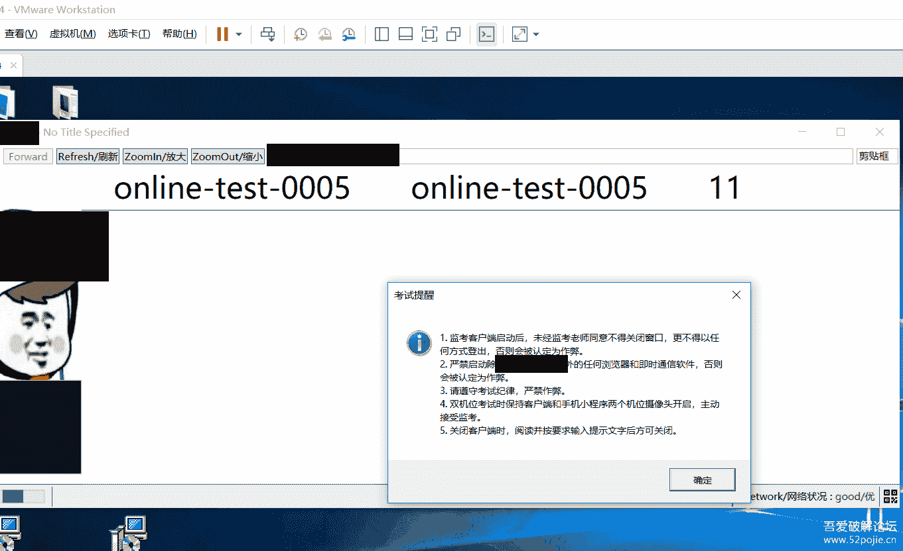

image-20220630035357799.png (199.89 KB, 下载次数: 2)

[forum.php?mod=attachment&aid=MjUzNDYwMXxlZDBmMTFhM3wxNzkzNTc0NzgxfDE2ODA4NnwxNjU3NTA4&nothumb=yes](https://www.52pojie.cn/forum.php?mod=attachment&aid=MjUzNDYwMXxlZDBmMTFhM3wxNzkzNTc0NzgxfDE2ODA4NnwxNjU3NTA4&nothumb=yes)

2022-7-5 03:41 上传
