# [原创] 伤心跳× 2.1（2008）及 10.4（2016）注册算法+自校验分析

- 原帖: https://www.52pojie.cn/forum.php?mod=viewthread&tid=1658431
- 抓取时间: 2026-11-01T23:13:01

该文软件来自 [//www.52pojie.cn/thread-1655767-1-1.html" target="_blank"](https://www.52pojie.cn/thread-1655767-1-1.html:href="https)，其中 2016 版本软件来自网络。

本文内容为个人独立分析完成。

代码压缩包内的文件标记了新的用户名，可能与现在显示的用户名不一致。

「伤心跳×」一共发行了两个大版本。一个是 2008 年左右期间发布的 `v2.1` 基础版本（右，下称为 2008 版），以及 2016 年左右发布的 `v10` 版本（左，下称为 2016 版）。在此期间发生了什么，无从得知。

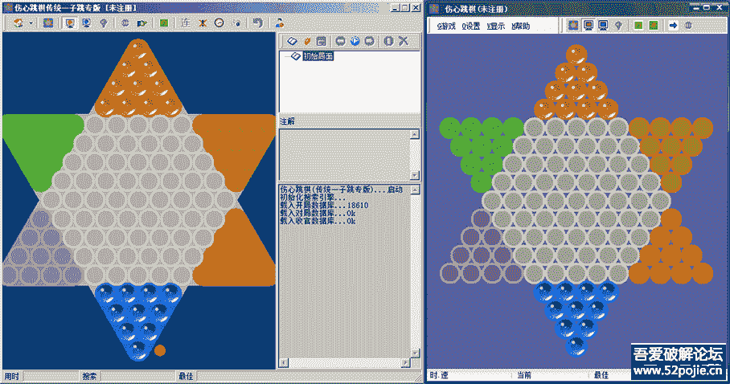

app_sxtq_1_2.png (66.51 KB, 下载次数: 244)

[href="forum.php?mod=attachment&aid=MjUzNTE0NHxkMDgwZTcyMHwxNzkzNTc0Nzc4fDE2ODA4NnwxNjU4NDMx&nothumb=yes" target="_blank"](https://www.52pojie.cn/forum.php?mod=attachment&aid=MjUzNTE0NHxkMDgwZTcyMHwxNzkzNTc0Nzc4fDE2ODA4NnwxNjU4NDMx&nothumb=yes)

2022-7-7 06:39 上传

伤心跳× (左 2008，右 2016)

该文的逆向目标如下：

- 分析出软件所使用的注册算法以及流程；
- 搞定软件的自校验；
- 如果需要，替换软件公钥。

## 使用到的工具

- `x64dbg` - 调试器（插件 [//rammichael.com/multimate-assembler" target="_blank" rel="noopener noreferrer nofollow"](http://rammichael.com/multimate-assembler:rel="nofollow noopener" href="http) + [//github.com/x64dbg/ScyllaHide/releases" target="_blank" rel="noopener noreferrer nofollow"](https://github.com/x64dbg/ScyllaHide/releases:rel="nofollow noopener" href="https)）
- `IDA Pro` - 静态分析
- `Detect it Easy` - 查壳工具
- `HxD` - 十六进制编辑器

上述工具都能在爱盘或其官网获取。

## 基础版本（2008）

首先查壳，可以发现是魔改过的 `UPX` 壳：

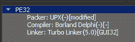

upx_packed.png (1.92 KB, 下载次数: 242)

[href="forum.php?mod=attachment&aid=MjUzNTEzMHxiMTg2YzJiMnwxNzkzNTc0Nzc4fDE2ODA4NnwxNjU4NDMx&nothumb=yes" target="_blank"](https://www.52pojie.cn/forum.php?mod=attachment&aid=MjUzNTEzMHxiMTg2YzJiMnwxNzkzNTc0Nzc4fDE2ODA4NnwxNjU4NDMx&nothumb=yes)

2022-7-7 06:38 上传

没有脱壳就无法使用静态分析工具辅助分析，所以第一步就是要去脱壳。

※ 当然，如果想偷懒只做静态分析，可以直接启动程序并转储内存即可。

### 脱壳

直接使用调试器 `x64dbg` 启动，进入到主程序代码空间：

```asm
0082A5E0 | 60                | pushad                             |
0082A5E1 | BE 00207A00       | mov esi,sxtq.7A2000                |
0082A5E6 | 8DBE 00F0C5FF     | lea edi,dword ptr ds:[esi-3A1000]  |
0082A5EC | 57                | push edi                           |
0082A5ED | EB 0B             | jmp sxtq.82A5FA                    |
```

因为已知是一个基于 `UPX` 魔改的壳，程序的原始入口通过这串代码底部的 `jmp` 跳转；因此往下翻直到一个长 `jmp` 指令：

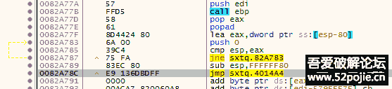

upx_far_jmp.png (10.7 KB, 下载次数: 234)

[href="forum.php?mod=attachment&aid=MjUzNTEzMXwxMmQ5NzQ1NHwxNzkzNTc0Nzc4fDE2ODA4NnwxNjU4NDMx&nothumb=yes" target="_blank"](https://www.52pojie.cn/forum.php?mod=attachment&aid=MjUzNTEzMXwxMmQ5NzQ1NHwxNzkzNTc0Nzc4fDE2ODA4NnwxNjU4NDMx&nothumb=yes)

2022-7-7 06:38 上传

选中后按下 `F4` 运行至该处，再按下 `F8` 跳转到程序的原入口。

然后使用 `x64dbg` 自带的 `Scylla` 进行转储 + 修复即可：

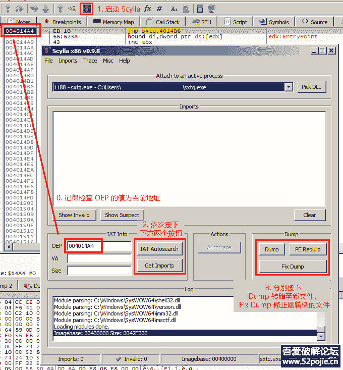

dump_instruction.png (33.48 KB, 下载次数: 236)

[href="forum.php?mod=attachment&aid=MjUzNTE0MnwwMzM3MWNjNnwxNzkzNTc0Nzc4fDE2ODA4NnwxNjU4NDMx&nothumb=yes" target="_blank"](https://www.52pojie.cn/forum.php?mod=attachment&aid=MjUzNTE0MnwwMzM3MWNjNnwxNzkzNTc0Nzc4fDE2ODA4NnwxNjU4NDMx&nothumb=yes)

2022-7-7 06:39 上传

转储完成后会生成一个叫「`sxtq_dump_SCY.exe`」的文件，直接双击执行能正常启动（因为有自校验失败而触发暗桩，无法正常进行游戏）。脱壳成功。

## 初尝试：试探软件注册

直接启动软件，可以看到标题提示未注册。

依次点击「帮助」→「注册」，发现是基于机器码的验证方案。

随意输入一些字符并确认，注册窗口直接关闭，无后续提示信息。

既然如此，直接搜索字符串看看：

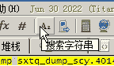

search_str_ref.png (3.01 KB, 下载次数: 231)

[href="forum.php?mod=attachment&aid=MjUzNTEzNHwzYzlmOGQzZXwxNzkzNTc0Nzc4fDE2ODA4NnwxNjU4NDMx&nothumb=yes" target="_blank"](https://www.52pojie.cn/forum.php?mod=attachment&aid=MjUzNTEzNHwzYzlmOGQzZXwxNzkzNTc0Nzc4fDE2ODA4NnwxNjU4NDMx&nothumb=yes)

2022-7-7 06:38 上传

然后搜索关键字「注册」：

```asm
00404217  mov edx,sxtq_dump_scy.533E76     "请输入电脑的思考时间(单位:毫秒)，\r思考时间越长电脑水平越高。注：未注册版本设置时间无效。"

00404564  mov edx,sxtq_dump_scy.533ED3     "谢谢你注册伤心跳×，请按确定以重新启动伤心跳×使注册生效。"

00404576  mov ecx,sxtq_dump_scy.533F0E     "注册"

00404628  mov edx,sxtq_dump_scy.533F23     "无法保存注册信息!!!"
```

可以在 `00404564` 找到一个注册成功后的提示文字。为了方便分析，把这个地址复制到 `IDA` 后查看伪代码：

```cpp
inline bool is_valid_serial_char(char c) {
  return (c >= '0' && c = 'a' && c = 'A' && c = 48 && len_reg_code
```

※ 由于篇幅的关系，这里直接放出我整理好的版本；本文后续的伪代码也是我手动简化过的。

该函数只进行了简单的合法性检查（数字、字母、`#` 以及 `$` 符号；48~66 长度），并未进行其它校验。看来是“重启检测”了。

此时我们就可以构造一个“伪码”——即看上去符合要求的序列号，来观察程序后续，如：

```text
0000111122223333444455556666777788889999AAAABBBBCCCCDDDD
```

软件直接提示感谢注册，并自动重启。而在软件目录可以发现序列号被写出到了一个新的文件，`SXTQREG.INI` 内。

## 重启验证序列号：算法分析

既然知道序列号会写出到 `SXTQREG.INI`，那我们可以尝试在 `IDA` 内搜索。

虽然因为函数签名识别错误导致伪代码看不出来，但我们可以手动调整 `0051EB74` 的函数名与签名：

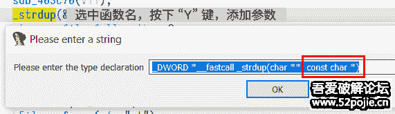

ida_fix_0051EB74.png (10.32 KB, 下载次数: 231)

[href="forum.php?mod=attachment&aid=MjUzNTEzOHw0NDU2NjAwOHwxNzkzNTc0Nzc4fDE2ODA4NnwxNjU4NDMx&nothumb=yes" target="_blank"](https://www.52pojie.cn/forum.php?mod=attachment&aid=MjUzNTEzOHw0NDU2NjAwOHwxNzkzNTc0Nzc4fDE2ODA4NnwxNjU4NDMx&nothumb=yes)

2022-7-7 06:38 上传

更改后可以看到该文件名出现了，然后加载流程就更直白了：

```cpp
file_reg_code = fopen(str_reg_file_full_path_2, "rt");
if ( file_reg_code ) {
  fgets(g_reg_code, 65, file_reg_code); // 64 字节 + 结束符
  fclose(file_reg_code);
}
```

现在可以直接查找全局变量 `g_reg_code (0x0053DF60)` 的交叉引用，这个变量是如何使用的：

```text
Dir   Address                     Text

Up    ValidateSerial_MakeMove+B6  mov     eax, offset g_reg_code

      ReadRegCode+16B             push    offset g_reg_code; Buffer

Down  _TA_mnRegClick+1EE          mov     esi, offset g_reg_code

Down  _TA_mnRegClick+2A1          push    offset g_reg_code; Format

Down  ValidateSerial_StartUp+B6   mov     eax, offset g_reg_code
```

其中 `_TA_mnRegClick` 为注册窗口储存过程函数；`ReadRegCode` 即我们现在所在之处。

剩下的两个函数经过调试器回溯验证，分别更名为「启动时验证（`ValidateSerial_StartUp`、`0x004052F4`）」与「落子时验证（`ValidateSerial_MakeMove`、`0x00401DC8`）」。这两个函数几乎一致，只看前者即可。

进去后可以看到一些 `a` 开头的变量，点进去后可以发现是字符串但是却不能直接显示。

此时可以将该变量标记为常量，这样 `IDA` 就会直接显示该字符串内容了：

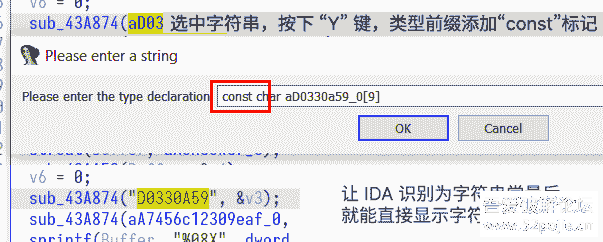

ida_show_string_literal.png (16.7 KB, 下载次数: 237)

[href="forum.php?mod=attachment&aid=MjUzNTEzN3w1ZWRjYTRlMXwxNzkzNTc0Nzc4fDE2ODA4NnwxNjU4NDMx&nothumb=yes" target="_blank"](https://www.52pojie.cn/forum.php?mod=attachment&aid=MjUzNTEzN3w1ZWRjYTRlMXwxNzkzNTc0Nzc4fDE2ODA4NnwxNjU4NDMx&nothumb=yes)

2022-7-7 06:38 上传

一番整理后，你可能会发现有很多 `sub_43A874` 的调用，直接点进去可以发现一个奇怪的字符串变量 `aInZhsreadSecon`（in zhsread, second argument）。直接上网搜索该字符串，得知：

> 这个算法用到了大整数运算库 freelip。而我是怎么知道的（静态链接）……
>
> 原因是我看到了这样的字符串："in zhsread, second argument"，运气如此之佳。
>
> ……
>
> 大整数运算库用来做原始的 RSA-64 运算。
>
> —— by 红绡枫叶 [//bbs.pediy.com/thread-207555.htm" target="_blank" rel="noopener noreferrer nofollow"](https://bbs.pediy.com/thread-207555.htm:rel="nofollow noopener" href="https)

继续搜寻 `Freelip` 相关的内容，可以追溯到 2001 年发表的这篇文章：

[//blog.csdn.net/Netguy/article/details/8669" target="_blank" rel="noopener noreferrer nofollow"](https://blog.csdn.net/Netguy/article/details/8669:rel="nofollow noopener" href="https)

虽然原文提到的下载链接已经无法访问，但还是能找到备份。

把 `Freelip` 下载后查看源码，根据找到的字符串信息可以将函数名填充回 `IDA`，如：

```cpp
zhsread("D0330A59", &rsa_E);
zhsread("A7456C12309EAF6BEF6..." /* 太长省略 */, &rsa_N);
```

## Freelip 篇

把 `freelip` 编译后玩了下，看看 `zhsread` 如何解析输入的内容。

将下述文件写出到 `testlip.c`：

```c
#include "lip.h"

int main() {

    verylong rsa_E = 0;

    zhsread("D0330A59", &rsa_E);

    zwriteln(rsa_E); // 输出十进制表示到终端

    return 0;

}
```

然后编译运行看看：

```bash
$ make && gcc -o ./testlip testlip.c lip.o -lm && ./testlip
3493005913
$ python3 -c 'print(0xD0330A59)'
3493005913
```

对比发现与 Python 解析的值一致（标准的十六进制表示），可以不用继续折腾 `gcc` 了。

## 字符串编码篇

在上述的代码可以看出我同时也识别了两个编码、解码的函数，「大数编码至字符串（`EncodeString`、`0x0043AB00`）」以及「字符串解码至大数（`DecodeBase64ToBigInt`、`0x0043AA58`）」。

这两个函数简化后可以发现就是一个 16 ↔ 64 进制的互转，因此直接放出对应的 Python 简化版实现：

```python
g_table_base64 = '0123456789ABCDEFGHIJKLMNOPQRSTUVWXYZabcdefghijklmnopqrstuvwxyz$#'

g_table_hex = '0123456789ABCDEF'

def decode_bi(input_str: str) -> int:

    result = 0

    for char in input_str:

        result  str:

    result = ''

    while bi > 0:

        result += g_table_base64[bi % 64]

        bi >>= 6  # 等价于 int(bi / 64)

    return result[::-1]
```


## RSA 流程分析篇

软件没有使用专门的 RSA 库，而是直接对大数进行运算。

简单介绍一下 RSA 算法的过程：

- RSA 为非对称加密，即私钥加密的数据只能使用公钥解密，反之亦然。
- 公、私钥由两个特别大的质数衍生而来，其中公钥由 `e`、`n` 组成，而私钥由 `d`、`n` 组成。
- 当公、私钥的位数足够大，在有限时间内根据其中一个密钥推导出另外一方密钥几乎不可能。
- 加密使用 `C = M ^ e MOD n` 计算，解密使用 `M = C ^ d MOD n` 计算。其中 `M` 与 `C` 分别为明文、密文。

知道了这一点后就可以开始理解原始的代码了：

首先获得一对密钥，对机器码解码为大数，进行 RSA 加密操作得到一个大数；编码该大数，拼接 `ACHECKER` 字样，再解码为一个大数：

```
zhsread("D0330A59", &rsa_E);
zhsread("A7456C12309EAF6BEF610A5B1F408D62B4AF7775E167656C236BC3B8D77F587E92D80DB14AC83281", &rsa_N);
sprintf(buf, "%08X", g_machine_code);
DecodeBase64ToBigInt(buf, &rsa_M);
zexpmod((int)rsa_M, (int *)rsa_E, (int)rsa_N, (int *)&EncryptedMachineCode);
EncodeString(buf, EncryptedMachineCode);
strcat(buf, "ACHECKER");
DecodeBase64ToBigInt(buf, &EncryptedMachineCode);
```

然后对输入的注册码进行相反的操作，将注册码解码回大数，然后进行 RSA 解密操作：

```
// 0075439C  43 39 38 35 46 39 37 41 33 43 34 45 30 44 33 42  C985F97A3C4E0D3B  
// 007543AC  46 37 44 33 35 44 43 34 31 34 38 45 35 43 34 37  F7D35DC4148E5C47  
// 007543BC  37 34 39 30 37 36 44 36 36 38 43 41 38 34 36 34  749076D668CA8464  
// 007543CC  41 36 44 32 43 43 46 42 31 42 32 36 31 38 33 36  A6D2CCFB1B261836  
// 007543DC  32 33 33 31 35 45 35 34 35 30 36 31 30 37 38 34  23315E5450610784  
// 007543EC  44 39 37 34 45 44 35 45 39 37 30 32 41 34 35 31  D974ED5E9702A451  

zhsread(byte_75439C, &rsa_E);                 // 0x75439C = &g_exe_mem[0x80]
DecodeBase64ToBigInt(g_reg_code, &rsa_M); // 变量共用，此处的 rsa_M 应理解为 rsa_C。下同。
zexpmod((int)rsa_M, (int *)rsa_E, (int)rsa_N, (int *)&DecryptedValue);
EncodeString(buf, DecryptedValue);
```

其中 `byte_75439C` 的内容通过动态调试获得，为可执行文件 `0x80` 偏移处开始的内容。

最后对比两边运算得到的数值是否一致：

```
serial_ok = zcompare(EncryptedMachineCode, DecryptedValue) == 0;
```

如果只是为了爆破，此时修改 `zcompare(...) == 0` 的条件为 `!= 0` 即可。

## Python 算法注册机篇

既然搞明白如何运作，那么可以直接使用 Python 将上述代码进行模拟了：

```
def from_machine_code(mc: str, edition: str = 'ACHECKER') -> int:
    rsa_e = 0xD0330A59
    rsa_n = 0xA7456C12309EAF6BEF610A5B1F408D62B4AF7775E167656C236BC3B8D77F587E92D80DB14AC83281
    bi_machine_code = decode_bi(mc)
    v6 = pow(bi_machine_code, rsa_e, rsa_n)
    buf1 = encode_bi(v6) + edition
    return decode_bi(buf1)

def decode_serial_code(serial: str) -> int:
    e = 0xD0330A59
    n = 0xC985F97A3C4E0D3BF7D35DC4148E5C47749076D668CA8464A6D2CCFB1B26183623315E5450610784D974ED5E9702A451
    bi_serial = decode_bi(serial)
    return pow(bi_serial, e, n)
```

但是此时我们遇到了一个问题：从机器码加密数据这一步还算简单，但要生成一个能正常解码的序列号却不容易。

那么就只能把公钥里的 `N` 给替换掉了。因为已知该数据来自可执行文件头，随便算一个进行替换即可。

从网上抄了一个密钥对生成的代码修改而成，详细请参见附件；最终生成的密钥对：

```
found pair of prime number:
p = 0x843639E2D71CC0ECE759D7A98E69262D9ACF5C8248FE46B9
q = 0xAAEAD7348A1D8C131206CE282598DCF7FD5013093C06B151
derived keys:
e = 0xD0330A59
d = 0x446D2FDBB8D1256A48CCFA14080E07D9340AAC319A6ADFBAE38D2AC9963618CABB819B2B2ACB77CEA0086027F3404E9
n = 0x58454B2639277AD2D9B0D34C190725824FB7F154308F80B56287FF315F671FF9EF1EB76184FC16DB6DBBDFBAEBB04989
```

将新的 `N` 带入脱壳前的可执行文件后，就可以正常算号了：

```
$ python ./sxtq/generate_serial.py 8B4BB9C0
ACHECKER --> Lsf10IlAOFtvm6giwVXsBh4ayfuDuV3wgGPSGCIX2UWrflt$BX0AJIg0zCQHo0El
```

直接将生成的序列号拿去测试，成功激活；可以设定电脑的思考时间。

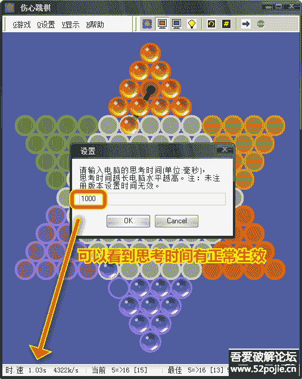

[reg_ok_proof.png (23.38 KB, 下载次数: 232)](https://www.52pojie.cn/forum.php?mod=attachment&aid=MjUzNTEzNXwxNDU4YTEyZXwxNzkzNTc0Nzc4fDE2ODA4NnwxNjU4NDMx&nothumb=yes)

2022-7-7 06:38 上传

## 固定机器码

在分析算法阶段已经得知一个全局变量 `g_machine_code`，直接查找交叉引用定位到来源。

因为是一个 `DWORD` 数值类型，使其每次都计算出一致的数值即可。

```
g_machine_code = 46091 * VolumeSerialNumber;
GenerateAlternativeMachineCode(); // 00401BC0
if ( g_alt_machine_code ) // 若是找到“更好”的替代机器码，则使用该值。
    g_machine_code = g_alt_machine_code;
```

其中一个方案为直接更改“次选”机器码计算过程：

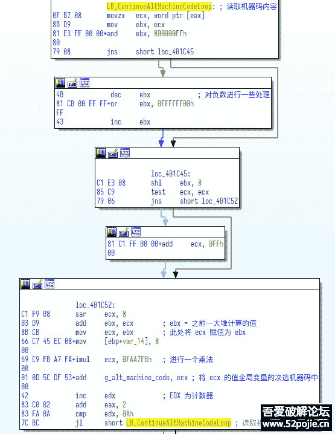

[alt_machine_code_gen.png (28.03 KB, 下载次数: 227)](https://www.52pojie.cn/forum.php?mod=attachment&aid=MjUzNTE0NXxkYTIwY2M0YnwxNzkzNTc0Nzc4fDE2ODA4NnwxNjU4NDMx&nothumb=yes)

2022-7-7 06:39 上传

直接将 `00401C57` 处的 `mov ecx, ebx` 替换为 `mov ecx, edx`即可无视读取到的特征，从而固定机器码。

若需要固定为特定一个值，可以直接暴力修改赋值过程为 `mov dword[g_alt_machine_code], 0x12345678`。

## 软件自校验

该软件分别实现了文件大小、文件头、以及运行时代码区段的内存校验。

### 文件校验

文件校验非常容易发现，直接对 `CreateFileW` 下断点，等待堆栈出现当前可执行文件路径为止：

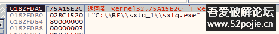

[create_file_breakpoint.png (5.64 KB, 下载次数: 234)](https://www.52pojie.cn/forum.php?mod=attachment&aid=MjUzNTE0M3xhMzI3OWE2Y3wxNzkzNTc0Nzc4fDE2ODA4NnwxNjU4NDMx&nothumb=yes)

2022-7-7 06:39 上传

然后根据调用堆栈，一路回溯到验证文件头处：

```
00401B1D    call  _fopen
```

该代码差不多类似于这样：

```
f_exe = fopen(g_exe_path, "rb");

if ( f_exe ) {
  DWORD size_of_buffer = fread(g_exe_mem, sizeof(char), 0x80000, f_exe); // 读取前 8k 内容（包括公钥所在处）
  fclose(f_exe);

  // 0x20 处的数值应等于读入数据量的 13 倍
  if ( 13 * size_of_buffer != *(DWORD *)&g_exe_mem[0x20] )
    g_file_tampered = 1;

  // 从缓冲区 0x80 处开始读取，直到结束
  DWORD hash = 0;
  DWORD* p_data = (DWORD*)&g_exe_mem[0x80];
  for (int i = 0; i 
```

Python 实现请参见附件，可以传入一个文件来计算应有的校验值。

当逆向到此处的时候，发现该校验非常脆弱。因此生成 RSA 密钥对的脚本会针对该特性来生成校验值一致的 `N` 值。

### 内存校验

该程序还有内存校验。具体的表现为… 暗桩触发后，AI 会变得异常迟钝。

因为我们更改了程序的字节码，所以直接对更改的地方下一个硬件访问断点即可；

在转储窗口跳转到该代码地址，右键更改处，选择「断点」→「硬件访问断点」：

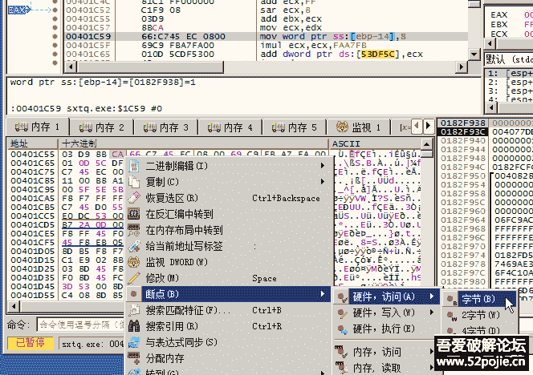

[find_what_access_our_code.png (31.63 KB, 下载次数: 235)](https://www.52pojie.cn/forum.php?mod=attachment&aid=MjUzNTE0MHxiZjhiZDY0M3wxNzkzNTc0Nzc4fDE2ODA4NnwxNjU4NDMx&nothumb=yes)

2022-7-7 06:38 上传

回到游戏继续操作，待断点触发后将该地址复制到 IDA 继续观察：

```
int ValidateMemory() {

  int hash = 0;

  for ( byte* p = (byte *)ValidateExecutableHeader; p 
```

和刚才一样朴实无华的 `XOR` 校验；在偏移是 `4` 的倍数的位置 `xor 1` 即可让校验码不变：

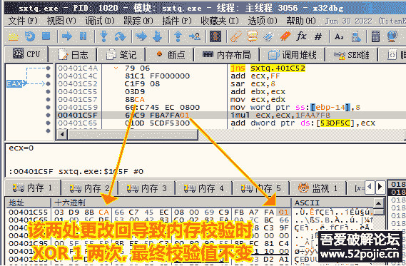

[fix_checksum_2008_memory.png (33.44 KB, 下载次数: 240)](https://www.52pojie.cn/forum.php?mod=attachment&aid=MjUzNTEzOXxiMjA1MGE3NHwxNzkzNTc0Nzc4fDE2ODA4NnwxNjU4NDMx&nothumb=yes)

2022-7-7 06:38 上传

## 带壳补丁固定机器码

没什么好说的，在 UPX 解压完成后直接照着上述的思路更改对应内存区块即可。

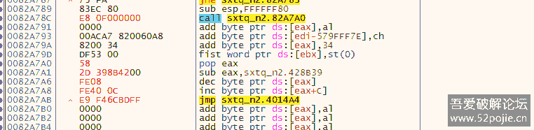

[patch_sxtq_loader_fixed_mc.png (18.55 KB, 下载次数: 237)](https://www.52pojie.cn/forum.php?mod=attachment&aid=MjUzNTEzNnw2NzQ2YTY0MnwxNzkzNTc0Nzc4fDE2ODA4NnwxNjU4NDMx&nothumb=yes)

2022-7-7 06:38 上传

需要注意此处能利用到的字节数有限。

如果需要更改大量数据可尝试插入加载 DLL 的代码后在 DLL 进行修改。

## 子跳专版（2016）

目标和之前分析的版本的一样，即搞懂软件的注册算法并编写算法注册机，同时避免触发校验错误暗桩。

### 试探软件注册

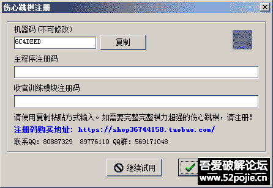

[sxtq2_regform.png (7.42 KB, 下载次数: 233)](https://www.52pojie.cn/forum.php?mod=attachment&aid=MjUzNTEzMnwxZTc2ZDFiN3wxNzkzNTc0Nzc4fDE2ODA4NnwxNjU4NDMx&nothumb=yes)

2022-7-7 06:38 上传

与上作相比，多了一个「收官训练模块」注册码。从这界面上来看，盲猜一手注册部分的代码基本没大改。

### 算法初探

直接脱壳，然后查找字符串引用，发现非常熟悉的 RSA 参数：

```
0041C290  push sxtq_dump_scy.795788        "A7456C1..."
0041C2CD  push sxtq_dump_scy.795808        "C985F97..."
```

把地址放到 IDA 里分析一番，然后交叉引用看看都拿来干什么了：

```
Dir Address                                   Text

Up  Serial__ValidateTiaoQiVersion+C3          push serial_public_n; "C985F97A3C"...

Up  feat1_validate_checksum+505               push serial_public_n; "C985F97A3C"...

Up  feat1_validate_checksum+511               push serial_public_n; "C985F97A3C"...
```


```
Up  Checksum__CalculateMemooryAndKeyMD5+44    push serial_public_n; "C985F97A3C"...
Up  Checksum__CalculateMemooryAndKeyMD5+50    push serial_public_n; "C985F97A3C"...
    Serial__ValidateCoreProduct+C3            push serial_public_n; "C985F97A3C"...
```

可以发现基本上就是校验与验证注册码了。

题外话：与上作不同的是，此时引用的公钥 `N` 不是来自文件头，而是数据区段。

如果需要补丁的话，仅靠 `UPX` 解码代码后面那么一点空间写起来非常繁琐且容易出错。

解决方案也很简单，魔改一番来加载我们的 DLL 即可；当然，这是后话了 😏。

点进去查看，发现上作的常数「`"ACHECKER"`」还在，而另一个验证序列号的函数内的常数则是「`"TiaoQiV"`」，以及通过序列号计算其版本：

```
int Serial::ValidateTiaoQiVersion() {
  // ...

  int len_prefix = strlen(str_tiaoqi_prefix);
  for (int i = 0; i = '1' && edition 
```

将之前的算法注册机稍作更改，可以算出新的注册码了：

```
版本        注册码
本体 (2008)    4F1mJhfUzhkiaMFLIJ9wGj$JSL5TXnq3AXNchHI59uKQ2fB1vhXHn2rqOh7r9yd0
基础版 (2016)    FHvRdZx3zyavuw3UntfwQGXHK$yaf$1y5WpfTfsbPkNErhDE8jjxHh220OcdsEAd
高级版 (2016)    1vkk4BbJOfMdDHd2lXH0qnwZoeP$V8kfxVVRKEuRPBbuw8Tk9JuG5OTJyRatUw3i
豪华版 (2016)    D08eMU#wL#x0P4p#xAnt4w4unPt7ni9em4YiW2hV#mfonj8I5e5SmSxdfoLekOnO
收官 DLC (2016)  4F1mJhfUzhkiaMFLIJ9wGj$JSL5TXnq3AXNchHI59uKQ2fB1vhXHn2rqOh7r9yd0
```

## 替换公钥

这次公钥不是从文件头读取了，而是直接从代码区域的内存读取。

为了方便，直接写个 DLL 注入进去修改比较容易。

因为程序没有开启重定向（Relocation），因而可以直接写死要修改的地址。

```
inline void patch_public_key() {
  dprintf("public key replaced!\n");
  static const char g_my_public_key[] =
      "58454B2639277AD2D9B0D34C190725824FB7F154308F80B5"
      "6287FF315F671FF9EF1EB76184FC16DB6DBBDFBAEBB04989";
  memcpy((void *)(0x00795808), g_my_public_key, sizeof(g_my_public_key));
}
```

## 修改加载 DLL

和改 2008 版本一样，直接在 `UPX` 解码代码后加上加载代码即可。因为我们的 DLL 需要在解码后执行。

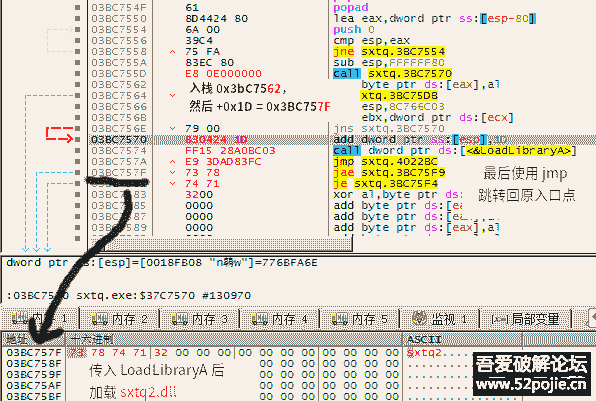

AddDllLoader.png (23.29 KB, 下载次数: 241)

[href="forum.php?mod=attachment&aid=MjUzNTE0OHxhNTQ1ODViNnwxNzkzNTc0Nzc4fDE2ODA4NnwxNjU4NDMx&nothumb=yes" target="_blank"](https://www.52pojie.cn/forum.php?mod=attachment&aid=MjUzNTE0OHxhNTQ1ODViNnwxNzkzNTc0Nzc4fDE2ODA4NnwxNjU4NDMx&nothumb=yes)

2022-7-7 07:18 上传

将 `"sxtq2"` 入栈，然后调用 `LoadLibraryA` 加载我们的 DLL 并出栈，然后回去原来的入口点。

## 机器码固定

次选机器码的代码这次变得复杂而且若检测到虚拟机会每次都生成一个随机的机器码。

因此直接改次选机器码赋值为主机器码的代码即可：

```
0041A489 | 74 01        | je sxtq.41A48C    |
0041A48B | 90           | nop               |
0041A48C | B9 66060052  | mov ecx,52000666  |
```

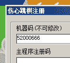

sxtq2_mc_change.png (2.35 KB, 下载次数: 236)

[href="forum.php?mod=attachment&aid=MjUzNTEzM3xlMGViNGE0Y3wxNzkzNTc0Nzc4fDE2ODA4NnwxNjU4NDMx&nothumb=yes" target="_blank"](https://www.52pojie.cn/forum.php?mod=attachment&aid=MjUzNTEzM3xlMGViNGE0Y3wxNzkzNTc0Nzc4fDE2ODA4NnwxNjU4NDMx&nothumb=yes)

2022-7-7 06:38 上传

## 自校验

经过上述的两个阶段，我们已经成功的获得了一个看起来能正常运行并注册的跳×游戏了。

但是只要你和 AI 稍微下几步棋就会发现它的智商退化得比未注册时还弱…

相比 2008 版的简单 XOR 算法，2016 版则改用 MD5。

### 内存校验

校验过程的查找与之前差不多，就不过多篇幅说明了。

由于 MD5 的特性（细微的小更改会造成生成的 MD5 散列值变化很大），我们很难能生成一个能提供同样 MD5 的内容…

因此我们在启动时进行备份，与 `md5_update` 函数挂钩，把读取原始内存区域的指针重定向到我们提前备份的副本里：

```
void __stdcall md5_update_hook(uintptr_t *stack) {
  // stack:
  //   [0]: return address
  //   [1]: md5_ctx
  //   [2]: p_data
  //   [3]: data_len
  uint8_t *p_data = reinterpret_cast(stack[2]);
  if (addr_start (&g_backup_ptr[p_data - addr_start]);

    dprintf("hooked: md5_update(p_data=%p, size=%d)\n", p_data, int(stack[3]));
  }
}

inline void patch() {
  // 1. 备份数据 (RW-)
  // 2. 覆盖原始的 md5_update 函数
  // 3. 将备份数据的内存更改为只读 (R--)
  g_backup_ptr = reinterpret_cast(VirtualAlloc(
      nullptr, backup_len, MEM_COMMIT | MEM_RESERVE, PAGE_READWRITE));
  memcpy(g_backup_ptr, addr_start, backup_len);
  write_trampoline(md5_update, 6, md5_update_hook);

  DWORD unused;
  VirtualProtect(g_backup_ptr, backup_len, PAGE_READONLY, &unused);
}
```

### 文件校验

内存校验补丁好了，剩下的就是文件校验了。和前作一样，直接对 `CreateFileW` 下断点直到看到我们所熟悉的可执行文件路径即可。

一路回溯到 `md5_file`（`0042A948`）这个函数。查找交叉引用，发现只有一个地方调用，直接改为跳转到我们的代码：

```
static void *const md5_file = reinterpret_cast(0x0042A948);

void __stdcall impl_md5_file(const char *str_path, uint8_t *md5_result) {
  static uint8_t self_md5[] = {
      0xED, 0xE1, 0x77, 0x46, 0x74, 0xC2, 0xAD, 0xA9,
      0xA9, 0x9A, 0x29, 0x94, 0x3B, 0xDC, 0x9F, 0xD8,
  };

  dprintf("self_md5('%s') -> hooked.\n", str_path);
  memcpy(md5_result, self_md5, sizeof(self_md5));
}

void patch_md5_self_verify() {
  MemoryRWGuard rw_guard(md5_file, 5);
  write_far_jmp(md5_file, reinterpret_cast(impl_md5_file));
}
```

## 后话

对主程序内存、公钥的 MD5 校验值其实还参与了文件 `SxtqCoef.bin` 的解密。

读者若是有兴趣可以参与下述两项挑战：

- 改造为透明加密（即 `SxtqCoef.bin` 储存的是解密后的内容）
- 去掉或缓解运行时重复执行的 MD5，让软件把更多 CPU 时间留给 AI。

最后，来个调试模式下的合影：

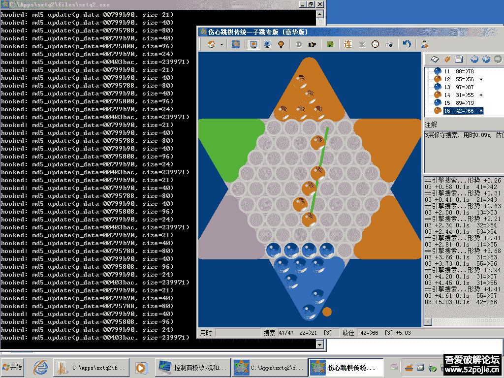

final_debug_screen.png (48.91 KB, 下载次数: 232)

[href="forum.php?mod=attachment&aid=MjUzNTE0MXxjMThiNTM0YnwxNzkzNTc0Nzc4fDE2ODA4NnwxNjU4NDMx&nothumb=yes" target="_blank"](https://www.52pojie.cn/forum.php?mod=attachment&aid=MjUzNTE0MXxjMThiNTM0YnwxNzkzNTc0Nzc4fDE2ODA4NnwxNjU4NDMx&nothumb=yes)

2022-7-7 06:39 上传

## 附件

- `Keygen.zip`

  

  [href="forum.php?mod=attachment&aid=MjUzNTE0Nnw4MzgzNTAyYnwxNzkzNTc0Nzc4fDE2ODA4NnwxNjU4NDMx" target="_blank"](https://www.52pojie.cn/forum.php?mod=attachment&aid=MjUzNTE0Nnw4MzgzNTAyYnwxNzkzNTc0Nzc4fDE2ODA4NnwxNjU4NDMx)

  (4.34 KB, 下载次数: 102)

  2022-7-7 06:47 上传

  点击文件名下载附件

  下载积分: 吾爱币 -1 CB

  算法注册机，包含一些其它一些相关的零零散散的代码。需要 `Python3`。

- `sxtq2.zip`

  

  [href="forum.php?mod=attachment&aid=MjUzNTE0N3wwNThiZDkzOXwxNzkzNTc0Nzc4fDE2ODA4NnwxNjU4NDMx" target="_blank"](https://www.52pojie.cn/forum.php?mod=attachment&aid=MjUzNTE0N3wwNThiZDkzOXwxNzkzNTc0Nzc4fDE2ODA4NnwxNjU4NDMx)

  (6.86 KB, 下载次数: 45)

  2022-7-7 06:48 上传

  点击文件名下载附件

  下载积分: 吾爱币 -1 CB

  `sxtq2.dll` 的源代码，可使用 `mingw-w64-i686` 工具链进行编译。

## 挑战

### 解密 `SxtqCoef.bin`

```
with open('SxtqCoef.bin', 'rb') as f:
    encrypted_data = bytearray(f.read())

decrypted_data = encrypted_data[:-0x20]

# 文件解密后的结尾全是 0
# b'\x3B\xC6\xFD\xF0\x4C\xBE\xC6\x31\x33\x34\x9C\x77\x29\x20\xE1\x39'
xor_key = encrypted_data[-0x30:-0x20]

for i in range(len(decrypted_data)):
    decrypted_data[i] ^= xor_key[i % 0x10]

with open('SxtqPatt.bin', 'wb') as f:
    f.write(decrypted_data)
    # 填充空白内容作为校验值
    f.write(b'\x00' * 0x20)
```

### 修改为透明加密（干掉 MD5 校验）

在源码目录下应用下述补丁（保存为 `disable_md5.patch` 然后执行 `patch` 应用）：

```diff
diff --git a/Makefile b/Makefile
index 2ebf45c..d938d2b 100644
--- a/Makefile
+++ b/Makefile
@@ -9,10 +9,11 @@ CXX = i686-w64-mingw32-g++
 RC = i686-w64-mingw32-windres
 DLL = sxtq2.dll
+OPT_DEF_FLAGS=
 OPT_CXXFLAG ?= -s -O2 -DNDEBUG -finline-functions -fno-keep-inline-dllexport
 OPT_LDFLAGS ?= -s -O2 -static -static-libgcc
-CXXFLAGS = ${OPT_CXXFLAG} -Wall -D ADD_EXPORTS
+CXXFLAGS = ${OPT_DEF_FLAGS} ${OPT_CXXFLAG} -Wall -D ADD_EXPORTS
 LDFLAGS = ${OPT_LDFLAGS} -fPIC -shared -s \
         -Wl,--subsystem,windows \
         -Wl,--exclude-all-symbols
diff --git a/src/disable_md5_verify.cpp b/src/disable_md5_verify.cpp
new file mode 100644
index 0000000..d528e9b
--- /dev/null
+++ b/src/disable_md5_verify.cpp
@@ -0,0 +1,30 @@
+#include "disable_md5_verify.h"
+#include "MemoryRWGuard.hpp"
+
+static uint8_t *const md5_init = reinterpret_cast(0x0042A690);
+static uint8_t *const md5_update = reinterpret_cast(0x0042A6CC);
+
+void disable_md5_verify() {
+  // 干掉 md5_init 与 md5_update
+  {
+    //
+    //   push ebp
+    //   mov ebp,esp
+    //   mov edi,dword [ebp+8]
+    //   xor eax, eax
+    //   mov ecx, 6
+    //   rep stosd
+    //   pop ebp
+    //   ret
+    uint8_t my_md5_init[17] = {0x55, 0x89, 0xE5, 0x8B, 0x7D, 0x08,
+                               0x31, 0xC0, 0xB9, 0x06, 0x00, 0x00,
+                               0x00, 0xF3, 0xAB, 0x5D, 0xC3};
+    MemoryRWGuard(md5_init, sizeof(my_md5_init));
+    memcpy(md5_init, my_md5_init, sizeof(my_md5_init));
+  }
+
+  {
+    MemoryRWGuard(md5_update, 1);
+    md5_update[0] = 0xC3;
+  }
+}
+
diff --git a/src/disable_md5_verify.h b/src/disable_md5_verify.h
new file mode 100644
index 0000000..ed4586d
--- /dev/null
+++ b/src/disable_md5_verify.h
```


## 补丁内容

```diff
@@ -0,0 +1,3 @@
+#pragma once
+
+void disable_md5_verify();

diff --git a/src/patch.cpp b/src/patch.cpp
index 2661e82..68f0b1e 100644
--- a/src/patch.cpp
+++ b/src/patch.cpp
@@ -8,6 +8,7 @@
  */
 #include "patch.h"
 #include "MemoryRWGuard.hpp"
+#include "disable_md5_verify.h"
 #include "hook_md5_self_verify.h"
 #include "hook_md5_update.h"
 #include "utils.h"
@@ -33,11 +34,15 @@ inline void patch_machine_code() {
 }
 
 void init_patch() {
+#if DISABLE_MD5_VERIFY
+  disable_md5_verify();
+#else
   // Backup memory
   patch_md5_update();
   // Patch file verification
   patch_md5_self_verify();
+#endif
   // Hardcode machine code
   patch_machine_code();
```

## 编译指令

然后执行下述指令进行编译即可：

```bash
make clean all "OPT_DEF_FLAGS=-DDISABLE_MD5_VERIFY=1"
```

当然，这需要你提前解密并将解密后的文件提换掉软件目录下的 `SxtqCoef.bin` 文件 :D

.

原文使用 Markdown 撰写。

## 原版程序下载

- [蓝奏](https://wws.lanzouq.com/b0ds8obwh) 密码：52pj
- [百度](https://pan.baidu.com/s/13xb5Kk7ugRc9eeXyaI0NXg?pwd=wq6n)

## 文件说明

- 其中 `7z` 压缩格式为安装后提取的绿色版，其中 `sxtq2_2016_收官模式_答案.7z` 为非必需文件（收官模式需要）
- `zip` 压缩格式为原始安装程序，可能会有捆绑。

注：若转载请注明来源（本贴地址）与作者信息。

> 伤心跳× 2.1（2008）及 10.4（2016）注册算法+自校验分析（吾爱破解论坛 - 爱飞的猫）
>
> https://www.52pojie.cn/thread-1658431-1-1.html
