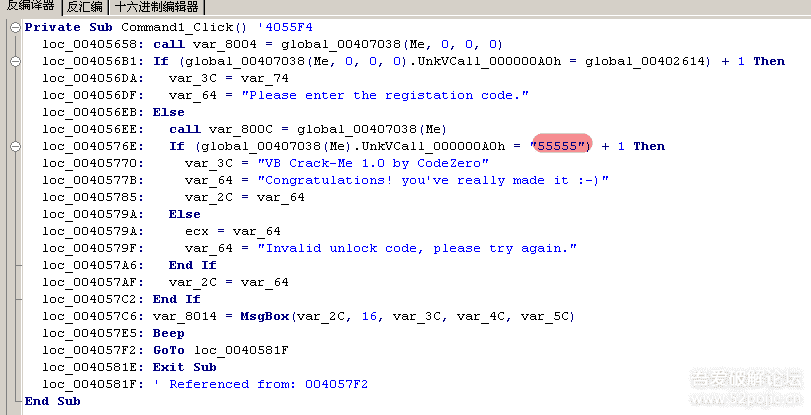

# [原创] 练习笔记之160Crackme-025

- 原帖: https://www.52pojie.cn/forum.php?mod=viewthread&tid=1659498
- 抓取时间: 2026-11-01T23:12:59

## 160CM-025

### 1. 去除NGA

VB Decompiler反汇编后，可以看到`Form_Load()`函数里面对两个窗口的显示状态进行了设置，其中`Form2`就是NGA窗口。

```
Private Sub Form_Load() '405905
  loc_00405948: Me.Visible = False
  loc_00405986: Form2.Visible = True
End Sub
```

找到40594和405986代码行位置，可以看到前面有两个`push`指令，一个“`push 0x0`”，一个“`push -0x1`”，分别代表显示和隐藏的含义，将两行代码位置互换，即可将NGA窗口去除。

```
00405945      6A 00         push 0x0
00405947  |.  57            push edi
00405948  |.  FF96 BC010000 call dword ptr ds:[esi+0x1BC]
……
00405981      6A FF         push -0x1
00405983  |.  56            push esi
00405984  |.  8B06          mov eax,dword ptr ds:[esi]
00405986  |.  FF90 BC010000 call dword ptr ds:[eax+0x1BC]
```

### 2. 注册

查看反编译后的代码，直接可以看到关键判断条件，注册码为固定字符串“55555”。



01.png (23.5 KB, 下载次数: 1)

[href="forum.php?mod=attachment&aid=MjUzNTc2NnxmMzRmNDJkMnwxNzkzNTc0Nzc3fDE2ODA4NnwxNjU5NDk4&nothumb=yes" target="_blank"](https://www.52pojie.cn/forum.php?mod=attachment&aid=MjUzNTc2NnxmMzRmNDJkMnwxNzkzNTc0Nzc3fDE2ODA4NnwxNjU5NDk4&nothumb=yes)

2022-7-9 12:46 上传

### 3. 总结

这道题难度较低，新手应该也可以轻松搞定。
