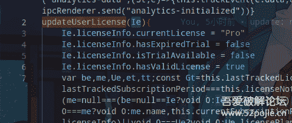
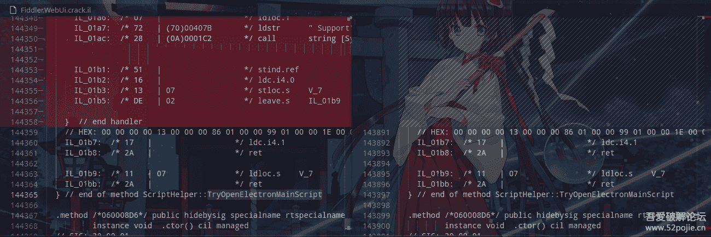
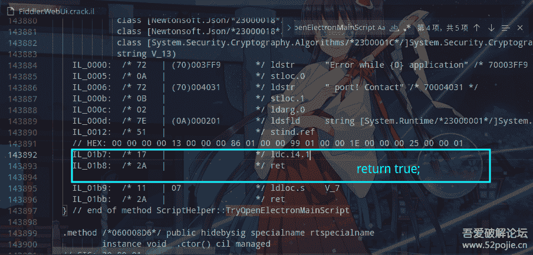
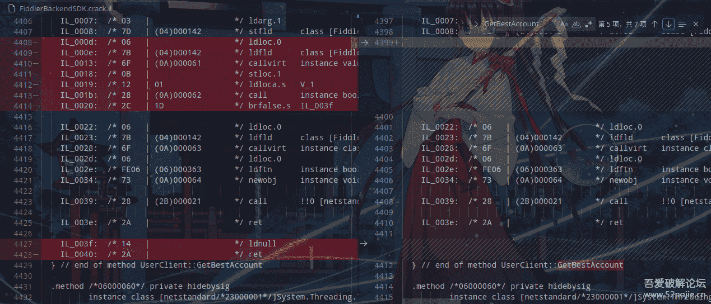
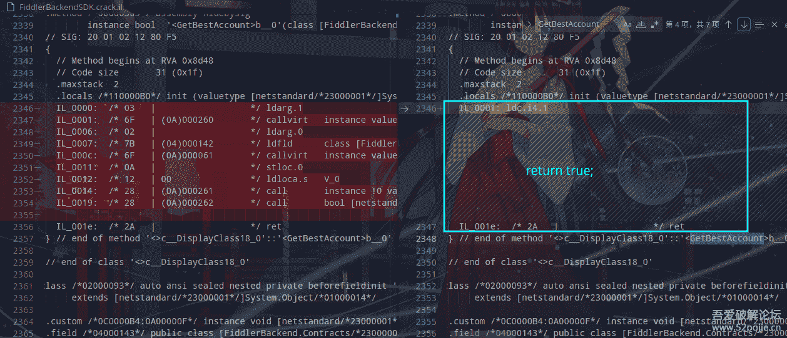

# [.NET逆向] fiddler everywhere 3.3.0 去除授权校验

- 原帖: https://www.52pojie.cn/forum.php?mod=viewthread&tid=1659955
- 抓取时间: 2026-11-01T23:12:57

## 前言

软件应该都知道，一个跨平台抓包工具；

之前搞定 3.2.0 版本时，是准备在吾爱发的，但是一直没时间来发；

今天下午跟进 3.3.0 版本后，去搜索引擎自搜了一下，发现有人发在吾爱了 {:1_921:}

[链接](https://www.52pojie.cn/thread-1654205-1-1.html)

笔者使用的是 Linux 操作系统，因而 dnspy、reflexil 等工具无法使用（也可能我没找到相关可视化工具），故采用 AvaloniaILSpy + `ilasm` / `ildasm` 进行处理；classic 版本也不支持 Linux，故有此 everywhere 的修改。

不提供成品，但是这个帖子（[链接](https://www.52pojie.cn/thread-1654857-1-1.html)）里面有个 github，我已经传上去了。

## 预处理

准备好 `ildasm` 与 `ilasm`。

使用 `ildasm` 将 `Fiddler.WebUi.dll` 转换为 `il` 文件。

使用 `ildasm` 将 `FiddlerBackendSDK.dll` 转换为 `il` 文件。

### Linux 获取 `ilasm` (`ildasm`)

- 安装好 `dotnet`，打开一个空文件夹并执行后续命令
- `dotnet new console -n test`
- `cd test`
- `dotnet add package Microsoft.NETCore.ILAsm (ILDAsm)`
- `dotnet publish -c Release --self-contained --runtime linux-x64`
- `export PATH=$(pwd)/bin/Release/netcoreapp3.1/linux-x64/publish:$PATH`
- `ilasm (ildasm)`

## 处理

### `main.xxxx.js`

为何在此进行修改？

这是使用控制台进行调试操作探索出来的。

打开 `fiddler/resources/app/out/WebServer/ClientApp/dist/main.xxx.js` 搜索 `updateUserLicense`。

函数开始处添加：（请将 `Ie` 替换为参数名称）

```
Ie.licenseInfo.currentLicense = "Pro"
Ie.licenseInfo.hasExpiredTrial = false
Ie.licenseInfo.isTrialAvailable = false
Ie.licenseInfo.hasValidLicense = true
```



`main.xxx.js-1.png`（128.21 KB，下载次数：1）

2022-7-10 20:12 上传

[附件下载](https://www.52pojie.cn/forum.php?mod=attachment&aid=MjUzNjAzOHxiNTdmZjM1ZHwxNzkzNTc0Nzc1fDE2ODA4NnwxNjU5OTU1&nothumb=yes)

### `Fiddler.WebUi.il`

如何知道修改此文件？

当修改 `main.js` 尝试调出控制台时，程序是不能启动的，通过程序提示找到关键代码。

修改此文件去除文件校验，在 3.3.0 版本开始 `main.xxx.js` 也被加入校验流程，在此之前此 dll 文件的修改是可选的。

去除 `TryOpenElectronMainScript` 的校验之后，可以修改 `app/out/main.js` 调出控制台。

对两个函数 `TryOpenClientMainScript` 与 `TryOpenElectronMainScript` 做相同操作：将函数体内容修改为直接返回 `true`。

删除函数内以下代码之前的所有代码（以下代码含义为 `return true;`）：

```
IL_0208:  /* 17   |                  */ ldc.i4.1
IL_0209:  /* 2A   |                  */ ret
```



`dll-TryOpenElectronMainScript-1.png`（655.61 KB，下载次数：1）

2022-7-10 20:12 上传

[附件下载](https://www.52pojie.cn/forum.php?mod=attachment&aid=MjUzNjAzNnw5NTJhNjc5ZHwxNzkzNTc0Nzc1fDE2ODA4NnwxNjU5OTU1&nothumb=yes)

删除后大概这个效果：



`dll-TryOpenElectronMainScript-2.png`（463.66 KB，下载次数：2）

2022-7-10 20:12 上传

[附件下载](https://www.52pojie.cn/forum.php?mod=attachment&aid=MjUzNjAzN3xjOGMxOWJhMnwxNzkzNTc0Nzc1fDE2ODA4NnwxNjU5OTU1&nothumb=yes)

### `FiddlerBackendSDK.il`

如何知道修改此文件？

这是通过替换验证服务器抓到的数据，操作有点麻烦；不过，如果对验证服务器做较为详尽的复现，应该能实现离线化。

#### method `FiddlerBackendSDK.User.UserClient::GetBestAccount`

搜索 `UserClient::GetBestAccount`。

删除 `IL_000d` - `IL_0020` 对应 `if` 语句。

删除 `IL_003f` - `IL_0040` 对应 `return null;` 语句。



`dll-GetBestAccount-1.png`（801.68 KB，下载次数：2）

2022-7-10 20:12 上传

[附件下载](https://www.52pojie.cn/forum.php?mod=attachment&aid=MjUzNjAzNHw1OWMzNTRmNnwxNzkzNTc0Nzc1fDE2ODA4NnwxNjU5OTU1&nothumb=yes)

#### method `'<>c__DisplayClass18_0'::'b__0'`

搜索 `b__0`。

删除 `IL_0000` - `IL_0019`，在 `IL_001e` 前插入 `ldc.i4.1`（即函数体直接返回 `true`）。



`dll-GetBestAccount-2.png`（827.88 KB，下载次数：0）

2022-7-10 20:12 上传

[附件下载](https://www.52pojie.cn/forum.php?mod=attachment&aid=MjUzNjAzNXw2NjE1OGM1ZHwxNzkzNTc0Nzc1fDE2ODA4NnwxNjU5OTU1&nothumb=yes)

### 禁用更新

修改 `fiddler/resources/app/out/main.js`：

将 `e.settingsService.get().autoUpdateSettings.disabled` 替换为 `true||e.settingsService.get().autoUpdateSettings.disabled`。
