# [原创] 使用 x64dbg 修改 WinRAR 去除广告和注册提示

- 原帖：https://www.52pojie.cn/forum.php?mod=viewthread&tid=1660764
- 抓取时间：2026-11-01T23:12:53

## 准备工作

- WinRAR（我用的是 WinRAR x64 v6.11）
- [x64dbg](https://x64dbg.com/)

## 开始

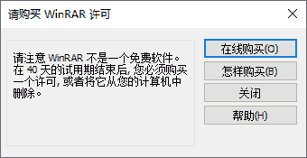

熟悉的注册提示

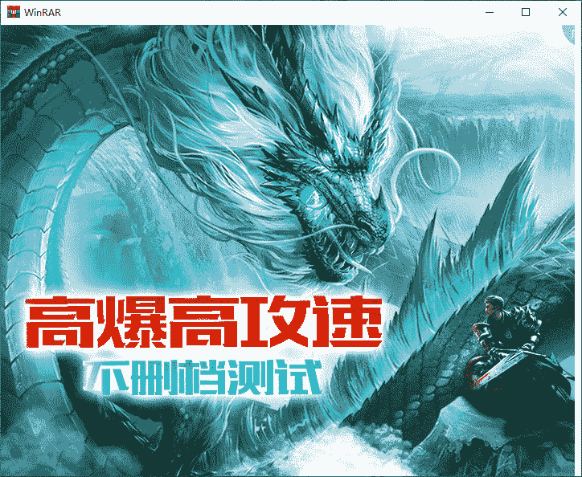

熟悉的广告（此为注册后）

1. 配置好 `x64dbg`，配置程序是 `x96dbg.exe`。
2. 调试 `WinRAR.exe`。老规矩，运行到用户代码，此时标题栏中模块变为 `WinRAR.exe`。
3. 我们看到广告窗口的标题是“WinRAR”，于是在 CPU 窗口 `Shift+D`，或者 `右键→搜索→当前模块→字符串`。
4. 寻找 `L"WinRAR"`，找到一堆，如下：

    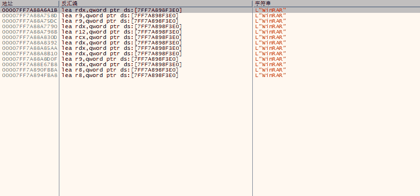

    挨个打开，找找那个后面紧跟着函数。发现只有最后两个。
5. 下断点调试，发现倒数第二个有些问题。就是它了！于是将函数所在行用 `nop` 填充。

    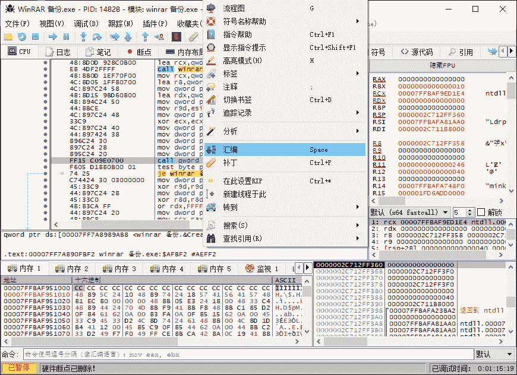

    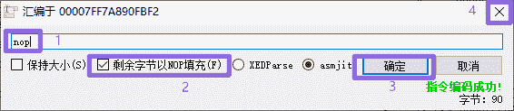

    下面不远处还有一个 `[`，大概就是第一张图所示的弹窗了。断点运行发现属实，一并 `nop` 了。
6. `文件→补丁→修补文件`。

    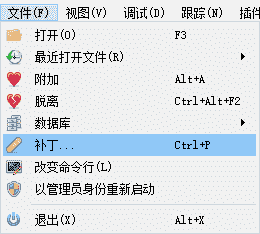

    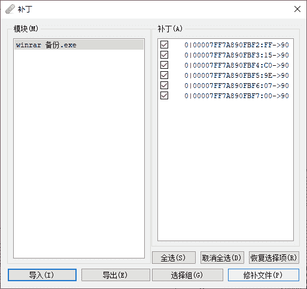
7. 运行，发现：

    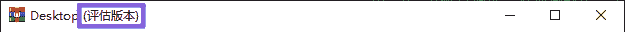

    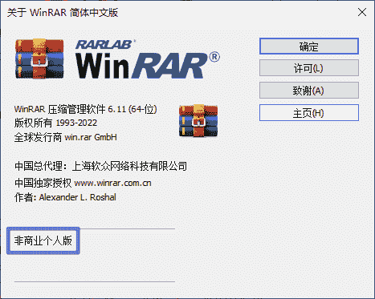

    十分不爽。于是请出 `ResEdit` 编辑窗口和字符串，删去了“评估版本”字符串。

    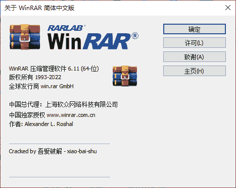
8. 但是，什么？

    

    括号还在！于是再去程序里看看。
9. 搜索左括号，找可疑的下断点结果确定在这里。

    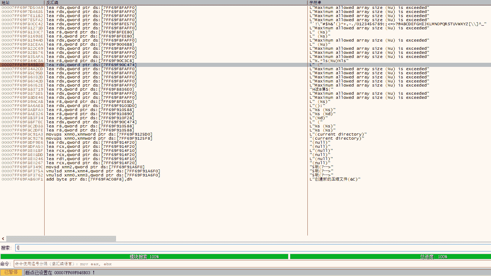

    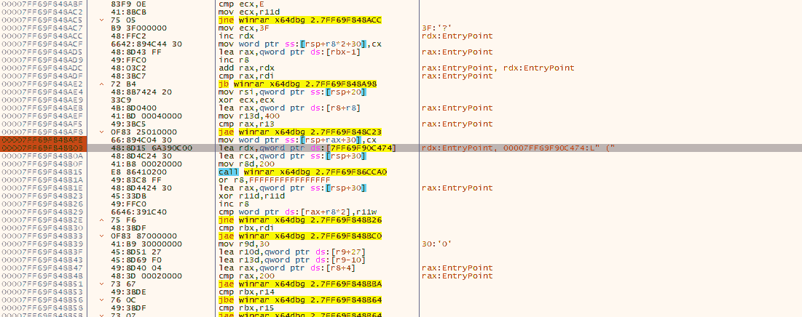

    可见地址是`00007FF69F90C474`，于是去内存中找这个地址。内存 1 没有，在内存 2。`右键→十六进制→ASCII`。

    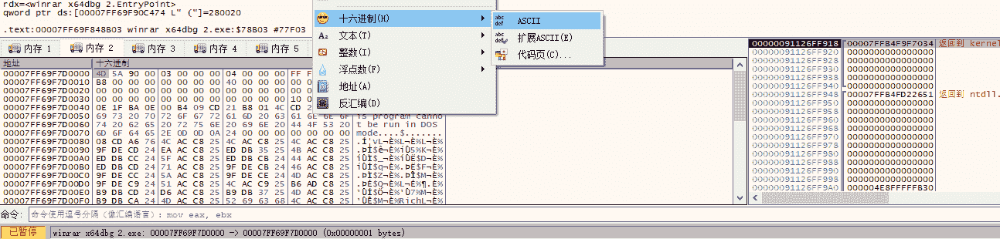

    `Ctrl+G` 或 `右键→转到→表达式`，

    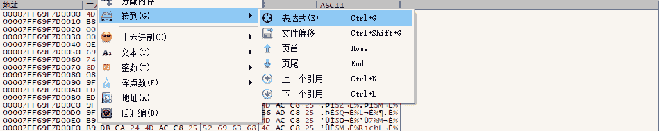

    输入刚才的地址，发现`00007FF69F90C476`处有个左括号，

    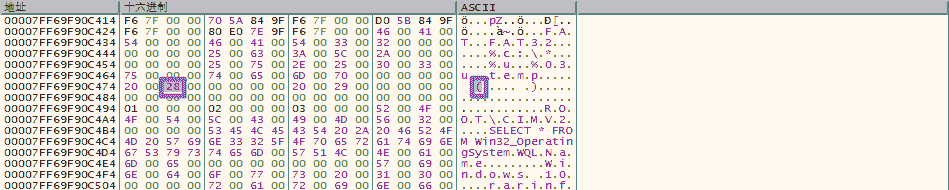

    双击左侧`28`，以`00`填充。右侧有个右括号一并解决了。补丁。
10. 诡异的事情发生了。怎么单单只有一个右括号？

    
11. 于是从第 9 步重来。找到 CPU 行之后去找内存，单把左括号解决了。从 CPU 行往下找，

    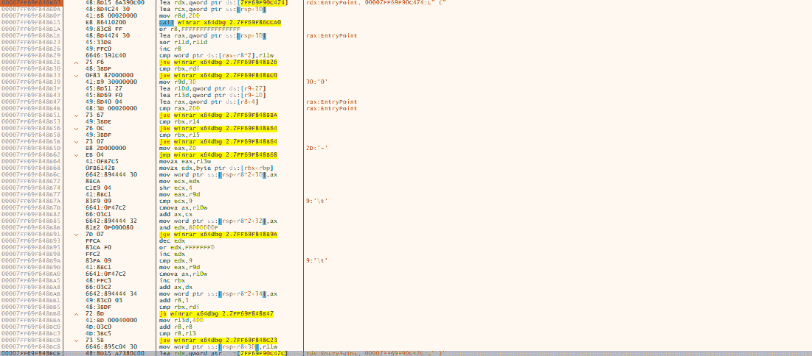

    就是它了！转到`00007FF69F90C47C`将`00007FF69F90C47E`处的右括号以`00`填充，补丁，大功告成！
