# [原创] 新人简单破解vmp程序

- 原帖：<https://www.52pojie.cn/forum.php?mod=viewthread&tid=1662430>
- 抓取时间：2026-11-01T23:12:47

第一次成功很兴奋，所以发个贴记录一下破解过程。

## 查壳

是 vmp 壳，不好破，所以直接载入 `od`。

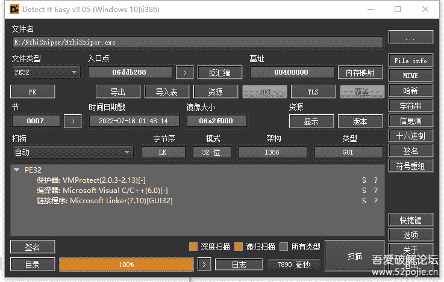

## 载入 `OD` 与反调试

这里说一下，这个 vmp 有反调试，所以用论坛的 `od` 载入运行会终止，并且不能在[该帖](https://www.52pojie.cn/thread-661779-1-1.html)里运行。

这里我用的是大佬整合插件的反调试 `od`，怕麻烦所以直接在真机上破解。

（`od` 发布原帖：[`OD` 发布帖](https://www.52pojie.cn/thread-1391378-1-1.html)，`od` 下载地址：<https://wws.lanzoui.com/iy1n8my1gib>，密码 6666）

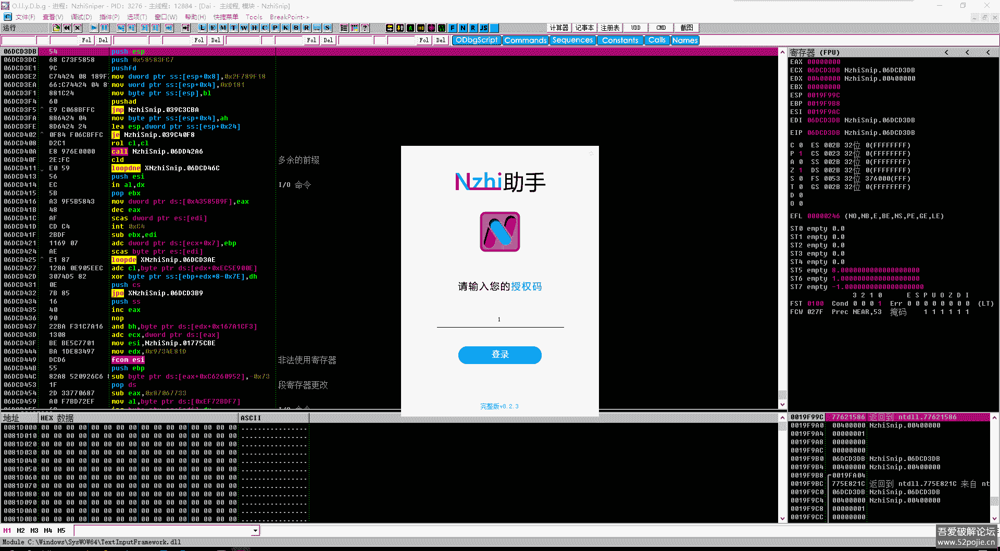

## 搜索字符串

运行成功！当时思路是这样的：先输入假码，看返回的字符串，再进入 `OD` 搜索字符串，上下寻找关键跳。这里程序输入假码后返回 `1027`，我们就搜 `1027`（说实话挺疑惑的）。

`ctrl+G` 跟随 `401000`，`右键 → 中文搜索引擎 → 智能搜索`，搜 `1027`。

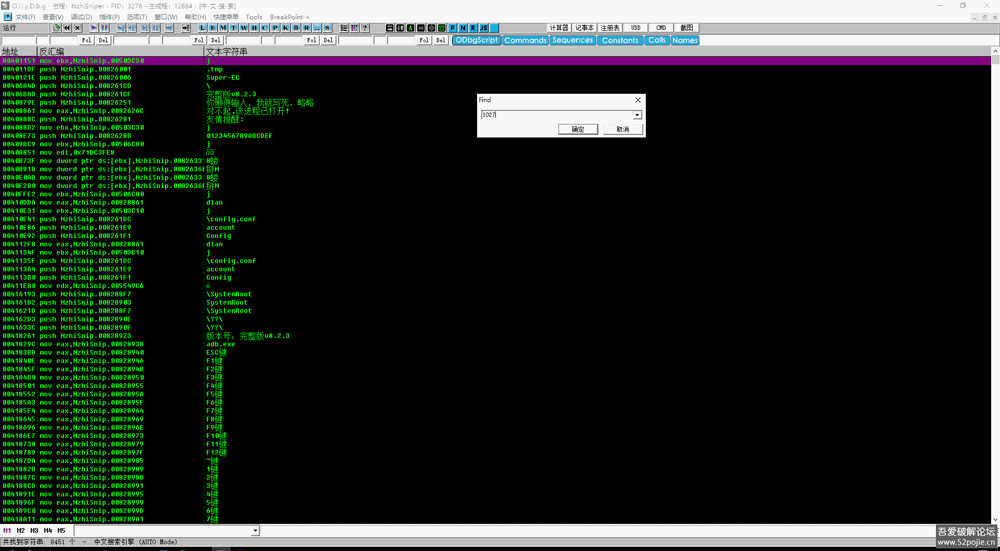

搜不到，很明显被 vm 掉了，这个思路行不通，那就换个思路，下 API 断点。

## API 断点

这里用 `插件-api断点设置工具-常用断点设置` 里的 `MessageBoxA`。

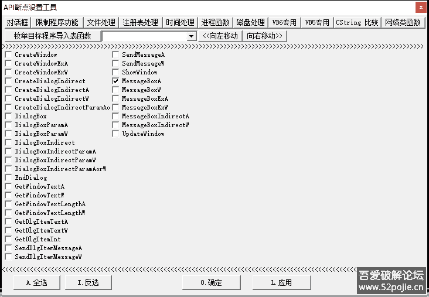

下好后咱们运行程序并输入假码。

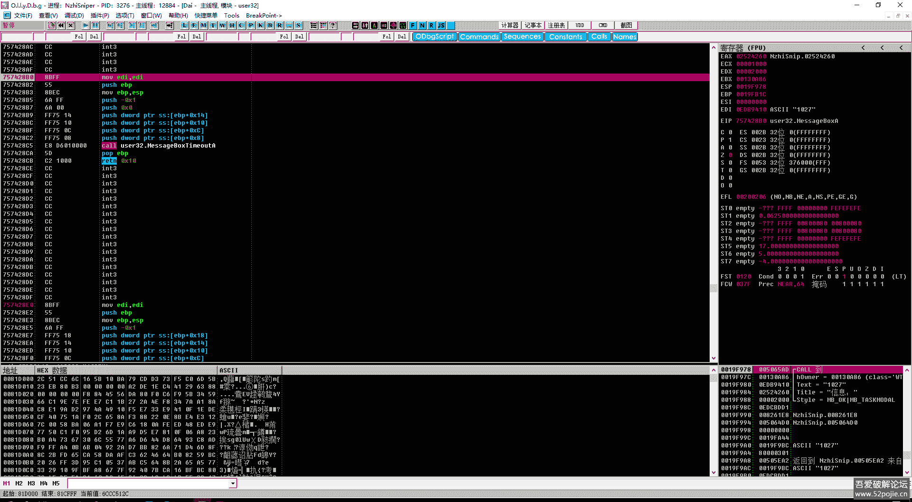

成功断下到系统领空，咱们单步运行（`F8`）`return` 回程序领空，出 `call` 上下翻找，并没有发现能跳过出来的这个 `call` 的关键跳，这里就不放图了。

咱们继续单步向下出这个 `call`，下一层也是如此，继续出 `call`。

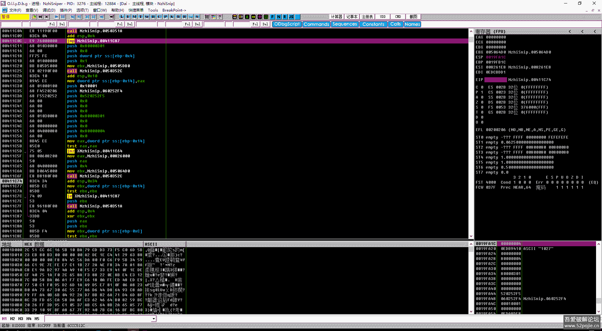

这一层就很可疑了，上面的 `jmp` 跳过了错误提示框的 `call`，我们就在这一层爆破。

这里可以继续分析，但我用的是另一种方法。

## 窗口 ID 工具分析

我用论坛大佬做的窗口 ID 工具试试能不能分析出窗口。这里用的 `EWND` 工具，原帖：[`EWND` 工具帖](https://www.52pojie.cn/thread-396634-1-1.html)。首先打开软件和任务管理器查看软件的 `pid`。

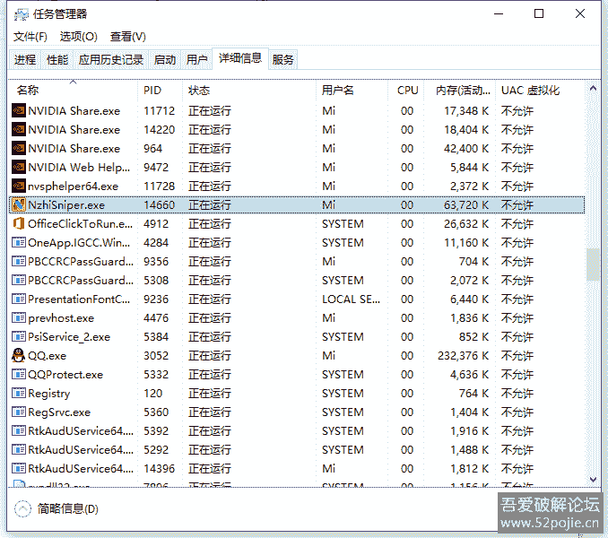

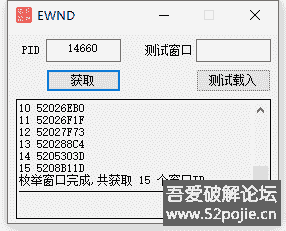

发现可用，那咱们一个个载入。

找到成功登录的窗口。

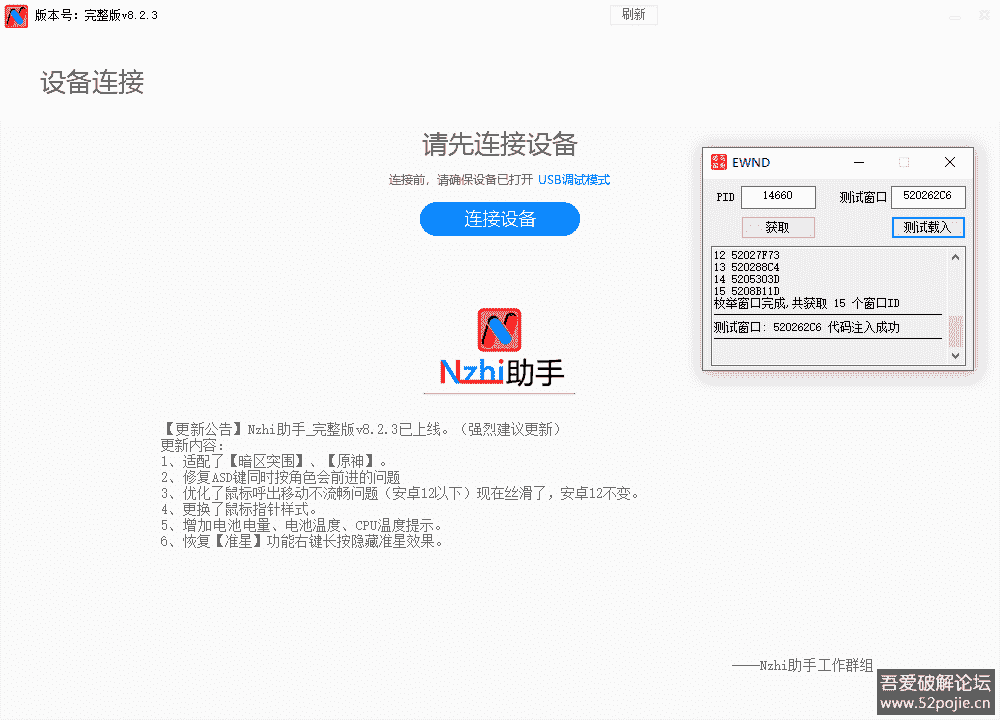

## 定位成功窗口并修改

把窗口 ID 复制下来，咱们关闭软件返回到 `OD`。

还是刚才可疑的那一层，咱们直接 `ctrl+F` 查找刚才找到的窗口 ID。

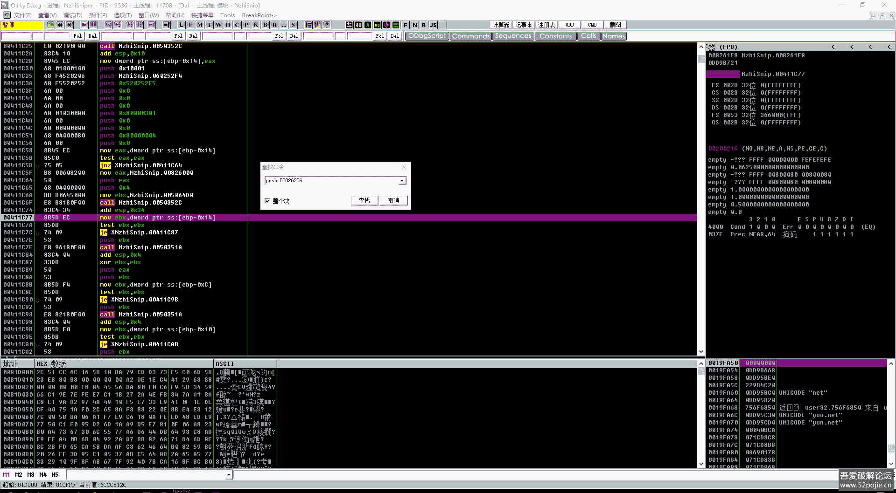

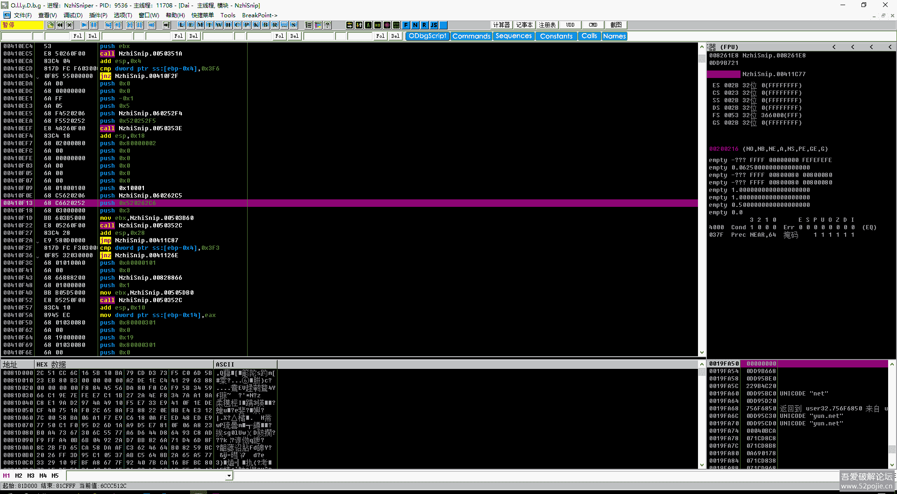

成功找到！这个命令的意思是弹出成功的窗口。我这里直接想用 `jmp` 跳到这里，那咱们直接选择 `jnz` 下面那一句进行复制，因为 `jnz` 跳过了成功的窗口，不能在它的上面选取。

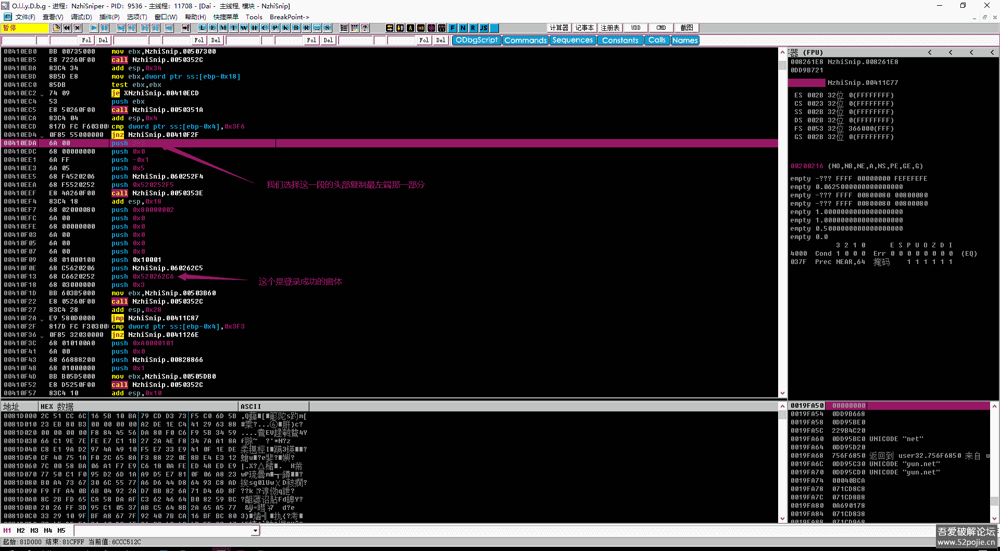

咱们复制到记事本上选择。

复制，返回 `OD`。

双击寄存器里 `EIP` 右边那一段，作用是返回当前暂停区段。

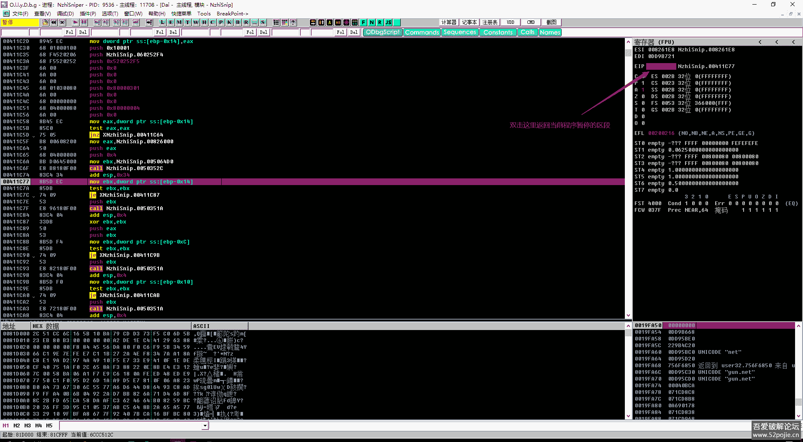

我找了下面一处 `call` 进行汇编。

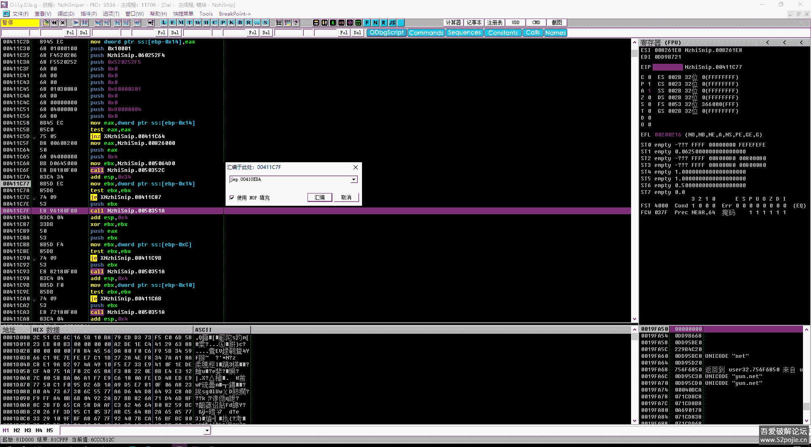

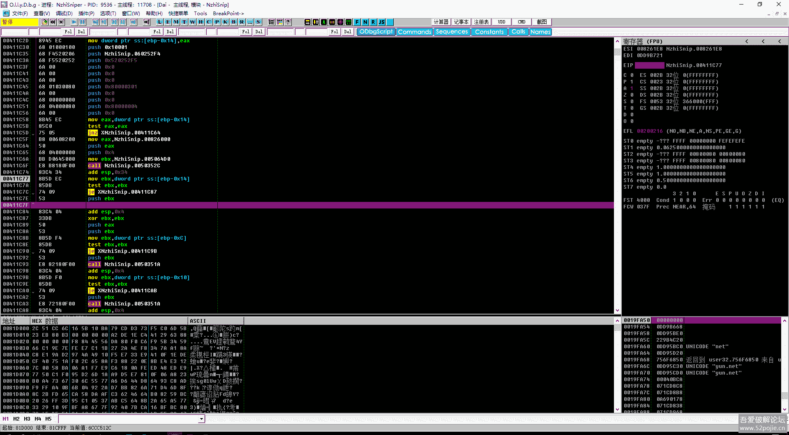

改好后运行发现成功了，直接右键复制刚刚修改的这一段到记事本。

## 打补丁

接下来就是打补丁了。

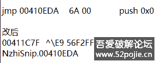

## 补丁信息

[查看附件](https://www.52pojie.cn/forum.php?mod=attachment&aid=MjUzNzQzNnw1ZWNmZDA5M3wxNzkzNTc0NzY1fDE2ODA4NnwxNjYyNDMw&nothumb=yes)

2022-7-17 12:46 上传

内存地址就是`00411C7F`，修改指令是`E956F2FFFF`，注意：要把空格去掉。

我用的是`XH`补丁工具，原贴：[查看原贴](https://www.52pojie.cn/thread-726980-1-1.html)

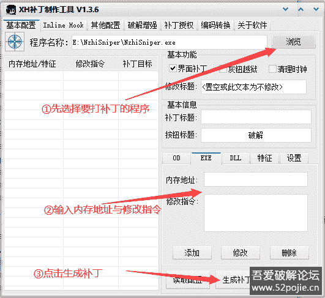

`19.png`（18.93 KB，下载次数：1）

[查看附件](https://www.52pojie.cn/forum.php?mod=attachment&aid=MjUzNzQyOHxiMjA3ZDljMnwxNzkzNTc0NzY1fDE2ODA4NnwxNjYyNDMw&nothumb=yes)

2022-7-17 12:42 上传

点击生成，最好与软件一个目录。

最后测试能不能破解成功。

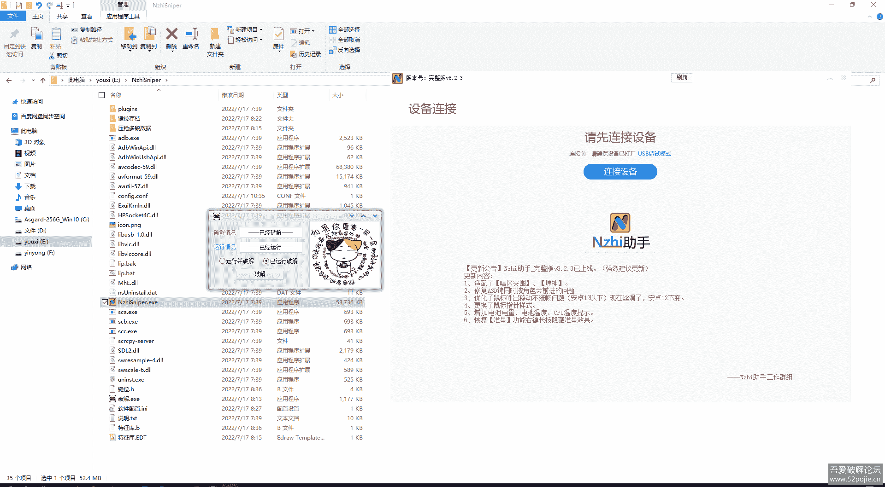

`20.png`（94.7 KB，下载次数：3）

[查看附件](https://www.52pojie.cn/forum.php?mod=attachment&aid=MjUzNzQzN3w0ZWM3YjMyZXwxNzkzNTc0NzY1fDE2ODA4NnwxNjYyNDMw&nothumb=yes)

2022-7-17 12:47 上传

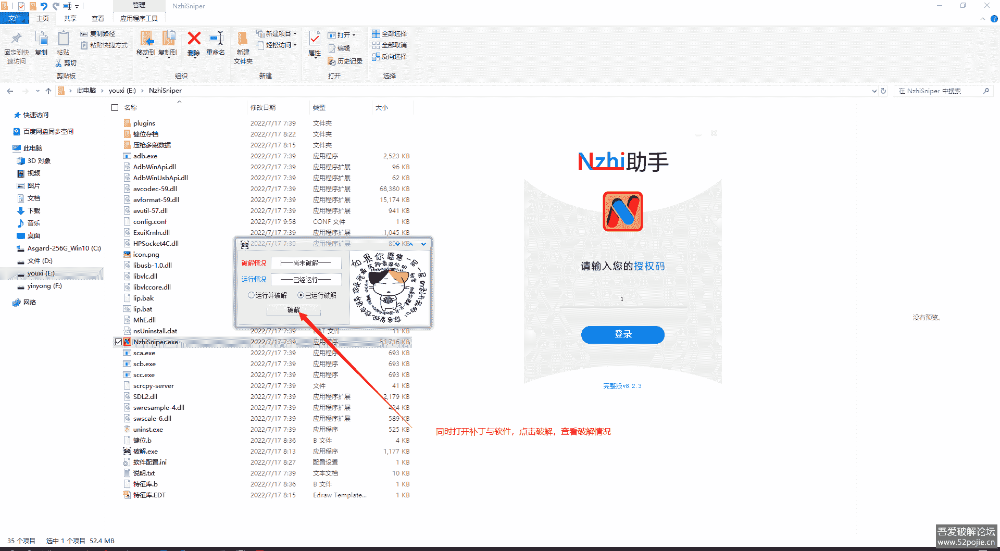

`21.png`（94.17 KB，下载次数：3）

[查看附件](https://www.52pojie.cn/forum.php?mod=attachment&aid=MjUzNzQzMHwyNmRmZmU0MHwxNzkzNTc0NzY1fDE2ODA4NnwxNjYyNDMw&nothumb=yes)

2022-7-17 12:42 上传

破解成功。

软件就不发出来了，只提供思路。

其实感觉我这个思路不是太完美，脑回路有点大，大佬勿喷。

