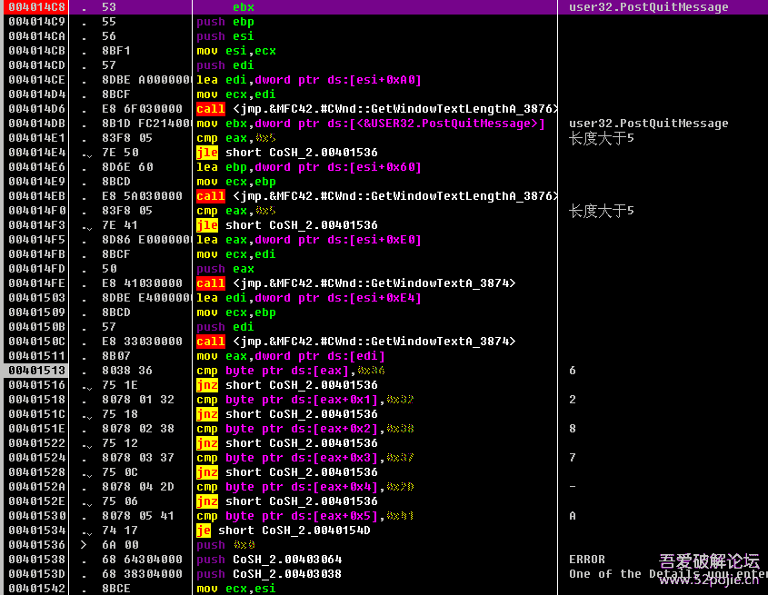
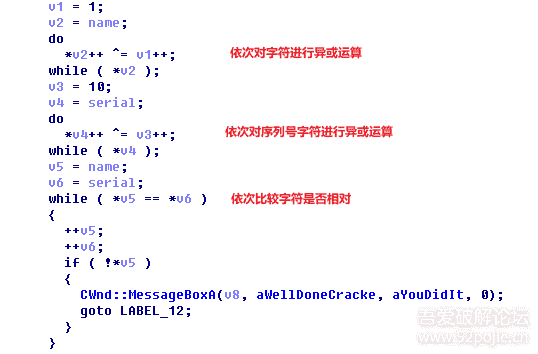
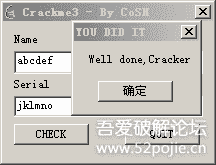

# [原创] 练习笔记之 160Crackme-028、029

- 原帖：https://www.52pojie.cn/forum.php?mod=viewthread&tid=1663691
- 抓取时间：2026-11-01T23:12:40

## 160CM-028

首先，拖入 PE 看一下，是个 VC 程序。搜索字符串可以很容易地找到关键代码位置，如下图：



01.png（36.56 KB，下载次数：1）

[href="forum.php?mod=attachment&aid=MjUzODI3MnwzMzc3NGMwYXwxNzkzNTc0NzU4fDE2ODA4NnwxNjYzNjkx&nothumb=yes" target="_blank"](https://www.52pojie.cn/forum.php?mod=attachment&aid=MjUzODI3MnwzMzc3NGMwYXwxNzkzNTc0NzU4fDE2ODA4NnwxNjYzNjkx&nothumb=yes)

2022-7-20 13:02 上传

程序执行过程很简单，先判断用户名和密码的长度是否大于 5，然后再判断密码前 6 个字符是不是依次为 `6287-A`，都满足条件则弹窗成功提示框。

爆破的话，将 `004014E4 /7E 50 jle short CoSH_2.00401536` 这行的跳转改成 `jmp short 0040154D` 就可以。

## 160CM-029

### 1. 爆破

爆破比较简单，搜索关键字符，找到第一个跳转位置 `00401503 /E9 BB000000 jmp cosh_3.004015C3`，将跳转地址改成 `4015D9` 就可以了。

### 2. 算法分析

主事件函数入口地址为 `4014B0`，算法在大约 `401570～4015C1` 区间段，算法也不算复杂，直接汇编阅读应该也能读懂。

```
004014B0  /.  55            push ebp
004014B1  |.  8BEC          mov ebp,esp
004014B3  |.  6A FF         push -0x1
004014B5  |.  68 C21B4000   push cosh_3.00401BC2                                  ;  溉%@; SE 处理程序安装
004014BA  |.  64:A1 0000000>mov eax,dword ptr fs:[0]
004014C0  |.  50            push eax
004014C1  |.  64:8925 00000>mov dword ptr fs:[0],esp
004014C8  |.  83EC 14       sub esp,0x14
004014CB  |.  53            push ebx
004014CC  |.  56            push esi                                              ;  cosh_3.004022E8
004014CD  |.  57            push edi
004014CE  |.  894D E0       mov [local.8],ecx
004014D1  |.  8D4D E4       lea ecx,[local.7]
004014D4  |.  E8 83030000   call 
004014D9  |.  C745 FC 00000>mov [local.1],0x0
004014E0  |.  8D4D F0       lea ecx,[local.4]
004014E3  |.  E8 74030000   call 
004014E8  |.  C645 FC 01    mov byte ptr ss:[ebp-0x4],0x1
004014EC  |.  8B4D E0       mov ecx,[local.8]
004014EF  |.  81C1 A0000000 add ecx,0xA0
004014F5  |.  E8 AA030000   call 
004014FA  |.  8945 EC       mov [local.5],eax
004014FD  |.  837D EC 05    cmp [local.5],0x5
00401501  |.  7F 05         jg short cosh_3.00401508
00401503  |.  E9 BB000000   jmp cosh_3.004015C3
00401508  |>  8B4D E0       mov ecx,[local.8]
0040150B  |.  83C1 60       add ecx,0x60
0040150E  |.  E8 91030000   call 
00401513  |.  8945 E8       mov [local.6],eax
00401516  |.  837D E8 05    cmp [local.6],0x5
0040151A  |.  7F 05         jg short cosh_3.00401521
0040151C  |.  E9 A2000000   jmp cosh_3.004015C3
00401521  |>  8B45 E0       mov eax,[local.8]
00401524  |.  05 E0000000   add eax,0xE0
00401529  |.  50            push eax
0040152A  |.  8B4D E0       mov ecx,[local.8]
0040152D  |.  81C1 A0000000 add ecx,0xA0
00401533  |.  E8 66030000   call 
00401538  |.  8B4D E0       mov ecx,[local.8]
0040153B  |.  81C1 E4000000 add ecx,0xE4
00401541  |.  51            push ecx
00401542  |.  8B4D E0       mov ecx,[local.8]
00401545  |.  83C1 60       add ecx,0x60
00401548  |.  E8 51030000   call 
0040154D  |.  8B55 E0       mov edx,[local.8]
00401550  |.  81C2 E0000000 add edx,0xE0
00401556  |.  52            push edx
00401557  |.  8D4D E4       lea ecx,[local.7]
0040155A  |.  E8 39030000   call 
0040155F  |.  8B45 E0       mov eax,[local.8]
00401562  |.  05 E4000000   add eax,0xE4
00401567  |.  50            push eax
00401568  |.  8D4D F0       lea ecx,[local.4]
0040156B  |.  E8 28030000   call 
00401570  |.  33C0          xor eax,eax
00401572  |.  33DB          xor ebx,ebx
00401574  |.  33C9          xor ecx,ecx
00401576  |.  B9 01000000   mov ecx,0x1
0040157B  |.  33D2          xor edx,edx
0040157D  |.  8B45 E4       mov eax,[local.7]
00401580  |>  8A18          /mov bl,byte ptr ds:[eax]
00401582  |.  32D9          |xor bl,cl
00401584  |.  8818          |mov byte ptr ds:[eax],bl
00401586  |.  41            |inc ecx
00401587  |.  40            |inc eax
00401588  |.  8038 00       |cmp byte ptr ds:[eax],0x0
0040158B  |.^ 75 F3         \jnz short cosh_3.00401580
0040158D  |.  33C0          xor eax,eax
0040158F  |.  33DB          xor ebx,ebx
00401591  |.  33C9          xor ecx,ecx
00401593  |.  B9 0A000000   mov ecx,0xA
00401598  |.  33D2          xor edx,edx
0040159A  |.  8B45 F0       mov eax,[local.4]
0040159D  |>  8A18          /mov bl,byte ptr ds:[eax]
0040159F  |.  32D9          |xor bl,cl
004015A1  |.  8818          |mov byte ptr ds:[eax],bl
004015A3  |.  41            |inc ecx
004015A4  |.  40            |inc eax
004015A5  |.  8038 00       |cmp byte ptr ds:[eax],0x0
004015A8  |.^ 75 F3         \jnz short cosh_3.0040159D
004015AA  |.  8B45 E4       mov eax,[local.7]
004015AD  |.  8B55 F0       mov edx,[local.4]
004015B0  |>  33C9          /xor ecx,ecx
004015B2  |.  8A18          |mov bl,byte ptr ds:[eax]
004015B4  |.  8A0A          |mov cl,byte ptr ds:[edx]
004015B6  |.  3AD9          |cmp bl,cl
004015B8  |.  75 09         |jnz short cosh_3.004015C3
004015BA  |.  40            |inc eax
004015BB  |.  42            |inc edx
004015BC  |.  8038 00       |cmp byte ptr ds:[eax],0x0
004015BF  |.^ 75 EF         \jnz short cosh_3.004015B0
004015C1  |.  EB 16         jmp short cosh_3.004015D9
004015C3  |>  6A 00         push 0x0
004015C5  |.  68 6C304000   push cosh_3.0040306C                                  ;  ERROR
004015CA  |.  68 40304000   push cosh_3.00403040                                  ;  One of the Details you entered was wrong
004015CF  |.  8B4D E0       mov ecx,[local.8]
004015D2  |.  E8 BB020000   call 
004015D7  |.  EB 14         jmp short cosh_3.004015ED
004015D9  |>  6A 00         push 0x0
004015DB  |.  68 34304000   push cosh_3.00403034                                  ;  YOU DID IT
004015E0  |.  68 20304000   push cosh_3.00403020                                  ;  Well done,Cracker
004015E5  |.  8B4D E0       mov ecx,[local.8]
004015E8  |.  E8 A5020000   call 
004015ED  |>  6A 64         push 0x64                                             ; /Timeout = 100. ms
004015EF  |.  FF15 00204000 call dword ptr ds:[]                 ; \Sleep
004015F5  |.  C645 FC 00    mov byte ptr ss:[ebp-0x4],0x0
004015F9  |.  8D4D F0       lea ecx,[local.4]
004015FC  |.  E8 65010000   call 
00401601  |.  C745 FC FFFFF>mov [local.1],-0x1
00401608  |.  8D4D E4       lea ecx,[local.7]
0040160B  |.  E8 56010000   call 
00401610  |.  8B4D F4       mov ecx,[local.3]
00401613  |.  64:890D 00000>mov dword ptr fs:[0],ecx
0040161A  |.  5F            pop edi                                               ;  0012FE0C
0040161B  |.  5E            pop esi                                               ;  0012FE0C
0040161C  |.  5B            pop ebx                                               ;  0012FE0C
0040161D  |.  8BE5          mov esp,ebp
0040161F  |.  5D            pop ebp                                               ;  0012FE0C
00401620  \.  C3            retn
```

不过也还可以借助 IDA 进行分析，这个函数在 IDA 中没有自动识别出来，需要手动创建一下，然后按 `F5` 生成伪代码，核心验证算法如下：



01.png（23.45 KB，下载次数：3）

[href="forum.php?mod=attachment&aid=MjUzODI3M3wxOGVkYzlmOXwxNzkzNTc0NzU4fDE2ODA4NnwxNjYzNjkx&nothumb=yes" target="_blank"](https://www.52pojie.cn/forum.php?mod=attachment&aid=MjUzODI3M3wxOGVkYzlmOXwxNzkzNTc0NzU4fDE2ODA4NnwxNjYzNjkx&nothumb=yes)

2022-7-20 13:03 上传

算法内容为将用户名和序列号的字符分别进行一定的异或运算，然后依次比较每个字符是否相同。将伪代码转换成可执行的 C 代码，如下，分别输入用户名和序列号，和 OD 跟踪的运算结果进行对比，可知正确无误。

```c
#include "stdafx.h"

#include 

#include 

#include 

int _tmain(int argc, _TCHAR* argv[])

{

    char name[20],serial[20];

    int i,j;

    BYTE *name1, *serial1;

    printf("请输入用户名（长度6~20）：");

    scanf_s("%s", name, 20);

    BYTE *name2, *serial2;

    printf("请输入用户名（长度6~20）：");

    scanf_s("%s", serial, 20);

    name1 = (BYTE*)name;

    serial1 = (BYTE*)serial;

    i = 1;

    do

        *name1++ ^= i++;

    while (*name1);

    printf("name为：%s\n", name);

    j = 10;

    do

        *serial1++ ^= j++;

    while (*serial1);

    printf("serial为：%s\n", serial);

    name2 = (BYTE*)name;

    serial2 = (BYTE*)serial;

    while (*name2 == *serial2)

    {

        ++*name2;

        ++*serial2;
```


```
        if (!*name2)
        {
            printf("正确\n");
        }
    }
    system("pause");
    return 0;
}
```

注册机的话就需要通过用户名计算序列号，从算法中可知验证的时候是对用户名和序列号中的字符依次进行验证，而运算过程又是异或运算，因此要从用户名得到序列号，只要将通过用户名字符串算法处理的结果，再用序列号字符串算法进行一次运算，就能得到正确的序列号。完整的注册算法程序如下：

```
#include "stdafx.h"
#include 
#include 
#include 

int _tmain(int argc, _TCHAR* argv[])
{
    char name[20],serial[20];
    int i,j;
    BYTE *name1, *serial1;
    printf("请输入用户名（长度6~20）：");
    scanf_s("%s", name, 20);
    name1 = (BYTE*)name;
    i = 1;
    do
        *name1++ ^= i++;
    while (*name1);
    //printf("name为：%s\n", name);
    serial1 = (BYTE*)name;
    j = 10;
    do
        *serial1++ ^= j++;
    while (*serial1);
    printf("序列号为：%s\n", name);
    system("pause");
    return 0;
}
```

注册结果如下：



`02.png` (11.25 KB, 下载次数: 2)

[href="forum.php?mod=attachment&aid=MjUzODI3NHxjODZmOGFmNnwxNzkzNTc0NzU4fDE2ODA4NnwxNjYzNjkx&nothumb=yes" target="_blank"](https://www.52pojie.cn/forum.php?mod=attachment&aid=MjUzODI3NHxjODZmOGFmNnwxNzkzNTc0NzU4fDE2ODA4NnwxNjYzNjkx&nothumb=yes)

2022-7-20 13:03 上传

## 3. 总结

这是一个比较简单的注册算法题，前面的题能做出来的话，这道题应该也没有什么难度。
