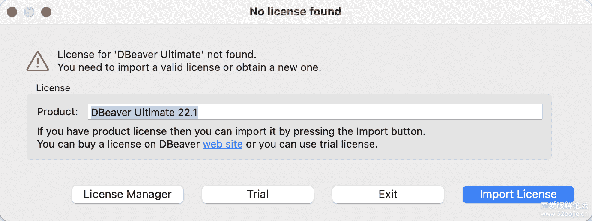
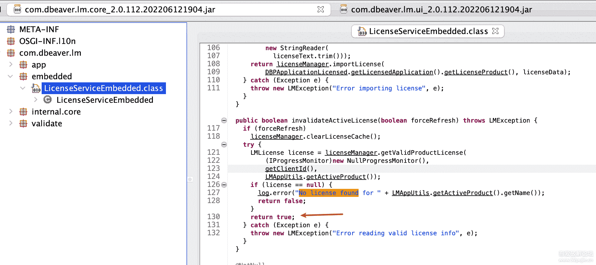
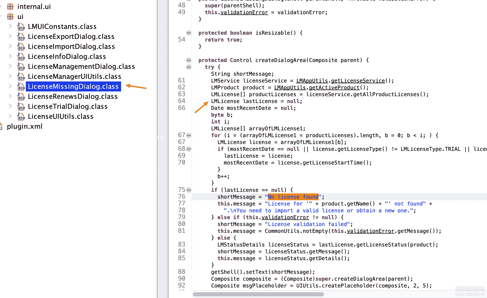
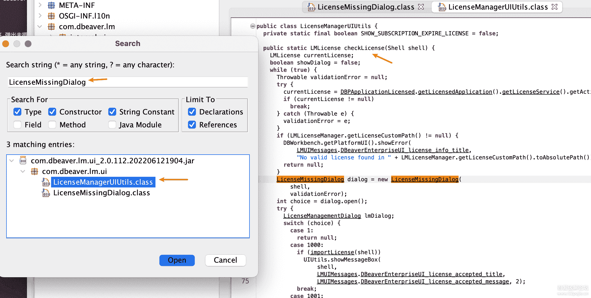
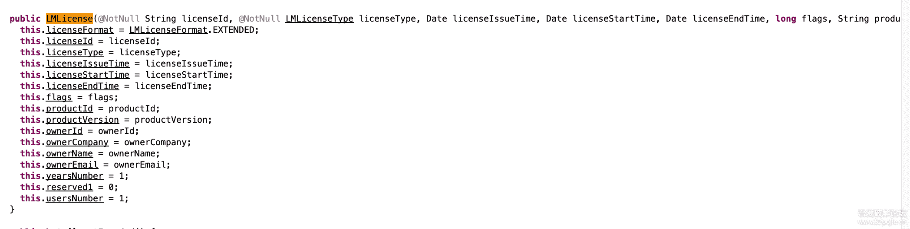
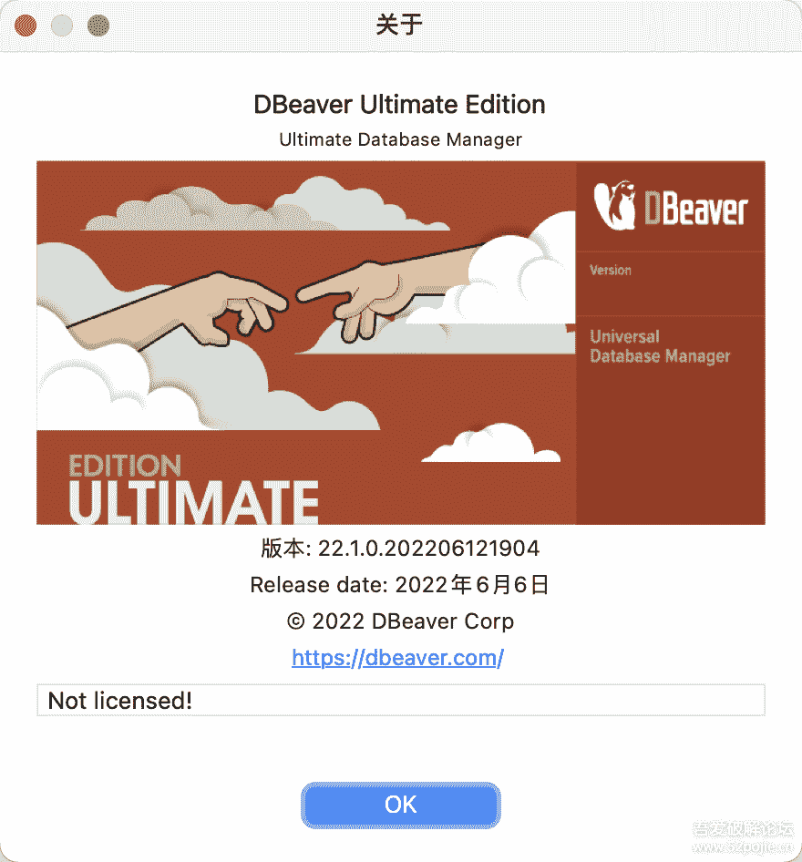
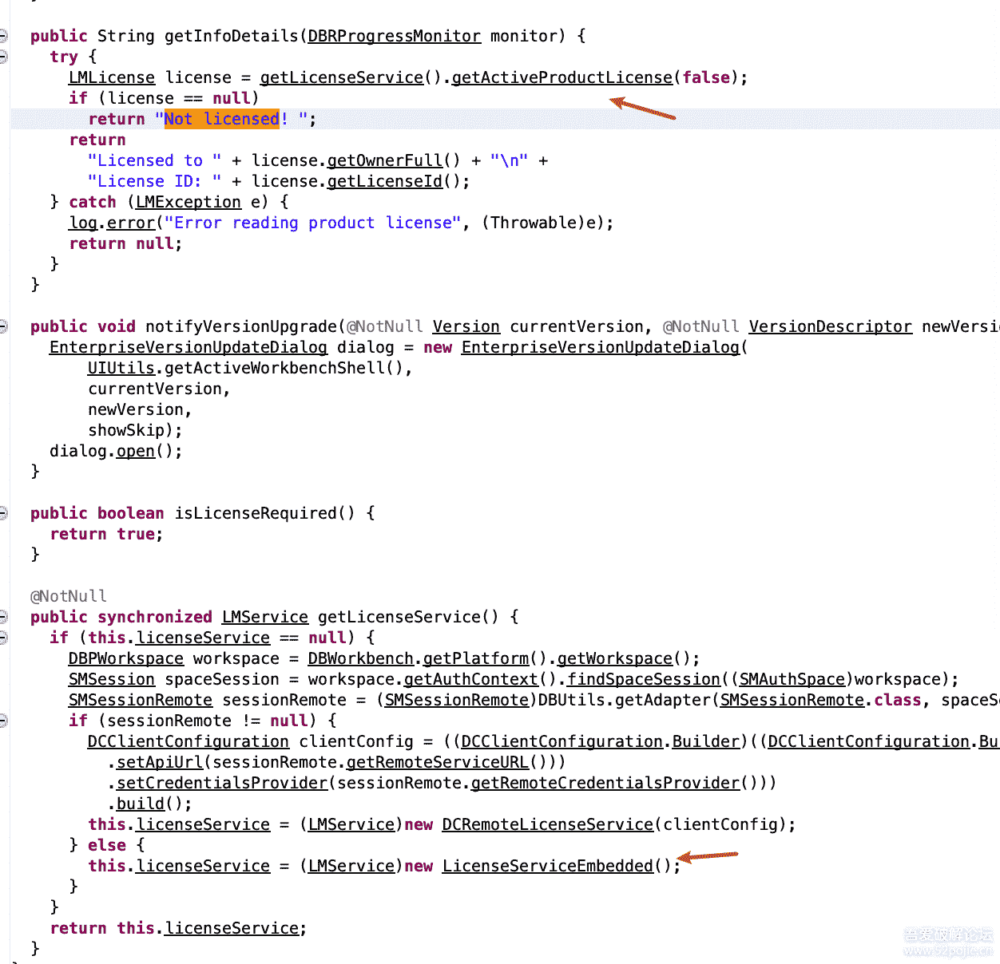
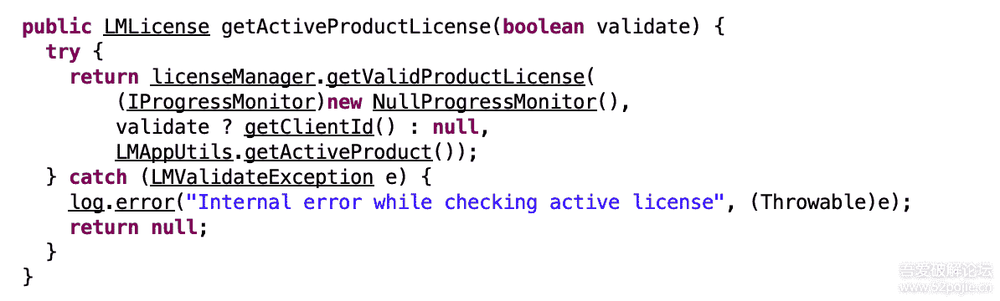
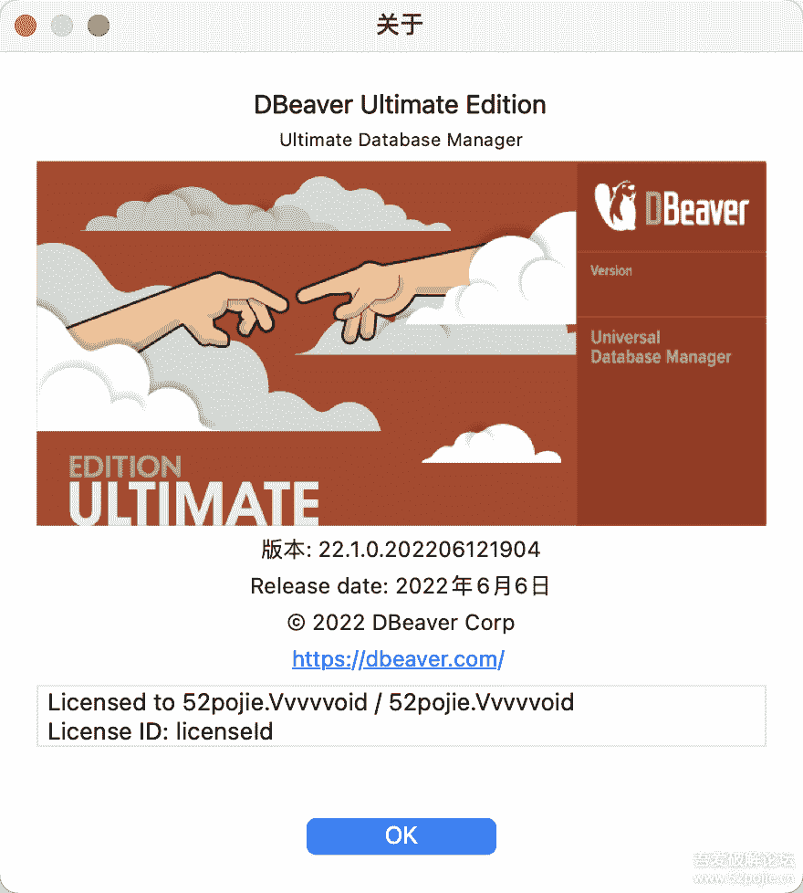

# [MacOS逆向] DBeaver Ultimate edition JAVA程序逆向分析

- 原帖: https://www.52pojie.cn/forum.php?mod=viewthread&tid=1666440
- 抓取时间: 2026-11-01T23:12:24

## DBeaver Ultimate edition JAVA程序逆向分析

官方下载地址: [https://dbeaver.com/download/ultimate/](https://dbeaver.com/download/ultimate/)

当前分析版本号: `dbeaver-ue-22.1.0`

### 环境

JAVA/Maven/`javassist`

原理：利用 `javassist` 载入资源文件，并修改字节码，保存为 `class` 文件；之后自行替换目标 `jar` 包中的 `class` 文件。

WIN10/Mac m1 测试通过。

### 分析

安装后打开主程序，弹出未授权框；关闭框后程序就跑飞了。



`dialog.jpg` (81.2 KB, 下载次数: 0)

[附件下载](https://www.52pojie.cn/forum.php?mod=attachment&aid=MjU0MDIzOHxmYzJlYWNiMHwxNzkzNTc0NzQyfDE2ODA4NnwxNjY2NDQw&nothumb=yes)

2022-7-25 16:21 上传

我们在程序主目录，找到环境下的所有依赖 `jar`，搜关键字 `No license found`。

找到一个关键 `jar`：`com.dbeaver.lm.core_2.0.112.202206121904.jar`。

简单分析后，记录执行修改如下：

`LicenseServiceEmbedded.invalidateActiveLicense` 返回 `true`；



`no_license_found.jpg` (411.46 KB, 下载次数: 1)

[附件下载](https://www.52pojie.cn/forum.php?mod=attachment&aid=MjU0MDI0NXxjYjAxYzZmZXwxNzkzNTc0NzQyfDE2ODA4NnwxNjY2NDQw&nothumb=yes)

2022-7-25 16:22 上传

接着 next，查找下一个。

找到关键 `jar`：`com.dbeaver.lm.ui_2.0.112.202206121904.jar`。

注意到当前的 `class` 是 `LicenseMissingDialog`，是 `IconAndMessageDialog` 的实现类。

同时，该 `jar` 包内有多个实现类，一定是哪里有什么判断，所以调用到了这里的 `licenseMiss`。



`miss_license.jpg` (285.41 KB, 下载次数: 0)

[附件下载](https://www.52pojie.cn/forum.php?mod=attachment&aid=MjU0MDI0NHw4YjkyNjMzNnwxNzkzNTc0NzQyfDE2ODA4NnwxNjY2NDQw&nothumb=yes)

2022-7-25 16:22 上传

接着搜一下 `LicenseMissingDialog`，看看是谁调用的；

此时定位到了 `LicenseManagerUIUtils.checkLicense`。

看着类名跟方法名都很像真的；简单分析下这个方法。



`license_manager.jpg` (398.54 KB, 下载次数: 0)

[附件下载](https://www.52pojie.cn/forum.php?mod=attachment&aid=MjU0MDI0Mnw5NmM4MWNlYnwxNzkzNTc0NzQyfDE2ODA4NnwxNjY2NDQw&nothumb=yes)

2022-7-25 16:22 上传

看到代码里有一段循环获取 `license`，如果 `license` miss 则会调用 `LicenseMissingDialog` 实现类，如果找到则直接返回 `license`。

这里我们注意到 `LMLicense` 这个对象；跟进去看看，看到一个构造器。



`LMLicense_cus.jpg` (91.83 KB, 下载次数: 0)

[附件下载](https://www.52pojie.cn/forum.php?mod=attachment&aid=MjU0MDI0M3w3ZGY4N2UxN3wxNzkzNTc0NzQyfDE2ODA4NnwxNjY2NDQw&nothumb=yes)

2022-7-25 16:22 上传

就用这个构造器，直接让 `checkLicense` 返回 `new LMLicense(xxxxx,xxx...)`。

改完之后，重新打开程序，没有弹框了，能正常使用了，但是还有一个瑕疵，点击关于还是显示 `Not licensed!`。



`Snipaste_2022-07-25_16-06-34.jpg` (147.66 KB, 下载次数: 0)

[附件下载](https://www.52pojie.cn/forum.php?mod=attachment&aid=MjU0MDI0N3w0NGJlZGI5N3wxNzkzNTc0NzQyfDE2ODA4NnwxNjY2NDQw&nothumb=yes)

2022-7-25 16:22 上传

接着搜，找到了第一步的那个类，定位到 `getActiveProductLicense` 这个方法，看到返回值也是 `LMLicense`，把第二步的 `return` 过去就可以。



`get_license.jpg` (422.27 KB, 下载次数: 0)

[附件下载](https://www.52pojie.cn/forum.php?mod=attachment&aid=MjU0MDI0MXw0NzI4MTQ5YnwxNzkzNTc0NzQyfDE2ODA4NnwxNjY2NDQw&nothumb=yes)

2022-7-25 16:22 上传



`get_active_license.jpg` (63.73 KB, 下载次数: 0)

[附件下载](https://www.52pojie.cn/forum.php?mod=attachment&aid=MjU0MDI0MHwyM2NjZWVlMXwxNzkzNTc0NzQyfDE2ODA4NnwxNjY2NDQw&nothumb=yes)

2022-7-25 16:22 上传

改完之后保存，打开程序 ok 了。



`Snipaste_2022-07-25_16-05-56.jpg` (154.77 KB, 下载次数: 0)

[附件下载](https://www.52pojie.cn/forum.php?mod=attachment&aid=MjU0MDI0Nnw2MGJhMzNjZHwxNzkzNTc0NzQyfDE2ODA4NnwxNjY2NDQw&nothumb=yes)

2022-7-25 16:22 上传

点更新的时候还是有点小瑕疵，留给大家当作业吧~

### 具体代码

自行修改路径，以及添加所有程序依赖的 `jar` 包，修改并保存后替换目标 `jar` 包里的 `class` 文件既可。

```text
org.javassist
javassist
3.26.0-GA
```

```java
ClassPool pool = ClassPool.getDefault();

// 设置目标类的路径
pool.insertClassPath("/Applications/DBeaverUltimate.app/Contents/Eclipse/plugins/com.dbeaver.app.advanced_22.1.0.202206121904.jar");
pool.insertClassPath("/Applications/DBeaverUltimate.app/Contents/Eclipse/plugins/com.dbeaver.app.ultimate_22.1.0.202206121904.jar");

......
```

把主程序相关所有 `jar` 都添加到 `ClassPath` 中。

```java
// 获得要修改的全路径类名
CtClass clazz = pool.get("com.dbeaver.lm.embedded.LicenseServiceEmbedded");
CtMethod bMethod = clazz.getDeclaredMethod("invalidateActiveLicense");

// 重置方法体
bMethod.setBody("return true;");

bMethod = clazz.getDeclaredMethod("getActiveProductLicense");

// 重置方法体
bMethod.setBody("return new org.jkiss.lm.LMLicense(\"licenseId\",org.jkiss.lm.LMLicenseType.ULTIMATE,new java.text.SimpleDateFormat(\"yyyy-MM-dd\").parse(\"2029-01-01\"),new java.text.SimpleDateFormat(\"yyyy-MM-dd\").parse(\"2020-01-01\"),new java.text.SimpleDateFormat(\"yyyy-MM-dd\").parse(\"2029-01-01\"),1L,\"2\",\"3\",\"4\",\"52pojie.Vvvvvoid\",\"52pojie.Vvvvvoid\",\"marlkiller@voidm.com\");");

// 保存到文件
save(clazz);

//public LMLicense(@NotNull String licenseId, @NotNull LMLicenseType licenseType, Date licenseIssueTime, Date licenseStartTime, Date licenseEndTime, long flags, String productId, String productVersion, String ownerId, String ownerCompany, String ownerName, String ownerEmail) {

clazz = pool.get("com.dbeaver.lm.ui.LicenseManagerUIUtils");
bMethod = clazz.getDeclaredMethod("checkLicense");

// 重置方法体
bMethod.setBody("return new org.jkiss.lm.LMLicense(\"licenseId\",org.jkiss.lm.LMLicenseType.ULTIMATE,new java.text.SimpleDateFormat(\"yyyy-MM-dd\").parse(\"2029-01-01\"),new java.text.SimpleDateFormat(\"yyyy-MM-dd\").parse(\"2020-01-01\"),new java.text.SimpleDateFormat(\"yyyy-MM-dd\").parse(\"2029-01-01\"),1L,\"2\",\"3\",\"4\",\"52pojie.Vvvvvoid\",\"52pojie.Vvvvvoid\",\"marlkiller@voidm.com\");");

// 保存到文件
save(clazz);
```

### 后记

仅供研究学习使用，请勿用于非法用途。

注：若转载请注明来源（本贴地址）与作者信息。
