# [原创] DBeaver Ultimate Edition License 验证分析

- 原帖：https://www.52pojie.cn/forum.php?mod=viewthread&tid=1668629
- 抓取时间：2026-11-01T23:12:12

## 前言

看了论坛大佬写的两篇帖子：

[//www.52pojie.cn/thread-1666440-1-1.html" target="_blank"](https://www.52pojie.cn/thread-1666440-1-1.html:href="https)

[//www.52pojie.cn/thread-1668139-1-1.html" target="_blank"](https://www.52pojie.cn/thread-1668139-1-1.html:href="https)

研究了一波 DBeaver 的源码，在这里分享一下我的过程与方法，补充一种绕过网络验证的方法。

测试环境：

- 操作系统：Windows10
- Java 版本：JDK11
- 软件版本：DBeaver Ultimate 22.1.0

## License 解密分析

下载安装后打开，弹窗提示如下：

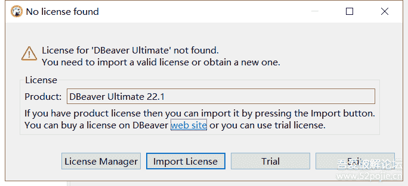

图片1.png (23.88 KB, 下载次数: 245)

[href="forum.php?mod=attachment&aid=MjU0MjUzNHwxNGExYzA1NXwxNzkzNTc0NzI5fDE2ODA4NnwxNjY4NjI5&nothumb=yes" target="_blank"](https://www.52pojie.cn/forum.php?mod=attachment&aid=MjU0MjUzNHwxNGExYzA1NXwxNzkzNTc0NzI5fDE2ODA4NnwxNjY4NjI5&nothumb=yes)

2022-8-2 17:16 上传

点击 `ImportLicense`，随便填写一串字符串，界面会出现以下报错信息：

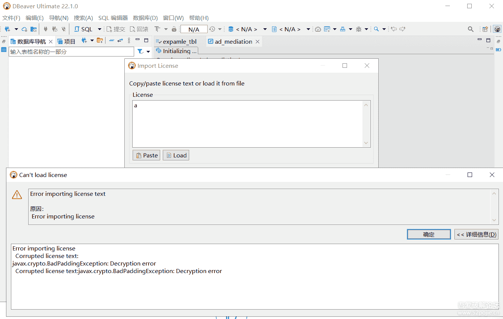

图片2.png (65.66 KB, 下载次数: 241)

[href="forum.php?mod=attachment&aid=MjU0MjUzNXw1MDg1ZTVkOHwxNzkzNTc0NzI5fDE2ODA4NnwxNjY4NjI5&nothumb=yes" target="_blank"](https://www.52pojie.cn/forum.php?mod=attachment&aid=MjU0MjUzNXw1MDg1ZTVkOHwxNzkzNTc0NzI5fDE2ODA4NnwxNjY4NjI5&nothumb=yes)

2022-8-2 17:16 上传

查看运行日志，日志路径：`C:\Users\Niclas\AppData\Roaming\DBeaverData\workspace6\.metadata\dbeaver-debug.log`，能看到报错信息：

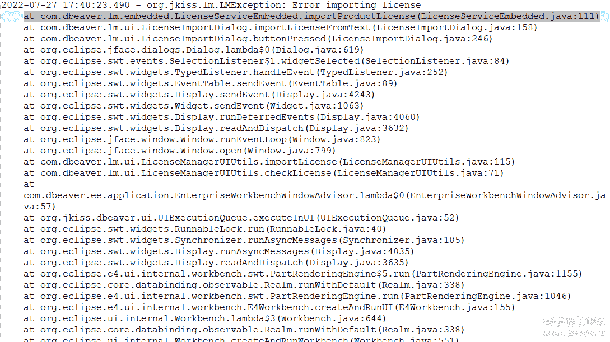

图片3.png (90.07 KB, 下载次数: 249)

[href="forum.php?mod=attachment&aid=MjU0MjUzNnw3ZTM3Mjg1ZnwxNzkzNTc0NzI5fDE2ODA4NnwxNjY4NjI5&nothumb=yes" target="_blank"](https://www.52pojie.cn/forum.php?mod=attachment&aid=MjU0MjUzNnw3ZTM3Mjg1ZnwxNzkzNTc0NzI5fDE2ODA4NnwxNjY4NjI5&nothumb=yes)

2022-8-2 17:16 上传

以上能看出导入 License 调用的方法在：`com.dbeaver.lm.embedded.LicenseServiceEmbedded.importProductLicense`

根据此处线索去安装目录下找对应的 JAR 包，查找到的 JAR 为安装目录下的：`DBeaverUltimate\plugins\com.dbeaver.lm.core_2.0.112.202206121739.jar`

反编译 JAR 包之后能找到对应的方法源码如下：

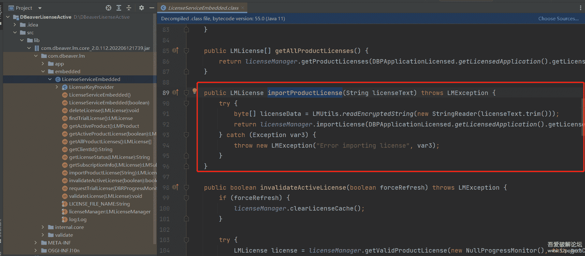

图片4.png (217.34 KB, 下载次数: 235)

[href="forum.php?mod=attachment&aid=MjU0MjUzN3w5N2VkNmMyNnwxNzkzNTc0NzI5fDE2ODA4NnwxNjY4NjI5&nothumb=yes" target="_blank"](https://www.52pojie.cn/forum.php?mod=attachment&aid=MjU0MjUzN3w5N2VkNmMyNnwxNzkzNTc0NzI5fDE2ODA4NnwxNjY4NjI5&nothumb=yes)

2022-8-2 17:16 上传

分析方法内代码，发现调用了方法：`org.jkiss.lm.LMLicenseManager#importLicense(org.jkiss.lm.LMProduct,byte[])`

查找到对应的 JAR 包为：`DBeaverUltimate\plugins\org.jkiss.lm_1.0.136.202206121739.jar`

导入项目中，反编译之后能看到如下代码：

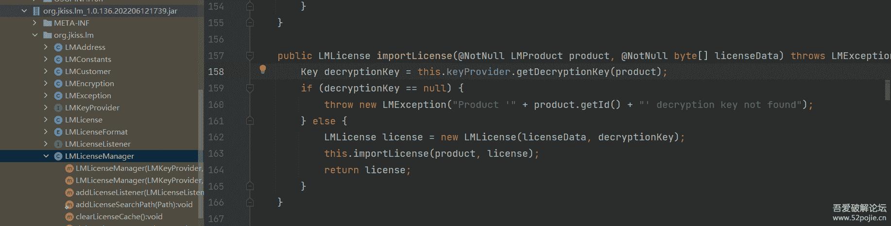

图片5.png (112.7 KB, 下载次数: 250)

[href="forum.php?mod=attachment&aid=MjU0MjUzOHxlN2U3MjBmOHwxNzkzNTc0NzI5fDE2ODA4NnwxNjY4NjI5&nothumb=yes" target="_blank"](https://www.52pojie.cn/forum.php?mod=attachment&aid=MjU0MjUzOHxlN2U3MjBmOHwxNzkzNTc0NzI5fDE2ODA4NnwxNjY4NjI5&nothumb=yes)

2022-8-2 17:16 上传

分析此处获取解密 Key 的方法，可以看到如下源码：

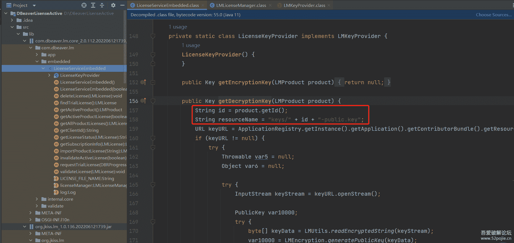

图片6.png (207.95 KB, 下载次数: 237)

[href="forum.php?mod=attachment&aid=MjU0MjUzOXw2N2YxNGEwNnwxNzkzNTc0NzI5fDE2ODA4NnwxNjY4NjI5&nothumb=yes" target="_blank"](https://www.52pojie.cn/forum.php?mod=attachment&aid=MjU0MjUzOXw2N2YxNGEwNnwxNzkzNTc0NzI5fDE2ODA4NnwxNjY4NjI5&nothumb=yes)

2022-8-2 17:16 上传

这里可以看出密钥来自于某一个 JAR 包根目录下的 `keys` 文件夹中，文件名是以 `-public.key` 结尾。

在安装目录中查找后，发现该文件在：`plugins\com.dbeaver.app.ultimate_22.1.0.202206121739.jar`

如图：

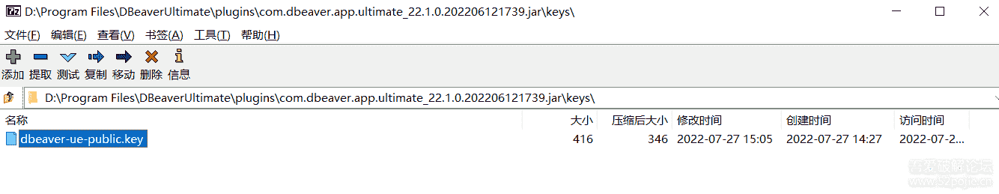

图片7.png (28.96 KB, 下载次数: 247)

[href="forum.php?mod=attachment&aid=MjU0MjU0MHwwYTEwZjNhNnwxNzkzNTc0NzI5fDE2ODA4NnwxNjY4NjI5&nothumb=yes" target="_blank"](https://www.52pojie.cn/forum.php?mod=attachment&aid=MjU0MjU0MHwwYTEwZjNhNnwxNzkzNTc0NzI5fDE2ODA4NnwxNjY4NjI5&nothumb=yes)

2022-8-2 17:16 上传

此处也能推出 `String id = product.getId();` 中获取的 id 是：`dbeaver-ue`

回到方法 `org.jkiss.lm.LMLicenseManager#importLicense(org.jkiss.lm.LMProduct,byte[])`，继续分析 `LMLicense license = new LMLicense(licenseData,decryptionKey);`，查找其解密方法，如图：

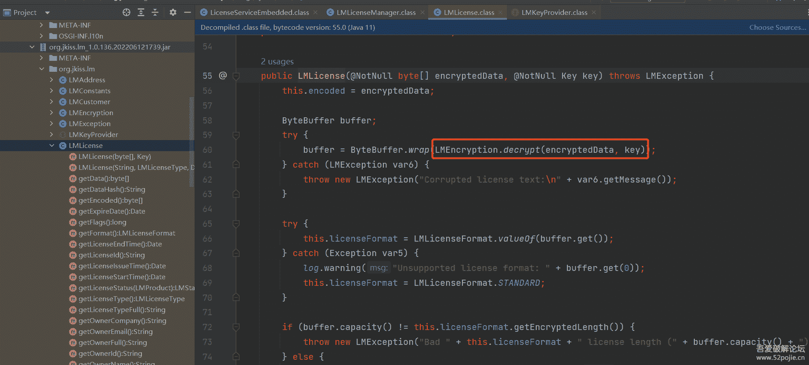

图片8.png (215.58 KB, 下载次数: 236)

[href="forum.php?mod=attachment&aid=MjU0MjU0MXw3ODI5YWM0YnwxNzkzNTc0NzI5fDE2ODA4NnwxNjY4NjI5&nothumb=yes" target="_blank"](https://www.52pojie.cn/forum.php?mod=attachment&aid=MjU0MjU0MXw3ODI5YWM0YnwxNzkzNTc0NzI5fDE2ODA4NnwxNjY4NjI5&nothumb=yes)

2022-8-2 17:16 上传

可以发现其加解密方式为：`RSA/ECB/PKCS1Padding`。

在 JAR 包中找到的 `dbeaver-ue-public.key` 文件为 RAS 解密需要的公钥。

## License 校验分析

根据上述解密过程分析，生成相应的 License（License 的生成方式见下面[//www.52pojie.cn" target="_blank" class="relatedlink"](https://www.52pojie.cn:href="https)步骤）导入激活，出现如下弹窗：

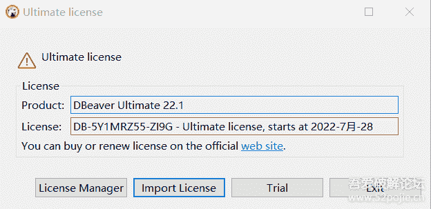

图片9.png (22.04 KB, 下载次数: 250)

[href="forum.php?mod=attachment&aid=MjU0MjU0MnxkOGRjODFmOXwxNzkzNTc0NzI5fDE2ODA4NnwxNjY4NjI5&nothumb=yes" target="_blank"](https://www.52pojie.cn/forum.php?mod=attachment&aid=MjU0MjU0MnxkOGRjODFmOXwxNzkzNTc0NzI5fDE2ODA4NnwxNjY4NjI5&nothumb=yes)

2022-8-2 17:16 上传

查看日志文件 `dbeaver-debug.log`，异常信息如下：

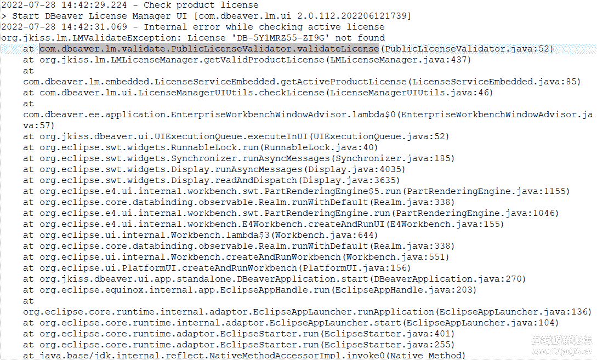

图片10.png (94.97 KB, 下载次数: 238)

[href="forum.php?mod=attachment&aid=MjU0MjU0M3xmOTAyNzE4MHwxNzkzNTc0NzI5fDE2ODA4NnwxNjY4NjI5&nothumb=yes" target="_blank"](https://www.52pojie.cn/forum.php?mod=attachment&aid=MjU0MjU0M3xmOTAyNzE4MHwxNzkzNTc0NzI5fDE2ODA4NnwxNjY4NjI5&nothumb=yes)

2022-8-2 17:16 上传

从日志可以看出验证的方法在：`com.dbeaver.lm.validate.PublicLicenseValidator.validateLicense`

根据路径查看该方法的代码，如下：

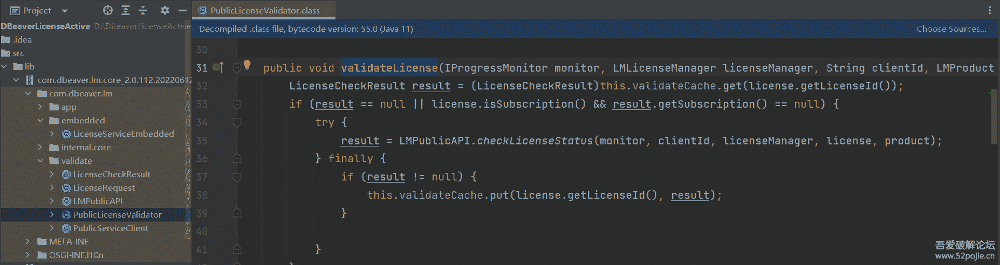

图片11.png (110.73 KB, 下载次数: 243)

[href="forum.php?mod=attachment&aid=MjU0MjU0NHw1YTExMDgzZHwxNzkzNTc0NzI5fDE2ODA4NnwxNjY4NjI5&nothumb=yes" target="_blank"](https://www.52pojie.cn/forum.php?mod=attachment&aid=MjU0MjU0NHw1YTExMDgzZHwxNzkzNTc0NzI5fDE2ODA4NnwxNjY4NjI5&nothumb=yes)

2022-8-2 17:16 上传

分析其逻辑，验证的步骤在：`result = LMPublicAPI.checkLicenseStatus(monitor,clientId, licenseManager, license, product);`

查看其代码如下：

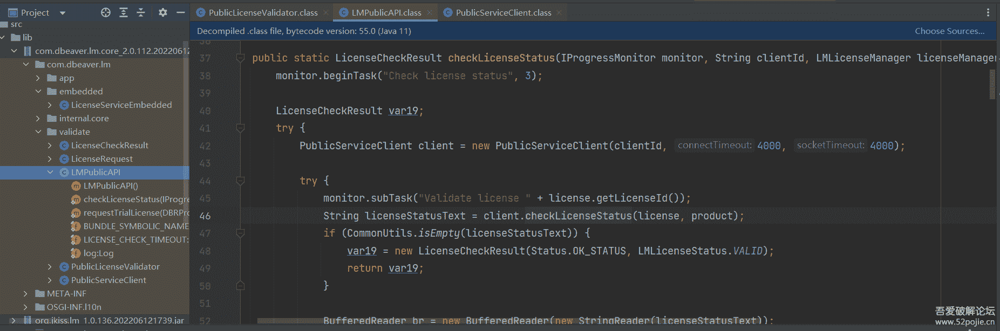

图片12.png (151.39 KB, 下载次数: 249)

[href="forum.php?mod=attachment&aid=MjU0MjU0NXw4ZmMwMWY2MnwxNzkzNTc0NzI5fDE2ODA4NnwxNjY4NjI5&nothumb=yes" target="_blank"](https://www.52pojie.cn/forum.php?mod=attachment&aid=MjU0MjU0NXw4ZmMwMWY2MnwxNzkzNTc0NzI5fDE2ODA4NnwxNjY4NjI5&nothumb=yes)

2022-8-2 17:16 上传

分析代码，发现 `String licenseStatusText = client.checkLicenseStatus(license, product);`

返回的 `licenseStatusText` 如果为空，那么该方法将会直接返回 `LMLicenseStatus.VALID` 的校验状态（即有效的状态）。

继续分析调用的 `checkLicenseStatus` 方法，代码如下：

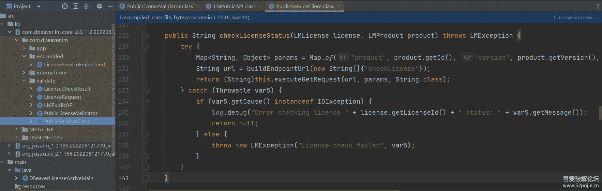

图片13.png (149.67 KB, 下载次数: 253)

[href="forum.php?mod=attachment&aid=MjU0MjU0NnwxNzc5ZjVkNHwxNzkzNTc0NzI5fDE2ODA4NnwxNjY4NjI5&nothumb=yes" target="_blank"](https://www.52pojie.cn/forum.php?mod=attachment&aid=MjU0MjU0NnwxNzc5ZjVkNHwxNzkzNTc0NzI5fDE2ODA4NnwxNjY4NjI5&nothumb=yes)

2022-8-2 17:17 上传

这里能看出请求了网络接口，调用的请求方法为父类中的方法，在安装目录下找到 `PublicServiceClient` 的父类在 `com.dbeaver.remote.client_1.0.2.202206121739.jar` 中。

在类 `com.dbeaver.remote.client.AbstractRemoteClient` 中能看到 HTTP 请求的客户端构造代码如下：

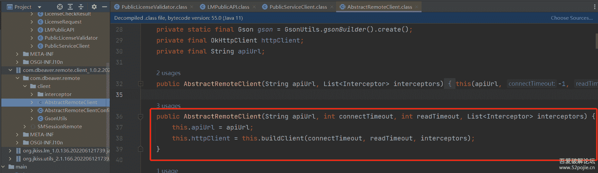

图片14.png (132.43 KB, 下载次数: 243)

[href="forum.php?mod=attachment&aid=MjU0MjU0N3xmNDFhZjAwMnwxNzkzNTc0NzI5fDE2ODA4NnwxNjY4NjI5&nothumb=yes" target="_blank"](https://www.52pojie.cn/forum.php?mod=attachment&aid=MjU0MjU0N3xmNDFhZjAwMnwxNzkzNTc0NzI5fDE2ODA4NnwxNjY4NjI5&nothumb=yes)

2022-8-2 17:17 上传

返回类 `com.dbeaver.lm.validate.PublicServiceClient` 中，能看到其构造客户端的代码如下：

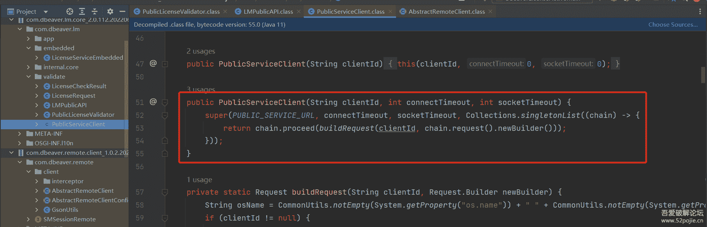

图片15.png (151.51 KB, 下载次数: 232)

[href="forum.php?mod=attachment&aid=MjU0MjU0OHw2Y2I1OTkwYXwxNzkzNTc0NzI5fDE2ODA4NnwxNjY4NjI5&nothumb=yes" target="_blank"](https://www.52pojie.cn/forum.php?mod=attachment&aid=MjU0MjU0OHw2Y2I1OTkwYXwxNzkzNTc0NzI5fDE2ODA4NnwxNjY4NjI5&nothumb=yes)

2022-8-2 17:17 上传


# DBeaver License 校验分析

## 请求地址追溯
能分析出`PUBLIC_SERVICE_URL`为接口的请求地址，继续追溯该变量的来源，其逻辑如下：

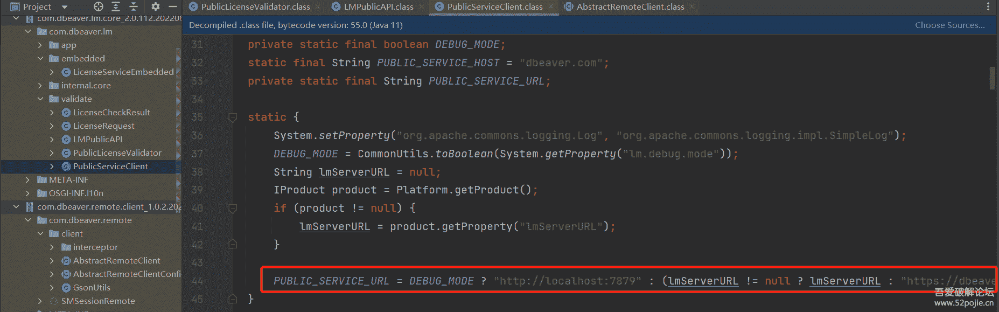
图片16.png (154.83 KB, 下载次数: 247)
[href="forum.php?mod=attachment&aid=MjU0MjU0OXxjM2FjODQ1YnwxNzkzNTc0NzI5fDE2ODA4NnwxNjY4NjI5&nothumb=yes" target="_blank"](https://www.52pojie.cn/forum.php?mod=attachment&aid=MjU0MjU0OXxjM2FjODQ1YnwxNzkzNTc0NzI5fDE2ODA4NnwxNjY4NjI5&nothumb=yes)
2022-8-2 17:17 上传

## 校验结果获取
回到获取校验结果`StringlicenseStatusText = client.checkLicenseStatus(license, product)`的代码，
当请求的路径无法访问时，那么得到的`licenseStatusText`就为空值了，就能直接得到有效的验证结果。
从上述代码中，能看出`DEBUG_MODE`为`true`或者是`https://dbeaver.com/lmp/`无法访问时，请求结果将会返回空值。

## 网络校验绕过方法
由此得到了两种通过网络校验的方法：
1. 在`hosts`文件中配置`dbeaver.com`的IP为`127.0.0.1`；
2. 在配置文件中设置`lm.debug.mode=true`

## 破解思路
1. 生成一对RAS加解密使用的公钥和私钥；
2. 将`com.dbeaver.app.ultimate_22.1.0.202206121739.jar`中的公钥替换成自己生成的公钥；
3. 用自己的私钥生成一个License文件导入到DBEaver中；
4. 绕过License网络校验。

## 破解步骤
1. 查看`org.jkiss.lm_1.0.136.202206121739.jar`内的代码，发现类`org.jkiss.lm.LMMain`中已经实现了生成密钥、生成License、解密License、导入License的测试代码，只需稍作修改就可以直接使用；
2. 导入项目需要依赖的jar包，需要依赖的jar包如下图：
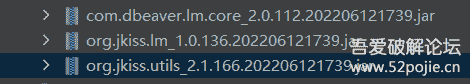
图片17.png (15.69 KB, 下载次数: 250)
[href="forum.php?mod=attachment&aid=MjU0MjU1MHw1MGZhMTdhNnwxNzkzNTc0NzI5fDE2ODA4NnwxNjY4NjI5&nothumb=yes" target="_blank"](https://www.52pojie.cn/forum.php?mod=attachment&aid=MjU0MjU1MHw1MGZhMTdhNnwxNzkzNTc0NzI5fDE2ODA4NnwxNjY4NjI5&nothumb=yes)
2022-8-2 17:17 上传
3. 创建一个新的类，修改`org.jkiss.lm.LMMain`中的代码，得到如下代码：
[Java] 纯文本查看 复制代码


# `DBeaverLicenseActiveMain` 示例

## Java 代码

```java
import org.jkiss.lm.*;
import org.jkiss.utils.Base64;

import java.io.*;
import java.security.Key;
import java.security.KeyPair;
import java.security.PrivateKey;
import java.security.PublicKey;
import java.util.Date;

public class DBeaverLicenseActiveMain {
    private static final LMProduct TEST_PRODUCT;

    static {
        TEST_PRODUCT = new LMProduct(
                "dbeaver-ue",
                "DB",
                "DBeaver Ultimate",
                "DBeaver Ultimate Edition",
                "22.1",
                LMProductType.DESKTOP,
                new Date(),
                new String[0]
        );
    }

    public static void main(String[] args) throws Exception {
        System.out.println("LM 2.0");
        // 生成RAS密钥对
        if (args.length > 0 && args[0].equals("gen-keys")) {
            System.out.println("Test key generation");
            generateKeyPair();
        // 生成加密License
        } else if (args.length > 0 && args[0].equals("encrypt-license")) {
            System.out.println("Encrypt license");
            encryptLicense();
        // 解密License
        } else if (args.length > 0 && args[0].equals("decrypt-license")) {
            System.out.println("Decrypt license");
            decryptLicense();
        // 导入License测试
        } else if (args.length > 0 && args[0].equals("import-license")) {
            System.out.println("Import license");
            importLicense();
        // 生成明文License
        } else {
            System.out.println("Test license generation");
            generateLicense();
        }
    }

    private static void encryptLicense() throws Exception {
        PrivateKey privateKey = readPrivateKey();
        BufferedReader in = new BufferedReader(new InputStreamReader(System.in));
        String licenseID = LMUtils.generateLicenseId(TEST_PRODUCT);
        System.out.println("License ID: " + licenseID);
        System.out.println("Product ID (" + TEST_PRODUCT.getId() + "):");
        String productID = in.readLine();
        if (productID.isEmpty()) {
            productID = TEST_PRODUCT.getId();
        }

        System.out.println("Product version (" + TEST_PRODUCT.getVersion() + "):");
        String productVersion = in.readLine();
        if (productVersion.isEmpty()) {
            productVersion = TEST_PRODUCT.getVersion();
        }

        System.out.println("Owner ID (10000):");
        String ownerID = in.readLine();
        if (ownerID.isEmpty()) {
            ownerID = "10000";
        }

        System.out.println("Owner company (JKISS):");
        String ownerCompany = in.readLine();
        if (ownerCompany.isEmpty()) {
            ownerCompany = "JKISS";
        }

        System.out.println("Owner name (Serge Rider):");
        String ownerName = in.readLine();
        if (ownerName.isEmpty()) {
            ownerName = "Serge Rider";
        }

        System.out.println("Owner email (serge@jkiss.org):");
        String ownerEmail = in.readLine();
        if (ownerEmail.isEmpty()) {
            ownerEmail = "serge@jkiss.org";
        }

        LMLicense license = new LMLicense(
                licenseID,
                LMLicenseType.ULTIMATE,
                new Date(),
                new Date(),
                (Date)null,
                LMLicense.FLAG_UNLIMITED_SERVERS,
                productID,
                productVersion,
                ownerID,
                ownerCompany,
                ownerName,
                ownerEmail);
        byte[] licenseData = license.getData();
        byte[] licenseEncrypted = LMEncryption.encrypt(licenseData, privateKey);
        System.out.println("--- LICENSE ---");
        System.out.println(Base64.splitLines(Base64.encode(licenseEncrypted), 76));
    }

    private static void decryptLicense() throws Exception {
        PublicKey publicKey = readPublicKey();
        System.out.println("License:");
        byte[] encryptedLicense = LMUtils.readEncryptedString(System.in);
        LMLicense license = new LMLicense(encryptedLicense, publicKey);
        System.out.println(license);
    }

    private static void importLicense() throws Exception {
        final PrivateKey privateKey = readPrivateKey();
        final PublicKey publicKey = readPublicKey();
        System.out.println("License:");
        byte[] encryptedLicense = LMUtils.readEncryptedString(System.in);
        LMLicenseManager lm = new LMLicenseManager(new LMKeyProvider() {
            public Key getEncryptionKey(LMProduct product) {
                return privateKey;
            }

            public Key getDecryptionKey(LMProduct product) {
                return publicKey;
            }
        }, (LMLicenseValidator)null);
        lm.importLicense(TEST_PRODUCT, encryptedLicense);
    }

    private static void generateKeyPair() throws LMException {
        KeyPair keyPair = LMEncryption.generateKeyPair(2048);
        PublicKey publicKey = keyPair.getPublic();
        PrivateKey privateKey = keyPair.getPrivate();
        System.out.println("--- PUBLIC KEY ---");
        System.out.println(Base64.splitLines(Base64.encode(publicKey.getEncoded()), 76));
        System.out.println("--- PRIVATE KEY ---");
        System.out.println(Base64.splitLines(Base64.encode(privateKey.getEncoded()), 76));
    }

    private static void generateLicense() throws LMException {
        System.out.println("Gen keys");
        KeyPair keyPair = LMEncryption.generateKeyPair(2048);
        PublicKey publicKey = keyPair.getPublic();
        PrivateKey privateKey = keyPair.getPrivate();
        System.out.println("Gen Test license");
        String licenseID = LMUtils.generateLicenseId(TEST_PRODUCT);
        LMLicense license = new LMLicense(
                licenseID,
                LMLicenseType.ULTIMATE,
                new Date(),
                new Date(),
                (Date)null,
                LMLicense.FLAG_UNLIMITED_SERVERS,
                TEST_PRODUCT.getId(),
                TEST_PRODUCT.getVersion(),
                "10000",
                "JKISS",
                "Serge Rider",
                "serge@jkiss.org");
        byte[] subData = license.getData();
        byte[] encrypted = LMEncryption.encrypt(subData, privateKey);
        String encodedBase64 = Base64.splitLines(Base64.encode(encrypted), 76);
        byte[] encodedBinary = Base64.decode(encodedBase64);
        LMLicense licenseCopy = new LMLicense(encodedBinary, publicKey);
        System.out.println(licenseCopy);
        System.out.println("Gen subscription");
        LMSubscription subscription = new LMSubscription(
                licenseID,
                LMSubscriptionPeriod.MONTH,
                new Date(),
                new Date(),
                1,
                true);
        subData = LMEncryption.encrypt(subscription.getData(), privateKey);
        String subBase64 = Base64.splitLines(Base64.encode(subData), 76);
        byte[] subBinary = Base64.decode(subBase64);
        LMSubscription subCopy = new LMSubscription(subBinary, publicKey);
        System.out.println(subCopy);
    }

    private static PrivateKey readPrivateKey() throws LMException {
        File keyFile = new File(new File(System.getProperty("user.home"), ".jkiss-lm"), "private-key.txt");
        if (!keyFile.exists()) {
            throw new LMException("Cannot find private key file (" + keyFile.getAbsolutePath() + ")");
        } else {
            try {
                Throwable var1 = null;
                Object var2 = null;

                try {
                    InputStream keyStream = new FileInputStream(keyFile);

                    PrivateKey var10000;
                    try {
                        byte[] privateKeyData = LMUtils.readEncryptedString(keyStream);
                        var10000 = LMEncryption.generatePrivateKey(privateKeyData);
                    } finally {
                        if (keyStream != null) {
                            keyStream.close();
                        }

                    }

                    return var10000;
                } catch (Throwable var12) {
                    if (var1 == null) {
                        var1 = var12;
                    } else if (var1 != var12) {
                        var1.addSuppressed(var12);
                    }
                    throw var1;
                }
            } catch (Throwable var13) {
                throw new LMException(var13);
            }
        }
    }

    private static PublicKey readPublicKey() throws LMException {
        File keyFile = new File(new File(System.getProperty("user.home"), ".jkiss-lm"), "public-key.txt");
        if (!keyFile.exists()) {
            throw new LMException("Cannot find public key file (" + keyFile.getAbsolutePath() + ")");
        } else {
            try {
                Throwable var1 = null;
                try {
                    InputStream keyStream = new FileInputStream(keyFile);

                    PublicKey var10000;
                    try {
                        byte[] keyData = LMUtils.readEncryptedString(keyStream);
                        var10000 = LMEncryption.generatePublicKey(keyData);
                    } finally {
                        if (keyStream != null) {
                            keyStream.close();
                        }

                    }

                    return var10000;
                } catch (Throwable var12) {
                    if (var1 == null) {
                        var1 = var12;
                    } else if (var1 != var12) {
                        var1.addSuppressed(var12);
                    }

                    throw var1;
                }
            } catch (Throwable var13) {
                throw new LMException(var13);
            }
        }
    }
}
```

## 生成密钥对输出

4. 上述代码传入参数`gen-keys`生成密钥对如下：

```text
--- PUBLIC KEY ---

MIIBIjANBgkqhkiG9w0BAQEFAAOCAQ8AMIIBCgKCAQEAhXxuid2ALfSF68yUrH0H3e2eJ0S9MfJu

Vil1r03M/JXTu5FgjTyUf1Q5KJnXSLaxiibtHjAJUXRk10C9iks7FFNeOP8diDL2KcbPTSdy7iap

CYAaxZilIRIq0Ab/Zhi+HwPh9wuJk/6XEgoUIC1eiKj0aVMz25G5udXHtIx8OjavH2eoFdlOpDwm

6ZMj1ZSbkY50cnOb6eJv38oKF8fL4b3i3J0vv5lk90NYpVSGFwPs9S2ANsWT1CXXfl3wQOuBHOfL

KToJN9V5fqMgiAoPNT8BvO5NMMJ8d9MKQD4rtqq3S40E7iIZ/fN51h/kQ0ynCHXdsdze48jQ+quS

sifHTwIDAQAB

--- PRIVATE KEY ---

MIIEvgIBADANBgkqhkiG9w0BAQEFAASCBKgwggSkAgEAAoIBAQCFfG6J3YAt9IXrzJSsfQfd7Z4n

RL0x8m5WKXWvTcz8ldO7kWCNPJR/VDkomddItrGKJu0eMAlRdGTXQL2KSzsUU144/x2IMvYpxs9N

J3LuJqkJgBrFmKUhEirQBv9mGL4fA+H3C4mT/pcSChQgLV6IqPRpUzPbkbm51ce0jHw6Nq8fZ6gV

2U6kPCbpkyPVlJuRjnRyc5vp4m/fygoXx8vhveLcnS+/mWT3Q1ilVIYXA+z1LYA2xZPUJdd+XfBA

64Ec58spOgk31Xl+oyCICg81PwG87k0wwnx30wpAPiu2qrdLjQTuIhn983nWH+RDTKcIdd2x3N7j

yND6q5KyJ8dPAgMBAAECggEATJu5JM5GfhlTspxaxxOKrEdu+MJugnfL8w8gR1ezSVMDjSZF70jR

QLIpi6+e6lBPXCYy95xB/Ml8Bj1VikTaxzOBY9ymKkB1HkzHNFRrlVoCsT0gID8WpgAzKeiaMxII

KuyjhpDMiG8YbHX0TvM6yduNSdVCccUUfh6+2lO2CAH1fRT+FJqEI8tUGbuB16YvM6t/mNjtbOo1

dSsRacc/7fV3vPP7a3kqc0PHpIDAyuKcLWn1HwEzBeAgp/TlX9J1bU8WcijKQBLcrxYmxAqDZOPD

imcV0XfKs6I2JUHEePUHiAoG59BhVGA/rJnkyQEpaD3mKkFImIIKm6poLvzboQKBgQD1iLWE4gKe

g/5TUAFO/aMhiMQG3vP410eBoWHZnvQt72VKX6hlgGwvZld1UF7hqljK1ICvvwFe2aGWDJAk5Zz5

0ipPj1UVkk5FsLoi/YT3Pj8tsNT0xJrilXDlpYAEsecbqvBs5QBGBKH+4QkFoCvCb6qWuDWQMNYJ

Ja/Su97nLQKBgQCLLQtqRutmw96XzkfV9yuqQ9nzk7Z7CfM00O4l0jP0tKTXomuSW1nRiYc3UfZJ

cJfPR91y40N4v7A8DaiReH5T5F6Mt6gnnSmRt/J6vE5tz3lODnoaUVOmjEpj7ytQdtr2xUYNOnEu

oRH2lPkhUdIBM35EfySpKBu7yWfc3ap16wKBgQDGZzKububI6kWvUp3ME34nUdl859njASph4GMu

M5iCKckCgSuU4WIKJzuSq2AQH9NiCrb1zHUyDM/abMppVjUzVZUk9uA87x1aiQTP02YHV4A7zoE2

TEwPvcwddU9t+8eQ/t8KTz2aVpIEYBknN5dEpXEGG1IE8sFxYMejlHX4/QKBgECo/NSzfkqQVapR

vC48V50TSP9RcUZYqRWwu/P2ZQ0boDpOy4uDxYcETj31ZmdYWC+FQ+1MiNxgspA0CE0NniN7xjG6

YfWFnvqEa7N6KTX7XnBVaYUwo5yNMUKcq5MGpVRg8trSfCMd0iqtq9E/IkJMmi1YpL+yUrA8MnT6

x2dhAoGBALSWWmS3fBhUi55YwnmxMGcZKRw3SR4qvgfMVsXx/wraLg6HdHYv5eugQ5JimqlAw6Bv

B6EIBnhrWT41s1uLkVrD3bYvOT5dKlgHmNUuosZdTkAZQAptiPq0tNnXJ5N++4NIf4vmTgbC4OhG

b5eH0TuNW8cBSErqYoCf/tVrjVTq
```
