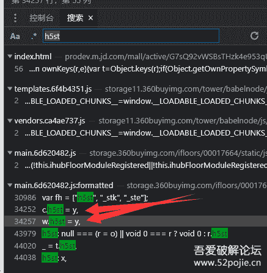
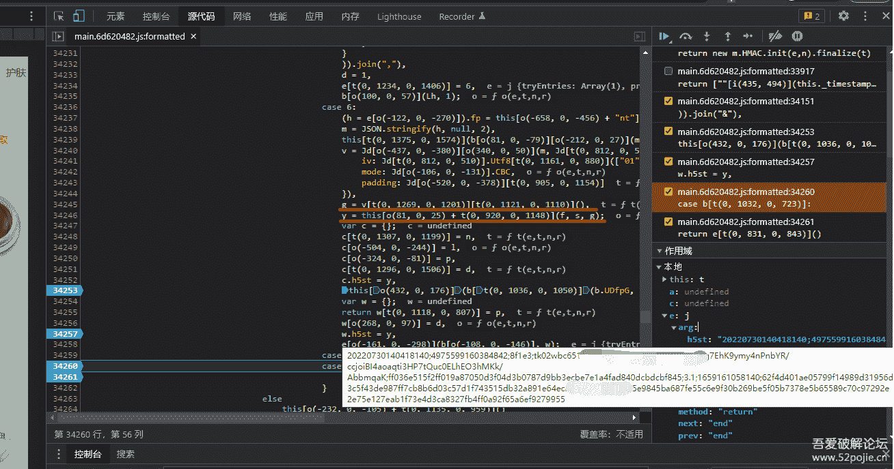
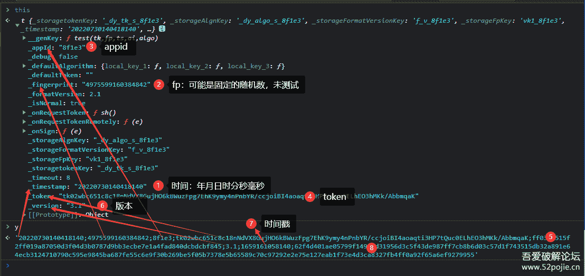
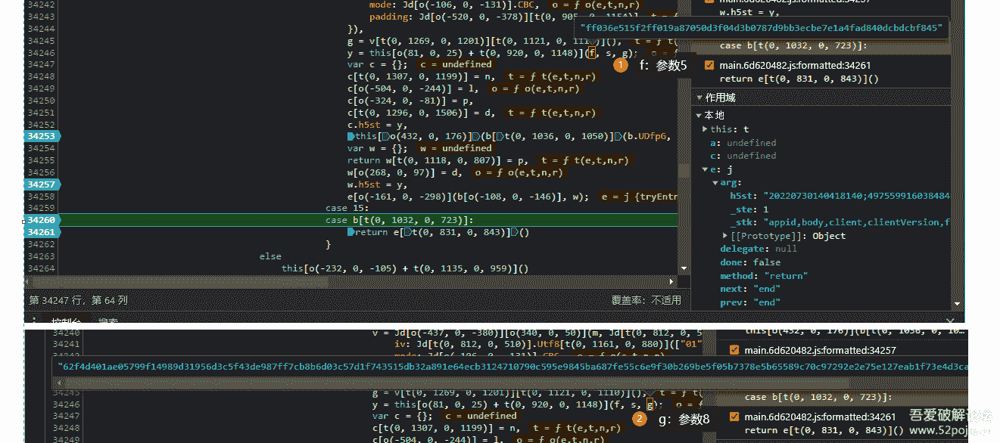
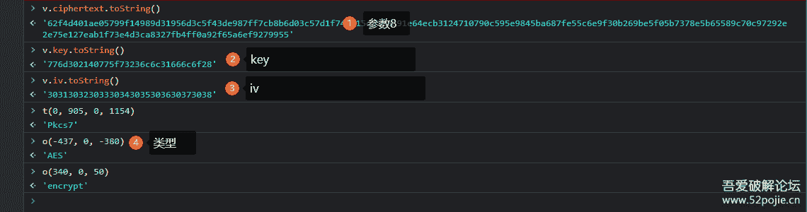

# [Web逆向] 京东试用h5st参数

- 原帖: https://www.52pojie.cn/forum.php?mod=viewthread&tid=1669042
- 抓取时间: 2026-11-01T23:12:10

## 网址

通过抓包找到jd试用的网址：aHR0cHM6Ly9wcm9kZXYubS5qZC5jb20vbWFsbC9hY3RpdmUvRzdzUTkydldTQnNUSHprNGU5NTNxVUdXUUo0L2luZGV4Lmh0bWw

## 开始操作

`F12`开发者模式，搜索 `h5st`，最后找到`main.6d****82.js`文件

1搜索h5st.png (49.5 KB, 下载次数: 7)

[href="forum.php?mod=attachment&aid=MjU0MTg0MHw4ODg0YWMzOHwxNzkzNTc0NzI3fDE2ODA4NnwxNjY5MDQy&nothumb=yes" target="_blank"](https://www.52pojie.cn/forum.php?mod=attachment&aid=MjU0MTg0MHw4ODg0YWMzOHwxNzkzNTc0NzI3fDE2ODA4NnwxNjY5MDQy&nothumb=yes)

2022-7-30 21:52 上传

分别给 `c.h5st = y` 和 `w.h5st = y` 附近多打几个断点，然后滑动页面加载下一页

2断点看到h5st.png (175.43 KB, 下载次数: 7)

[href="forum.php?mod=attachment&aid=MjU0MTg0MXwwYWYyNTdiNXwxNzkzNTc0NzI3fDE2ODA4NnwxNjY5MDQy&nothumb=yes" target="_blank"](https://www.52pojie.cn/forum.php?mod=attachment&aid=MjU0MTg0MXwwYWYyNTdiNXwxNzkzNTc0NzI3fDE2ODA4NnwxNjY5MDQy&nothumb=yes)

2022-7-30 21:52 上传

可以看出`y`就是`h5st`，而 `y = this[o(81, 0, 25) + t(0, 920, 0, 1148)](f, s, g)`；

挨个分析

`this`中包含了 `_appId` 和 `_fingerprint` 和 `_token`和`_timestamp`和`_version`等信息，都是`h5st`中用到的

[在电脑浏览器登录京东试用的时候，cookie中`sfstoken`就是`token`]

3this.png (101.33 KB, 下载次数: 4)

[href="forum.php?mod=attachment&aid=MjU0MTg0MnxmMzMyYTNkOXwxNzkzNTc0NzI3fDE2ODA4NnwxNjY5MDQy&nothumb=yes" target="_blank"](https://www.52pojie.cn/forum.php?mod=attachment&aid=MjU0MTg0MnxmMzMyYTNkOXwxNzkzNTc0NzI3fDE2ODA4NnwxNjY5MDQy&nothumb=yes)

2022-7-30 21:52 上传

8个参数，现在就剩下5和8了，再往上看，找到了调用参数(`f`, `s`, `g`)

`f`为第五个参数，`g`为第八个

4第5和8个参数.png (153.06 KB, 下载次数: 3)

[href="forum.php?mod=attachment&aid=MjU0MTg0M3w1ZDNhZjU2OXwxNzkzNTc0NzI3fDE2ODA4NnwxNjY5MDQy&nothumb=yes" target="_blank"](https://www.52pojie.cn/forum.php?mod=attachment&aid=MjU0MTg0M3w1ZDNhZjU2OXwxNzkzNTc0NzI3fDE2ODA4NnwxNjY5MDQy&nothumb=yes)

2022-7-30 21:52 上传

继续往上看， `g=v[t(0, 1269, 0, 1201)][t(0, 1121, 0, 1110)]()`

可以得出参数8的加密方式、`key`和`iv`等信息

5 找到参数8的key iv和加密方式.png (37.86 KB, 下载次数: 2)

[href="forum.php?mod=attachment&aid=MjU0MTg0NHwxNGYxNmM2Y3wxNzkzNTc0NzI3fDE2ODA4NnwxNjY5MDQy&nothumb=yes" target="_blank"](https://www.52pojie.cn/forum.php?mod=attachment&aid=MjU0MTg0NHwxNGYxNmM2Y3wxNzkzNTc0NzI3fDE2ODA4NnwxNjY5MDQy&nothumb=yes)

2022-7-30 21:52 上传

而`iv`和`key`又可由`hex`解码解出

`iv` |

`key` |

`0102030405060708`
