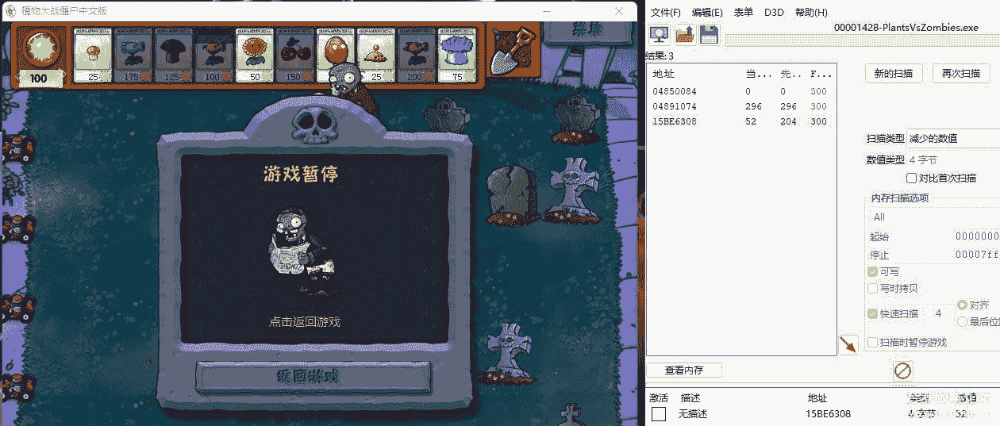
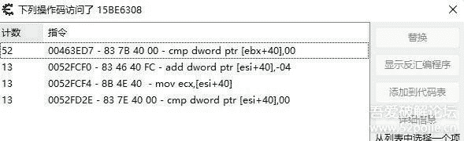
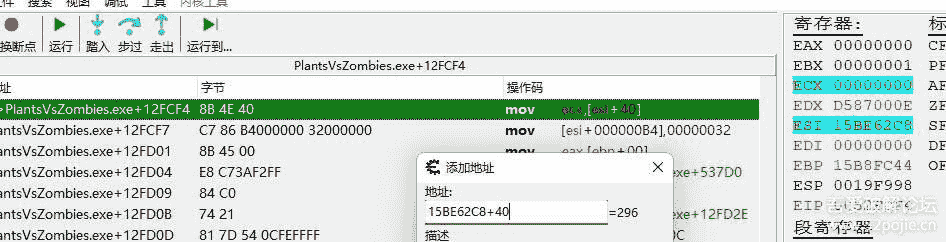
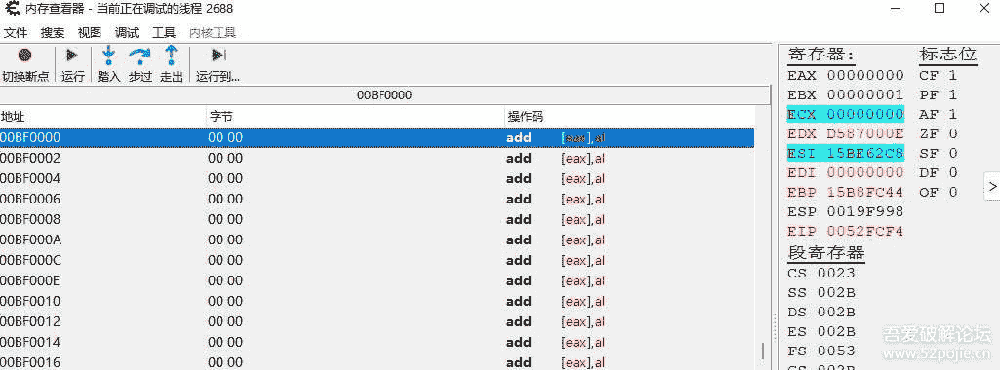
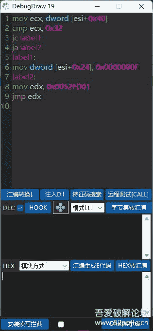
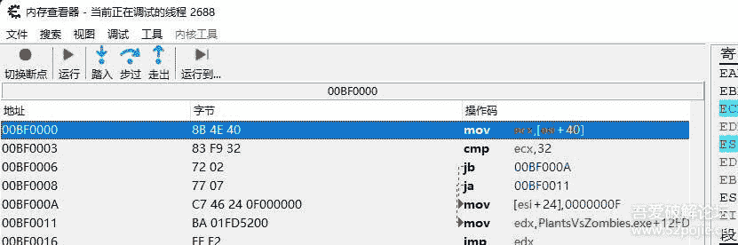
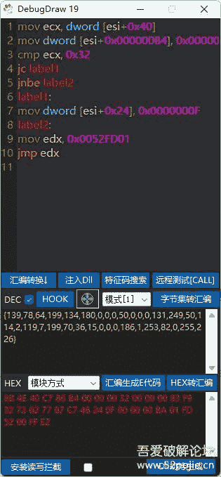
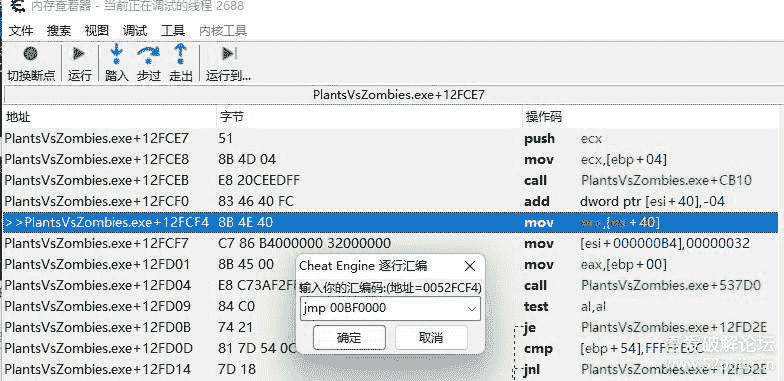
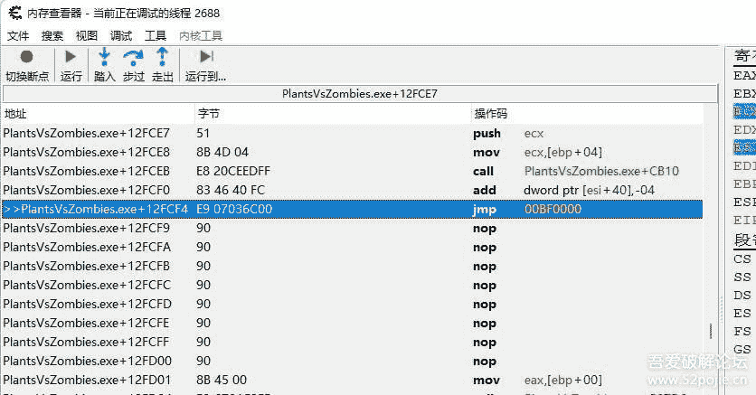

# [原创] 植物大战僵尸之这豌豆有毒啃着啃着就炸了

- 原帖: https://www.52pojie.cn/forum.php?mod=viewthread&tid=1671905
- 抓取时间: 2026-11-01T23:11:46

虽然是单机游戏很久以前的，很多都可以找出地址然后去修改内存，但是却缺乏去探索。我们可以利用这个内存区达到一些什么。而不是拿到地址以后去修改数值。比如我们现在的教程 不是找出来 去修改血量 达到血量很多。

搜先我们种植一个植物，我选择的是豌豆。搜索当前植物的血量，豌豆的我知道是300，不知道血量的。搜索为止初始值，来找出血量



xl.jpg (127.34 KB, 下载次数: 2)

[href="forum.php?mod=attachment&aid=MjU0MzYwMnw5YjBhOWY3ZHwxNzkzNTc0NzAzfDE2ODA4NnwxNjcxOTA1&nothumb=yes" target="_blank"](https://www.52pojie.cn/forum.php?mod=attachment&aid=MjU0MzYwMnw5YjBhOWY3ZHwxNzkzNTc0NzAzfDE2ODA4NnwxNjcxOTA1&nothumb=yes)

2022-8-6 12:30 上传

血量找出以后我们查看是谁访问了这个地址

```
00463ED7 - 83 7B 40 00 - cmp dword ptr [ebx+40],00
0052FCF0 - 83 46 40 FC - add dword ptr [esi+40],-04
0052FCF4 - 8B 4E 40  - mov ecx,[esi+40]
0052FD2E - 83 7E 40 00 - cmp dword ptr [esi+40],00
```



a.jpg (28.38 KB, 下载次数: 2)

[href="forum.php?mod=attachment&aid=MjU0MzYwM3wzNzNkYzRmMHwxNzkzNTc0NzAzfDE2ODA4NnwxNjcxOTA1&nothumb=yes" target="_blank"](https://www.52pojie.cn/forum.php?mod=attachment&aid=MjU0MzYwM3wzNzNkYzRmMHwxNzkzNTc0NzAzfDE2ODA4NnwxNjcxOTA1&nothumb=yes)

2022-8-6 12:32 上传

这儿注意的是，我们需要选被僵尸咬而触发的地址

```
0052FCF0 - 83 46 40 FC - add dword ptr [esi+40],-04
0052FCF4 - 8B 4E 40  - mov ecx,[esi+40]
0052FD2E - 83 7E 40 00 - cmp dword ptr [esi+40],00

---------------------------------

0052FCF4 - 8B 4E 40  - mov ecx,[esi+40] //我就选择这个地址来操作
```

通过下段 我们得出 `[esi+40]`=当前植物血量

`[esi+24]`=当前植物ID



aa.jpg (69.89 KB, 下载次数: 1)

[href="forum.php?mod=attachment&aid=MjU0MzYwNXwyNzQxZDg0ZHwxNzkzNTc0NzAzfDE2ODA4NnwxNjcxOTA1&nothumb=yes" target="_blank"](https://www.52pojie.cn/forum.php?mod=attachment&aid=MjU0MzYwNXwyNzQxZDg0ZHwxNzkzNTc0NzAzfDE2ODA4NnwxNjcxOTA1&nothumb=yes)

2022-8-6 12:36 上传

尽然这道我们就开始搞，老规矩申请一个内存



1.jpg (78.96 KB, 下载次数: 1)

[href="forum.php?mod=attachment&aid=MjU0MzYwOHxkOGIxOTZhZHwxNzkzNTc0NzAzfDE2ODA4NnwxNjcxOTA1&nothumb=yes" target="_blank"](https://www.52pojie.cn/forum.php?mod=attachment&aid=MjU0MzYwOHxkOGIxOTZhZHwxNzkzNTc0NzAzfDE2ODA4NnwxNjcxOTA1&nothumb=yes)

2022-8-6 12:42 上传

接着我们开始自己写代码，在上面我们说了 `[esi+40]` =血量 +24=ID 我们就从这儿入手



2.jpg (37.68 KB, 下载次数: 0)

[href="forum.php?mod=attachment&aid=MjU0MzYxMHxiMDYzMDgyOXwxNzkzNTc0NzAzfDE2ODA4NnwxNjcxOTA1&nothumb=yes" target="_blank"](https://www.52pojie.cn/forum.php?mod=attachment&aid=MjU0MzYxMHxiMDYzMDgyOXwxNzkzNTc0NzAzfDE2ODA4NnwxNjcxOTA1&nothumb=yes)

2022-8-6 12:44 上传

```
mov ecx, dword [esi+0x40]   把[esi+40] 传递给ecx  我们知道[esi+40]=血量
cmp ecx, 0x32  判断 ecx血量 是否50
jc label1   小于50 则跳到 label1
ja label2 大于50 则跳label2
label1:
mov dword [esi+0x24], 0x0000000F  //把F传递给[esi+24]  上面说到 [esi+24]=植物得ID   F=15  等于毁灭古ID
label2:
mov edx, 0x0052FD01  把52FD01传递给edx  52FD01=我们跳回的地址
jmp edx
```

我们把这段代码 写进申请的内存里    在CE的代码如下



3.jpg (51.19 KB, 下载次数: 2)

[href="forum.php?mod=attachment&aid=MjU0MzYxMnw4ZDFjMDAxYXwxNzkzNTc0NzAzfDE2ODA4NnwxNjcxOTA1&nothumb=yes" target="_blank"](https://www.52pojie.cn/forum.php?mod=attachment&aid=MjU0MzYxMnw4ZDFjMDAxYXwxNzkzNTc0NzAzfDE2ODA4NnwxNjcxOTA1&nothumb=yes)

2022-8-6 12:48 上传

抱歉 之前漏掉了一句代码 我们补码的代码也要写进去



5.jpg (51.38 KB, 下载次数: 1)

[href="forum.php?mod=attachment&aid=MjU0MzYxM3xiNThkMDJmZHwxNzkzNTc0NzAzfDE2ODA4NnwxNjcxOTA1&nothumb=yes" target="_blank"](https://www.52pojie.cn/forum.php?mod=attachment&aid=MjU0MzYxM3xiNThkMDJmZHwxNzkzNTc0NzAzfDE2ODA4NnwxNjcxOTA1&nothumb=yes)

2022-8-6 12:52 上传

我们在之前选中的地址  跳转到 `00BF0000`



6.jpg (91.86 KB, 下载次数: 2)

[href="forum.php?mod=attachment&aid=MjU0MzYxNXxmY2ZiY2M0MXwxNzkzNTc0NzAzfDE2ODA4NnwxNjcxOTA1&nothumb=yes" target="_blank"](https://www.52pojie.cn/forum.php?mod=attachment&aid=MjU0MzYxNXxmY2ZiY2M0MXwxNzkzNTc0NzAzfDE2ODA4NnwxNjcxOTA1&nothumb=yes)

2022-8-6 12:53 上传



7.jpg (85.08 KB, 下载次数: 1)

[href="forum.php?mod=attachment&aid=MjU0MzYxNnxmOTQzMTU2YXwxNzkzNTc0NzAzfDE2ODA4NnwxNjcxOTA1&nothumb=yes" target="_blank"](https://www.52pojie.cn/forum.php?mod=attachment&aid=MjU0MzYxNnxmOTQzMTU2YXwxNzkzNTc0NzAzfDE2ODA4NnwxNjcxOTA1&nothumb=yes)

2022-8-6 12:53 上传

可以看到 当我们的豌豆小于50  就炸了 


8.jpg (52.35 KB, 下载次数: 2)

[href="forum.php?mod=attachment&aid=MjU0MzYxN3xmNzkxNTEwMHwxNzkzNTc0NzAzfDE2ODA4NnwxNjcxOTA1&nothumb=yes" target="_blank"](https://www.52pojie.cn/forum.php?mod=attachment&aid=MjU0MzYxN3xmNzkxNTEwMHwxNzkzNTc0NzAzfDE2ODA4NnwxNjcxOTA1&nothumb=yes)

2022-8-6 12:55 上传

整个教程就到此结束了
