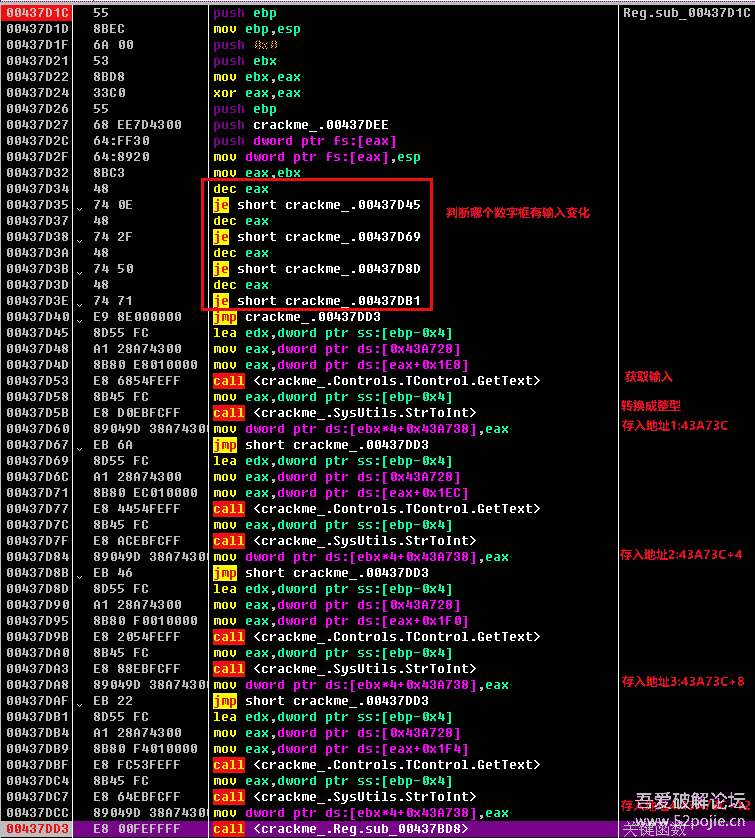
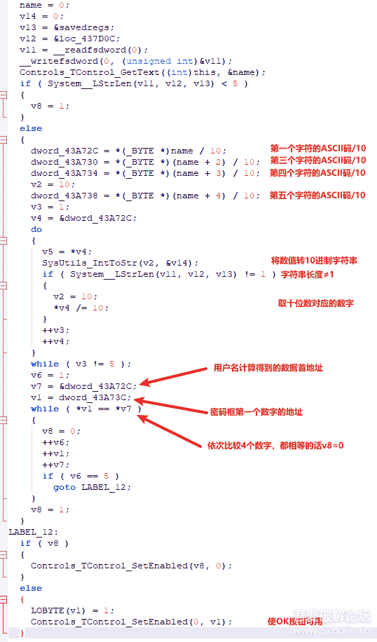
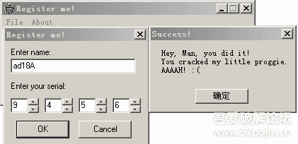

# [原创] 练习笔记之160Crackme-032

- 原帖: https://www.52pojie.cn/forum.php?mod=viewthread&tid=1672031
- 抓取时间: 2026-11-01T23:11:42

## 160CM-032

### 1. 算法分析

首先拖入PE看一下，有UPX的壳，先把壳拖了，由于是delphi程序，用IDR打开，可以很容易的确定程序结构，找到主事件函数`437D1C`，同时可以导出map文件，以便在OD或IDA中载入，便于分析代码。主事件函数中，先判断四个密码输入框哪个有变化，然后将其数字存入指定地址中，最后再调用`437BD8`函数进行校验。



`01.png` (65.26 KB, 下载次数: 1)

[href="forum.php?mod=attachment&aid=MjU0MzY4MnxiYzgzZWVlM3wxNzkzNTc0Njk5fDE2ODA4NnwxNjcyMDMx&nothumb=yes" target="_blank"](https://www.52pojie.cn/forum.php?mod=attachment&aid=MjU0MzY4MnxiYzgzZWVlM3wxNzkzNTc0Njk5fDE2ODA4NnwxNjcyMDMx&nothumb=yes)

2022-8-6 18:22 上传

`437BD8`函数的校验过程也不算复杂，但用IDA生成伪代码还是更方便一些。从伪代码来看，对输入的用户名，取其第1、3、4、5个字符，以字符的ASCII码值除以10，得到的数字（大于10取十位数的数字）与密码进行比较，全部一致则使OK按钮可用。



`02.png` (93 KB, 下载次数: 1)

[href="forum.php?mod=attachment&aid=MjU0MzY4M3w1MWYyMTJlOXwxNzkzNTc0Njk5fDE2ODA4NnwxNjcyMDMx&nothumb=yes" target="_blank"](https://www.52pojie.cn/forum.php?mod=attachment&aid=MjU0MzY4M3w1MWYyMTJlOXwxNzkzNTc0Njk5fDE2ODA4NnwxNjcyMDMx&nothumb=yes)

2022-8-6 18:22 上传

使用vs2015编写VC注册机程序如下：

```
#include "stdafx.h"
#include 
#include 
#include 

int _tmain(int argc, _TCHAR* argv[])
{
    char name[20];
    int code[4];
    char temp[10];
    int i;
    printf("请输入用户名（长度5~20）：");
    scanf_s("%s", name, 20);

    if (strlen(name) 
```

运行注册机程序，输入用户名ad18A，可得密码为9456，输入程序输入框，验证正确。



`03.png` (10.98 KB, 下载次数: 1)

[href="forum.php?mod=attachment&aid=MjU0MzY4NHxkM2MzNzU1ZnwxNzkzNTc0Njk5fDE2ODA4NnwxNjcyMDMx&nothumb=yes" target="_blank"](https://www.52pojie.cn/forum.php?mod=attachment&aid=MjU0MzY4NHxkM2MzNzU1ZnwxNzkzNTc0Njk5fDE2ODA4NnwxNjcyMDMx&nothumb=yes)

2022-8-6 18:22 上传

### 2. 总结

这道题也不算难，借助IDR、IDA、OD三个软件，分析起来还是比较顺利的。
