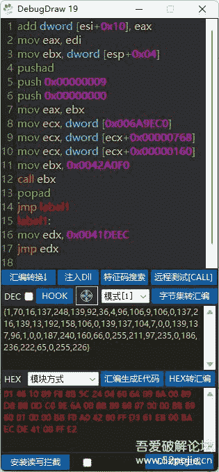
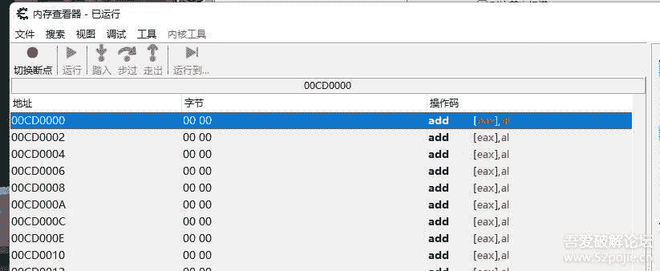
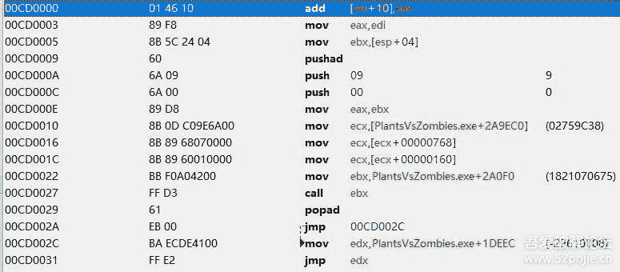

# [原创] 植物大战僵尸之种植植物调用僵尸 `CALL`

- 原帖：<https://www.52pojie.cn/forum.php?mod=viewthread&tid=1672538>
- 抓取时间：`2026-11-01T23:11:38`

## 定位当前植物数量

我们首先找出当前植物的个数，右键访问，查看是谁访问了这个地址。


`1.jpg`（126.74 KB，下载次数：0）

[附件下载](https://www.52pojie.cn/forum.php?mod=attachment&aid=MjU0MzkzNHxjNzY3ZDcxOHwxNzkzNTc0Njk1fDE2ODA4NnwxNjcyNTM4&nothumb=yes)

2022-8-8 10:07 上传

只有这一条地址，我们就选这一条地址。

```asm
add [esi+10],eax    ; 我们直接在这进行 HOOK
mov eax,edi
call PlantsVsZombies.exe+1B20
mov eax,edi
pop edi
pop ebx
ret
```

## 编写 HOOK 汇编

开始写汇编。



`5.jpg`（69.62 KB，下载次数：0）

[附件下载](https://www.52pojie.cn/forum.php?mod=attachment&aid=MjU0MzkzNnxiYTk5NzRhOXwxNzkzNTc0Njk1fDE2ODA4NnwxNjcyNTM4&nothumb=yes)

2022-8-8 10:12 上传

```asm
add dword [esi+0x10], eax

mov eax, edi
; 这两句是被 HOOK 的代码，我们申请内存以后还原上
mov ebx, dword [esp+0x04]
; [esp+4] = 植物的纵坐标；我们把纵坐标传递给 ebx
; 为什么要获取纵坐标呢？因为等会我们的调用僵尸 call 需要坐标
; 我们判断植物在哪个坐标，僵尸就在哪一个坐标出来

; 以下是僵尸 call 相关代码
pushad
push 0x00000009
push 0x00000000
mov eax, ebx
; 这儿把我们获取植物的纵坐标传递给 eax，僵尸需要出来的纵坐标
mov ecx, dword [0x006A9EC0]
mov ecx, dword [ecx+0x00000768]
mov ecx, dword [ecx+0x00000160]
mov ebx, 0x0042A0F0
call ebx
popad
jmp label1
label1:
mov edx, 0x0041DEEC
; 跳回 HOOK 的下一处执行代码
jmp edx
```

## 申请内存并写入汇编

现在我们申请一个内存。



`2.jpg`（51.29 KB，下载次数：0）

[附件下载](https://www.52pojie.cn/forum.php?mod=attachment&aid=MjU0MzkzNXw5ODY4YTQ4ZXwxNzkzNTc0Njk1fDE2ODA4NnwxNjcyNTM4&nothumb=yes)

2022-8-8 10:10 上传

写入我们的汇编，然后 HOOK 的地址跳到这个地址。



`6.jpg`（62.08 KB，下载次数：0）

[附件下载](https://www.52pojie.cn/forum.php?mod=attachment&aid=MjU0MzkzOXwwYzg5MmFmZXwxNzkzNTc0Njk1fDE2ODA4NnwxNjcyNTM4&nothumb=yes)

2022-8-8 10:20 上传

## 最终效果

最终的结果是，当你种植一个植物，会直接调用一个僵尸，会和植物在同一横坐标。

至此整个分析就完成了，我们要用一切能想到的方法去尝试修改。万一成功呢，对不对。

## 额外参考

额外之前分析的教程：

- [`thread-1672170-1-1.html`](https://www.52pojie.cn/thread-1672170-1-1.html)：当前这几篇的写法都在这个里面，写法一样我只写了其中一个。
- [`thread-1671905-1-1.html`](https://www.52pojie.cn/thread-1671905-1-1.html)
- [`thread-1671405-1-1.html`](https://www.52pojie.cn/thread-1671405-1-1.html)：以前写的源码都在这里面，功能还算全面。
