# [原创] 植物大战僵尸之子弹魅惑

- 原帖：[https://www.52pojie.cn/forum.php?mod=viewthread&tid=1672977](https://www.52pojie.cn/forum.php?mod=viewthread&tid=1672977)
- 抓取时间：2026-11-01T23:11:33

## 分析思路

我们的思维是-找到植物数-找当僵尸血量-判断植物数

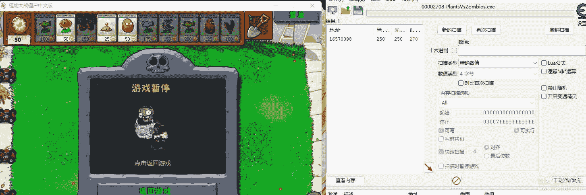
1.jpg（135.17 KB，下载次数：1）｜[附件下载](https://www.52pojie.cn/forum.php?mod=attachment&aid=MjU0NDE1NHw2MTExYjE1M3wxNzkzNTc0NjkxfDE2ODA4NnwxNjcyOTc3&nothumb=yes)｜2022-8-9 09:23 上传

## 定位关键代码

搜索出来以后我们右键访问是谁访问了该地址

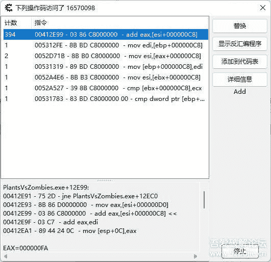
2.jpg（65.21 KB，下载次数：1）｜[附件下载](https://www.52pojie.cn/forum.php?mod=attachment&aid=MjU0NDE1NnxiMDBjNDgzMXwxNzkzNTc0NjkxfDE2ODA4NnwxNjcyOTc3&nothumb=yes)｜2022-8-9 09:24 上传

```asm
00412E99 - 03 86 C8000000  - add eax,[esi+000000C8]
005312FE - 8B BD C8000000  - mov edi,[ebp+000000C8]
0052D71B - 8B B0 C8000000  - mov esi,[eax+000000C8]
00531319 - 89 BD C8000000  - mov [ebp+000000C8],edi
0052A4E6 - 8B B3 C8000000  - mov esi,[ebx+000000C8]
0052A527 - 39 8B C8000000  - cmp [ebx+000000C8],ecx
00531783 - 83 BD C8000000 00 - cmp dword ptr [ebp+000000C8],00
```

第一条我们不考虑，因为一直在进行内存操作，我们选下面一条

```asm
005312FE - 8B BD C8000000  - mov edi,[ebp+000000C8]
```

反汇编查看：

```asm
je PlantsVsZombies.exe+1312FE

push 00

mov eax,ebp

call PlantsVsZombies.exe+130950

mov edi,[ebp+000000C8]

mov eax,ebp

mov [esp+14],edi

call PlantsVsZombies.exe+12D710
```

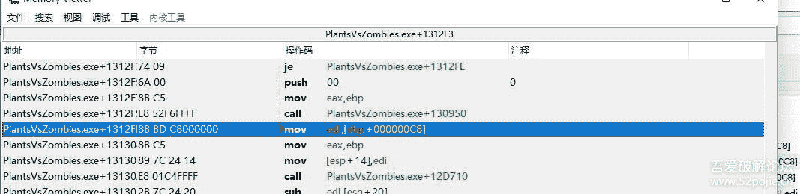
3.jpg（65.37 KB，下载次数：1）｜[附件下载](https://www.52pojie.cn/forum.php?mod=attachment&aid=MjU0NDE1OXxjOTA1ZTBiOXwxNzkzNTc0NjkxfDE2ODA4NnwxNjcyOTc3&nothumb=yes)｜2022-8-9 09:28 上传

这儿是把当前僵尸的血量传递给`edi`

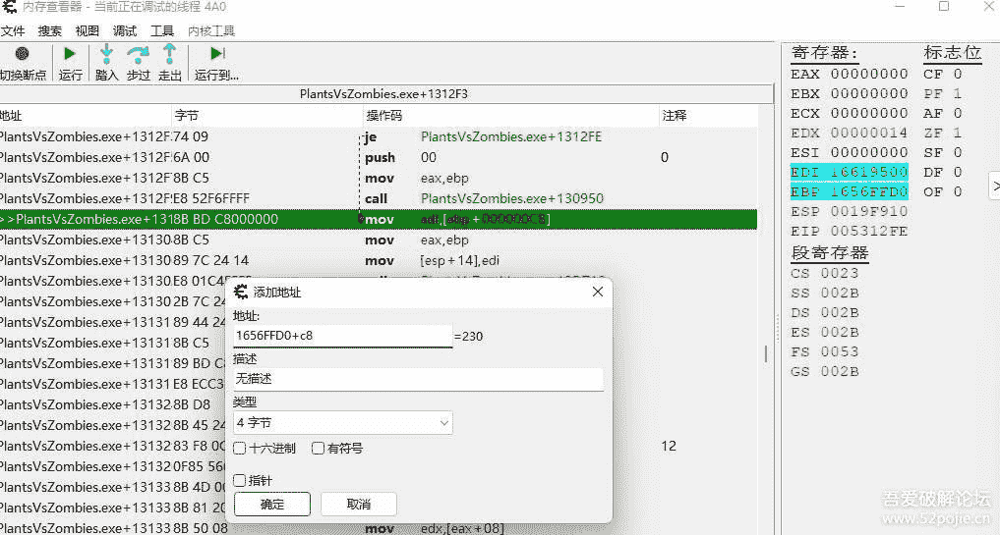
4.jpg（131.19 KB，下载次数：1）｜[附件下载](https://www.52pojie.cn/forum.php?mod=attachment&aid=MjU0NDE2MHxmNmY4NDFjN3wxNzkzNTc0NjkxfDE2ODA4NnwxNjcyOTc3&nothumb=yes)｜2022-8-9 09:30 上传

## 申请内存

老方法，申请一个内存

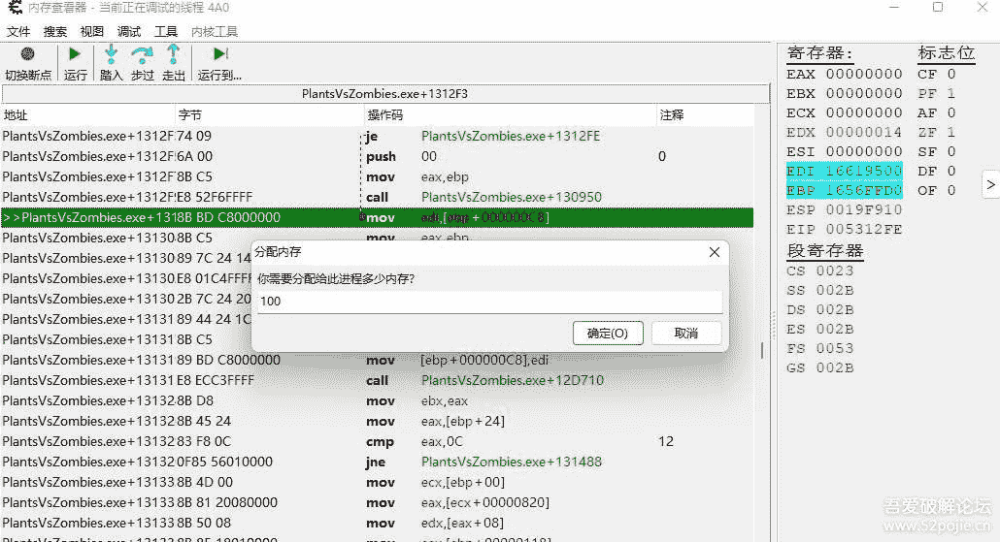
5.jpg（146 KB，下载次数：1）｜[附件下载](https://www.52pojie.cn/forum.php?mod=attachment&aid=MjU0NDE2MXw1NjdmMDI1OXwxNzkzNTc0NjkxfDE2ODA4NnwxNjcyOTc3&nothumb=yes)｜2022-8-9 09:32 上传

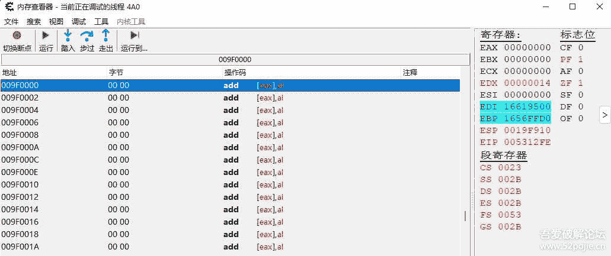
6.jpg（87.6 KB，下载次数：1）｜[附件下载](https://www.52pojie.cn/forum.php?mod=attachment&aid=MjU0NDE2MnwwZDUxYjNkMHwxNzkzNTc0NjkxfDE2ODA4NnwxNjcyOTc3&nothumb=yes)｜2022-8-9 09:33 上传

## 编写汇编

现在我们就要写汇编了，首先跳到我们申请的内存

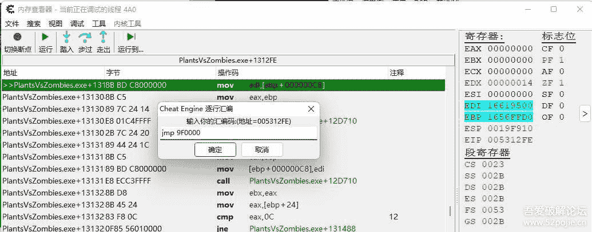
7.jpg（115.07 KB，下载次数：1）｜[附件下载](https://www.52pojie.cn/forum.php?mod=attachment&aid=MjU0NDE2NXw4NTBlMzVhOXwxNzkzNTc0NjkxfDE2ODA4NnwxNjcyOTc3&nothumb=yes)｜2022-8-9 09:36 上传

汇编大概如下：

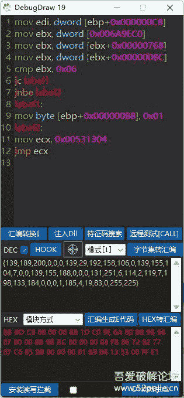
8.jpg（60.87 KB，下载次数：1）｜[附件下载](https://www.52pojie.cn/forum.php?mod=attachment&aid=MjU0NDE3MnxkZjM2ZTQ0ZnwxNzkzNTc0NjkxfDE2ODA4NnwxNjcyOTc3&nothumb=yes)｜2022-8-9 09:47 上传

```asm
mov edi, dword [ebp+0x000000C8] //还原HOOK的代码
//以下是取植物的数量
mov ebx, dword [0x006A9EC0]  把基址传递给 ebx
mov ebx, dword [ebx+0x00000768] //在把基址+768传递给ebx
mov ebx, dword [ebx+0x000000BC] //最后把 基址+768+bc传递给ebx 至此整取就完成了
cmp ebx, 0x06 判断 ebx
jc label1    小于 则跳到label1
jnbe label2  大于则 跳到label2   
//上面的理解是  当植物小于6的时候执行我们的写入的汇编代码，否则就跳回原代码去执行
label1:
mov byte [ebp+0x000000B8], 0x01   // ebp+b8 是僵尸是否被魅惑，可以看作是一个逻辑判断 0=假  1=真
label2:
mov ecx, 0x00531304
jmp ecx
```

## 写入与测试

现在写入到我们申请的内存里面

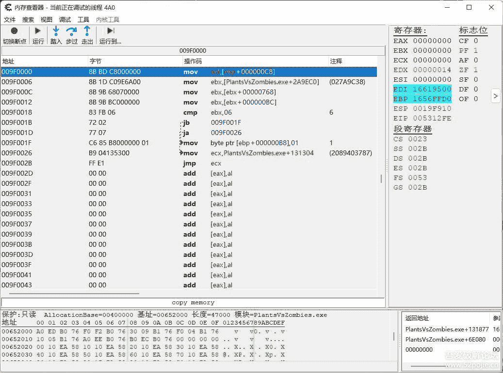
9.jpg（175.72 KB，下载次数：1）｜[附件下载](https://www.52pojie.cn/forum.php?mod=attachment&aid=MjU0NDE3M3wwNWQ5ZmQwNXwxNzkzNTc0NjkxfDE2ODA4NnwxNjcyOTc3&nothumb=yes)｜2022-8-9 09:48 上传

进游戏看效果

植物小于6 那么触发我们的代码 目前子弹没击中僵尸的状态

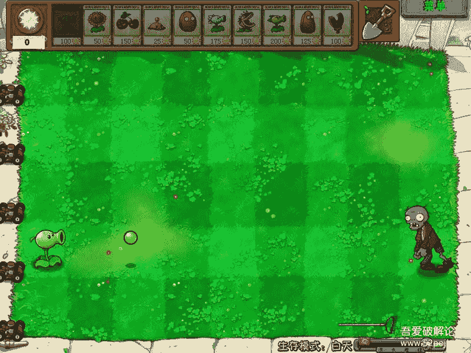
10.jpg（117.03 KB，下载次数：1）｜[附件下载](https://www.52pojie.cn/forum.php?mod=attachment&aid=MjU0NDE3NHxhZjRmNjRmMnwxNzkzNTc0NjkxfDE2ODA4NnwxNjcyOTc3&nothumb=yes)｜2022-8-9 09:49 上传

只要是僵尸受到伤害以后

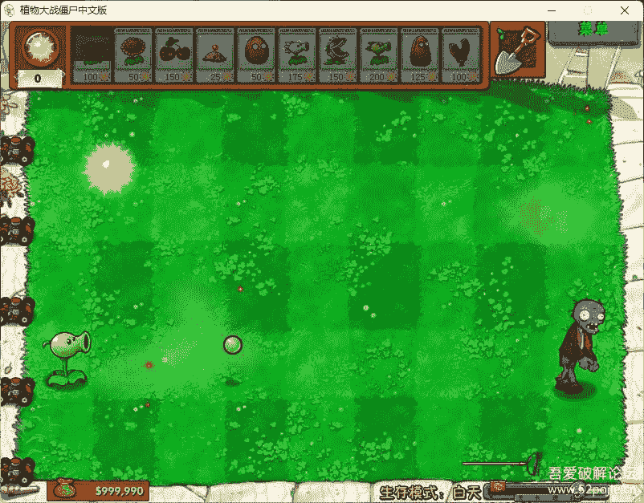
11.jpg（126.28 KB，下载次数：1）｜[附件下载](https://www.52pojie.cn/forum.php?mod=attachment&aid=MjU0NDE3NXw5MDBmMjc3MXwxNzkzNTc0NjkxfDE2ODA4NnwxNjcyOTc3&nothumb=yes)｜2022-8-9 09:50 上传

为了不是很变态，我们才增加植物数量的判断，大于6 我们就恢复原代码去执行了。目前这个是普通僵尸的地址，需要别的大家可以去练练手 方式方法一样

## 往期帖子

- [https://www.52pojie.cn/thread-1672538-1-1.html](https://www.52pojie.cn/thread-1672538-1-1.html)
- [https://www.52pojie.cn/thread-1672170-1-1.html](https://www.52pojie.cn/thread-1672170-1-1.html)
- [https://www.52pojie.cn/thread-1671905-1-1.html](https://www.52pojie.cn/thread-1671905-1-1.html)
- [https://www.52pojie.cn/thread-1671405-1-1.html](https://www.52pojie.cn/thread-1671405-1-1.html)
