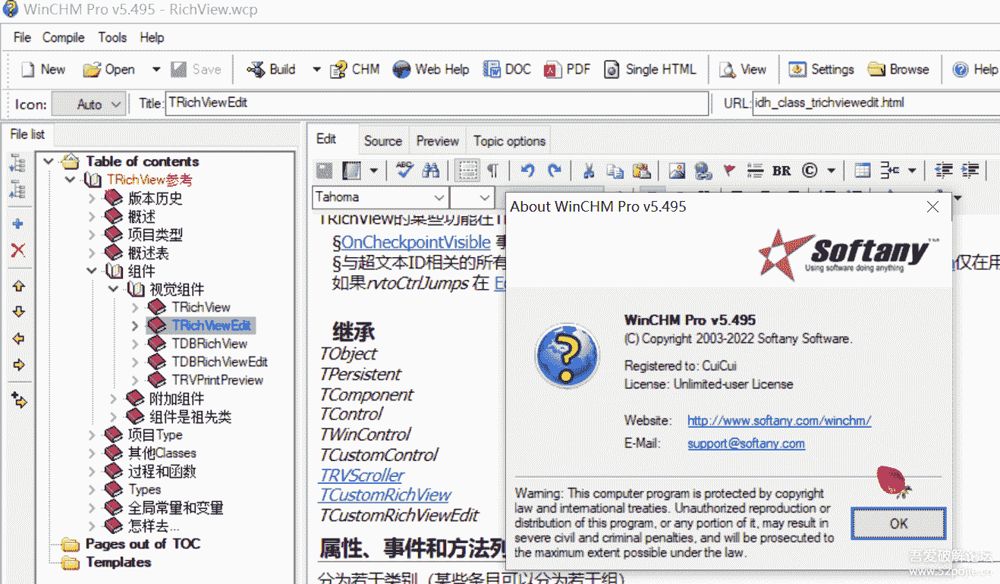
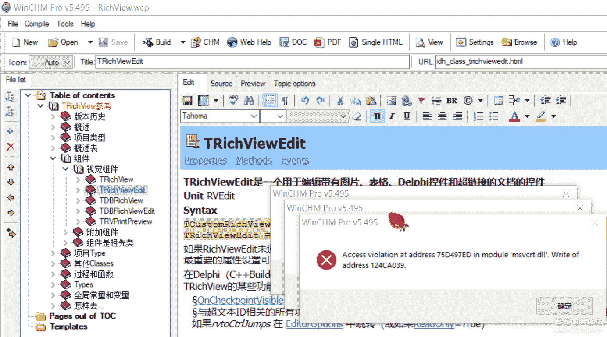
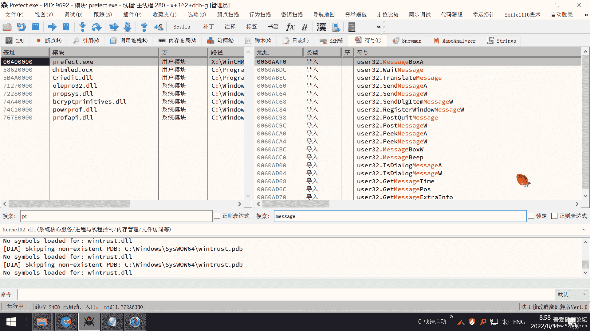
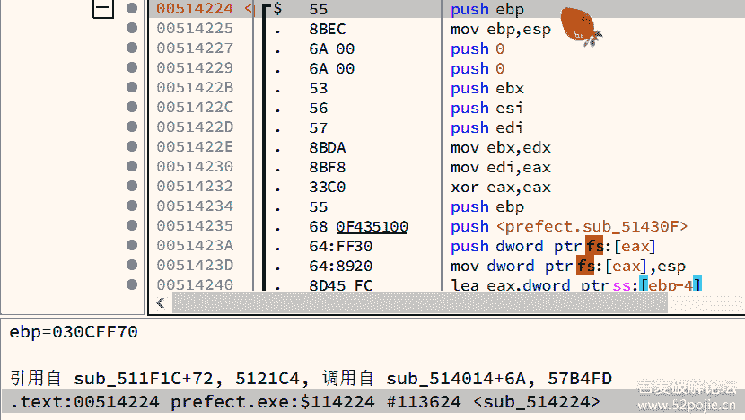
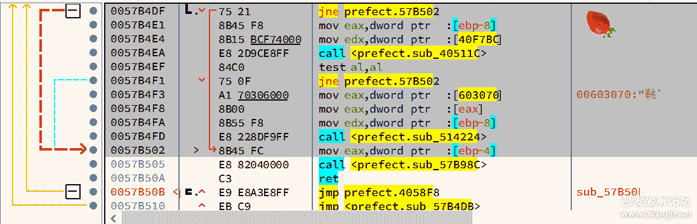
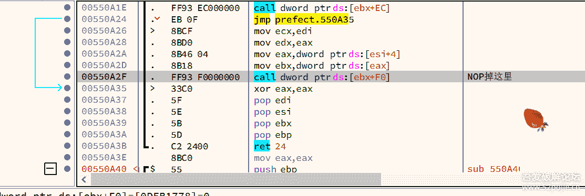

# [原创] WinCHM 4.495除虫记

- 原帖：<https://www.52pojie.cn/forum.php?mod=viewthread&tid=1673870>
- 抓取时间：2026-11-01T23:11:18

`image.png` (404.86 KB, 下载次数: 2)

[附件下载](https://www.52pojie.cn/forum.php?mod=attachment&aid=MjU0NDcwOXwyM2NkOTYxN3wxNzkzNTc0Njc1fDE2ODA4NnwxNjczODcw&nothumb=yes)

2022-8-11 08:50 上传

## 背景

由于要汉化 CHM 文件，最近几年用 CHM Editor，不过经那货汉化修改后的 chm 文件就不会被 ExtraCHM 打开了（打不开就不能使用高级索引和全文检索功能）。

又换了几个 CHM，包括 EasyCHM、SuperCHM，最后还是用这个吧，网上一找竟然天国境内没有最新爆破版，于是就只能自己开刀了。

简单爆破几处，完美爆破，今天咱们说的不是这些。

## 弹框现象

转天在使用过程中，发现会：

`image.png` (354.44 KB, 下载次数: 2)

[附件下载](https://www.52pojie.cn/forum.php?mod=attachment&aid=MjU0NDcxMHxhMzU1ZTVlNXwxNzkzNTc0Njc1fDE2ODA4NnwxNjczODcw&nothumb=yes)

2022-8-11 08:56 上传

弹出这种框框，就算是原版也不例外。

出现这种先不要结束进程，马上附加进来：

`image.png` (301.17 KB, 下载次数: 1)

[附件下载](https://www.52pojie.cn/forum.php?mod=attachment&aid=MjU0NDcxNXxmYjE3OGU1ZHwxNzkzNTc0Njc1fDE2ODA4NnwxNjczODcw&nothumb=yes)

2022-8-11 08:59 上传

## 下断点与堆栈分析

来到模块窗口 `Message` 之类的：

- `user32.SendMessageA`
- `user32.SendMessageW`
- `user32.MessageBoxA`
- `user32.MessageBoxW`
- `user32.IsDialogMessageA`
- `user32.IsDialogMessageW`

这些统统下上断点。

或 `F12` 暂停后，马中查看堆栈。

注意调用顺序，用注释标好编号，记好笔记。

先后会来到几个位置：

`image.png` (72.33 KB, 下载次数: 2)

[附件下载](https://www.52pojie.cn/forum.php?mod=attachment&aid=MjU0NDcxNnw5M2RkZTY4Y3wxNzkzNTc0Njc1fDE2ODA4NnwxNjczODcw&nothumb=yes)

2022-8-11 09:03 上传

## 尝试跳过

尝试 `RET` 掉，或：

`image.png` (77.01 KB, 下载次数: 2)

[附件下载](https://www.52pojie.cn/forum.php?mod=attachment&aid=MjU0NDcxN3w4MjE5NDA5ZXwxNzkzNTc0Njc1fDE2ODA4NnwxNjczODcw&nothumb=yes)

2022-8-11 09:04 上传

`JMP` 掉，就会发现弹框不见了，但发现滚动条滚动时就会非常卡顿。

`image.png` (69.4 KB, 下载次数: 1)

[附件下载](https://www.52pojie.cn/forum.php?mod=attachment&aid=MjU0NDcxOHwxZmNkMTQyNnwxNzkzNTc0Njc1fDE2ODA4NnwxNjczODcw&nothumb=yes)

2022-8-11 09:05 上传

## 定位并修复

最后通过前后文（对话框里有个 dll 的文件名）和堆栈调用的位置（主程序名第 1 次出现 + 外加触发 bug 弹框第一次的地址被调用）等因素综合看，就是这里第一次调用了，我们 `NOP` 掉，这个 bug 就解决了。
