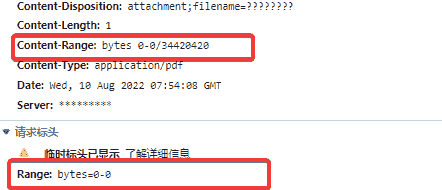
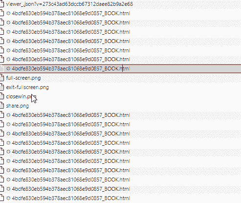

# [Web逆向] 在线阅读文档解密

- 原帖: https://www.52pojie.cn/forum.php?mod=viewthread&tid=1674294
- 抓取时间: 2026-11-01T23:11:14

## 在线阅读文档解密

## 前言

承接上篇 https://www.52pojie.cn/thread-1634927-1-1.html ，这次讲讲一些常见在线阅读文档解密。

## 正文

图片全挂了有需要下载 https://nicaicai.lanzouv.com/i2n3E0fw3ovg

### pdf文件头

```
%PDF-1.
base64:JVBERi0x
hex:25 50 44 46 2D 31  
bytes:{37,80,68,70,45,49}
```
这个很重要，至少要记住前两行，方便快速识别文件

#### 一、pdf格式

##### 第一种，Range



请求头中有个明显的参数 `Range: bytes=0-0` ，看网页中不断请求同一个地址



每次请求的 `Range:` 范围都不一样，说明就是分段请求的，通常只需要把请求头中 `bytes=0-?` ，改成 `bytes=0-` ，就可以得到整个 `pdf` ，最简单的办法就是用 `fiddler` 抓包，重发


这种应该是最简单的了，但可能会有坑，我碰到过一个，如果直接按 `bytes=0-` ，会保错，后来发现，直接翻到最后一页，请求头中的范围，比响应头返回的要小十个字节左右，所以还是要根据实际情况仔细甄别。

##### 第二种，base64


很明显就是 `base64` 编码了，网页解码后很多时候再生成一个 `blob` ， `pdf` 。
这个只需要解下码在写入文件就行，或者有 `blob` 直接下载就行。
这种也有坑的，有可能 `pdf` 会有密码，也有可能在生成 `blob` 时加上了密码。

##### 第三种，AES或其他

aHR0cDovL3d3dy5qdHlzYnouY246ODAwOS9wZGYvdmlld2VyLzA5NDY0MjcyNWJmOWE=


最大特征就是啥也看不懂，只有分析 `js` 。
以这个网站为例简单分析一下，先下一个 `XHR` 断点（也可以根据堆栈分析），

F5刷新，看堆栈，看看附近的代码

发现一个可疑的的地方，查看函数调用，直接搜索，或者下断点刷新，再看堆栈

没什么好说的了，人家注释都标上了，就是一个 `AES`


##### 第四种，请求头加密

浏览器返回的数据，并没有加密，但无论是直接打开还是用 `curl` - `py` ,都不行，说明请求地址很可能是一次性的

先验证下，右键阻止请求域，翻一页。链接生成了，并没有发送出去，用 `py` 跑两次。

可以看到第一次请求成功，第二次失败了，说明就是一次性的

而且这个 `pdf` 是分页的，不可能手动下载，看下参数，同一本书，四个不一样，页数，时间戳，签名，还有个应该是随机生成的，直接用 `uuid.uuid4()` 就行了，

直接搜索关键词 `nonce` ，下个断点刷新，看堆栈，找到加密的位置。

可以看到这个 `UUID` ，就是 `uuid4` , `py` 里面直接

```
import uuid

uuid=uuid.uuid4()
```
然后是这个 `sign` , 先控制台运行几遍，同时查看各参数值

发现每次，签名结果都一样，而且都是32位，很大可能就是 `MD5` ，随便找个网站验证下，

没问题就是 `md5` ，就懒得继续分析，用 `Python` 还原跑一下

很好没问题，贴上代码

```
import hashlib
import time
import uuid
from urllib.parse import parse_qs, urlparse
import requests
bookruid=''
cookies = {}
headers = {}
stime = str(round(time.time()))
nonce = str(uuid.uuid4())
sign = hashlib.md5((str('123456') + nonce + stime).encode()).hexdigest().upper()
params = {
    'pinst': 'null',
    'nonce': nonce,
    'stime': stime,
    'sign': sign,
    'typecode': 'ebook',
}
data = requests.get(f'https://www.**.com/api/books/{bookruid}/pdf', params=params, cookies=cookies, headers=headers).json()
print(data['title'])
catalogs=data['catalog']
for catalog in catalogs:
    print(catalog['title'], '\t',catalog['page'])
print(data['filePath'])
o = parse_qs(urlparse(data['filePath']).query)
filePath=o['filePath'][0]
pages=data['totalPage']
for page in range(0,pages):
    stime = str(round(time.time()))
    nonce = str(uuid.uuid4())
    sign = hashlib.md5((str('123456') + nonce + stime).encode()).hexdigest().upper()
    params = {
        'pinst': 'null',
        'nonce': nonce,
        'stime': stime,
        'sign': sign,
        'typecode': 'ebook',
    }
    params = [
        ('filePath',filePath
         ),
        ('readtype', 'pdf'),
        ('pageno', page),
        ('bookruid', bookruid),
        ('readtype', 'pdf'),
        ('nonce', nonce),
        ('stime', stime),
        ('sign', sign),
    ]

    response = requests.get('https://mirrorxz.**.com/ebookapissocore/api/OnlineEBook', params=params,
                            headers=headers)
    print("page:",page,response)
```

##### 第五种，啥也看不懂

`pdf` 是加密的，加密解密在 `wasm` 里面

解密位置在这, `wasm` ，里面的 `_decodeData` 方法

```
decodeData(data) {
    var ptr = this._module._malloc(data.length);
    this._module.HEAPU8.set(data, ptr);
    this._module._decodeData(ptr, data.length);
    var output_array = new Uint8Array(this._module.HEAPU8.subarray(ptr, ptr + data.length));
    this._module._free(ptr);
    return output_array;
}
```
通常到这里了，要么分析 `wasm` ，还原算法，要么把 `wasm` 扣下来，但对于这个网站完全没必要，注意到， `pdf` 是整个文件，那就根本没必要了，直接就 `hook` 整个 `pdf` 数据，在下载下来，省去复杂的解密过程

但这种仅限于，单个 `pdf` ，不然文件太多了，比较麻烦

##### 其他

https://www.52pojie.cn/thread-1672614-1-1.html

##### 随心所欲验证码型


##### 字体加密型


##### 他来他也不行


最后这个相对比较麻烦，代码混淆了，而且不是一个两个代码混淆，还要封 `ip` ，封账号，解密还算比较容易，本地生成公私钥，返回后端公钥，后端再返回加密的 `key` ，前端再利用私钥解密，然后 `AES/ECB` 解密 `pdf` 。
基本 `web` 端纯 `pdf` 解密就这些了，大不了就是加密解密，混淆不太一样。

#### 二、png格式

##### 第一种，idm批量下载


除了 `page` 其他参数完全一样，直接用 `idm` 下载就行了

唯一要注意的就是通配符
比如有些编号是 000 0001 0111  111，这种就需要设置通配符长度4
还有些对请求头有要求这种就可以考虑，用 https://www.52pojie.cn/home.php?mod=space&uid=293382 的下载器，或者自己写程序都比较简单
还有的是编号是十六进制

##### 第二种，综合类

aHR0cHM6Ly9tcC56aGl6aHVtYS5jb20vYm9vay9zYW1wbGUyLmh0bT9jb2RlPTQ1MWEwZTYyYjEyJnNoYXJlXz0xNTUyMzc3MTk=

和 上面 `pdf` , 请求头加密同样的直接打开图片链接不行，阻止请求域， `py` 跑两遍先，这就很离谱了啊，两次都不行

搜索关键字 `auth_key` ，定位相关代码

```
{
    t = "key1=" + r.key;
    r = "key2=023" + Tools.getCookie(Tools.genCookieName(r.env));
    var A = (new URL(d)).pathname
      , v = Math.random()
      , K = Date.parse(new Date) / 1E3 - parseInt(differenceDate) + 15;
    A = CryptoJS.MD5(A + "-" + K + "-" + v + "-0-69731cbade6a64b58d60").toString();
    t = urlAddParam(d, "auth_key=" + K + "-" + v + "-0-" + A + "&" + t + "&" + r);
    e(t)
}
```
离谱的事情就来了

稍微停了一下，几秒不到，链接就访问不了，这失效也太快了。
先分析一下，图片链接的参数
`key1` 是 https://mp.zhizhuma.com/ebookSampleService/sia.do 返回的，这个接口也有很多参数一会分析
`key2` ，是 `cookie` 里面的 `logkey` ，貌似是随机生成的，
然后就是这个 `auth_key` ，比较麻烦
简单还原了一下

```
t = "key1=" + sia.json()['data']['key']

r = "key2=023" + _logkey_

A = urlparse(imageUrl).path

K = str(int(time.time()) + 18)

v = str(random.random())

A = hashlib.md5((A + "-" + K + "-" + v + "-0-69731cbade6a64b58d60").encode()).hexdigest()

t = imageUrl + '?' + ("auth_key=" + K + "-" + v + "-0-" + A + "&" + t + "&" + r)
```
跑一下，没问题


然后就是`key1`这个[`https://mp.zhizhuma.com/ebookSampleService/sia.do`](https://mp.zhizhuma.com/ebookSampleService/sia.do)参数，具体方法在这里

```js
d = d || {};
d._timestamp = Date.parse(new Date) / 1E3;
d._nonce = requestUuidV4();
var e = window.ytLoggerData || {};
e.pageUrl && e.pageUrl.newUrl && (d.refer = e.pageUrl.newUrl);
var n = window.YTLogger;
n && n.deviceId && n.traceId && (e = n.deviceId(),
n = n.traceId(),
e && (d._deviceid = e),
n && (d._traceId = n));
e = "";
n = Object.keys(d).sort();
for (var t = 0; t 
```

要注意`requestUuidV4()`，并不能直接用`py`里面的`uuid4`，要稍微改一下

```js
function requestUuidV4() {
    return "xxxxxxxxxxxx4xxxyxxxxxxxxxxxxxxx".replace(/[xy]/g, function(d) {
        var e = 16 * Math.random() | 0;
        return ("x" == d ? e : e & 3 | 8).toString(16)
    })
}
```

```python
def get_uuid():
    return str(uuid.uuid4()).replace("-",'')
```

还有`_sign`，取了大写`MD5`还要取前20位

```python
_sign=hashlib.md5((_deviceid+'_deviceid'+_nonce+'_nonce'+ts+'_timestamp'+_traceId+'_traceId'+imageUrl+'imageUrl').encode('UTF-8')).hexdigest()[0:20].upper()
```

然后就是图片地址，找了半天都没找到，说明很可能是加密的，注意到有个[`https://biz.zhizhuma.com/ebookpageservices/queryPurchaseAllPageByEbookId/v2.do`](https://biz.zhizhuma.com/ebookpageservices/queryPurchaseAllPageByEbookId/v2.do)返回的数据

```text
encrypted: true
encryptedData: "aSJcuVHA2HEFmUiq5SApZDxNRcMMQofnCufp3uU69XXP4Mk3Z
success: true
```

直接搜索`encryptedData`，下个断点刷新


就是我们需要的数据，看下代码就是一个`ECB`

```python
response = requests.post(url,
                         cookies=cookies, headers=headers, data=data)

data=response.json()['encryptedData']

cryptor = AES.new(key='Suj4XDDt3jPsH9Jj'.encode(), mode=AES.MODE_ECB,)

de = json.loads(unpad(cryptor.decrypt(base64.b64decode(data)), AES.block_size))
```

批量跑一下


很好没问题，原本到这里应该结束了，结果。


就搞人心态，继续分析图片的解密，翻到加密那页之前下个`xhr`，根据堆栈可以发现，在这里


在跟进去，很明显了，就是解密的位置，一开始判断是否加密，加密就解密

```js
ImgBytes = {
    render: function(d, e, n) {
        if (!isEmpty(imgBytes) && 1 == d) {
            var t = new XMLHttpRequest;
            t.open("GET", n, !0);
            t.responseType = "arraybuffer";
            t.onload = function(r) {
                r = t.response;
                for (var A = new Uint8Array(r), v = new Uint8Array(r.byteLength), K = Math.floor(.45 * r.byteLength), B = Math.floor(.55 * r.byteLength), E = 0; E = K && E 
```

主要的解密部分就是那个`for`循环，多了个参数`imgBytes`，再根据堆栈回推，就是一开始`ECB`解密后里面的`canvas_info`

```js
             imgBytes = t.canvas ? $.parseJSON(t.canvas).canvas_info : "";

for (var A = new Uint8Array(r), v = new Uint8Array(r.byteLength), K = Math.floor(.45 * r.byteLength), B = Math.floor(.55 * r.byteLength), E = 0; E = K && E 
```

用`Python`还原一下

```python
def jiemi(pageNo, down_url, canvas):
 imgBytes = canvas
    z = requests.get(url=down_url, stream=True).content
    K = math.floor(.45 * len(z))
    A = math.floor(.55 * len(z))
    v = [0] * len(z)
    for G in range(len(z)):
        if G >= K and G 
```

很好解密没有问题


总结一下

先根据[`https://biz.zhizhuma.com/ebookpageservices/queryPurchaseAllPageByEbookId/v2.do`](https://biz.zhizhuma.com/ebookpageservices/queryPurchaseAllPageByEbookId/v2.do)，拿到加密的数据

再`ECB`解密数据拿到`url`，`canvas_info`，`encrypt`

再[`https://mp.zhizhuma.com/ebookSampleService/sit.do`](https://mp.zhizhuma.com/ebookSampleService/sit.do)拿一个`key1`

然后生成图片地址，返回数据

如果是加密的再进行解密，保存

总的来说，并不难，主要是动态调试，那个地址失效太快了

最后提示一点，注意到图片地址，开头`sample img tmp`，说明很可能是临时缓存，可以直接改`host`拿到永久的地址，就用不到分析图片地址加密参数，这种就类似于某可知对外售卖的平台


## 其他

### 不知道取啥名

这个和综合类的解密部分基本差不多，扣`js`就行，看起来镜像翻转，再还原右边


### 分块


这种通常需要找到，拼接顺序，各个图片位置，这种只分了几块的，直接看都看的出来了，但对于很多漫画类以及藏品动不动就几百就需要分析`js`。

除此之外，对于上图这种阅读器，某个公司的，可以直接打印整张`png`，也可以直接拿到源`pdf`，目前遇到几个网站都可以。

## 三、`epub`格式

### 第一种，混淆+`AES`

一来就是个`debugger`，下面还是`jsjiami`，原本打算还原的，结果发现下面很明显就是一个`cbc`，解密，先跑一下


就是我们需要的东西，懒得还原了，论坛有很多


### 第二种，`RSA`、`DES`、`AES`

某才`app`

随便打开一本书，注意链接，人家都提示了，`mobileAes`，没什么好说的，先`hook`一下


就是先`DES`解密，得到`key`，再`AES`解密，`epub`内容


然后就是`getkey`，里面参数加密的


直接常用加密`hook`不到，用`jadx`查看


很容易找到这，就是个`RSA`，但不知道为啥直接`hook`不到

跟进去，很明显了，`RSA`和`des`都在这里，继续跟一下

```java
public static String requestByRSA(Context context, String str, JSONObject jSONObject) {
    if (!checkNet(context)) {
        return null;
    }
    HttpPost httpPost = new HttpPost(ToolsUtil.setshuProxy(str));
    try {
        httpPost.setEntity(new StringEntity(RSAResquest.rsaEncode(jSONObject), "UTF-8"));
        HttpResponse request = request(context, httpPost);
        if (request == null) {
            return "";
        }
        if (request.getStatusLine().getStatusCode() == 200) {
            return new String(RSAResquest.desDecrypt(EntityUtils.toString(request.getEntity(), "UTF-8").replace("\n", "").replace("\r", "").getBytes()), Charset.forName("UTF-8")).replace("\n", "").replace("\r", "");
        }
        return null;
    } catch (Exception e) {
        e.printStackTrace();
        return null;
    }
}
```

就很离谱了，居然都是明文


自定义，重新`hook`一下


很清楚了，还有个`token`，一开始还以为很麻烦，分析了好久，结果发现就是现成的

就在每个`epub`的`toc.ncx`里面，

/

至于其他的还有些参数，比如`epub`链接的解密，就是`des`，就不分析了。

用`py`还原一下，没问题


贴上部分代码


```
import json
import re
import uuid
import logging
import random
import requests
import base64
from Crypto.Cipher import PKCS1_v1_5 as Cipher_pksc1_v1_5, AES
from Crypto.PublicKey import RSA
from Crypto.Util.Padding import unpad
from pyDes import *

def get_Rsa(data):
    key = 'MIIBIjANBgkqhkiG9w0BAQEFAAOCAQ8AMIIBCgKCAQEAwIbK7LEP3b5y0UabUG9ZD71GUGTOf0lPPDnrDE1+6DK+t/giyQQfBHqeCHe7MQtoGFzxsWfZyWlEoWtB1cO3TzP+f8lm4PxpRAJ7uTaDepUyBltsj264D8xdaCweqNRfxu3CpKDAmRaN7HGxZLP6nVITy66SdZtS7vFZIj3uehKRW1VNqGUm+S4wtmV+IGHJW1of8mIXe7jDGzXtwh2aF65Gd2IaHlDzqTT0dr6xgJaRrSgMrquVE66pFZhvebn5bHfEZws3CJ34Mx5Kps/EQbWn6w8MpKs85Kl+ZMJ+CnJ6R66B2Zcio6U4Evn3sLp0KaGXuCItmZXqTD3p6Hsj7QIDAQAB'
    public_key = '-----BEGIN PUBLIC KEY-----\n' + key + '\n-----END PUBLIC KEY-----'
    rsakey = RSA.importKey(public_key)
    cipher = Cipher_pksc1_v1_5.new(rsakey)
    cipher_text = base64.b64encode(cipher.encrypt(data.encode()))
    return cipher_text.decode()

def get_Des(res):
    Des_Key = "1a2s3d%*"
    Des_IV = "%*1a2s3d"
    k = des(Des_Key, CBC, Des_IV, pad=None, padmode=PAD_PKCS5)
    b64str = base64.b64decode(res)
    return k.decrypt(b64str).decode()

def get_AES(data):
    Aes_Key = "1a2s3d%*1a2s3d%*"
    Aes_IV = "%*1a2s3d%*1a2s3d"
    cryptor = AES.new(key=Aes_Key.encode(), mode=AES.MODE_CBC, iv=Aes_IV.encode())
    dekey = cryptor.decrypt(base64.b64decode(data))
    return unpad(dekey, 16).decode()

def get_Token(url):
    res = requests.get(url=url).text
    token=re.findall('(.+?)',res)[0]
    #print(token)
    #print(res)
    return get_kv(token)
```

3> to be continued

就先这样了，后面的有机会在写，写完这个，摸鱼生活正式结束了，给自己放两周假
