# [MacOS 逆向] MacOS：某 AllInOne 开发小工具 DevUtils 不完美逆向分析

- 原帖：https://www.52pojie.cn/forum.php?mod=viewthread&tid=1675917
- 抓取时间：2026-11-01T23:11:04

## 前言

偶然发现一款开源的 MacOS APP，适合开发使用，功能齐全。

拿开源版本编译了一下，发现跟 Release 发布版本差别很大，功能也差很多。奈何买不起付费版，于是想着简单分析分析。

## 软件功能介绍

- Unix 时间转换器
- URL 编码器/解码器
- JSON Formatter/Validator
- JWT 调试器
- Base64 编码/解码器
- 查询字符串解析器
- HTML 实体编码器/解码器
- 反斜杠 Escaper/Unescaper
- UUID 生成器/解码器
- HTML 预览
- 文本差异检查器
- ……等 42 个功能

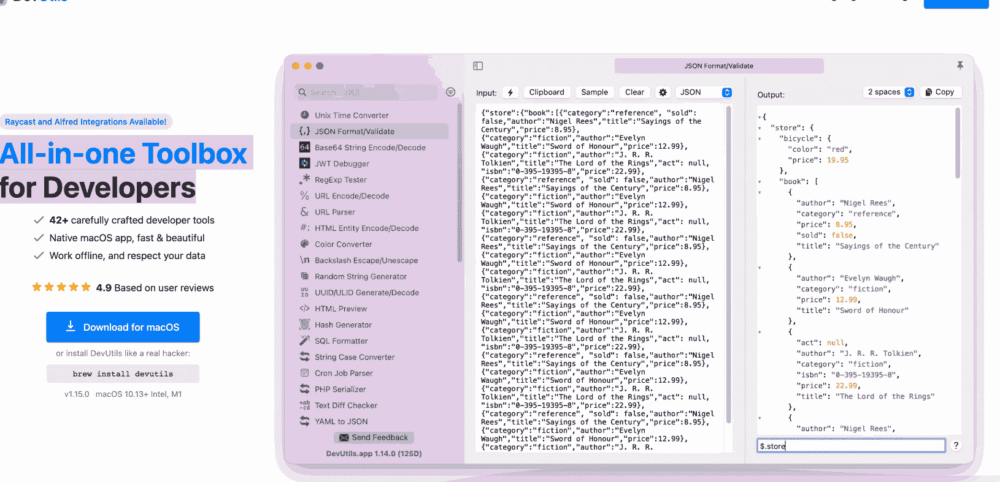

`Untitled1 (1).gif`（1.85 MB，下载次数：2）

[查看附件](https://www.52pojie.cn/forum.php?mod=attachment&aid=MjU0NjM0MXxhNzIyNDk2ZHwxNzkzNTc0NjYyfDE2ODA4NnwxNjc1OTE3&nothumb=yes)

2022-8-15 23:28 上传

## 环境信息

DevUtils 官方下载地址：https://devutils.com/

当前分析版本号：1.15（132D）

- IDAFree
- HopperDemo

## 分析 1：基于 About 页面

打开软件后，可以发现只有基本的两个功能能用。

其他功能都需要付费才行。

并且付费功能的页面默认是只读状态，修改就会弹窗，如下图。

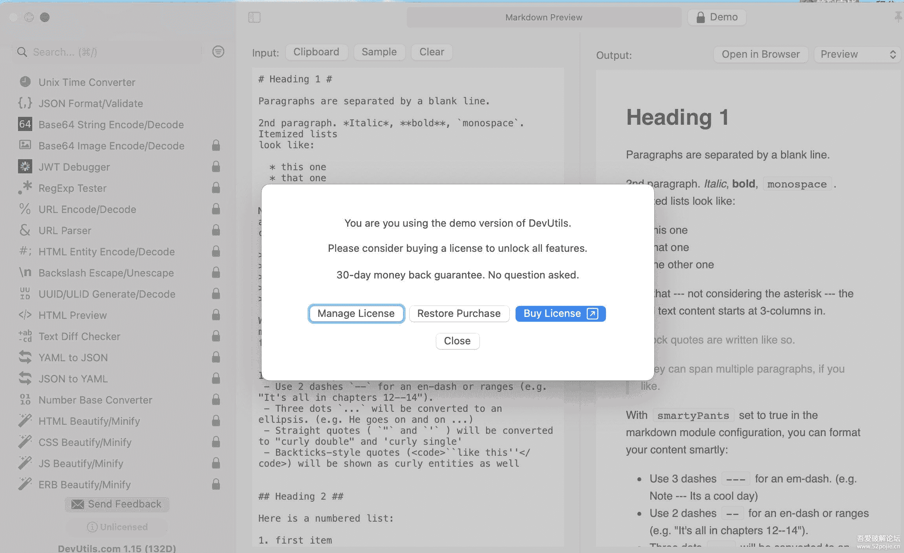

`0000.png`（296.6 KB，下载次数：3）

[查看附件](https://www.52pojie.cn/forum.php?mod=attachment&aid=MjU0NjM0MnxiMDI4OTc0MHwxNzkzNTc0NjYyfDE2ODA4NnwxNjc1OTE3&nothumb=yes)

2022-8-15 23:29 上传

关于页面有 license 信息，我们先从这里入手看看。

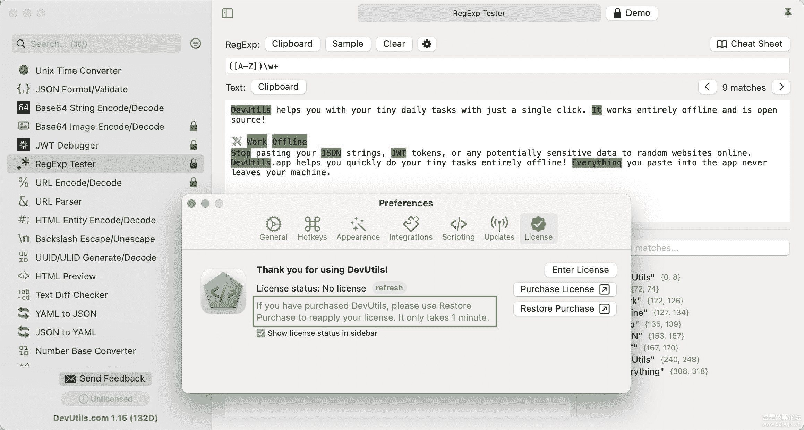

`1.png`（302.11 KB，下载次数：3）

[查看附件](https://www.52pojie.cn/forum.php?mod=attachment&aid=MjU0NjM0M3w4ZmNmNGZlNnwxNzkzNTc0NjYyfDE2ODA4NnwxNjc1OTE3&nothumb=yes)

2022-8-15 23:30 上传

拖入 IDA 后，搜索下关键字，如下。

还有意外收获，关键字下方就是认证成功的？难道这次轻松秒杀？

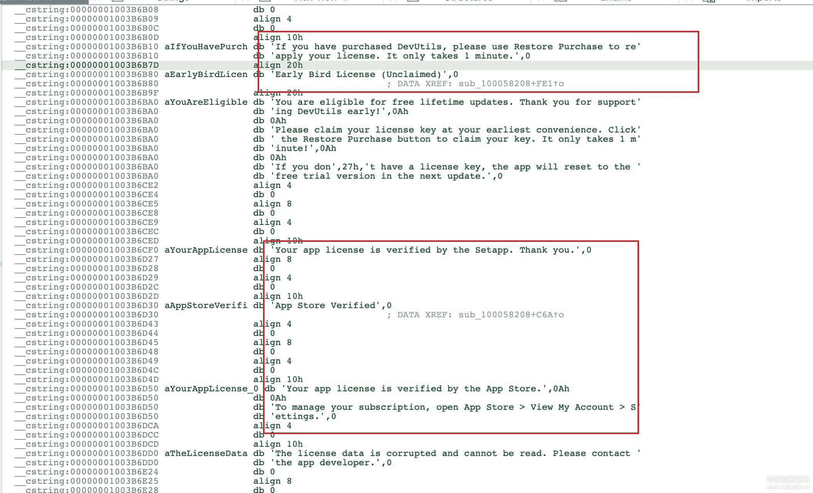

`license2.png`（415.99 KB，下载次数：3）

[查看附件](https://www.52pojie.cn/forum.php?mod=attachment&aid=MjU0NjM0NHw1MjQzOTgxN3wxNzkzNTc0NjYyfDE2ODA4NnwxNjc1OTE3&nothumb=yes)

2022-8-15 23:31 上传

按 `X` 一下，查看引用，发现这三个字符串都是在同一个引用链路里的，这就好办了。

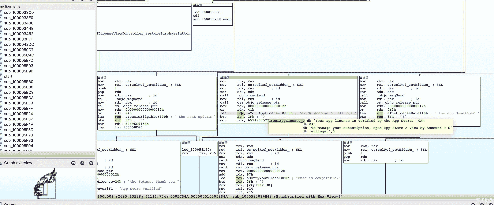

`license3.png`（588.42 KB，下载次数：3）

[查看附件](https://www.52pojie.cn/forum.php?mod=attachment&aid=MjU0NjM0NXwwNGU1MDhlNHwxNzkzNTc0NjYyfDE2ODA4NnwxNjc1OTE3&nothumb=yes)

2022-8-15 23:31 上传

在想要的“认证成功”这个点开始，往前一直按 `X`，按一次下一个断点，直接按 `X` 到函数头为止。按完之后按 `F9` 运行。

程序运行之后，点 Refresh，然后断下来了。我们按照前面按 `X` 的路线来走，走不通就改跳转。

断点下了十多个，实际上只改了一处跳转。Whatever……

看看效果，注册成功了。

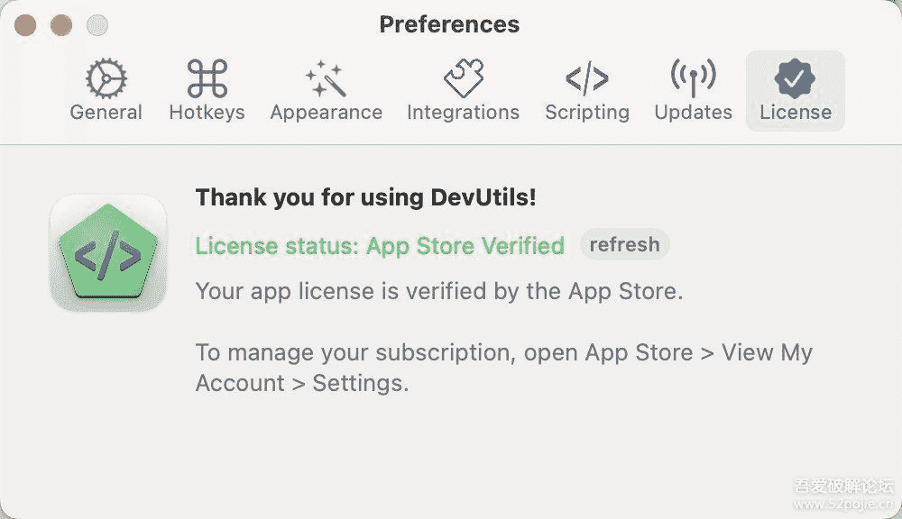

`4.png`（55.76 KB，下载次数：3）

[查看附件](https://www.52pojie.cn/forum.php?mod=attachment&aid=MjU0NjM0NnwxZDA5NGM2ZXwxNzkzNTc0NjYyfDE2ODA4NnwxNjc1OTE3&nothumb=yes)

2022-8-15 23:32 上传

然后满怀信心地点付费功能使用的时候，还是不能用，还是弹窗 + 付费……

而且比较麻烦的是，这个弹窗的字符串是搜不到的。

## 分析 2：基于窗口事件

一筹莫展的时候，想到了能不能试试搜索 `checkLicense`、`validationLicense` 之类的方法。忙活了半天，然而没什么成效。

突然之间，偶然看到了这么一个东西。

我们开发 GUI 程序的时候，通常会给窗口控件绑定些函数，比如 `clickEvent`、`doubleClickEvent`、`changeEvent`，恰好，这个软件弹框的效果也是类似于监听文本框内容改变。

然后我们找到了如下函数列表。

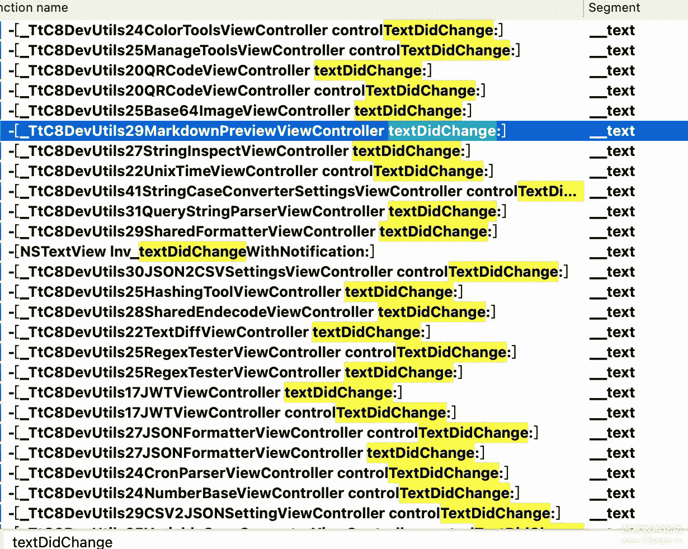

`textdidchange1.png`（354.03 KB，下载次数：2）

[查看附件](https://www.52pojie.cn/forum.php?mod=attachment&aid=MjU0NjM0OHw1YWRmNjNhMXwxNzkzNTc0NjYyfDE2ODA4NnwxNjc1OTE3&nothumb=yes)

2022-8-15 23:34 上传

看来是每一个功能窗口都有绑定一个监听函数。我们选择一个 Markdown 格式化的选项跟踪下试试。

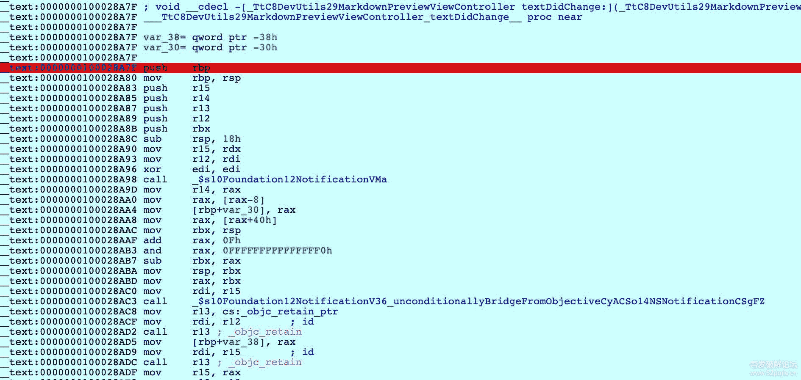

`event_fun_head.png`（293.79 KB，下载次数：2）

[查看附件](https://www.52pojie.cn/forum.php?mod=attachment&aid=MjU0NjM0OXxlYWE5OTFlNnwxNzkzNTc0NjYyfDE2ODA4NnwxNjc1OTE3&nothumb=yes)

2022-8-15 23:35 上传

在函数头下断点，之后随便输入点东西，然后一步一步跟。

跟踪的过程就不多说了，其实就是一个 `call` 一个 `call` 地试，判断哪个 `call` 是弹框的。

最后定位到了这里。实际上分析的过程痛苦且漫长，逆向这个东西嘛，耐心还是要有的。

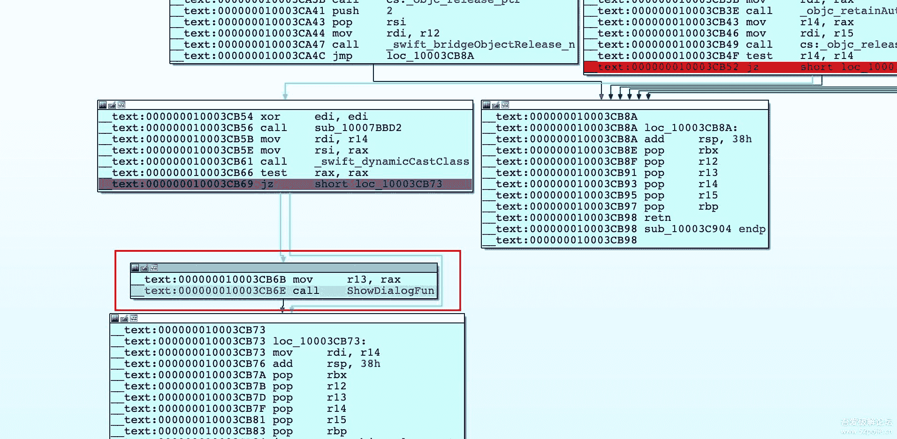

`showDiaLog.png`（327.88 KB，下载次数：2）

[查看附件](https://www.52pojie.cn/forum.php?mod=attachment&aid=MjU0NjM1MHwwZTBlZDlhOHwxNzkzNTc0NjYyfDE2ODA4NnwxNjc1OTE3&nothumb=yes)

2022-8-15 23:36 上传

就这么两句，本来以为改一下上面的跳转，绕过弹框就解决了。

然而改完后发现，跳转是没有了，但是输入的文本也没有了……搞过头了。

我想我们一定是错过了些什么。

我们回到函数头看看。

看到一个可疑的标记：`OBJCIVAR$__TtC8DevUtils18ToolViewController_locked`。

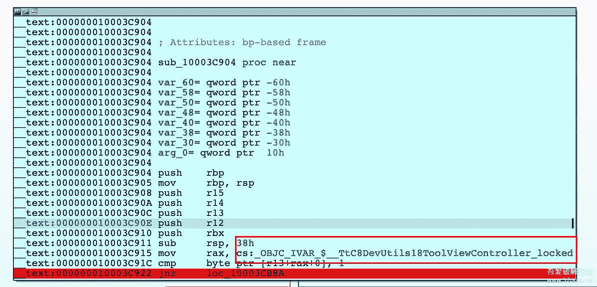

`lock.png`（215.55 KB，下载次数：1）

[查看附件](https://www.52pojie.cn/forum.php?mod=attachment&aid=MjU0NjM1MXxkYTgyZjM5MnwxNzkzNTc0NjYyfDE2ODA4NnwxNjc1OTE3&nothumb=yes)

2022-8-15 23:36 上传

看着像是一个全局变量 + 标记，并且下面紧跟着有一个判断的大跳。

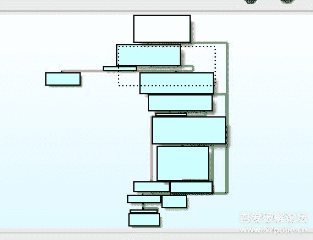

`lock_jmp.png`（18.23 KB，下载次数：3）

[查看附件](https://www.52pojie.cn/forum.php?mod=attachment&aid=MjU0NjM1Mnw2ZjM4NTY3NnwxNzkzNTc0NjYyfDE2ODA4NnwxNjc1OTE3&nothumb=yes)

2022-8-15 23:37 上传

右面那根粗粗的绿色的就是它没有达到的大跳。

我们改一下这个跳试试：

```asm
000000010003C973 jnz short loc_10003C9AA
000000010003C973 jz short loc_10003C9AA
```

改完之后再试试，居然成功了。

好家伙，不用 `license`，不用 `validation`，用 `lock`。又学会一个关键字。

之后我们按 `X` 查看 `Lock` 这个地址，看看哪些引用。之后将引用这个变量的后面的一句跳转全部改成 `jmp`，完事。

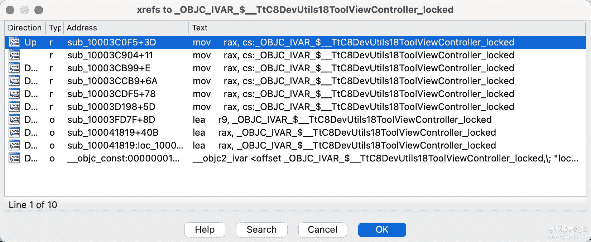

`lock_x.png`（215.15 KB，下载次数：3）

[查看附件](https://www.52pojie.cn/forum.php?mod=attachment&aid=MjU0NjM1M3w2NWIwYWRhMHwxNzkzNTc0NjYyfDE2ODA4NnwxNjc1OTE3&nothumb=yes)

2022-8-15 23:37 上传

具体修改如下：

```text
000000010003C13F 0x3 0F 85 E3 E9 E4 00
000000010003C922 0x4 0F 85 62 02 E9 63 02 00
000000010003CBB4 0x3 0F 85 A4 E9 A5 00
000000010003D204 0x3 0F 85 E8 E9 E9 00
```

改完之后效果就达成了，如下图。

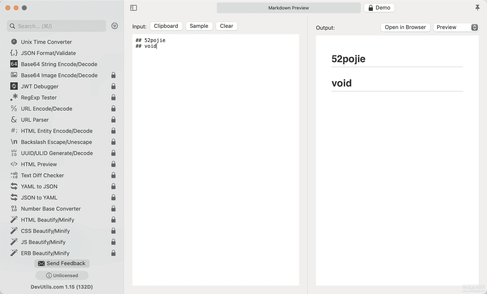

`success.png`（185.25 KB，下载次数：2）

[查看附件](https://www.52pojie.cn/forum.php?mod=attachment&aid=MjU0NjM1NHw3YmFmOGI0NXwxNzkzNTc0NjYyfDE2ODA4NnwxNjc1OTE3&nothumb=yes)

2022-8-15 23:38 上传

好了，至此就能快乐地学习了！

## 后记

不完美的逆向分析。

虽然使用不影响，但是界面上其实还是有锁的 icon 图标，还是有 unlicense 按钮。有大佬再看看吧，我要睡了。

Arm M1 本的 IDA 是分析不了的，应该是因为 free 版的 IDA 不支持 arm。

所以本次分析全是在 Intel 的 x86 下运行的。

修改完后也可以在 M1 上运行，但是需要配置强制用 Intel 来解释。

改完需要重新签名。

如果打不开的话，关闭 Mac SIP 并且允许任意来源。

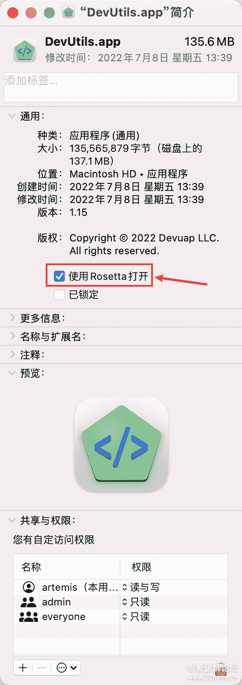

`arm.png`（205.77 KB，下载次数：1）

[查看附件](https://www.52pojie.cn/forum.php?mod=attachment&aid=MjU0NjQ0NnxjMTI0OGJhZnwxNzkzNTc0NjYyfDE2ODA4NnwxNjc1OTE3&nothumb=yes)

2022-8-16 11:19 上传

仅供研究学习使用，请勿用于非法用途。

注：若转载请注明来源（本贴地址）与作者信息。

## 补充（2021-08-20）

又继续更了下，算是实现完美爆破了，DEMO 按钮没有了，lock 图标也没有了，双字节即可爆破……

就不详细说过程了，看看有时间的话把算法整整吧。

修改如下（可以恢复掉上面之前所有的修改）：

### 双字节功能爆破

每个菜单下都维护一个变量 `freeTrial`，来标记该项功能是收费还是免费的。

正常来说，前两个功能为 `1`，免费；其余的都是 `0`，收费。


### 强制赋值

我们强制将所有的赋值为 1 ，即可免费所有（我这里使用了 `mov` 指令来赋值，改成用 `or` 按位或指令应该也是可以的）。

```
000000010004E5DE and al,1 > mov al, 1
000000010004E5DE 0x1 24 B0
```

### 去掉 `unlicense` 按钮

想去掉 `unlicense` 按钮的话，如下：

```
00000001000F58A5 0x2 75 66 90 90
```

### 修改版权信息

想改版权信息的话，如下：

```
000000010005836F 0x1 84 85
00000001000584AD 0x6 0F 85 B5 08 00 00 90 90 90 90 90 90
00000001000584BA 0x6 0F 8C FA 00 00 00 90 90 90 90 90 90
0000000100058BDB 0x2 75 0F 90 90
0000000100058BE0 0x2 75 0A 90 90
00000001003B70D0
```

### 最终效果

最终效果如图：

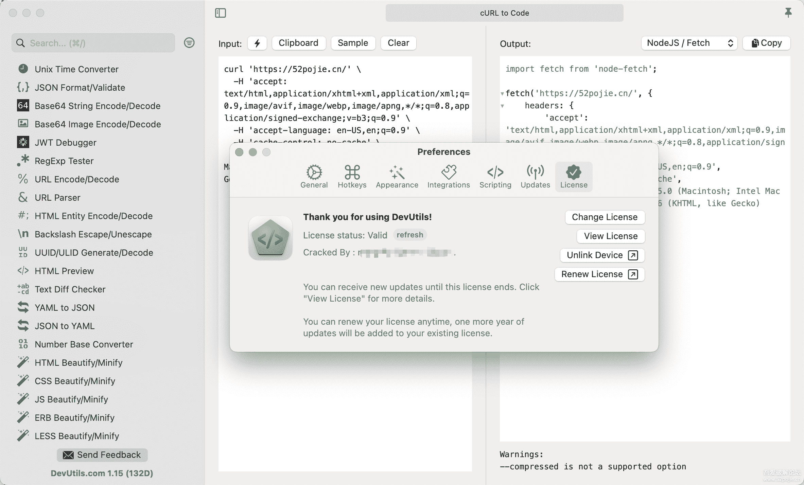

`bea.png`（633.52 KB，下载次数：2）

[href="forum.php?mod=attachment&aid=MjU0NzYzMnw0ODRhZmY3OXwxNzkzNTc0NjYyfDE2ODA4NnwxNjc1OTE3&nothumb=yes" target="_blank"](https://www.52pojie.cn/forum.php?mod=attachment&aid=MjU0NzYzMnw0ODRhZmY3OXwxNzkzNTc0NjYyfDE2ODA4NnwxNjc1OTE3&nothumb=yes)

2022-8-21 00:04 上传
