# [Web逆向] js逆向-猿人学比赛14题-扣代码破解

- 原帖：[https://www.52pojie.cn/forum.php?mod=viewthread&tid=1679174](https://www.52pojie.cn/forum.php?mod=viewthread&tid=1679174)
- 抓取时间：2026-11-01T23:10:55
- 题目地址：https://match.yuanrenxue.com/match/14

## 题目截图

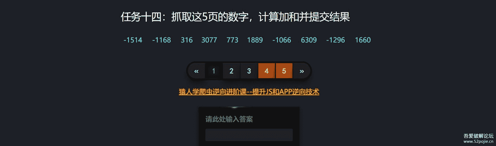

`snipaste20220821_111233.jpg`（63.07 KB，下载次数：265；2022-8-25 16:05 上传；[附件](https://www.52pojie.cn/forum.php?mod=attachment&aid=MjU0ODkwMnxjM2EwNTVjNHwxNzkzNTc0NjUzfDE2ODA4NnwxNjc5MTc0&nothumb=yes)）

## 接口分析

### fiddler分析接口

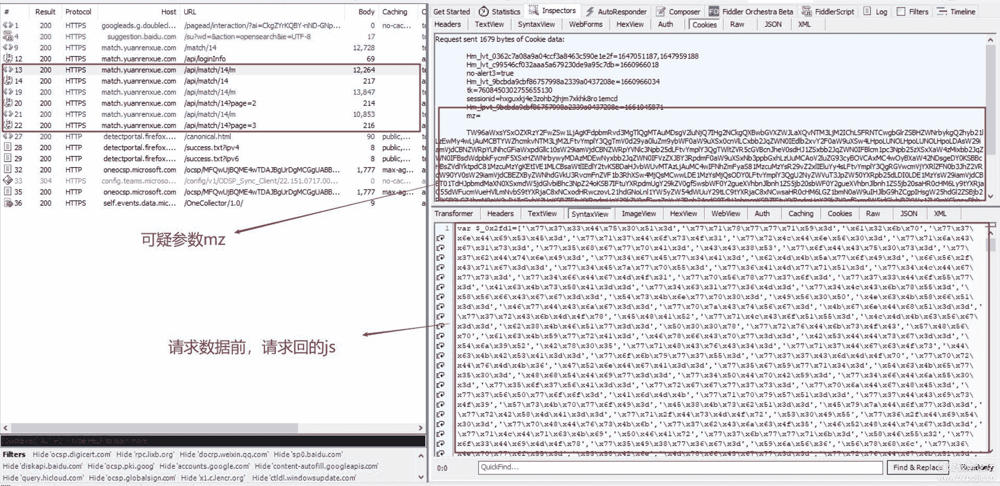

`14-1.jpg`（508.05 KB，下载次数：262；2022-8-25 16:06 上传；[附件](https://www.52pojie.cn/forum.php?mod=attachment&aid=MjU0ODkwM3xjNGFlYzJhMnwxNzkzNTc0NjUzfDE2ODA4NnwxNjc5MTc0&nothumb=yes)）

每次请求数据，都会先请求 https://match.yuanrenxue.com/api/match/14/m，会带上可疑参数 `mz`，每次请求此参数不变化。

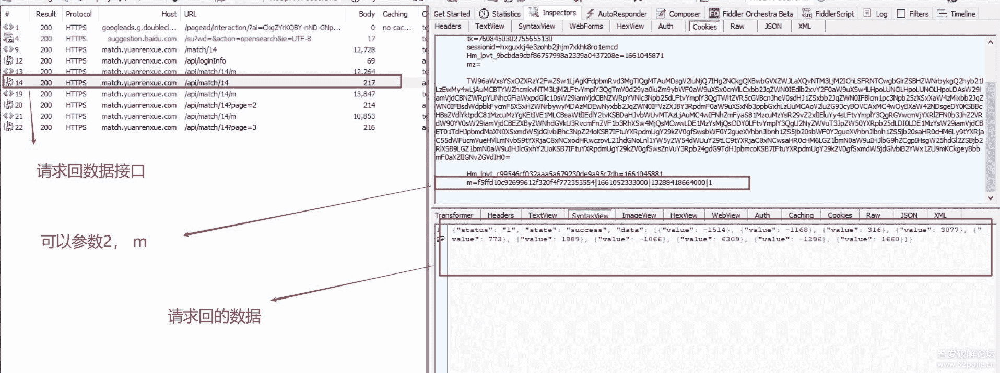

`14-2.jpg`（251.4 KB，下载次数：266；2022-8-25 16:06 上传；[附件](https://www.52pojie.cn/forum.php?mod=attachment&aid=MjU0ODkwNHxiMjVhNTA5YXwxNzkzNTc0NjUzfDE2ODA4NnwxNjc5MTc0&nothumb=yes)）

请求数据接口，都会带上可疑参数 `m`，每次请求 `m` 都会变。

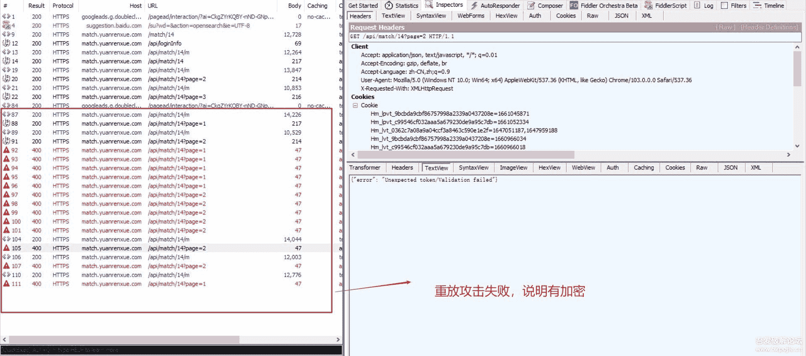

`14-3.jpg`（268.95 KB，下载次数：271；2022-8-25 16:07 上传；[附件](https://www.52pojie.cn/forum.php?mod=attachment&aid=MjU0ODkwNXwxMThiNTA0OHwxNzkzNTc0NjUzfDE2ODA4NnwxNjc5MTc0&nothumb=yes)）

重放攻击，请求数据出错。确定接口被加密。

## Hook Cookie 确定加密位置

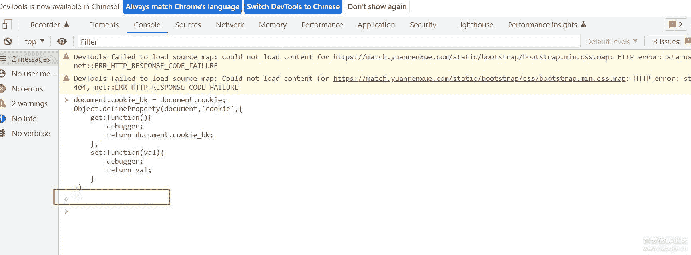

`hook-1.jpg`（130.8 KB，下载次数：273；2022-8-25 16:08 上传；[附件](https://www.52pojie.cn/forum.php?mod=attachment&aid=MjU0ODkwNnwxYTgzMzIzY3wxNzkzNTc0NjUzfDE2ODA4NnwxNjc5MTc0&nothumb=yes)）

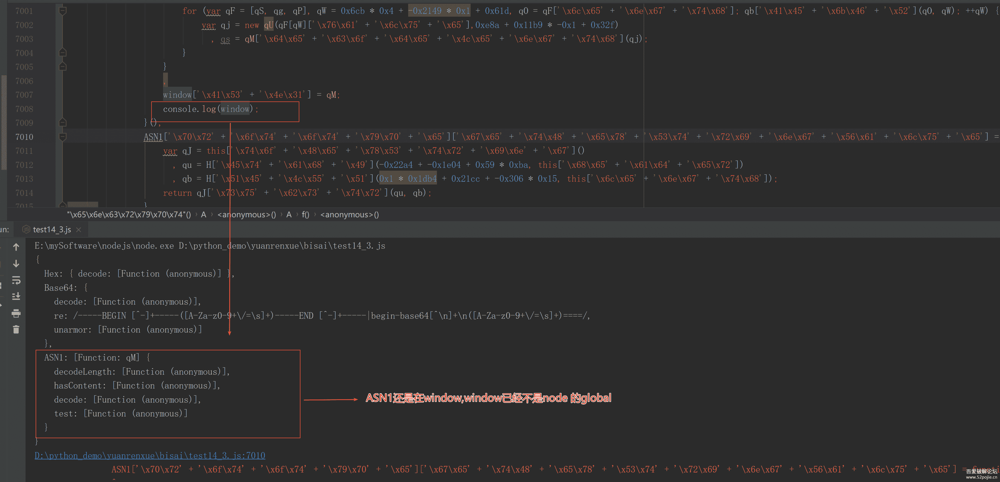

`扣代码-8.png`（300.24 KB，下载次数：266；2022-8-25 16:09 上传；[附件](https://www.52pojie.cn/forum.php?mod=attachment&aid=MjU0ODkxMXwxYWE4ZWRlZHwxNzkzNTc0NjUzfDE2ODA4NnwxNjc5MTc0&nothumb=yes)）

尝试 hook cookie 失败，`Object.defineProperty` 方法被重写。

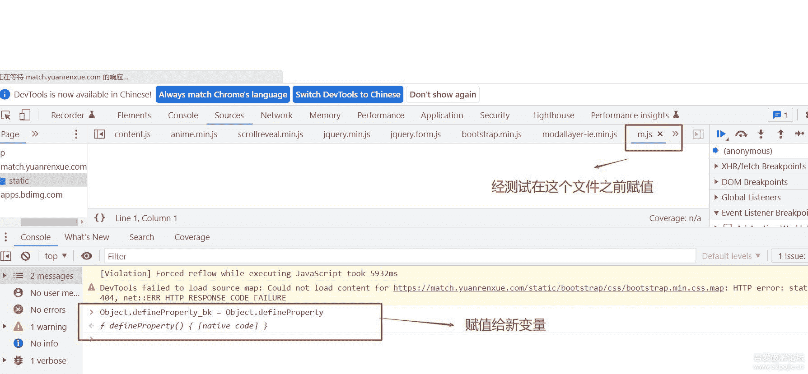

`hook-2.jpg`（178.96 KB，下载次数：269；2022-8-25 16:10 上传；[附件](https://www.52pojie.cn/forum.php?mod=attachment&aid=MjU0ODkxMnxjMThhMjA3NHwxNzkzNTc0NjUzfDE2ODA4NnwxNjc5MTc0&nothumb=yes)）

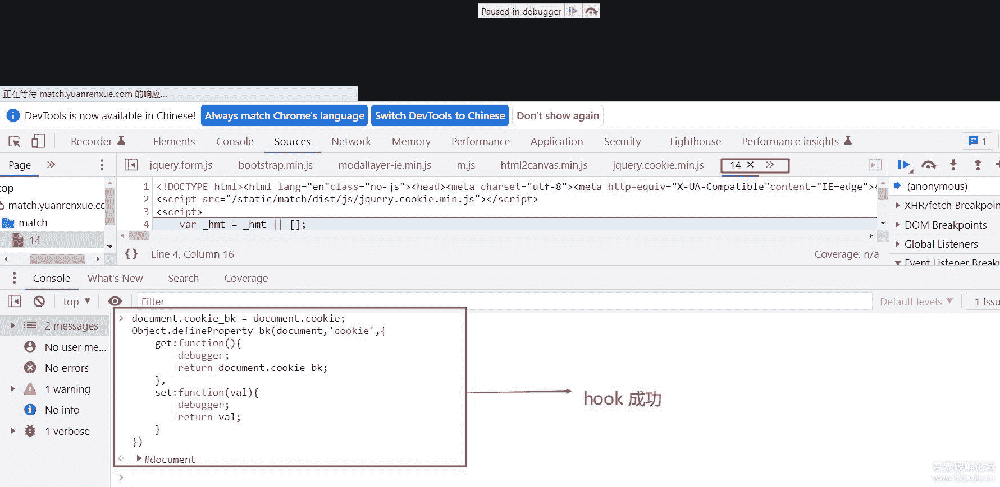

`hook-3.jpg`（187.87 KB，下载次数：268；2022-8-25 16:11 上传；[附件](https://www.52pojie.cn/forum.php?mod=attachment&aid=MjU0ODkxM3xmODlkYTYzYXwxNzkzNTc0NjUzfDE2ODA4NnwxNjc5MTc0&nothumb=yes)）

在 `Object.defineProperty` 方法被重写赋给新的变量，使用新的变量重新 hook 成功。

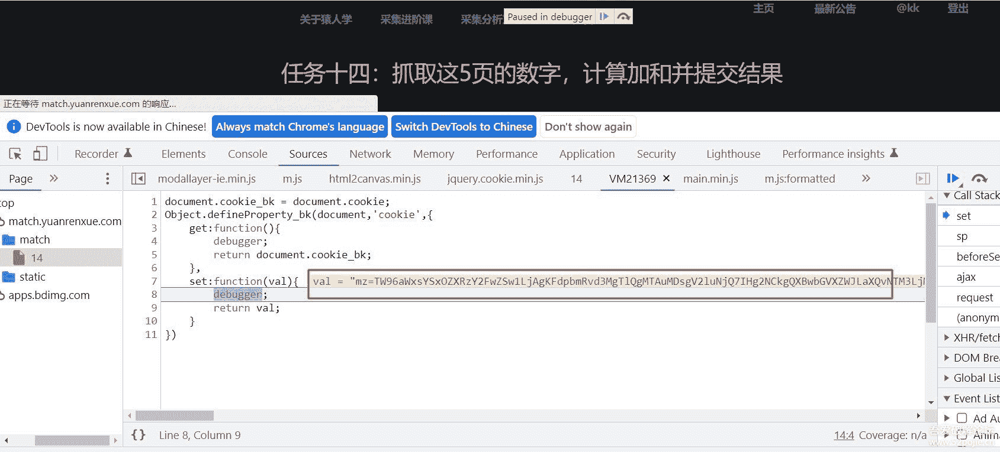

`hook-4.jpg`（175.28 KB，下载次数：260；2022-8-25 16:12 上传；[附件](https://www.52pojie.cn/forum.php?mod=attachment&aid=MjU0ODkxNHxkMWIzMDI5MnwxNzkzNTc0NjUzfDE2ODA4NnwxNjc5MTc0&nothumb=yes)）

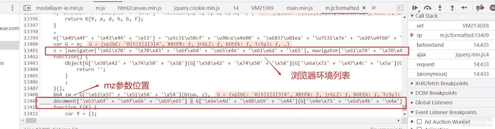

`hook-5.jpg`（171.92 KB，下载次数：253；2022-8-25 16:13 上传；[附件](https://www.52pojie.cn/forum.php?mod=attachment&aid=MjU0ODkxNXw0OWY5ZTljZnwxNzkzNTc0NjUzfDE2ODA4NnwxNjc5MTc0&nothumb=yes)）

## 参数生成位置分析

找到可疑参数 `mz` 生成位置，由浏览器环境组成的 `z` 数组，然后在 `base64` 加密生成。浏览器环境不变这个 `mz` 参数就不变，这道题可以直接拿结果用。

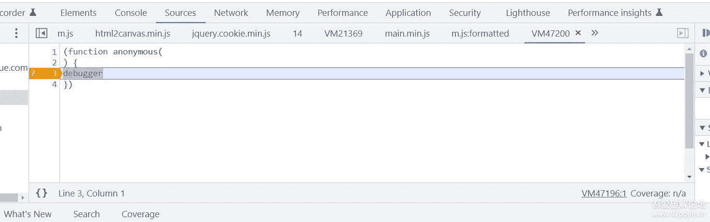

`hook-6.jpg`（65.76 KB，下载次数：262；2022-8-25 16:13 上传；[附件](https://www.52pojie.cn/forum.php?mod=attachment&aid=MjU0ODkxNnwxM2NiMzJmOXwxNzkzNTc0NjUzfDE2ODA4NnwxNjc5MTc0&nothumb=yes)）

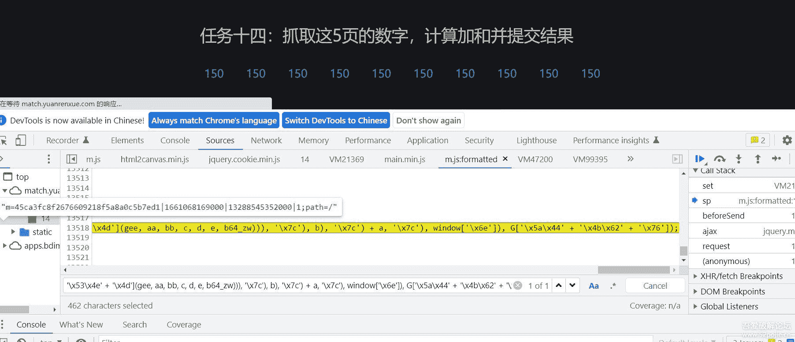

`hook-7.jpg`（190.55 KB，下载次数：272；2022-8-25 16:14 上传；[附件](https://www.52pojie.cn/forum.php?mod=attachment&aid=MjU0ODkxN3xkZDQ2OWRhY3wxNzkzNTc0NjUzfDE2ODA4NnwxNjc5MTc0&nothumb=yes)）

继续找 `m` 参数位置，遇到 `debugger`。直接右键 `never pause here`，跳过 `debugger` 后找到加密参数 `m` 的生成位置。

## 扣代码生成 m 参数

接下来就是扣代码生成 `m` 参数拉。

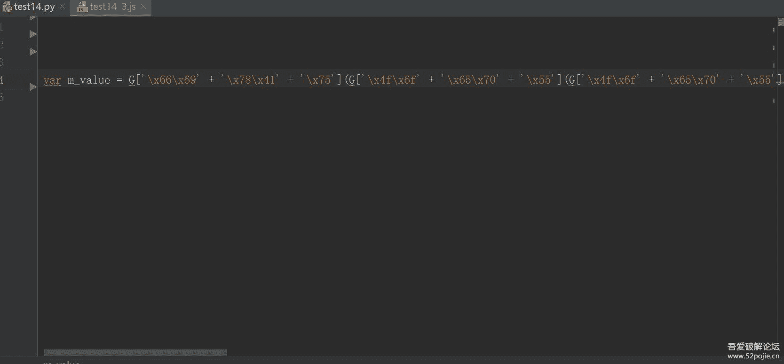

`抠代码-1.jpg`（48.18 KB，下载次数：270；2022-8-25 16:15 上传；[附件](https://www.52pojie.cn/forum.php?mod=attachment&aid=MjU0ODkxOHw4OTlkYzc2ZXwxNzkzNTc0NjUzfDE2ODA4NnwxNjc5MTc0&nothumb=yes)）

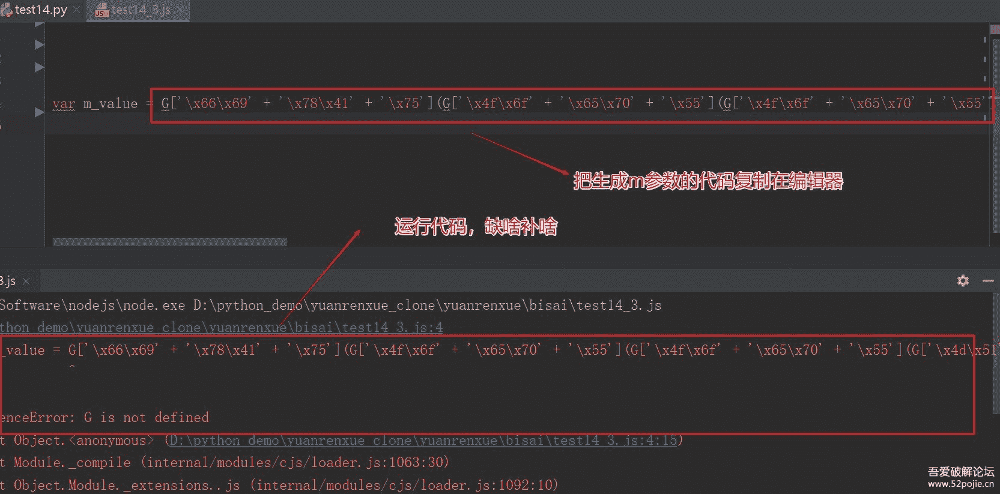

`抠代码-2.jpg`（142.13 KB，下载次数：255；2022-8-25 16:15 上传；[附件](https://www.52pojie.cn/forum.php?mod=attachment&aid=MjU0ODkxOXxkYWZiZDQwZHwxNzkzNTc0NjUzfDE2ODA4NnwxNjc5MTc0&nothumb=yes)）

把生成参数 `m` 的代码复制到编辑器，然后缺啥补啥的扣。

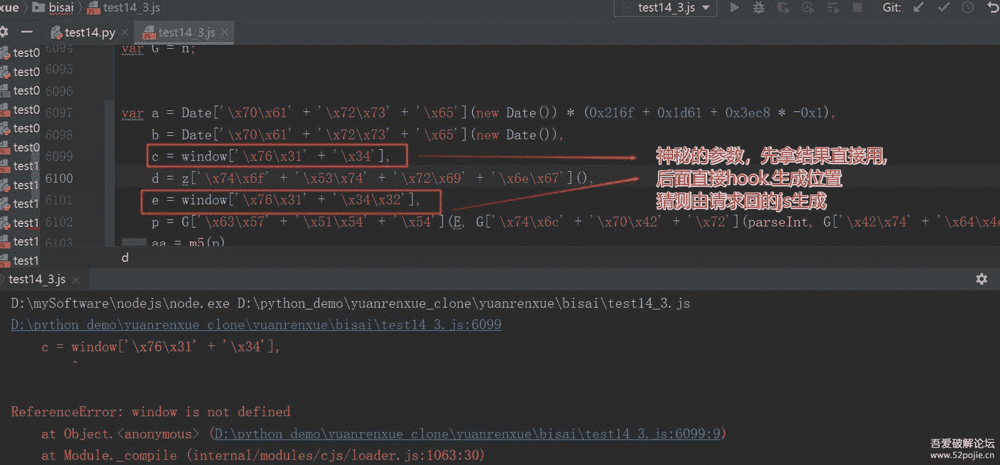

`抠代码-3.jpg`（178.85 KB，下载次数：280；2022-8-25 16:16 上传；[附件](https://www.52pojie.cn/forum.php?mod=attachment&aid=MjU0ODkyMHxhODg2ZmVkMHwxNzkzNTc0NjUzfDE2ODA4NnwxNjc5MTc0&nothumb=yes)）

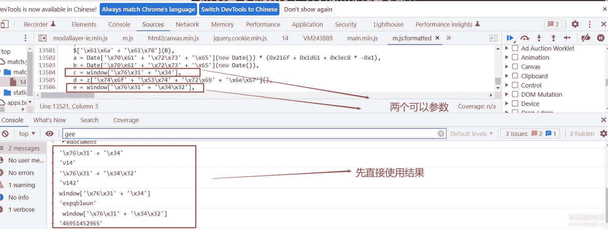

`抠代码-4.jpg`（207.66 KB，下载次数：263；2022-8-25 16:17 上传；[附件](https://www.52pojie.cn/forum.php?mod=attachment&aid=MjU0ODkyMXwxNTcxNWViZXwxNzkzNTc0NjUzfDE2ODA4NnwxNjc5MTc0&nothumb=yes)）

### 扣代码过程遇到的问题1

神秘参数被混淆，在页面不能直接找到。先把结果拿来用，继续扣。后面在 hook 参数的位置。猜测是返回 js 生成的加密参数。

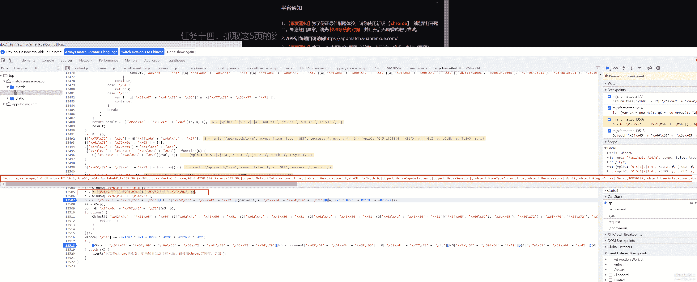

`扣代码-z.png`（428.75 KB，下载次数：267；2022-8-25 16:17 上传；[附件](https://www.52pojie.cn/forum.php?mod=attachment&aid=MjU0ODkyMnw4MmVlNmUwN3wxNzkzNTc0NjUzfDE2ODA4NnwxNjc5MTc0&nothumb=yes)）

### 扣代码过程遇到的问题2

`d` 变量的生成是上面提到过的由浏览器环境生成的 `z` 数组，可以直接拿结果用。继续扣。

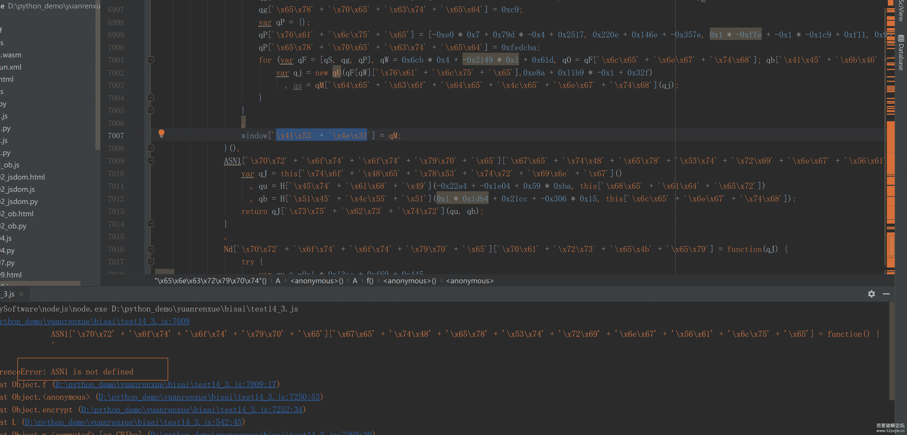

`扣代码-asn1.png`（365.15 KB，下载次数：261；2022-8-25 16:18 上传；[附件](https://www.52pojie.cn/forum.php?mod=attachment&aid=MjU0ODkyM3xiNDNjY2YxMHwxNzkzNTc0NjUzfDE2ODA4NnwxNjc5MTc0&nothumb=yes)）

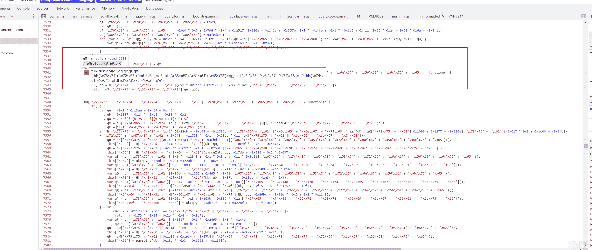

`扣代码-asn1-2.png`（422.46 KB，下载次数：273；2022-8-25 16:19 上传；[附件](https://www.52pojie.cn/forum.php?mod=attachment&aid=MjU0ODkyNHw2MDkyNzZkZnwxNzkzNTc0NjUzfDE2ODA4NnwxNjc5MTc0&nothumb=yes)）

# 扣代码记录

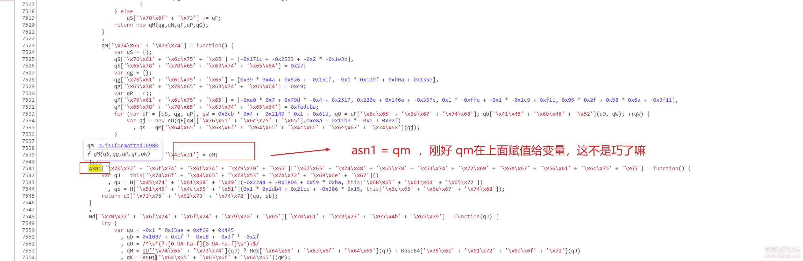
扣代码-6.png (206.6 KB, 下载次数: 261)
[href="forum.php?mod=attachment&aid=MjU0ODkyNXxhZjcyMWM5NXwxNzkzNTc0NjUzfDE2ODA4NnwxNjc5MTc0&nothumb=yes" target="_blank"](https://www.52pojie.cn/forum.php?mod=attachment&aid=MjU0ODkyNXxhZjcyMWM5NXwxNzkzNTc0NjUzfDE2ODA4NnwxNjc5MTc0&nothumb=yes)
k-8
2022-8-25 16:20 上传

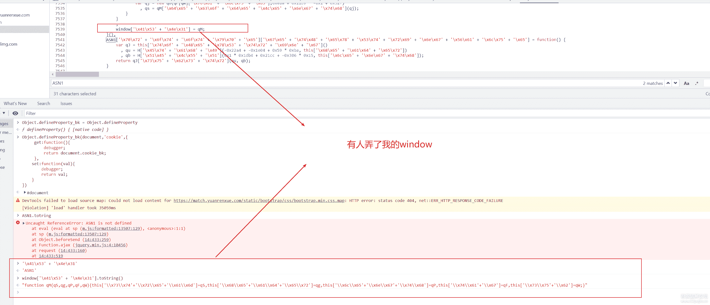
扣代码-7.png (203.29 KB, 下载次数: 269)
[href="forum.php?mod=attachment&aid=MjU0ODkyNnw0MGM0NWI4YXwxNzkzNTc0NjUzfDE2ODA4NnwxNjc5MTc0&nothumb=yes" target="_blank"](https://www.52pojie.cn/forum.php?mod=attachment&aid=MjU0ODkyNnw0MGM0NWI4YXwxNzkzNTc0NjUzfDE2ODA4NnwxNjc5MTc0&nothumb=yes)
k-9
2022-8-25 16:23 上传

扣代码-8.png (300.24 KB, 下载次数: 277)
[href="forum.php?mod=attachment&aid=MjU0ODkyN3xlNDkwYzUzZnwxNzkzNTc0NjUzfDE2ODA4NnwxNjc5MTc0&nothumb=yes" target="_blank"](https://www.52pojie.cn/forum.php?mod=attachment&aid=MjU0ODkyN3xlNDkwYzUzZnwxNzkzNTc0NjUzfDE2ODA4NnwxNjc5MTc0&nothumb=yes)
k-10
2022-8-25 16:23 上传

## 扣代码过程遇到的问题3
发现`ASN1`未定义，但是在浏览器中`window['ASN1] = qM`，`ASN1`是属于`window`的参数，在全局中是可以找到的。说明利用浏览器环境和`node`环境的差异弄了`window`导致在`node`环境中找不到`ASN1`

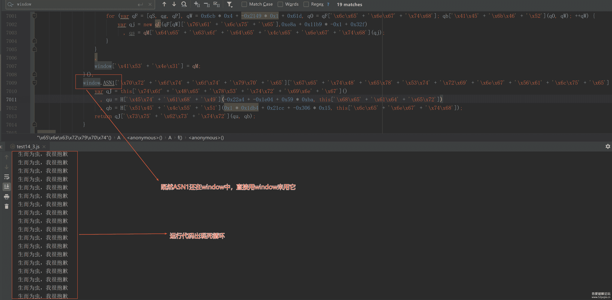
扣代码-9.png (359.32 KB, 下载次数: 273)
[href="forum.php?mod=attachment&aid=MjU0ODkzMHw1NmI3NjMxY3wxNzkzNTc0NjUzfDE2ODA4NnwxNjc5MTc0&nothumb=yes" target="_blank"](https://www.52pojie.cn/forum.php?mod=attachment&aid=MjU0ODkzMHw1NmI3NjMxY3wxNzkzNTc0NjUzfDE2ODA4NnwxNjc5MTc0&nothumb=yes)
k-11
2022-8-25 16:26 上传

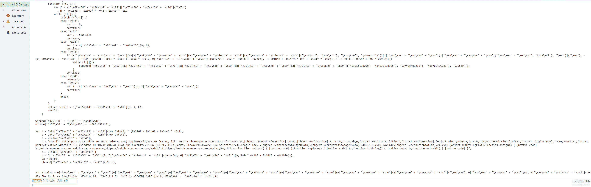
扣代码-10.png (200.97 KB, 下载次数: 274)
[href="forum.php?mod=attachment&aid=MjU0ODkzMXwwNGNmYmI2MXwxNzkzNTc0NjUzfDE2ODA4NnwxNjc5MTc0&nothumb=yes" target="_blank"](https://www.52pojie.cn/forum.php?mod=attachment&aid=MjU0ODkzMXwwNGNmYmI2MXwxNzkzNTc0NjUzfDE2ODA4NnwxNjc5MTc0&nothumb=yes)
k-12
2022-8-25 16:27 上传

直接用`window`使用`ASN1`,运行代码出现死循环，把代码复制到浏览器中运行也是进入死循环，说明不是浏览器指纹问题

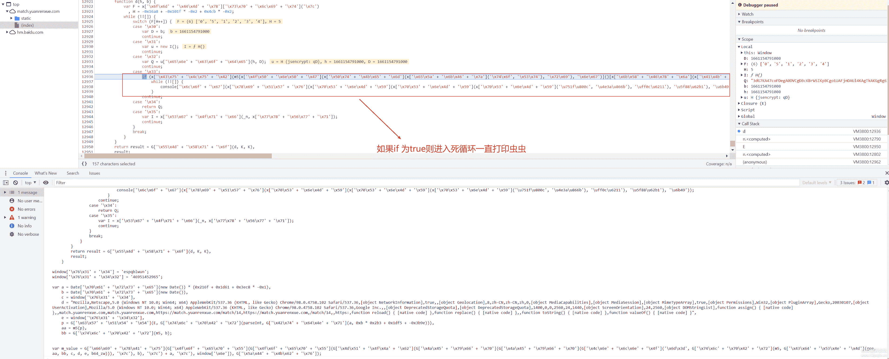
扣代码-11.png (350.92 KB, 下载次数: 258)
[href="forum.php?mod=attachment&aid=MjU0ODkzMnwyNDBhMzYyYnwxNzkzNTc0NjUzfDE2ODA4NnwxNjc5MTc0&nothumb=yes" target="_blank"](https://www.52pojie.cn/forum.php?mod=attachment&aid=MjU0ODkzMnwyNDBhMzYyYnwxNzkzNTc0NjUzfDE2ODA4NnwxNjc5MTc0&nothumb=yes)
k-13
2022-8-25 16:28 上传

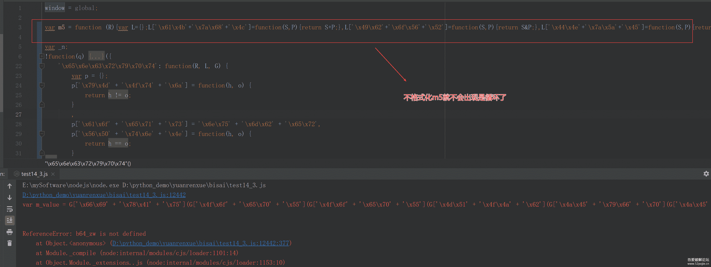
扣代码-12.png (208.69 KB, 下载次数: 267)
[href="forum.php?mod=attachment&aid=MjU0ODkzM3wyNmRhMjYxMXwxNzkzNTc0NjUzfDE2ODA4NnwxNjc5MTc0&nothumb=yes" target="_blank"](https://www.52pojie.cn/forum.php?mod=attachment&aid=MjU0ODkzM3wyNmRhMjYxMXwxNzkzNTc0NjUzfDE2ODA4NnwxNjc5MTc0&nothumb=yes)
k-14
2022-8-25 16:29 上传

这个判断是判断`m5`函数是是否有换行，有换行就true,所以`m5`函数不格式化就可以解决，或者直接把判断结果替换为`false`. 继续往下扣

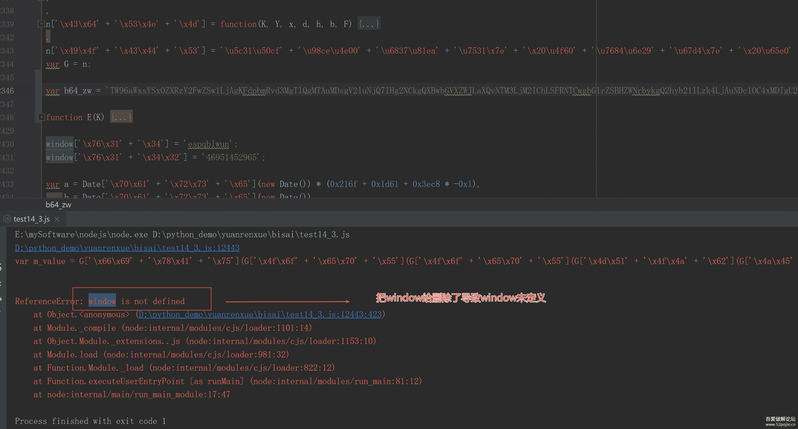
扣代码-13.png (253.85 KB, 下载次数: 265)
[href="forum.php?mod=attachment&aid=MjU0ODkzNHw0YjJlYTJkMnwxNzkzNTc0NjUzfDE2ODA4NnwxNjc5MTc0&nothumb=yes" target="_blank"](https://www.52pojie.cn/forum.php?mod=attachment&aid=MjU0ODkzNHw0YjJlYTJkMnwxNzkzNTc0NjUzfDE2ODA4NnwxNjc5MTc0&nothumb=yes)
k-15
2022-8-25 16:29 上传

## 扣代码过程遇到的问题4
遇到`window`未定义，说明`window`被删了

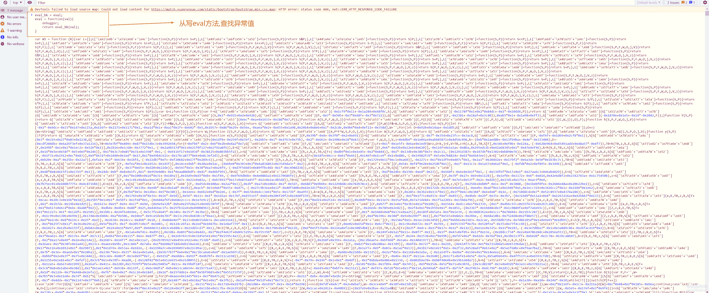
扣代码-15.png (994.95 KB, 下载次数: 266)
[href="forum.php?mod=attachment&aid=MjU0ODkzNnwxODdiYzdkZXwxNzkzNTc0NjUzfDE2ODA4NnwxNjc5MTc0&nothumb=yes" target="_blank"](https://www.52pojie.cn/forum.php?mod=attachment&aid=MjU0ODkzNnwxODdiYzdkZXwxNzkzNTc0NjUzfDE2ODA4NnwxNjc5MTc0&nothumb=yes)
k-17
2022-8-25 16:32 上传

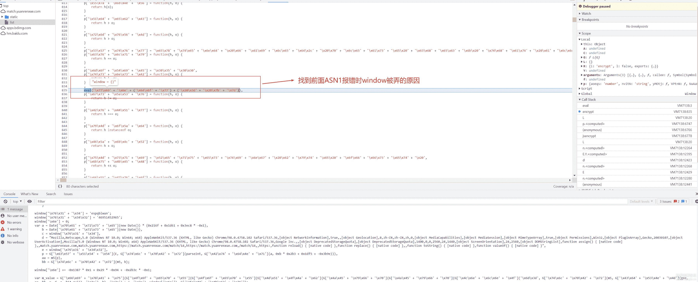
扣代码-16.png (367.91 KB, 下载次数: 270)
[href="forum.php?mod=attachment&aid=MjU0ODkzN3w0ZTM2M2VmOHwxNzkzNTc0NjUzfDE2ODA4NnwxNjc5MTc0&nothumb=yes" target="_blank"](https://www.52pojie.cn/forum.php?mod=attachment&aid=MjU0ODkzN3w0ZTM2M2VmOHwxNzkzNTc0NjUzfDE2ODA4NnwxNjc5MTc0&nothumb=yes)
k-18
2022-8-25 16:33 上传

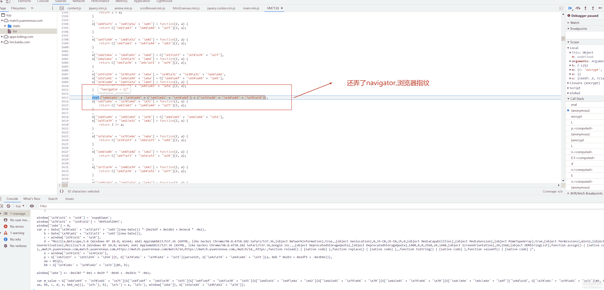
扣代码-17.png (374.14 KB, 下载次数: 257)
[href="forum.php?mod=attachment&aid=MjU0ODkzOHxiOWU0MWMzN3wxNzkzNTc0NjUzfDE2ODA4NnwxNjc5MTc0&nothumb=yes" target="_blank"](https://www.52pojie.cn/forum.php?mod=attachment&aid=MjU0ODkzOHxiOWU0MWMzN3wxNzkzNTc0NjUzfDE2ODA4NnwxNjc5MTc0&nothumb=yes)
k-19
2022-8-25 16:33 上传

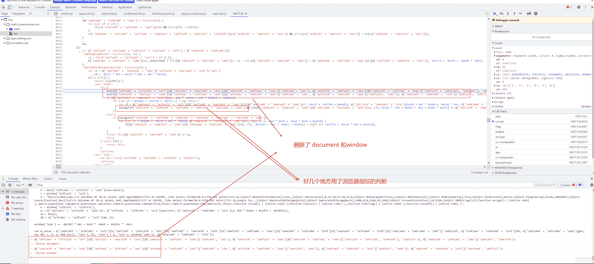
扣代码-18.png (559.06 KB, 下载次数: 264)
[href="forum.php?mod=attachment&aid=MjU0ODkzOXw0NjUyODIyN3wxNzkzNTc0NjUzfDE2ODA4NnwxNjc5MTc0&nothumb=yes" target="_blank"](https://www.52pojie.cn/forum.php?mod=attachment&aid=MjU0ODkzOXw0NjUyODIyN3wxNzkzNTc0NjUzfDE2ODA4NnwxNjc5MTc0&nothumb=yes)
k-20
2022-8-25 16:34 上传

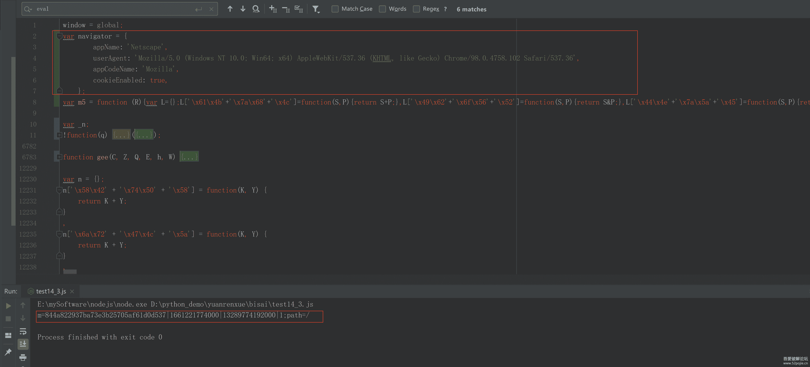
扣代码-19.png (203.64 KB, 下载次数: 275)
[href="forum.php?mod=attachment&aid=MjU0ODk0MHxhYmE2M2U2Y3wxNzkzNTc0NjUzfDE2ODA4NnwxNjc5MTc0&nothumb=yes" target="_blank"](https://www.52pojie.cn/forum.php?mod=attachment&aid=MjU0ODk0MHxhYmE2M2U2Y3wxNzkzNTc0NjUzfDE2ODA4NnwxNjc5MTc0&nothumb=yes)
k-21
2022-8-25 16:35 上传

通过重写`eval` 进行`debugger`发现很多对浏览器没用的操作而对`node`环境有用的操作,把对`window`,`navigator`,`document` 的操作注释了。补全一下相关的`navigator`环境,然后运行代码`m`参数出来，接下来我们要去看看之前两个神秘参数`window['v14']`和`window['v142']`是怎么生成的

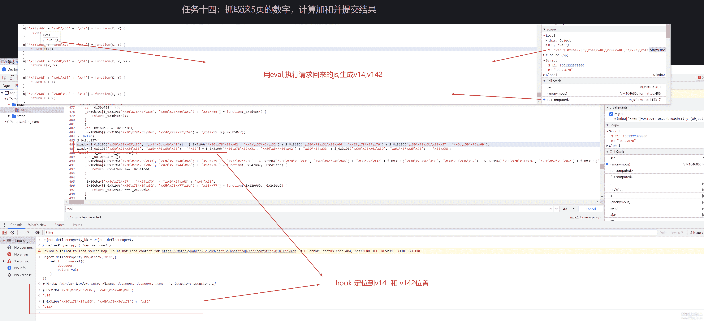
扣代码-20.png (416.79 KB, 下载次数: 265)
[href="forum.php?mod=attachment&aid=MjU0ODk0MXxjODBjODlkZXwxNzkzNTc0NjUzfDE2ODA4NnwxNjc5MTc0&nothumb=yes" target="_blank"](https://www.52pojie.cn/forum.php?mod=attachment&aid=MjU0ODk0MXxjODBjODlkZXwxNzkzNTc0NjUzfDE2ODA4NnwxNjc5MTc0&nothumb=yes)
k-22
2022-8-25 16:35 上传

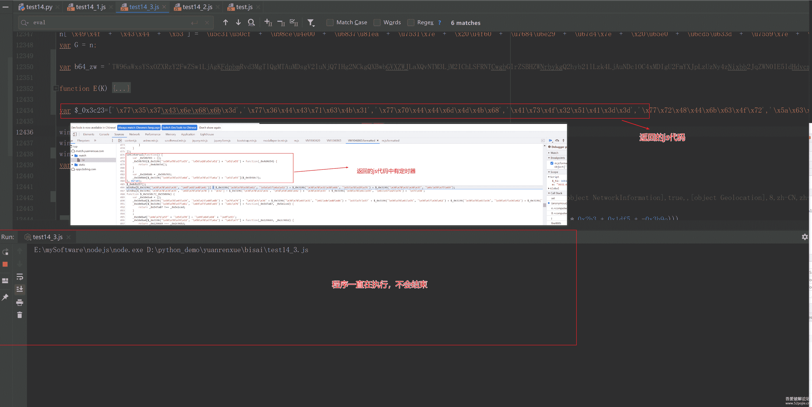
扣代码-21.png (486.92 KB, 下载次数: 270)
[href="forum.php?mod=attachment&aid=MjU0ODk0Mnw0MTIwYjYwZnwxNzkzNTc0NjUzfDE2ODA4NnwxNjc5MTc0&nothumb=yes" target="_blank"](https://www.52pojie.cn/forum.php?mod=attachment&aid=MjU0ODk0Mnw0MTIwYjYwZnwxNzkzNTc0NjUzfDE2ODA4NnwxNjc5MTc0&nothumb=yes)
k-23
2022-8-25 16:36 上传

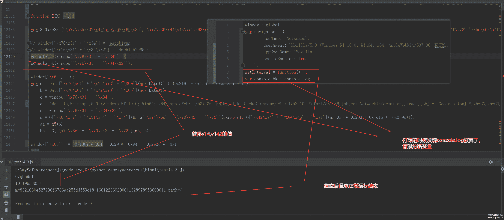
扣代码-22.png (455.87 KB, 下载次数: 275)
[href="forum.php?mod=attachment&aid=MjU0ODk0M3wwZTM5Y2IxMnwxNzkzNTc0NjUzfDE2ODA4NnwxNjc5MTc0&nothumb=yes" target="_blank"](https://www.52pojie.cn/forum.php?mod=attachment&aid=MjU0ODk0M3wwZTM5Y2IxMnwxNzkzNTc0NjUzfDE2ODA4NnwxNjc5MTc0&nothumb=yes)
k-24
2022-8-25 16:37 上传

确认`v14`,`v142`是返回的`js`生成，直接把返回的`js`拿过来测试,程序结束不了，检测有定时器。直接把定时器置空,然后程序正常运行。接下来实际测试加密函数看能不能用。

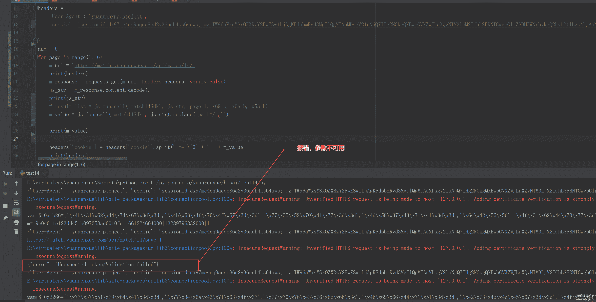
扣代码-23.png (394.92 KB, 下载次数: 274)
[href="forum.php?mod=attachment&aid=MjU0ODk0NnwxMmZhYmZhZnwxNzkzNTc0NjUzfDE2ODA4NnwxNjc5MTc0&nothumb=yes" target="_blank"](https://www.52pojie.cn/forum.php?mod=attachment&aid=MjU0ODk0NnwxMmZhYmZhZnwxNzkzNTc0NjUzfDE2ODA4NnwxNjc5MTc0&nothumb=yes)
k-25
2022-8-25 16:38 上传

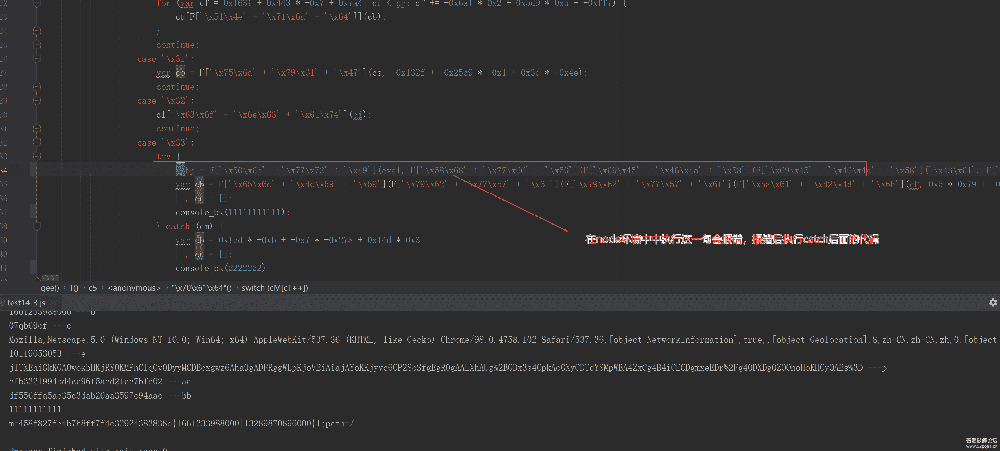
扣代码-24.png (284.49 KB, 下载次数: 253)
[href="forum.php?mod=attachment&aid=MjU0ODk1MHxiYmNmMTJiMXwxNzkzNTc0NjUzfDE2ODA4NnwxNjc5MTc0&nothumb=yes" target="_blank"](https://www.52pojie.cn/forum.php?mod=attachment&aid=MjU0ODk1MHxiYmNmMTJiMXwxNzkzNTc0NjUzfDE2ODA4NnwxNjc5MTc0&nothumb=yes)
k-26
2022-8-25 16:41 上传

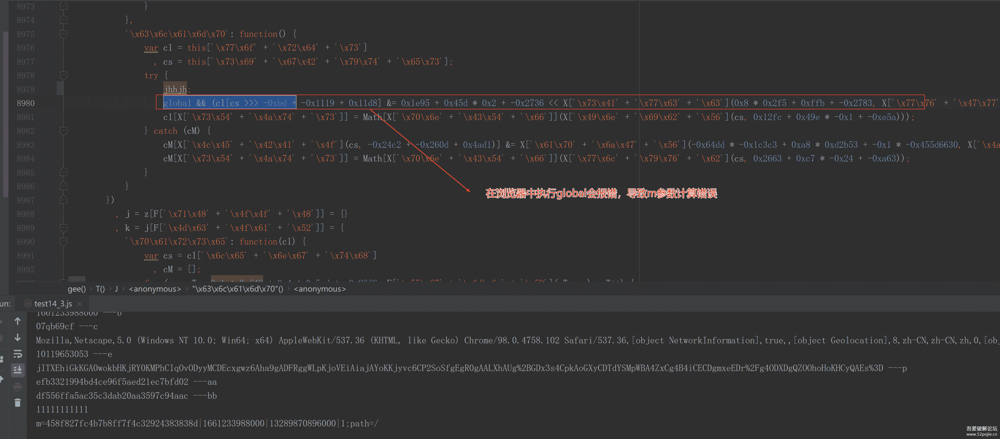
扣代码-25.png (324.19 KB, 下载次数: 270)
[href="forum.php?mod=attachment&aid=MjU0ODk1MXw5M2JiNDRiYXwxNzkzNTc0NjUzfDE2ODA4NnwxNjc5MTc0&nothumb=yes" target="_blank"](https://www.52pojie.cn/forum.php?mod=attachment&aid=MjU0ODk1MXw5M2JiNDRiYXwxNzkzNTc0NjUzfDE2ODA4NnwxNjc5MTc0&nothumb=yes)
k-27
2022-8-25 16:41 上传

测试报错`m`参数生成有误，利用捕获代码错误语句和浏览器与`node`的差异，识别否是正常浏览。把上面两个地方修改后。再试试能不能获取数据

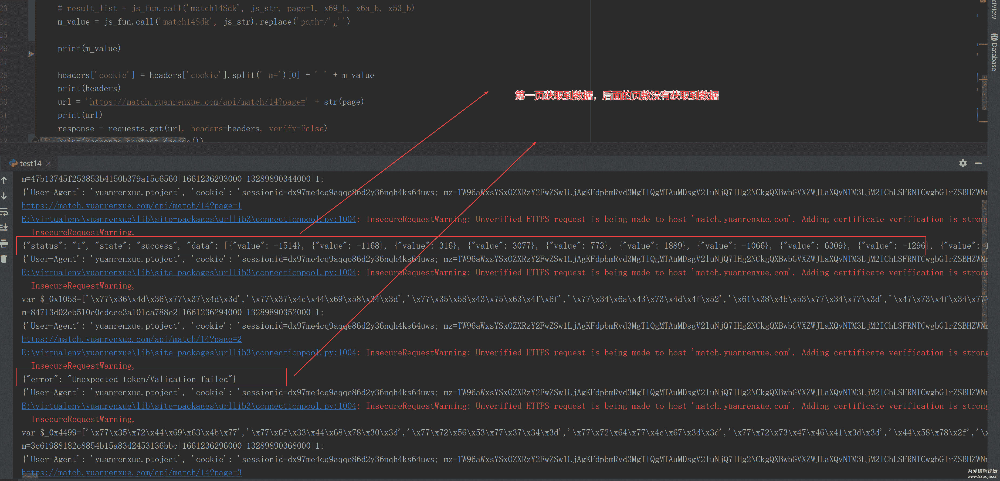
扣代码-26.png (478.54 KB, 下载次数: 269)

## k-28
2022-8-25 16:42 上传

[href="forum.php?mod=attachment&aid=MjU0ODk1MnxmYjcwNmE4M3wxNzkzNTc0NjUzfDE2ODA4NnwxNjc5MTc0&nothumb=yes" target="_blank"](https://www.52pojie.cn/forum.php?mod=attachment&aid=MjU0ODk1MnxmYjcwNmE4M3wxNzkzNTc0NjUzfDE2ODA4NnwxNjc5MTc0&nothumb=yes)

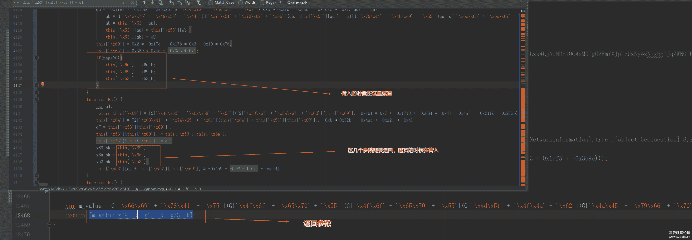
扣代码-27.png (451.94 KB, 下载次数: 266)

## k-29
2022-8-25 16:48 上传

[href="forum.php?mod=attachment&aid=MjU0ODk1M3wxYzA0YTA1YnwxNzkzNTc0NjUzfDE2ODA4NnwxNjc5MTc0&nothumb=yes" target="_blank"](https://www.52pojie.cn/forum.php?mod=attachment&aid=MjU0ODk1M3wxYzA0YTA1YnwxNzkzNTc0NjUzfDE2ODA4NnwxNjc5MTc0&nothumb=yes)

第一页获取到数据，说明js是没有错误的。应该是翻页过程中产生了新的数据变量导致后面参数计算有误。经过一番调试发现`this['\x69']`、`this['\x6a']`、`this['\x53']`每请求一页数据都会有变化，请求下一页数据是会保持上一页的值，所以这三个参数要返回

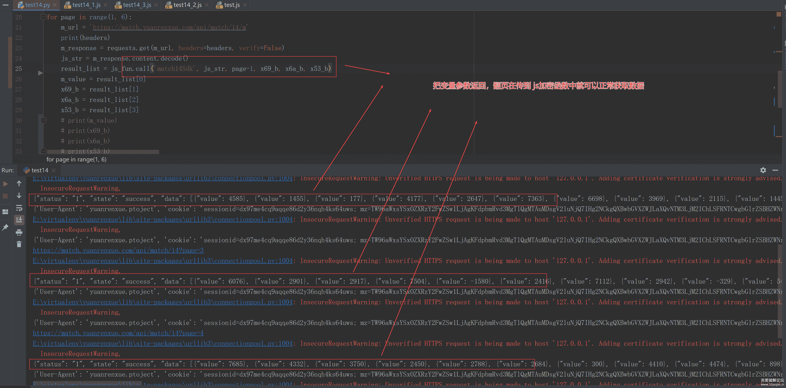
扣代码-28.png (527.24 KB, 下载次数: 265)

## k-30
2022-8-25 16:49 上传

[href="forum.php?mod=attachment&aid=MjU0ODk1NHw0YTNmOTJjZHwxNzkzNTc0NjUzfDE2ODA4NnwxNjc5MTc0&nothumb=yes" target="_blank"](https://www.52pojie.cn/forum.php?mod=attachment&aid=MjU0ODk1NHw0YTNmOTJjZHwxNzkzNTc0NjUzfDE2ODA4NnwxNjc5MTc0&nothumb=yes)

把变量参数加上就可以获取到数据了
