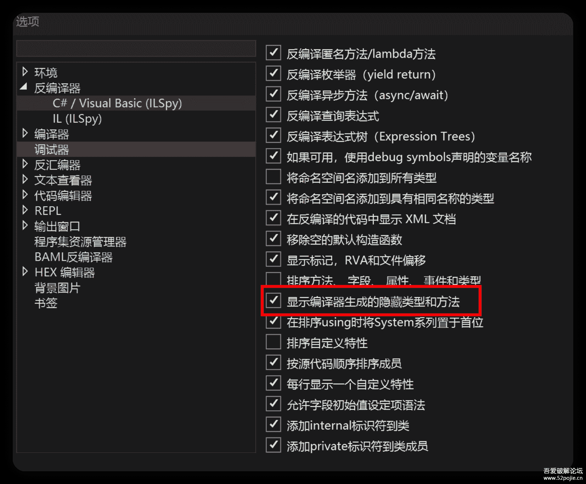
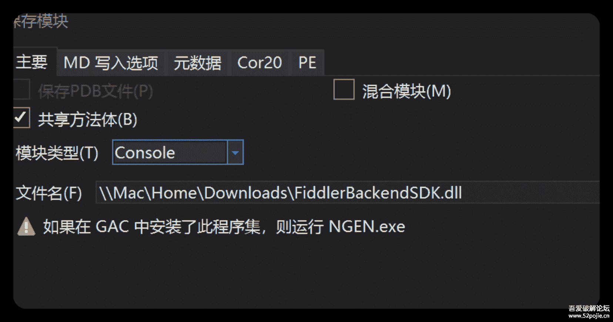

# [.NET逆向] Fiddler EveryWhere 3.4.0 for Mac M1

## 原帖信息

- 原帖：[https://www.52pojie.cn/forum.php?mod=viewthread&tid=1679610](https://www.52pojie.cn/forum.php?mod=viewthread&tid=1679610)
- 抓取时间：2026-11-01T23:10:53

## 参考与准备

参考自 [3.3.0版本的帖子](https://www.52pojie.cn/thread-661779-1-1.html)。

准备工具 `dnspy.net`，由于没有 Win 电脑，所以用的 [https://www.52pojie.cn/thread-661779-1-1.html](https://www.52pojie.cn/thread-661779-1-1.html)。

1. 下载最新 [dnSpy](https://github.com/dnSpy/dnSpy/releases)。
2. 打开 dnSpy，设置视图->选项，如图设置。



`image.png` (547.62 KB, 下载次数: 3)

[附件下载](https://www.52pojie.cn/forum.php?mod=attachment&aid=MjU0ODY0M3xlNjI1MDE1YnwxNzkzNTc0NjUwfDE2ODA4NnwxNjc5NjEw&nothumb=yes)

2022-8-24 14:51 上传

## 2. 打开文件

`/Applications/Fiddler Everywhere.app/Contents/Resources/app/out/WebServer/ClientApp/dist/main.8a2e352fe4ea9310.js`

搜索 `updateUserLicense`。

函数开始处添加（请将 `Ie` 替换为参数名称）：

```javascript
Ie.licenseInfo.currentLicense = "Pro"
Ie.licenseInfo.hasExpiredTrial = false
Ie.licenseInfo.isTrialAvailable = false
Ie.licenseInfo.hasValidLicense = true
```

## 4. 修改 DLL

### 4.1 修改 `Fiddler.WebUi.dll`

在 `/Applications/Fiddler Everywhere.app/Contents/Resources/app/out/WebServer/Fiddler.WebUi.dll` 找到 `Fiddler.WebUi`。

对两个函数 `TryOpenClientMainScript` 与 `TryOpenElectronMainScript` 做相同操作：

将函数体内容修改为直接返回 `true`。

可以用 `IL Editor` 或者直接编辑方法。

修改完成后直接文件->保存模块。



`image.png` (220.28 KB, 下载次数: 3)

[附件下载](https://www.52pojie.cn/forum.php?mod=attachment&aid=MjU0ODY0NXxmYmJlMjRmMHwxNzkzNTc0NjUwfDE2ODA4NnwxNjc5NjEw&nothumb=yes)

2022-8-24 14:52 上传

### 4.2 修改 `FiddlerBackendSDK.dll`

找到另一个 `FiddlerBackendSDK.dll`，方法 `FiddlerBackendSDK.User.UserClient::GetBestAccount`。

搜索 `UserClient::GetBestAccount`。

删除 `IL_000d - IL_0020` 对应 `if` 语句。

删除 `IL_003f - IL_0040` 对应 `return null;` 语句。

### 4.3 修改方法 `'<>cDisplayClass18_0'::'b0'`

搜索 `b__0`，删除 `IL_0000 - IL_0019`，在 `IL_001e` 前插入 `ldc.i4.1`（即函数体直接返回 `true`）。

## 最终效果


`image.png` (110.09 KB, 下载次数: 3)

[附件下载](https://www.52pojie.cn/forum.php?mod=attachment&aid=MjU0ODY0NnxjMTc0ZGY2YnwxNzkzNTc0NjUwfDE2ODA4NnwxNjc5NjEw&nothumb=yes)

2022-8-24 14:53 上传

## 5. 禁用更新

在 `/Applications/Fiddler Everywhere.app/Contents/Resources/app/out/main.js` 中搜索 `e.settingsService.get().autoUpdateSettings.disabled`，替换为 `true||e.settingsService.get().autoUpdateSettings.disabled`。

## 下载地址


[附件下载](https://www.52pojie.cn/forum.php?mod=attachment&aid=MjU0ODY0N3xjNTgzODE1MHwxNzkzNTc0NjUwfDE2ODA4NnwxNjc5NjEw)

(1.95 MB, 下载次数: 1004)

2022-8-24 14:59 上传

点击文件名下载附件

下载积分: 吾爱币 -1 CB

## 备注

> m1，替换了 `zip` 的文件后，损坏，百度后解决后，一直卡在 `plase wait..` 大家可以参考 24 楼的方案试试
