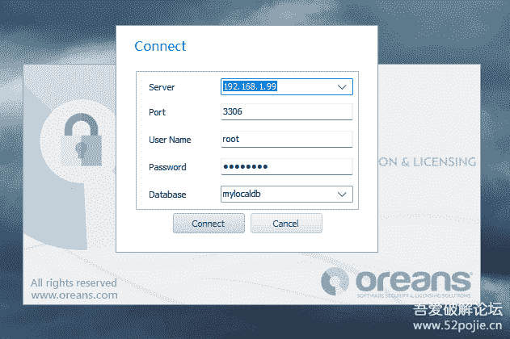
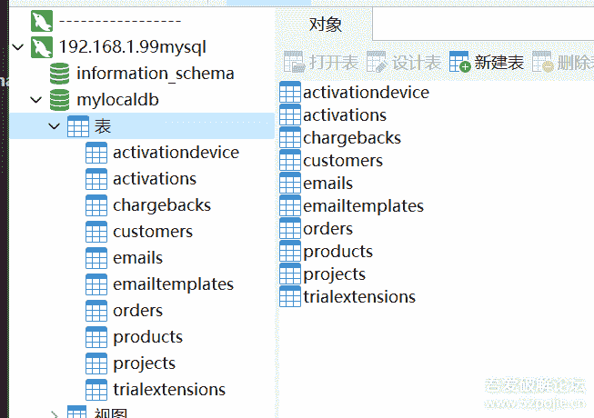
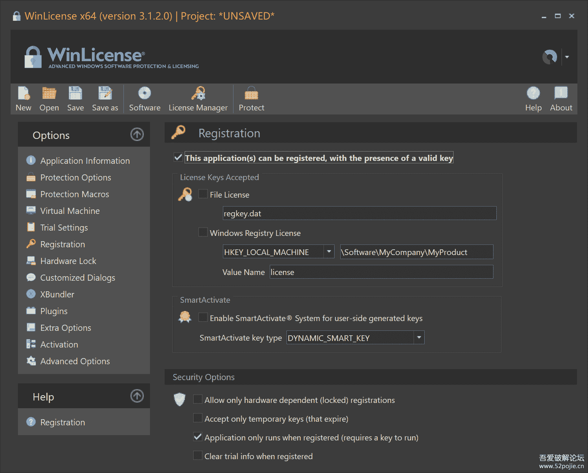
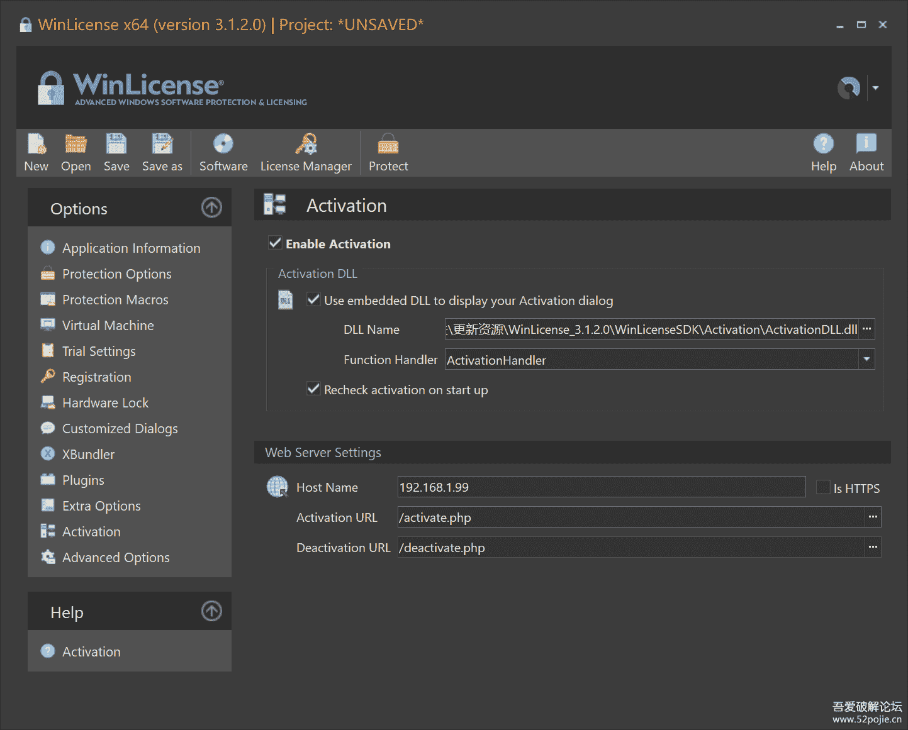
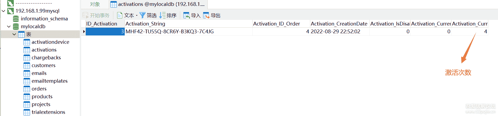
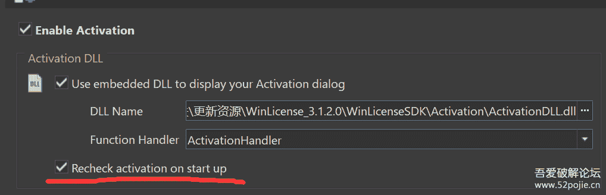
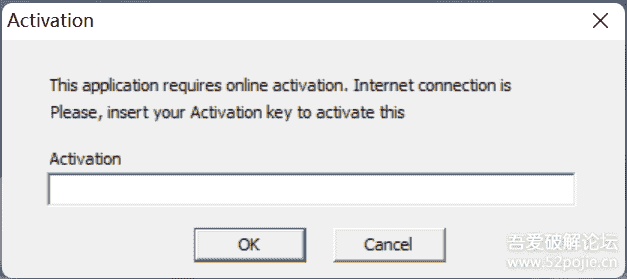
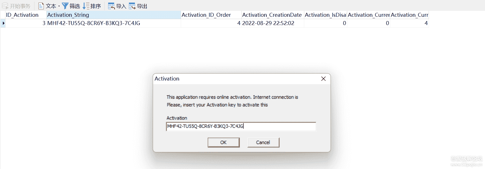

# [原创] Winlicense 网络授权设置详情

- 原帖: https://www.52pojie.cn/forum.php?mod=viewthread&tid=1681754
- 抓取时间: 2026-11-01T23:10:33

有坛友发了 https://www.52pojie.cn/thread-1681251-1-1.html，不知道官方从什么时候开始自带了网络授权模块，使用自带的`dll`+`mysql`完全可以满足网络授权需求！

网络授权首先需要`mysql`数据库，我们先新建数据库，信息如下

主机:192.168.1.99 账号root 密码rootroot 数据库mylocaldb

## 1. 连接数据库

打开`Winlicense`，选择`License Manager`，选择`Database`，`Select`，选择`Server Database`，输入我们的数据库信息后会自动重启

连接数据库即可（`Winlicense`连接数据库后会在数据库创建网络验证用到的所有表，无需我们自己导入）

## 2. 导入程序并设置 Registration

导入我们要加密的程序，`Registration`设置如下

## 3. 设置 Activation

`Activation`设置如下

`ActivationDLL.dll`可以用自带源码生成，就是一个程序启动显示个输入key的窗口

## 4. 生成授权 Key

其他默认直接加密，最后使用`License Manager`功能给程序生成key，以供测试

`Winlicense`主程序连接`mysql`的，无需我们自己新增数据，生成了自动插入了`mysql`

## 5. 联网验证设置

如果要求每次启动程序都需要联网验证，这里打上勾即可

如果不选，只有第一次需要网络激活，然后本地生成key，之后就可以本地运行

## 6. 部署服务器环境

服务器需要个`web`+`php`环境，把`WinLicenseSDK\Activation\PHP`文件丢过去，外网能访问即可

记得修改`main_settings.php`里面的数据库连接信息

处理后效果如下：

附件是一个`x64demo`和`x64`的授权`dll`，可自行测试

下载积分: 吾爱币 -1 CB
