# [原创] 有趣的 Crackme 分析分享 01-snake

- 原帖：<https://www.52pojie.cn/forum.php?mod=viewthread&tid=1682550>
- 抓取时间：2026-11-01T23:10:28

## 前言

曾经试图挑战 160 个 cm 练习，但是很快又放弃了，这次重新归来，由于很多 cm 很重复没啥意思，所以就挑着有趣的或者有价值的来论坛发帖跟大家分享分享（当然，也会有其他来源的 cm）。

对于其他的 cm 分析，有兴趣的童鞋可以去 [www.kn0sky.com](https://www.kn0sky.com/) 上逛逛。

本文的 cm 来自新 160 个 crackme 练习中的第 60 个，以静态分析为主，动态分析可以看 [B 站视频](https://www.bilibili.com/video/BV1CP4y1A7BN/)。

## 信息收集

### 运行情况

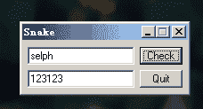

`image-20220831122451-tbsls0k.png`（18.77 KB，下载次数：0）  
[附件下载](https://www.52pojie.cn/forum.php?mod=attachment&aid=MjU1MDQ3MnwzMTQ3YzAyZHwxNzkzNTc0NjI1fDE2ODA4NnwxNjgyNTUw&nothumb=yes)  
2022-8-31 19:08 上传

### 查壳与脱壳

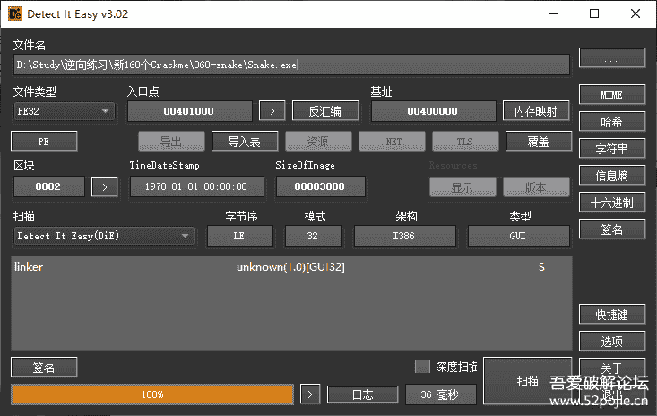

`image-20220831122457-2ksq2ar.png`（31.66 KB，下载次数：0）  
[附件下载](https://www.52pojie.cn/forum.php?mod=attachment&aid=MjU1MDQ1NXw0Mzg2ZWQ4MHwxNzkzNTc0NjI1fDE2ODA4NnwxNjgyNTUw&nothumb=yes)  
2022-8-31 19:06 上传

## 调试分析

### Check 按钮事件

老样子，IDA 打开，找到 `Check` 按钮的事件分支：

首先是获取 `Name` 和 `Serial`，为空会提示。

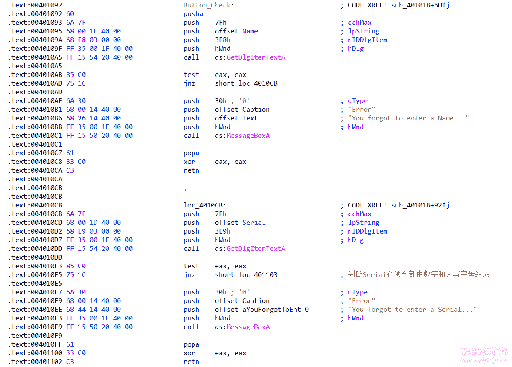

`image-20220831163746-ijgpd1b.png`（101.3 KB，下载次数：0）  
[附件下载](https://www.52pojie.cn/forum.php?mod=attachment&aid=MjU1MDQ1NnxmYWQyZmUyM3wxNzkzNTc0NjI1fDE2ODA4NnwxNjgyNTUw&nothumb=yes)  
2022-8-31 19:06 上传

然后一个 `call` 验证 `Serial` 合法性，不行就弹窗提示。

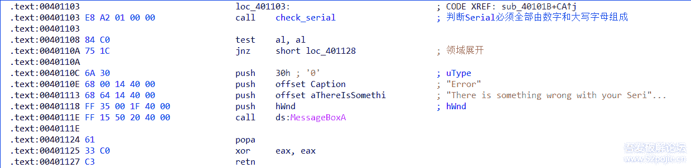

`image-20220831163814-82nd4am.png`（41.9 KB，下载次数：0）  
[附件下载](https://www.52pojie.cn/forum.php?mod=attachment&aid=MjU1MDQ1N3xkZWUyZWM5NHwxNzkzNTc0NjI1fDE2ODA4NnwxNjgyNTUw&nothumb=yes)  
2022-8-31 19:06 上传

这个 `call` 的内容如下：判断内容要由数字和大写字母组成。

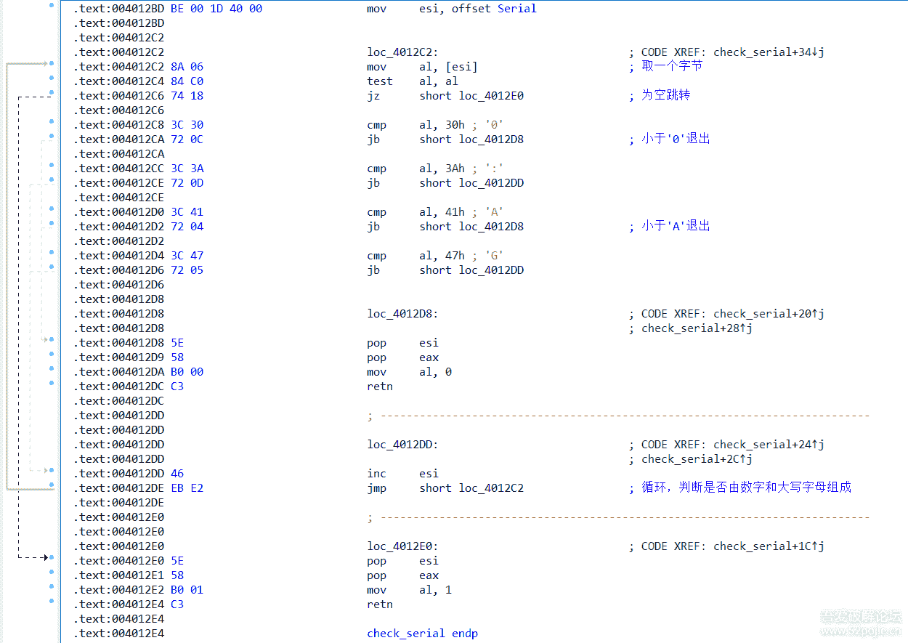

`image-20220831163931-pom9zhx.png`（101.35 KB，下载次数：0）  
[附件下载](https://www.52pojie.cn/forum.php?mod=attachment&aid=MjU1MDQ1OHw5ZmRkMjI2ZnwxNzkzNTc0NjI1fDE2ODA4NnwxNjgyNTUw&nothumb=yes)  
2022-8-31 19:06 上传

再往下就是三个 `call` 和弹窗提示验证是否成功了：

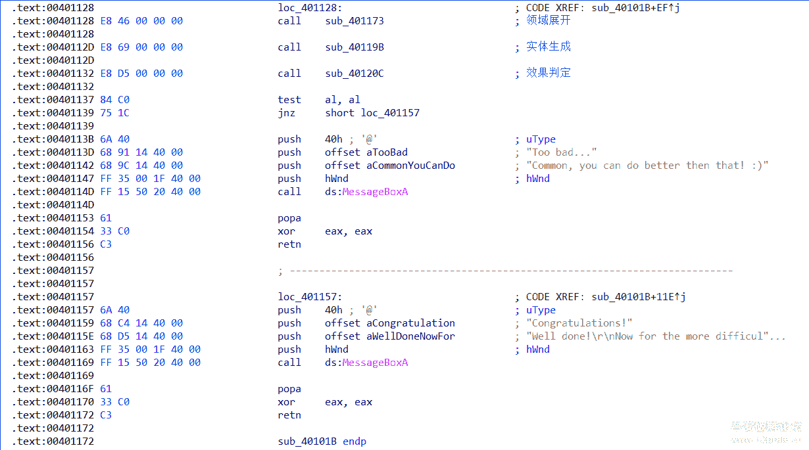

`image-20220831164042-uq3wvni.png`（81.85 KB，下载次数：0）  
[附件下载](https://www.52pojie.cn/forum.php?mod=attachment&aid=MjU1MDQ1OXw4M2RmMzZkYXwxNzkzNTc0NjI1fDE2ODA4NnwxNjgyNTUw&nothumb=yes)  
2022-8-31 19:06 上传

### 验证过程--第 1 个 `Call`

验证过程主要是 3 个 `call`。

首先是第一个 `call`：

内容较少，简单来说就是填充数组：

填充 16 个 `FF`，然后填充 `16*16` 个 `00`，然后再填充 16 个 `FF`。

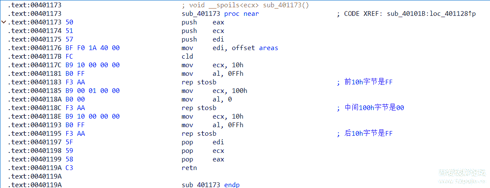

`image-20220831164222-8aqttmi.png`（53.66 KB，下载次数：0）  
[附件下载](https://www.52pojie.cn/forum.php?mod=attachment&aid=MjU1MDQ2MHxiZWQ4MjExN3wxNzkzNTc0NjI1fDE2ODA4NnwxNjgyNTUw&nothumb=yes)  
2022-8-31 19:06 上传

### 验证过程--第 2 个 `Call`

第 2 个 `Call` 内容多点：

首先是对输入的 `Name` 进行处理，累加每一个字符，得到一个累加值，保存到 `dl`。

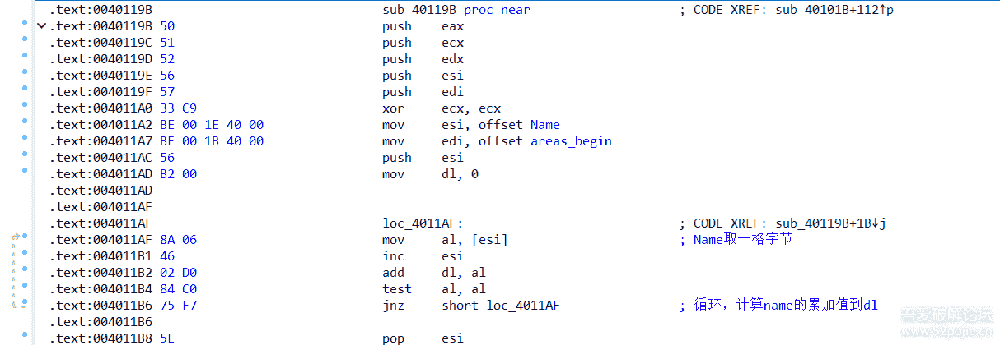

`image-20220831164618-yg0k6qk.png`（53.15 KB，下载次数：0）  
[附件下载](https://www.52pojie.cn/forum.php?mod=attachment&aid=MjU1MDQ2MXxjOTE5MzE2ZXwxNzkzNTc0NjI1fDE2ODA4NnwxNjgyNTUw&nothumb=yes)  
2022-8-31 19:06 上传

接下来生成 `CC`，通过累加值 `dl` 和取出来的字节进行异或，得到数组索引，该位置是 `0` 就往该位置填充 `CC`，计数 `CC` 的数量。

累加值异或字节，然后用过的累加值再减去字节值，来使得 `CC` 随机分布，但最终取决于输入的 `Name`。

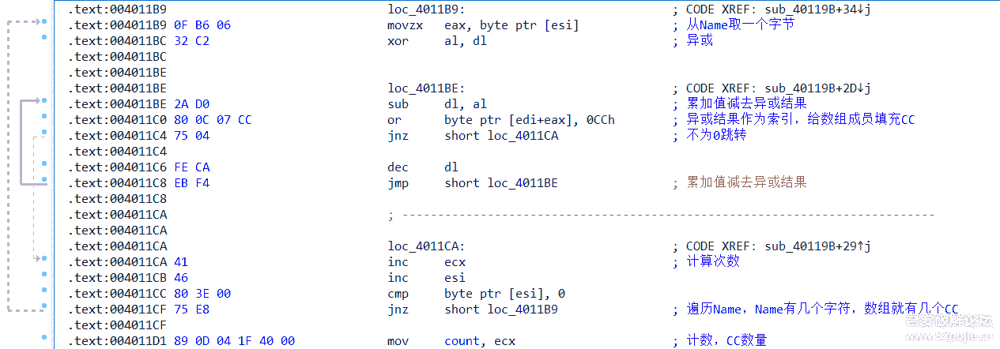

`image-20220831164823-xae8djd.png`（61.62 KB，下载次数：0）  
[附件下载](https://www.52pojie.cn/forum.php?mod=attachment&aid=MjU1MDQ2Mnw1NzZjNDlkZHwxNzkzNTc0NjI1fDE2ODA4NnwxNjgyNTUw&nothumb=yes)  
2022-8-31 19:06 上传

再往下就是填充 `DD`，总共填充一个，接着用刚刚填充 `CC` 的位置计算方法进行。

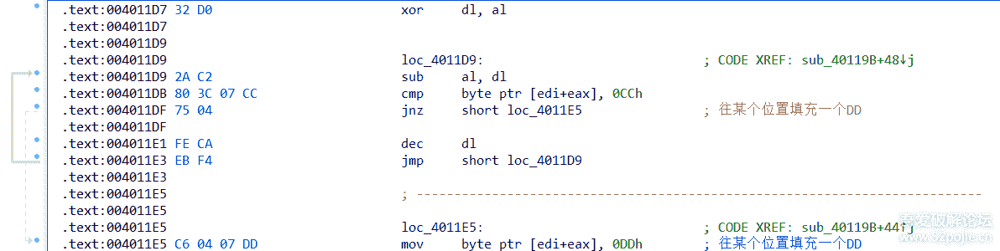

`image-20220831165034-9dt8dp5.png`（40.22 KB，下载次数：0）  
[附件下载](https://www.52pojie.cn/forum.php?mod=attachment&aid=MjU1MDQ2M3wxMWE3Y2M3YnwxNzkzNTc0NjI1fDE2ODA4NnwxNjgyNTUw&nothumb=yes)  
2022-8-31 19:06 上传

再往后就是填充 `99`：

直接用计算到最后的 `dl` 作为索引进行，如果是 `00`，就填充为 `99`，否则就往前挪一格再次判断，最后保存 `99` 的地址。

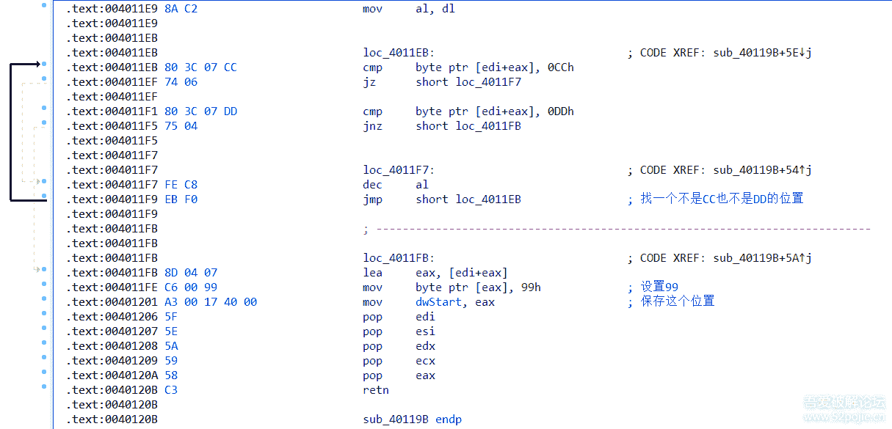

`image-20220831165115-aj0x4ye.png`（68.08 KB，下载次数：0）  
[附件下载](https://www.52pojie.cn/forum.php?mod=attachment&aid=MjU1MDQ2NHxmYzllZDhiYnwxNzkzNTc0NjI1fDE2ODA4NnwxNjgyNTUw&nothumb=yes)  
2022-8-31 19:06 上传

使用字符串 `selph` 生成一个地图看看：

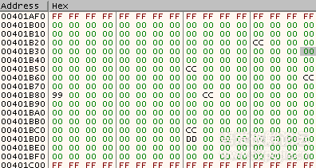

`image-20220831170156-qmkpmre.png`（11.7 KB，下载次数：0）  
[附件下载](https://www.52pojie.cn/forum.php?mod=attachment&aid=MjU1MDQ2N3wxMmQ3YmNkMHwxNzkzNTc0NjI1fDE2ODA4NnwxNjgyNTUw&nothumb=yes)  
2022-8-31 19:06 上传

### 验证过程--第 3 个 `Call`

到这里已经很明显的感觉到了，`16*16` 的地图，生成了很多 `CC`，然后有一个 `DD`，一个 `99`，再加上程序名 `snake`，这就是一个贪吃蛇啊。

第一个 `call` 开辟空间，第二个 `call` 布置场地，第三个 `call` 理所应当就是开始游戏了！

首先获取当前位置和序列号，通过序列号的输入来进行移动。

首先是判断输入是否是数字，是数字则直接进行移动，这里的移动是通过加减数组的索引进行的。

判断方式是这样进行的：取数字的后两位：

- `00`：向下一格
- `01`：向上一格
- `10`：向左一格
- `11`：向右一格

如果数字不只是后两位有值，则执行完用前两位再次走一遍判断，比如 `9`，就是 `1001`，就是上左移动一格，如果输入的是大写字母的话，也是类似的，具体可见反汇编这一段的计算过程。

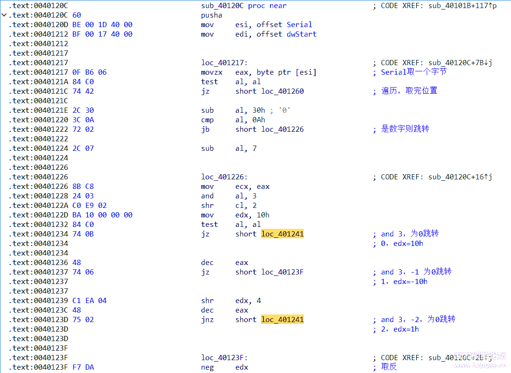

`image-20220831165504-1zd1x2u.png`（89.67 KB，下载次数：0）  
[附件下载](https://www.52pojie.cn/forum.php?mod=attachment&aid=MjU1MDQ2NXxmMTBiZTAyNHwxNzkzNTc0NjI1fDE2ODA4NnwxNjgyNTUw&nothumb=yes)  
2022-8-31 19:06 上传

计算完移动方向之后，该进行移动判断了：

如果下一个位置是 `0`，或者 `CC`，都跳转去执行，如果是 `99` 则返回 `0` 失败，如果是 `DD` 且没吃完 `CC`，也返回 `0` 失败，如果是 `CC` 吃完了，就是返回 `1` 成功。

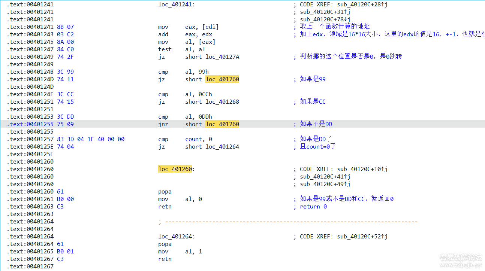

`image-20220831170024-6c76p9c.png`（86.25 KB，下载次数：0）  
[附件下载](https://www.52pojie.cn/forum.php?mod=attachment&aid=MjU1MDQ2NnxlNWI4MTdkZHwxNzkzNTc0NjI1fDE2ODA4NnwxNjgyNTUw&nothumb=yes)  
2022-8-31 19:06 上传

首先看如果下一个位置是 `00` 怎么处理：

调用一个 `call`，就是走格子用的，然后判断是否有高 2 位，有的话再按高 2 位走一遍，没有的话，获取下一个字符进入下一个循环。

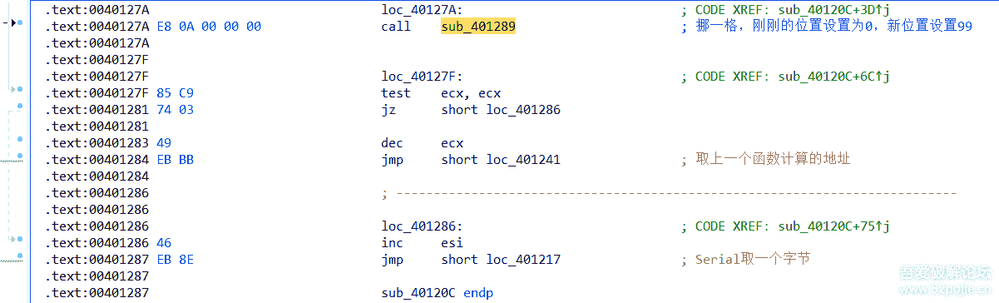

`image-20220831170251-b7ak4la.png`（48.45 KB，下载次数：0）  
[附件下载](https://www.52pojie.cn/forum.php?mod=attachment&aid=MjU1MDQ2OHw1YjQwZTk2NHwxNzkzNTc0NjI1fDE2ODA4NnwxNjgyNTUw&nothumb=yes)  
2022-8-31 19:06 上传

接下来看看这个走格子的 `call`：

首先是获取当前格子的新位置，起始位置，把新位置写入 `99`，把当前位置写入 `00`。

然后 `edi+4` 进行判断，`edi` 里装的是个数组，数组成员是当前蛇的身子的位置，当长度大于 `1` 的时候，`edi+4` 就是第二个位置，有值的时候，把刚刚写入 `0` 的位置作为新位置，把身子的位置作为当前位置，再次进行相同的操作。

视觉效果就是，身子跟着头一起移动了。

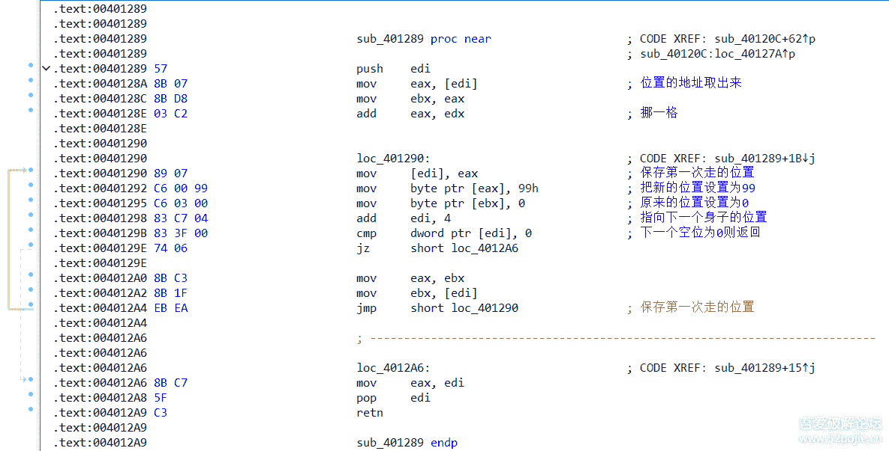

`image-20220831170355-vw5q3qu.png`（79.43 KB，下载次数：0）


[href="forum.php?mod=attachment&aid=MjU1MDQ2OXw3MGE1YTYzYnwxNzkzNTc0NjI1fDE2ODA4NnwxNjgyNTUw&nothumb=yes" target="_blank"](https://www.52pojie.cn/forum.php?mod=attachment&aid=MjU1MDQ2OXw3MGE1YTYzYnwxNzkzNTc0NjI1fDE2ODA4NnwxNjgyNTUw&nothumb=yes)

2022-8-31 19:06 上传

回到刚刚的循环里，如果移动遇到了`CC`则再次执行这个移动的函数，同时给`count`计数-1，这个`count`变量保存的是当前场上`CC`的数量

然后把这个函数清零的位置变成`99`，也就是让蛇身子最后一个位置本来清零了，结果又填充回`99`，同时把新的位置加入到身子数组里

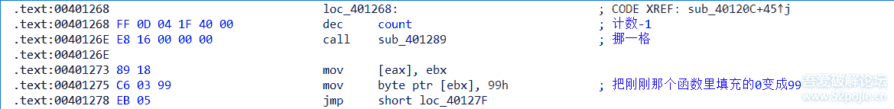

image-20220831170706-zx7glml.png (26.06 KB, 下载次数: 0)

[href="forum.php?mod=attachment&aid=MjU1MDQ3MHw5NzZlMzkxN3wxNzkzNTc0NjI1fDE2ODA4NnwxNjgyNTUw&nothumb=yes" target="_blank"](https://www.52pojie.cn/forum.php?mod=attachment&aid=MjU1MDQ3MHw5NzZlMzkxN3wxNzkzNTc0NjI1fDE2ODA4NnwxNjgyNTUw&nothumb=yes)

2022-8-31 19:06 上传

到这里，整个程序的逻辑分析完整了，就是贪吃蛇，吃完所有`CC`走到`DD`即可验证通过

## 注册机

### 注册码生成算法

```
#include 
#include 
using namespace std;

uint8_t areas[18][16] = {0};
uint8_t countCC = 0;
uint8_t snake[10][2] = {0};
uint8_t pos[10][2] = { 0 };

void GenerateAreas(string str) {
    // 场地生成
    memset(&areas[0], 0xFF, 0x10);
    memset(&areas[1], 0, 0x100);
    memset(&areas[17], 0xFF, 0x10);

    // 填充CC
    uint8_t* areasBegin = (uint8_t*)&areas[1];
    uint8_t sum = 0;
    uint8_t tmp = 0;
    for (auto var : str) sum += var;
    for (auto var : str) {
        tmp = var ^ sum;
        sum -= tmp;
        *(areasBegin + tmp) = 0xCC;
        // 保存坐标
        pos[countCC][0] = tmp / 16;
        pos[countCC][1] = tmp % 16;
        countCC++;
    }

    // 填充DD
    sum ^= tmp;
    for (; *(areasBegin + (tmp -= sum)) == 0xCC; sum--);
    *(areasBegin + tmp) = 0xDD;
    pos[countCC][0] = tmp / 16;
    pos[countCC][1] = tmp % 16;;

    // 填充99
    tmp = sum;
    for (; *(areasBegin + tmp) == 0xCC || *(areasBegin + tmp) == 0xDD; tmp--);
    *(areasBegin + tmp) = 0x99;
    snake[0][0] = tmp / 16;
    snake[0][1] = tmp % 16;
    countCC++;
}

int main()
{
    GenerateAreas("selph");

    // 生成注册码：长度短的情况下，不用考虑自己咬到自己
    uint8_t x = snake[0][0];
    uint8_t y = snake[0][1];
    for (int i = 0; i= 0) for (int i = 0; i = 0) for (int i = 0; i
```

效果：

```
selph

33333333333333311222222200000031111333111111222200000000000
```

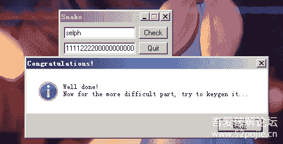

image-20220831182249-gqj0rm8.png (94.79 KB, 下载次数: 0)

[href="forum.php?mod=attachment&aid=MjU1MDQ3MXxmNzI5NzRhNXwxNzkzNTc0NjI1fDE2ODA4NnwxNjgyNTUw&nothumb=yes" target="_blank"](https://www.52pojie.cn/forum.php?mod=attachment&aid=MjU1MDQ3MXxmNzI5NzRhNXwxNzkzNTc0NjI1fDE2ODA4NnwxNjgyNTUw&nothumb=yes)

2022-8-31 19:06 上传

### 总结

有趣的验证方式，通过输入的用户名生成贪吃蛇地图，通过密码来进行移动，吃完豆子`CC`，走到终点`DD`算验证通过，很有趣的一次逆向体验
