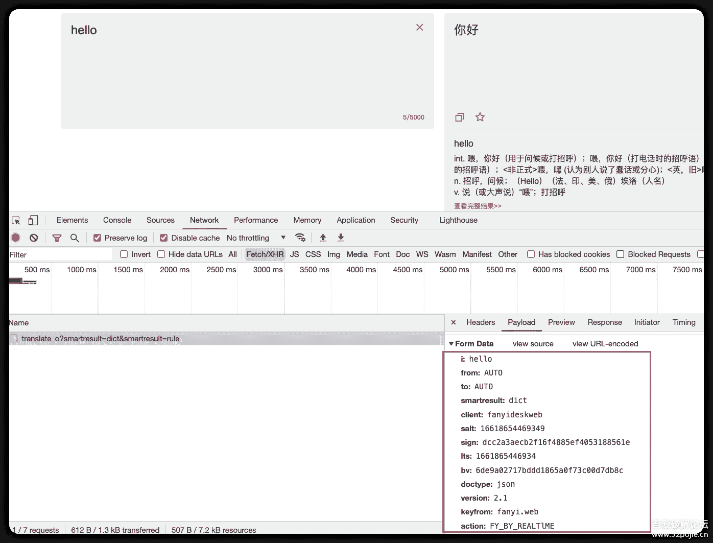
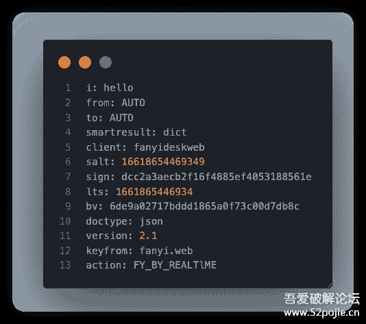
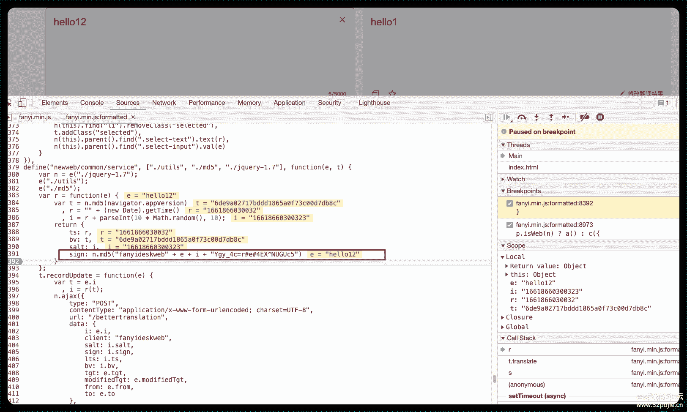
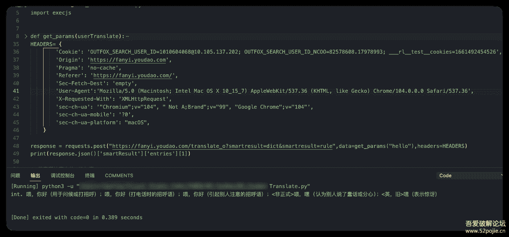
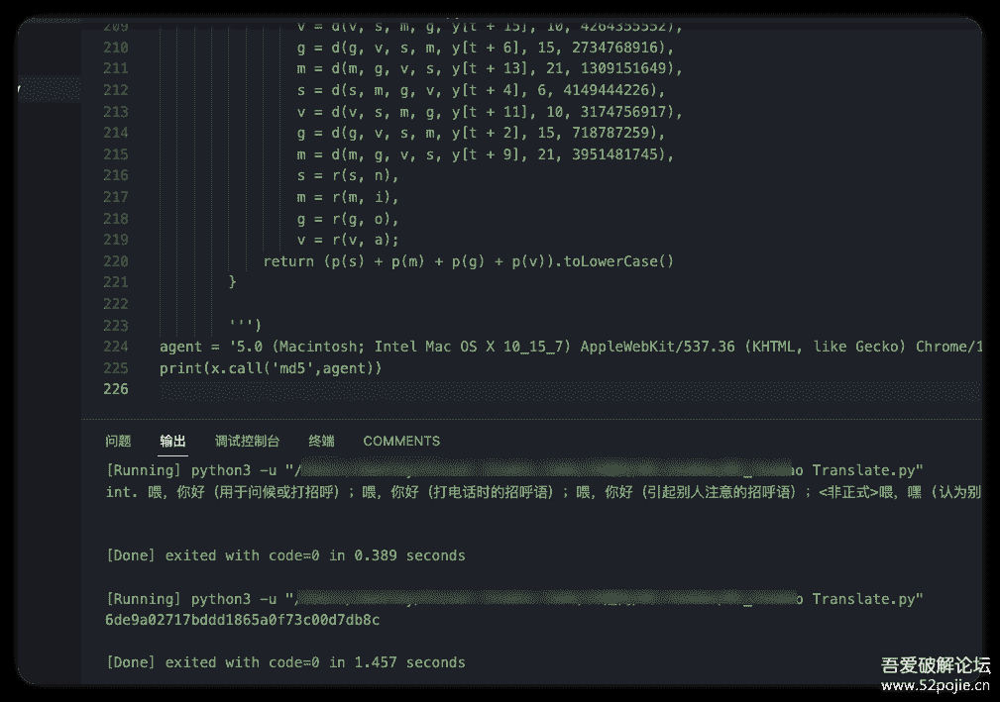

# [Web逆向] 什么？你居然还不会分析网站加密算法？某翻译网站JS算法还原实战

- 原帖: https://www.52pojie.cn/forum.php?mod=viewthread&tid=1683284
- 抓取时间: 2026-11-01T23:10:24
站点：aHR0cHM6Ly9mYW55aS55b3VkYW8uY29tLw==

## 1.分析

首先输入内容后会立马自动返回翻译结果，观察`network`发现发送了一个`XHR`请求。



2022-08-30-21-22-23-image.png (166.41 KB, 下载次数: 1)

[href="forum.php?mod=attachment&aid=MjU1MDg3OXwyZGFlYjFiMnwxNzkzNTc0NjIxfDE2ODA4NnwxNjgzMjg0&nothumb=yes" target="_blank"](https://www.52pojie.cn/forum.php?mod=attachment&aid=MjU1MDg3OXwyZGFlYjFiMnwxNzkzNTc0NjIxfDE2ODA4NnwxNjgzMjg0&nothumb=yes)

2022-9-2 14:32 上传

经过多次发送对比后发现，`salt`、`lts`、`sign`为每次会变化，`salt`、`lts`参数应该是时间戳，但是`salt`比`lts`多处了一位。



2022-08-30-21-21-33-image.png (72.99 KB, 下载次数: 1)

[href="forum.php?mod=attachment&aid=MjU1MDg3OHw2YjFmMGJiYnwxNzkzNTc0NjIxfDE2ODA4NnwxNjgzMjg0&nothumb=yes" target="_blank"](https://www.52pojie.cn/forum.php?mod=attachment&aid=MjU1MDg3OHw2YjFmMGJiYnwxNzkzNTc0NjIxfDE2ODA4NnwxNjgzMjg0&nothumb=yes)

2022-9-2 14:32 上传

## 2. 跟进

通过堆栈跟进后最终来到`fanyi.min.js`的8392行发现加密函数。



2022-08-30-21-29-11-image.png (280.66 KB, 下载次数: 0)

[href="forum.php?mod=attachment&aid=MjU1MDg4MHw3N2EwZjVlZnwxNzkzNTc0NjIxfDE2ODA4NnwxNjgzMjg0&nothumb=yes" target="_blank"](https://www.52pojie.cn/forum.php?mod=attachment&aid=MjU1MDg4MHw3N2EwZjVlZnwxNzkzNTc0NjIxfDE2ODA4NnwxNjgzMjg0&nothumb=yes)

2022-9-2 14:32 上传

`t`参数发现是为`n.md5(navigator.appVersion)`也就是请求包中的`lts`参数，使用的是浏览器版本号加密。

`salt`盐值为：`r + parseInt(10 * Math.random(), 10)` ，`r`为13位时间戳，也就是时间戳加上一位十进制的随机数。

`sign`需要用到参数`e`和`i`，其中`i`是已经知道的，`e`就是用户需要翻译的内容。

不会跟代码的请点击[//ke.qq.com/course/5814082#term_id=106024084" target="_blank" rel="noopener noreferrer nofollow"](https://ke.qq.com/course/5814082#term_id=106024084:rel="nofollow noopener" href="https) ，第3个视频就是这个案例！

## 3. 还原

通过使用其他`MD5`进行加密后和`n.md5(navigator.appVersion)`加密结果对比，发现为原生加密算法，那么直接使用`Python`进行写代码。

```python
import hashlib
import random
import time
import requests
import execjs

def get_params(userTranslate):

    agent = '5.0 (Macintosh; Intel Mac OS X 10_15_7) AppleWebKit/537.36 (KHTML, like Gecko) Chrome/104.0.0.0 Safari/537.36'
    bv=  hashlib.md5(agent.encode('utf-8')).hexdigest()
    ts = int(round(time.time() * 1000))
    salt = ts + random.randint(0,9) 
    sign =  hashlib.md5(str("fanyideskweb" + userTranslate +str(salt) + "Ygy_4c=r#e#4EX^NUGUc5").encode('utf-8')).hexdigest()

    params={
        "i": userTranslate,
        "from": "AUTO",
        "to": 'AUTO',
        "smartresult": 'dict',
        "client": 'fanyideskweb',
        'salt': salt,
        'sign': sign,
        'lts':  ts,
        'bv': bv,
        'doctype': 'json',
        'version': 2.1,
        'keyfrom': 'fanyi.web',
        'action': 'FY_BY_REALTlME'
    }

    return params
HEADERS= {
        'Cookie': 'OUTFOX_SEARCH_USER_ID=1010604068@10.105.137.202; OUTFOX_SEARCH_USER_ID_NCOO=82578608.17978993; ___rl__test__cookies=1661492454526',
        'Origin': 'https://fanyi.youdao.com',
        'Pragma': 'no-cache',
        'Referer': 'https://fanyi.youdao.com/',
        'Sec-Fetch-Dest': 'empty',
        'User-Agent':'Mozilla/5.0 (Macintosh; Intel Mac OS X 10_15_7) AppleWebKit/537.36 (KHTML, like Gecko) Chrome/104.0.0.0 Safari/537.36',
        'X-Requested-With': 'XMLHttpRequest',
        'sec-ch-ua': '"Chromium";v="104", " Not A;Brand";v="99", "Google Chrome";v="104"',
        'sec-ch-ua-mobile': '?0',
        'sec-ch-ua-platform': "macOS",
    }

response = requests.post("https://fanyi.youdao.com/translate_o?smartresult=dict&smartresult=rule",data=get_params("hello"),headers=HEADERS)
print(response.json()['smartResult']['entries'][1])
```



2022-08-30-21-43-58-image.png (172.66 KB, 下载次数: 0)

[href="forum.php?mod=attachment&aid=MjU1MDg4MXw0MmJkODlkZnwxNzkzNTc0NjIxfDE2ODA4NnwxNjgzMjg0&nothumb=yes" target="_blank"](https://www.52pojie.cn/forum.php?mod=attachment&aid=MjU1MDg4MXw0MmJkODlkZnwxNzkzNTc0NjIxfDE2ODA4NnwxNjgzMjg0&nothumb=yes)

2022-9-2 14:32 上传

到这好像有太没意思了.... 那么干脆把网站原生JS算法扣下来了。

## 使用网站原生的md5加密

```python
import execjs

x = execjs.compile('''

    var n = function(e, t) {

        return e >> 32 - t

    }

      , r = function(e, t) {

        var n, r, i, o, a;

        return i = 2147483648 & e,

        o = 2147483648 & t,

        n = 1073741824 & e,

        r = 1073741824 & t,

        a = (1073741823 & e) + (1073741823 & t),

        n & r ? 2147483648 ^ a ^ i ^ o : n | r ? 1073741824 & a ? 3221225472 ^ a ^ i ^ o : 1073741824 ^ a ^ i ^ o : a ^ i ^ o

    }

      , i = function(e, t, n) {

        return e & t | ~e & n

    }

      , o = function(e, t, n) {

        return e & n | t & ~n

    }

      , a = function(e, t, n) {

        return e ^ t ^ n

    }

      , s = function(e, t, n) {

        return t ^ (e | ~n)

    }

      , l = function(e, t, o, a, s, l, c) {

        return e = r(e, r(r(i(t, o, a), s), c)),

        r(n(e, l), t)

    }

      , c = function(e, t, i, a, s, l, c) {

        return e = r(e, r(r(o(t, i, a), s), c)),

        r(n(e, l), t)

    }

      , u = function(e, t, i, o, s, l, c) {

        return e = r(e, r(r(a(t, i, o), s), c)),

        r(n(e, l), t)

    }

      , d = function(e, t, i, o, a, l, c) {

        return e = r(e, r(r(s(t, i, o), a), c)),

        r(n(e, l), t)

    }

      , f = function(e) {

        for (var t, n = e.length, r = n + 8, i = 16 * ((r - r % 64) / 64 + 1), o = Array(i - 1), a = 0, s = 0; s >> 29,

        o

    }

      , p = function(e) {

        var t, n = "", r = "";

        for (t = 0; t >> 8 * t & 255).toString(16)).substr(r.length - 2, 2);

        return n

    }

      , h = function(e) {

        for (var t = "", n = 0; n  127 && r > 6 | 192),

                t += String.fromCharCode(63 & r | 128);

            else if (r >= 55296 && r = 56320 && i > 18 & 7),

                        t += String.fromCharCode(128 | o >> 12 & 63),

                        t += String.fromCharCode(128 | o >> 6 & 63),

                        t += String.fromCharCode(128 | 63 & o),

                        n++

                    }

                }

            } else

                t += String.fromCharCode(r >> 12 | 224),

                t += String.fromCharCode(r >> 6 & 63 | 128),

                t += String.fromCharCode(63 & r | 128)

        }

        return t

    };

        md5=function(e) {

            var t, n, i, o, a, s, m, g, v, y = Array();

            for (e = e,

            y = f(e),

            s = 1732584193,

            m = 4023233417,

            g = 2562383102,

            v = 271733878,

            t = 0; t 
```



2022-08-30-21-52-02-image.png (151.23 KB, 下载次数: 0)

[href="forum.php?mod=attachment&aid=MjU1MDg4M3xlMTRmZjBhZHwxNzkzNTc0NjIxfDE2ODA4NnwxNjgzMjg0&nothumb=yes" target="_blank"](https://www.52pojie.cn/forum.php?mod=attachment&aid=MjU1MDg4M3xlMTRmZjBhZHwxNzkzNTc0NjIxfDE2ODA4NnwxNjgzMjg0&nothumb=yes)

2022-9-2 14:32 上传

Ok ，使用`execjs`库执行扣下来的代码也是没问题的，收工👋
